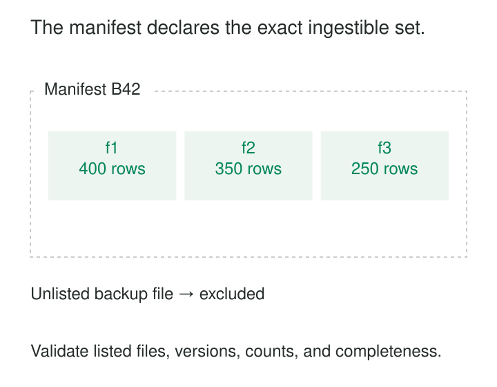

A supplier delivers a daily export as three files. Two arrive at 02:00; the third finishes uploading at 02:07. Your ingestion job starts at 02:03, loads everything it finds, and reports success. The dashboard now shows a complete-looking day with one-third of its data missing.

Waiting another ten minutes might work tomorrow. It does not establish what “complete” means.

**Manifest-Based File Ingestion defines a batch through an explicit list of files, published when the producer has finished preparing them.** The consumer uses that declaration to determine what belongs together, validate the delivery, and load it reproducibly.

The pattern replaces a timing assumption with a shared contract.

## A directory shows presence; a manifest declares membership

A directory or object-storage prefix answers, “What files are visible here?” A manifest answers a different question: “Which exact files constitute this delivery?”

That distinction matters even with strongly consistent storage. Amazon S3 provides strong consistency for object reads and listings, but does not provide atomic updates across multiple object keys. A listing can accurately show two completed files while a producer is still preparing the third. See the [S3 consistency model](https://docs.aws.amazon.com/AmazonS3/latest/userguide/Welcome.html#ConsistencyModel).

The producer therefore writes the data files first, confirms their successful completion, and publishes the manifest afterward. Publication closes the batch under the agreed protocol.



A useful manifest identifies the dataset and batch, lists exact file locations, and declares how to interpret them. Depending on the protocol, it may also contain object versions, byte sizes, checksums, schema versions, expected row counts, and business control totals.

These fields serve different purposes. File locations establish membership. Checksums establish byte integrity. Row counts support reconciliation. None alone proves that the source export represents a consistent business snapshot.

## The publication protocol makes the list trustworthy

The manifest becomes a reliable boundary only when producers and consumers follow compatible rules.

**Referenced files must remain stable.** Unique immutable paths work well. Versioned object references can also work when the reader supports them. Reusing `latest/orders.csv` allows the content to change between validation and loading.

**Publication must be recognizable and complete.** The consumer must never mistake a partially written manifest for a finished declaration. The mechanism depends on storage: an atomic object write, an atomic filesystem rename where supported, or a separate completion marker tied to an exact manifest version.

**The consumer must use the declared set.** Reading the manifest and then loading every file matching a prefix reintroduces the original ambiguity. Missing required files, duplicate entries, incompatible schemas, and integrity failures need explicit handling.

Finally, the manifest’s batch identity must remain stable across retries. A new delivery and a repeated notification about an existing delivery are different events.

## A warehouse load includes exactly three files

Suppose batch B42 contains 1,000 orders:

| File | Expected rows |
|---|---:|
| `B42/part-01.csv` | 400 |
| `B42/part-02.csv` | 350 |
| `B42/part-03.csv` | 250 |

The producer uploads all three and then releases the manifest. An unrelated `backup.csv` in the same area is outside the batch.

Amazon Redshift implements this selection mechanism directly. Its `COPY` command can read a JSON manifest listing full object paths. A simplified native manifest looks like this:

```json
{
  "entries": [
    {"url": "s3://example-data/B42/part-01.csv", "mandatory": true},
    {"url": "s3://example-data/B42/part-02.csv", "mandatory": true},
    {"url": "s3://example-data/B42/part-03.csv", "mandatory": true}
  ]
}
```

The `mandatory` flag matters: Redshift defaults it to `false`. Marking required files as mandatory makes a missing file an error rather than an acceptable omission. AWS documents this behavior in [Using a manifest to specify data files](https://docs.aws.amazon.com/redshift/latest/dg/loading-data-files-using-manifest.html).

The loader can additionally reconcile the staged records against the expected 1,000 rows. That reconciliation is a surrounding ingestion control; it is not automatically supplied by the manifest’s file list.

## An inventory report has its own completion signal

Amazon S3 Inventory provides another documented implementation. A report can contain multiple data files, accompanied by a manifest describing their locations, sizes, and checksums, together with format and schema information. The manifest itself has a separate checksum file. See [Locating your inventory list](https://docs.aws.amazon.com/AmazonS3/latest/userguide/storage-inventory-location.html).

AWS supports triggering processing when the manifest checksum file is created, using it as the inventory-completion signal. This illustrates an important variation: a protocol may publish a manifest and then publish a final marker that declares it ready. The consumer follows the producer’s documented boundary rather than assuming every manifest-like filename means completion. See [Inventory completion notifications](https://docs.aws.amazon.com/AmazonS3/latest/userguide/storage-inventory-notification.html).

The trigger remains separate from batch identity. S3 notifications can be duplicated and arrive out of order, so receiving a notification cannot itself authorize another append of the same report. AWS describes those delivery properties in its [event notification documentation](https://docs.aws.amazon.com/AmazonS3/latest/userguide/notification-how-to-event-types-and-destinations.html).

## A corrected delivery needs explicit meaning

Consider an illustrative settlement feed. Batch S18 contains Monday’s transactions. On Tuesday, the supplier discovers an error and sends corrected files.

Overwriting the original files makes previous ingestion decisions difficult to reproduce. Publishing new batch S19 preserves both deliveries, but introduces another question: should S19 append transactions, replace Monday’s partition, or apply corrections to selected records?

The delivery contract must answer it. For example, S19 might declare that it supersedes S18 for a specific settlement date. The loader validates S19 in staging, then replaces that date’s published data through a controlled commit.

A later retry of S18 must not overwrite the correction. The ingestion ledger therefore needs more than “file seen”: it must preserve batch identity and the applicable replacement or ordering rules.

A manifest establishes the input set. It does not infer how that set changes the destination.

## Source completion and destination commit are separate

A producer can correctly publish a complete manifest while a consumer exposes an incomplete load.

Suppose the loader appends part 1 and part 2 directly into a visible table, then crashes. Retrying all three files duplicates the first two; skipping the retry leaves the batch incomplete.

A common solution is to stage data under a batch identity, validate the complete result, and then publish it. Where the destination supports suitable transactions, the data changes and completion record can commit together. Other systems may require an atomic version-pointer change or another recoverable publication mechanism.

Concurrent workers also need coordination so that both cannot publish the same batch independently. A completed-batch record should bind a producer, dataset, and batch ID to the exact manifest identity or digest. Reusing the same batch ID with different contents should trigger investigation.

Checksums need equally precise definitions: algorithm, byte representation, and whether the value covers the whole object or a composite of parts. An S3 ETag is not universally an MD5 checksum, as the [S3 Object API documentation](https://docs.aws.amazon.com/AmazonS3/latest/API/API_Object.html) explains.

## What the pattern costs—and cannot prove

Manifests add coordination. Producers must retain publication state; consumers must maintain validation results, retries, and ingestion history. Checksumming large files consumes computation and potentially additional reads. Staging and replay retention increase storage.

Batch latency also follows the slowest required file. A failed producer may leave completed but unpublished files, requiring cleanup that allows enough time for legitimate retries. Very large deliveries can require hierarchical manifests rather than one enormous list.

The pattern is valuable for parallel exports, partner deliveries, partitioned warehouse loads, and reproducible backfills. It offers less benefit when every file is independently meaningful and can safely become visible immediately.

Its central limitation is the producer’s declaration. A manifest can faithfully list an incomplete export. Control totals, source-side reconciliation, and [[data-consistent-snapshot-reads|Consistent Snapshot Reads]] address different parts of that problem.

[[data-chunked-snapshotting|Chunked Snapshotting]] can produce the files that one manifest binds together. **Idempotent Processing** makes repeated ingestion safe. [[data-historical-restatement|Historical Restatement]] defines how corrected batches replace earlier results. Together, these patterns distinguish three questions that file arrival alone cannot answer: what belongs in the delivery, whether it is valid, and when its effects become visible.
