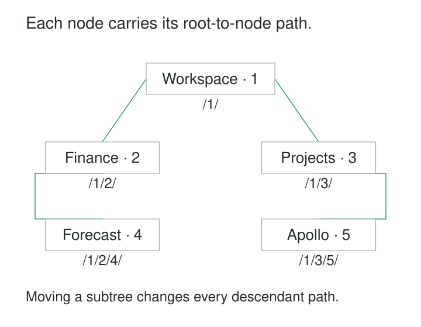

A folder browser repeatedly needs the same information: everything beneath Finance, the breadcrumb leading to Forecast, and the location of each search result. The database stores immediate parents, so every request reconstructs ancestry by following links.

The hierarchy changes occasionally. Its paths are read constantly.

**Materialized Paths store each node’s ancestry as a value on that node.** A branch can then be selected by its shared path prefix, while a breadcrumb can be reconstructed from the segments already present.

The pattern trades repeated traversal for duplicated ancestry. Reads become simpler; moving a branch requires updating its descendants.

## Put the route into the row

A materialized path records the sequence from a root toward a node. Segments might be identifiers, encoded positions, or labels.

For this article’s folder example, paths contain stable numeric identifiers, include the node itself, and use a slash at each boundary:

| id | name | path |
|---|---|---|
| 1 | Workspace | `/1/` |
| 2 | Finance | `/1/2/` |
| 3 | Projects | `/1/3/` |
| 4 | Forecast | `/1/2/4/` |
| 5 | Apollo | `/1/3/5/` |

Forecast’s path says that it belongs beneath Finance, beneath Workspace. Its display name remains an ordinary attribute.



A separate `parent_id` may still be useful for immediate-child queries or rebuilding paths. If both representations exist, their agreement becomes a maintained invariant.

## Example: retrieving a folder branch

Finance and everything beneath it share the prefix `/1/2/`:

```sql
SELECT id, name
FROM folder
WHERE path LIKE '/1/2/%'
ORDER BY path;
```

This returns Finance and Forecast. Because `%` can match an empty suffix, the query includes Finance itself. A descendants-only query would explicitly exclude that row.

The delimiter matters. Searching for `/1/2%` could also match `/1/20/`. The complete segment boundary distinguishes node `2` from node `20`.

A breadcrumb works in the other direction. Splitting `/1/2/4/` yields the identifiers `1`, `2`, and `4`. Looking up their names while preserving segment order produces:

**Workspace → Finance → Forecast**

Renaming Finance changes its name, while the identifier-based paths remain valid. A path built from display names would require rewriting descendant paths after a rename.

## Moving a branch rewrites its shared prefix

Suppose Finance moves beneath Projects.

Its old prefix is `/1/2/`; its new prefix is `/1/3/2/`. Every path in the moving branch must have that initial prefix replaced:

| Folder | Before | After |
|---|---|---|
| Finance | `/1/2/` | `/1/3/2/` |
| Forecast | `/1/2/4/` | `/1/3/2/4/` |

The suffix describing each descendant’s position within the branch stays intact.

This is a prefix replacement, rather than an unrestricted string replacement: matching text elsewhere in a path must remain untouched.

Before the move, the system must reject Finance itself or any descendant of Finance as the destination parent. Otherwise the proposed structure contains a cycle.

The changes also need coordination with concurrent writes. A child inserted beneath Finance during the move must receive the correct new ancestry. A transaction makes a multirow update atomic, but the surrounding locking or isolation strategy must also coordinate competing moves and inserts.

## Encoding is part of the model

A path works only when every reader and writer interprets it identically.

**Declare whether the node includes itself.** The illustrated convention does. Other implementations store ancestors only. That choice changes root values, depth calculations, and whether a branch query includes its starting node.

**Make segments unambiguous.** Delimiters must be reserved or escaped. Fixed-width segments are another option. If strings are used with `LIKE` or regular expressions, pattern metacharacters need appropriate handling.

**Separate identity from location.** A node’s identifier can survive a move even when its path changes. Systems needing enduring references should use that identity.

**Define root and scope rules.** Multiple roots can form a forest. Tenant or account boundaries must remain consistent with the ancestry represented.

**Validate the structure behind the string.** A syntactically valid path does not prove that its parent exists. In the illustrated model, each non-root node’s parent prefix should identify an existing node, and the final segment should match the node’s own ID. Any stored parent reference or depth must agree.

The Django library `django-treebeard` demonstrates a different encoding: fixed-width, encoded segments without separators. It also maintains depth and child counts, and requires changes through its tree operations to preserve those values. Its documentation warns against changing encoding settings after data has been stored. [django-treebeard: Materialized Path trees](https://django-treebeard.readthedocs.io/en/latest/mp_tree.html)

## Example: MongoDB’s category catalog

MongoDB’s official materialized-path example models a book-category hierarchy using comma-delimited ancestor strings.

A Programming category has ancestor path `,Books,`. A Databases category beneath Programming has `,Books,Programming,`. The document’s own identifier is separate, and the root’s path is `null`.

This is an **ancestors-only** convention. Documents whose paths contain the Programming segment are descendants of Programming; Programming’s own path does not contain itself.

The example also exposes an important performance distinction. A query anchored to a known root prefix can benefit from the path index. Searching for a segment somewhere in the middle of a path requires inspecting the entire index in the documented approach. An index on the field does not make every path search equally selective. [MongoDB: Model Tree Structures with Materialized Paths](https://www.mongodb.com/docs/manual/tutorial/model-tree-structures-with-materialized-paths/)

The mechanism is verified in the database’s documentation; the category names are demonstration data, rather than evidence of a particular company’s deployment.

## Example: typed department paths in PostgreSQL

An organization assigns these identifier-based paths:

| Department | Path |
|---|---|
| Company | `n10` |
| Engineering | `n10.n20` |
| Platform | `n10.n20.n30` |

PostgreSQL’s `ltree` extension represents paths as dot-separated labels and supplies hierarchy-aware operators. With an `ltree` path column, Engineering and its descendants can be selected directly:

```sql
SELECT id, name
FROM department
WHERE path <@ 'n10.n20'::ltree;
```

The `<@` operator includes equality, so Engineering appears alongside Platform. GiST indexes support this descendant operator and the corresponding ancestor operator. This avoids implementing segment boundaries through ad hoc string matching. [PostgreSQL: ltree](https://www.postgresql.org/docs/current/ltree.html)

The specialized type provides path semantics and indexing. The application still has to maintain valid department relationships when the organization changes.

## Where the costs accumulate

Materialized paths suit folder browsers, catalogs, navigation structures, and organizational directories where branch reads are frequent and structural changes are manageable.

Each row stores a path whose length grows with depth. Shared prefixes repeat across descendants, increasing table and index size. Very deep trees can encounter path-length or index limits even when the node count is modest.

Insertion usually constructs one new path. Moving a branch rewrites every path beneath it, along with affected index entries. Large moves can hold locks, generate substantial replication traffic, and invalidate cached locations.

Index behavior depends on the database, operator, encoding, and collation. Verify the actual query plan instead of assuming that a prefix-looking expression uses the desired index.

Sorting deserves similar care. Textual identifiers such as `10` and `2` need not follow numeric order. A product’s sibling order should be defined explicitly or supported by an encoding designed to preserve it.

## Limits beyond the string

One path per node assumes one ancestry route. Categories with several parents, shared components, and other graph structures need a richer representation. Duplicating a node under several paths also changes the grain: records may represent placements rather than distinct entities.

Current paths describe current structure. Historical reports that need yesterday’s organization or category hierarchy require versions, effective dates, or snapshots.

When parent references and paths coexist, direct updates to either can create disagreement. A controlled maintenance mechanism and a way to validate or rebuild paths are useful operating requirements.

## Related patterns

[[data-adjacency-lists|Adjacency Lists]] store immediate parents and make structural changes compact. [[data-closure-tables|Closure Tables]] store ancestry as separate pairs, supporting direct ancestor and descendant lookups. **Namespace Identifiers** helps keep path segments unambiguous across scopes. [[data-separate-source-facts-from-derived-interpretations|Separate Source Facts from Derived Interpretations]] clarifies whether stored paths are authoritative structure or a projection rebuilt from parent relationships.
