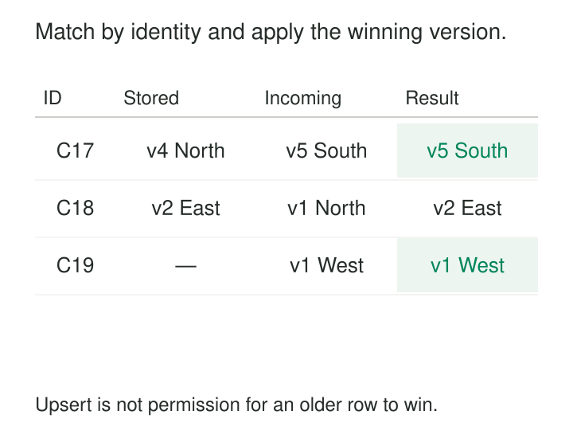

An hourly customer feed contains three kinds of records: customers the warehouse already knows, newly created customers, and delayed updates describing older states.

Appending everything creates duplicates. Replacing the whole table wastes work and may remove records absent from this particular delivery.

**Merge and Upsert reconcile incoming records with existing state by matching identities and applying explicit actions.** New identities can be inserted, eligible matches updated, and deletions handled under a defined protocol.

The statement performs the reconciliation. The model must establish what counts as the same record and which incoming information should prevail.

## Match identity, then decide what changes

An *upsert* usually means “insert, or update an existing row when its key conflicts.” A SQL `MERGE` generally offers a broader set of conditional actions based on matches between source and target.

PostgreSQL implements upsert through `INSERT ... ON CONFLICT` and provides separate [`MERGE` syntax](https://www.postgresql.org/docs/current/sql-merge.html) supporting conditional inserts, updates, and deletes. Exact capabilities and guarantees vary by database.

Three decisions define the pattern:

| Decision | Example |
|---|---|
| Identity | Customer ID within a source or tenant |
| Eligibility | Incoming source version is newer |
| Action | Replace specified attributes, insert, delete, or leave unchanged |

The match condition should identify the target row. Conditions controlling whether to update it belong in the action rules.

Putting “incoming version is newer” into the match condition can make an existing identity appear unmatched. An attempted update may then become an attempted insert, producing a duplicate or constraint error.



## A customer projection accepts newer state

Consider an illustrative target:

| Customer | Stored version | Region |
|---|---:|---|
| C17 | 4 | North |
| C18 | 2 | East |

The incoming batch contains C17 version 5 in South, new customer C19 version 1 in West, and delayed C18 version 1 in North.

Under a newer-version-wins rule, C17 changes, C19 is inserted, and C18 remains in East.

For a PostgreSQL table with a primary key on `customer_id`, a simplified non-delete upsert looks like this:

```sql
INSERT INTO customer_current AS t
    (customer_id, source_version, region)
VALUES ('C17', 5, 'South')
ON CONFLICT (customer_id) DO UPDATE
SET region = EXCLUDED.region,
    source_version = EXCLUDED.source_version
WHERE EXCLUDED.source_version > t.source_version;
```

PostgreSQL documents this conflict-handling mechanism in its [`INSERT` reference](https://www.postgresql.org/docs/current/sql-insert.html).

The example assumes non-null, comparable versions from one authoritative sequence for each customer. A processing timestamp from whichever worker finished last would establish a different—and often unsuitable—precedence rule.

Repeating version 5 leaves the same logical state. Equal versions carrying contradictory values should trigger investigation rather than silently masquerade as ordinary retries.

## Keys and source cardinality establish correctness

The target key must represent the declared grain. A daily store measure might require store, reporting date, and currency. Customer IDs reused across tenants require the tenant in the identity.

Mutable attributes such as region or status generally do not belong in a current-customer match key. Including them can turn an attribute change into a new identity.

Both sides also need controlled cardinality. Multiple incoming records for one key can produce ambiguous updates, errors, or duplicate inserts.

Snowflake explicitly documents these cases: multiple source matches can make updates nondeterministic, and duplicate unmatched source records can all be inserted. See [duplicate behavior in `MERGE`](https://docs.snowflake.com/en/sql-reference/sql/merge#duplicate-join-behavior).

Delta Lake likewise requires an incoming log batch to be deduplicated within itself in its documented [merge-based deduplication example](https://docs.delta.io/delta-update/).

Selecting the latest incoming version is appropriate for full-state records when intermediate states are unnecessary. It is unsafe for arbitrary deltas: choosing the latest of three balance adjustments would discard the other adjustments.

Null keys also need explicit treatment. Ordinary equality does not provide a dependable identity match for null values.

## A daily aggregate needs a complete replacement value

An illustrative daily total currently holds 100 EUR. Corrected source transactions now imply 80 EUR.

A merge keyed by store, day, and currency can replace 100 with 80—provided the incoming row contains the complete recomputed total for that group.

If the incoming row contains only a newly arrived 20 EUR transaction, replacing the existing total with 20 is wrong. Adding 20 may be appropriate for a delta protocol, but repeating that delivery would add it again.

This is why merge and incremental computation are separate responsibilities. The transformation calculates the correct replacement or adjustment. Merge publishes it according to the chosen identity and action rules.

dbt’s [incremental strategy documentation](https://docs.getdbt.com/docs/build/incremental-strategy) describes merge as updating matched keys and inserting new ones. That mechanism cannot determine whether a supplied aggregate is complete.

A disappeared aggregate group also needs an explicit deletion path. Returning no replacement row does not necessarily remove its old target row.

## A deletion needs evidence—or a complete snapshot

A change feed can carry an explicit delete operation. A merge can route that operation to a delete action or retain a deleted-state marker, depending on the target contract.

Physical removal has a consequence: the target may lose its stored version. A delayed older upsert can then recreate the record. A retained tombstone or separate ordering ledger can prevent that resurrection.

Another deletion mechanism compares the target with an authoritative snapshot. If a complete customer snapshot for tenant A omits C17, absence may legitimately mean removal.

That conclusion requires a complete snapshot for the exact scope being reconciled. A partial page, recent-change batch, or failed extraction cannot establish it.

A `WHEN NOT MATCHED BY SOURCE` deletion clause applied to an incremental batch can therefore remove perfectly valid target records. Snapshot completeness and scope must be established before absence receives deletion semantics.

## Decide whether records replace or patch

An incoming full-state record can replace designated source-owned attributes. A patch updates only fields explicitly supplied.

These contracts differ when a field is missing or null.

If `region` is omitted from a patch, it may mean “leave unchanged.” If it is explicitly null, it may mean “clear the region.” A blanket `COALESCE(incoming.region, target.region)` prevents intentional clearing.

Patch protocols need field-presence information or another explicit update representation. Source and target column ownership also matters: an external feed should not accidentally overwrite warehouse-managed classifications or operational metadata.

An ordinary current-state upsert overwrites earlier attributes. Preserving historical versions requires an additional history design, such as SCD Type 2 or recorded-time history.

## Atomic statements still need an operating protocol

A native upsert avoids the common race in “check whether the row exists, then insert.” PostgreSQL documents an atomic insert-or-update outcome for `ON CONFLICT DO UPDATE`, subject to its conditions and independent errors.

Its documentation also states that `MERGE` and `ON CONFLICT` are not interchangeable under concurrent modification. See the [PostgreSQL concurrency considerations](https://www.postgresql.org/docs/current/sql-merge.html).

Other engines have their own transaction, conflict, and uniqueness behavior. A configured match key does not necessarily create an enforced uniqueness constraint.

The pipeline must coordinate publication with source progress, retry conflicts safely, and prevent stale workers from overwriting newer results. Merge does not automatically make external side effects or additive updates idempotent.

## Reconciliation has a cost

Matching can require target scans, joins, sorting, locking, or data-file rewrites. Small incoming batches can still be expensive against large targets.

Indexes, clustering, and partition pruning can reduce work, but pruning must preserve every legitimate match. Excluding an older target partition can make an existing record appear new.

Operational checks should distinguish inserts, updates, deletes, unchanged rows, stale records, and conflicting duplicates. Replaying a batch is a useful verification case: replacement-style reconciliation should preserve the intended state.

The pattern fits current-state replicas, corrected facts, deduplicated event stores, and maintained aggregates. Append-only history and wholesale snapshot replacement may call for different mechanisms.

[[data-composite-keys|Composite Keys]] defines matching identity. [[data-deterministic-transformations|Deterministic Transformations]] prepares unambiguous incoming records. [[data-deletion-tombstones|Deletion Tombstones]] preserves removal evidence. **Incremental Transformations** determines which results need reconciliation.

A dependable merge makes identity, precedence, and action explicit enough that every changed row—and every unchanged row—has an explainable outcome.
