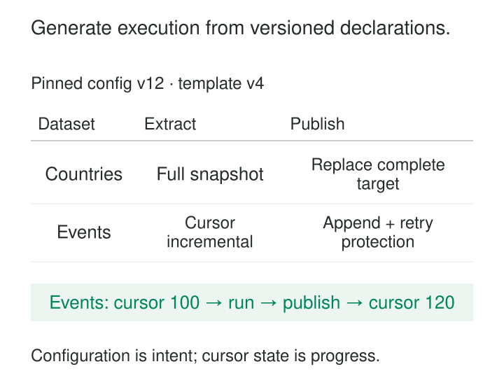

The first ingestion pipeline copies one table. The second copies another, with a different destination and schedule. By the twentieth, the team is maintaining nearly identical workflows whose differences are scattered across code, notebooks, and orchestration settings.

A retry fix must be applied twenty times. One pipeline still uses an old watermark rule. Adding another source means copying a workflow and hoping every setting gets changed.

**Metadata-Driven Pipelines represent recurring pipeline differences as structured specifications that reusable execution logic can interpret.** Metadata describes which objects to process, which supported behavior to apply, and which constraints govern the work.

The purpose is to make repeated work consistent while keeping each dataset’s requirements explicit.

## Describe the variation, implement the behavior

A metadata-driven design has three distinct responsibilities.

**Configuration describes intent.** It identifies sources, destinations, keys, extraction strategies, mappings, quality rules, dependencies, and resource limits.

**Templates implement behavior.** Reusable code interprets those declarations and performs operations such as snapshot extraction, incremental loading, validation, and publication.

**Runtime state records progress.** Checkpoints, completed partitions, attempt identifiers, and output references describe what actually happened.

These can share a storage system, but they need different ownership and update rules. Changing a dataset’s destination is a configuration change. Advancing its cursor after successful processing is a state transition.

Metadata becomes operational when an engine uses it to construct or execute work. A catalog entry that merely documents a table does not, by itself, drive a pipeline.

## One ingestion framework, several declared strategies

Consider this illustrative configuration:

| Dataset | Extraction strategy | Publication strategy | Required details |
|---|---|---|---|
| Countries | Full snapshot | Replace complete target | Expected schema |
| Events | Cursor incremental | Append with retry protection | Sequence column, event key |
| Customers | Change-data capture | Merge changes | Customer key, deletion handling |

The framework selects a supported implementation for each row. Adding another compatible snapshot dataset requires a new declaration rather than another copy of the extraction code.

Azure Data Factory documents this approach directly. Its metadata-driven copy tool generates parameterized pipelines and control tables containing source objects, destinations, mappings, and loading behavior. Objects can be added or changed through the control table without redeploying those pipelines. [Azure Data Factory metadata-driven copy documentation](https://learn.microsoft.com/en-us/azure/data-factory/copy-data-tool-metadata-driven)

The declaration does not establish correctness on its own. Setting `strategy = cursor` does not prove that a column captures every relevant change.

For the events example, suppose the last completed sequence is `100`, and the run fixes its upper bound at `120`. Processing `(100, 120]` is safe only under a source contract that makes that range complete and stable. A sequence assigned before transactions commit may need additional handling because lower-numbered records can become visible later.

Databricks provides a documented implementation using a control table, a `For each` task, and a reusable incremental-copy notebook. Its example explicitly discusses the assumptions behind timestamp watermarks and warns that resetting progress without clearing appended targets can duplicate historical data. [Databricks metadata-driven incremental-copy tutorial](https://docs.databricks.com/aws/en/jobs/how-to/foreach-watermark-tutorial)

A framework standardizes a strategy’s implementation. It still needs evidence that the strategy fits each source.

## Quality rules become executable policy

Metadata can also describe validation behavior:

| Dataset | Rule | Action |
|---|---|---|
| Orders | `order_id` must be present | Fail publication |
| Orders | Delivery postcode should be present | Retain and record violations |
| Products | Product code must be unique within source | Fail publication |

Suppose a batch contains 1,000 orders, including ten without identifiers. Under this contract, the identifier failure prevents publication. Missing delivery postcodes remain visible as quality violations while the records continue downstream.

The shared engine implements the checks, metrics, and actions. Dataset owners supply the applicable rules.

These actions have materially different meanings. Recording a violation, dropping a record, quarantining it, and rejecting an update cannot safely be interchangeable defaults. Databricks pipeline expectations provide a concrete implementation of configurable constraints with retain, drop, and fail behaviors. [Databricks expectations documentation](https://docs.databricks.com/aws/en/ldp/expectations)

The framework must also distinguish kinds of checks. A row-level predicate cannot establish uniqueness across a dataset without additional computation. A structurally valid rule can still encode a mistaken business assumption—for example, rejecting every negative amount when refunds are legitimate.

## A worklist can determine the run’s shape

A backfill needs to rebuild daily sales for October 23, 24, and 25. Its run specification contains three partition entries, an explicit transformation version, and the publication strategy for each partition.

The orchestrator creates three task instances from that worklist. If one fails, its status remains identifiable, and the framework can retry that partition under the same declared scope.

Apache Airflow’s Dynamic Task Mapping supports this mechanism: an upstream task produces a list or dictionary, and the scheduler creates task instances from it at runtime. [Apache Airflow Dynamic Task Mapping documentation](https://airflow.apache.org/docs/apache-airflow/stable/authoring-and-scheduling/dynamic-task-mapping.html)

This differs from rereading “whatever needs work now” on every retry. The original run needs a retained plan or equivalent stable inputs, so an operator can explain which partitions it intended to process.

Parallelism also needs limits. Three partitions may be inexpensive; thirty thousand can overwhelm a source, scheduler, or warehouse. Metadata can express priorities and concurrency classes, while the execution engine enforces them.

## Treat the specification as an execution contract

A dependable framework validates metadata before performing consequential work.

Required fields depend on the selected strategy. A merge requires matching keys. Partition replacement requires an explicit replacement scope. An incremental strategy requires defined progress semantics. Unsupported combinations should fail clearly instead of silently selecting a convenient default.

The framework should resolve configuration into a concrete run plan: selected objects, destinations, dependency relationships, intervals, template versions, and relevant mappings. Retaining that plan makes troubleshooting possible even after the live configuration changes.

Pinning metadata is necessary for reproducibility, but insufficient by itself. Inputs, reference data, code, and runtime behavior can also change. A retry that uses the original configuration while reading a different source snapshot may produce different results.

Progress must follow durable publication. If a target write succeeds but recording the checkpoint fails, a retry may repeat the write. The publication operation therefore needs retry protection, or a commit protocol that coordinates output and progress. Concurrent runs also need rules preventing conflicting writes and stale checkpoint updates.

Airflow’s guidance similarly recommends repeatable task outcomes, explicit data partitions, and avoiding changing “latest” inputs during retries. It also recommends connection references for credentials rather than embedding authentication values in tasks. [Apache Airflow best practices](https://airflow.apache.org/docs/apache-airflow/stable/best-practices.html)

## The operating costs move into the framework

This pattern pays off when many datasets share a small number of genuine processing strategies: onboarding source tables, applying common quality policies, or managing recurring partition work.

It reduces duplicated implementation, but creates a shared component that must be maintained as a product. Costs include configuration validation, migration tooling, compatibility testing, documentation, observability, and support for exceptional datasets.

A template defect can affect many pipelines. Changes therefore need representative tests and controlled rollout. Operational views should identify the dataset, configuration release, template version, effective parameters, output, and progress state—not merely report that a generic task failed.

Metadata lookup and planning also consume resources. Fetching configuration repeatedly while an orchestrator parses workflow definitions can create avoidable load; Airflow explicitly advises against database and network access in top-level workflow code. [Apache Airflow best practices](https://airflow.apache.org/docs/apache-airflow/stable/best-practices.html)

The common architectural mistake is allowing exceptions to accumulate until configuration becomes an obscure programming language. Arbitrary expressions, nested conditionals, and dozens of interacting flags can become harder to understand than ordinary code.

Keep supported strategies small and explicit. Complex business transformations can remain named, tested implementations that metadata selects. A few highly distinctive pipelines may be easier to maintain directly.

## Related patterns

[[data-canonical-mapping|Canonical Mapping]] can supply versioned translation rules that a shared pipeline applies.

[[data-deterministic-transformations|Deterministic Transformations]] explains why configuration, code, inputs, and reference versions all matter when reproducing results.

[[data-cursor-based-incremental-extraction|Cursor-Based Incremental Extraction]] provides one strategy a metadata-driven framework can implement, together with its source assumptions.

[[data-manifest-based-file-ingestion|Manifest-Based File Ingestion]] provides an explicit worklist for a file batch; a metadata-driven engine can use that manifest to plan and verify processing.
