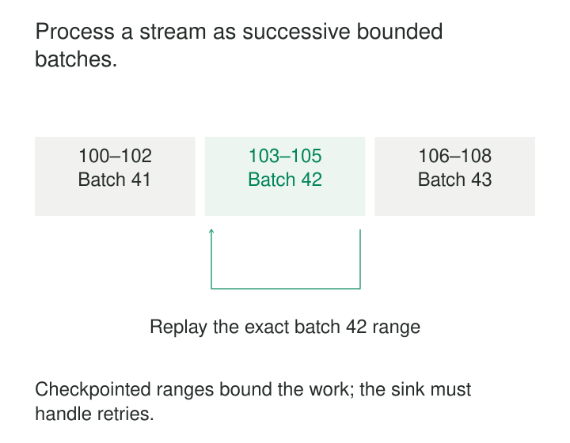

A sales dashboard needs fresh numbers throughout the day. An overnight load is too slow, but writing every purchase separately creates thousands of tiny operations, expensive commits, and complicated recovery.

Microbatch Processing groups newly available records into small, bounded units of work. Each unit runs through a familiar batch computation, publishes its results, and records enough progress to continue after a failure.

The purpose is to combine frequent updates with the efficiency and recoverability of batch execution. The important property is a clear boundary around each increment of work.

## Turn an unbounded input into bounded executions

A stream keeps arriving. A microbatch gives the processor a finite question: **Which records will this execution handle?**

For a partitioned log, that boundary is usually a start and end offset for each partition. For files, it may be a recorded set of newly discovered objects. The processor selects the input, applies transformations, updates any persistent state, and publishes output under a recoverable commit protocol.

The next batch continues from the recorded position.

Apache Spark Structured Streaming provides a widely used implementation: its default execution engine processes streams as a sequence of small batch jobs using the Spark SQL engine. Queries can retain aggregation and other state across those executions. [Spark Structured Streaming overview](https://spark.apache.org/docs/latest/streaming/index.html)

A microbatch can contain parallel tasks across many machines. Conversely, processing several records together does not automatically provide checkpointing, replay, or safe publication. Those mechanisms must accompany the grouping.

## Execution boundaries are different from business windows

A ten-second microbatch interval describes when the engine checks for and processes work. A one-minute sales window describes which purchases belong in a result. These are separate decisions.

Suppose a query calculates sales for the event-time interval `[10:00, 10:01)`:

| Event | Event time | Amount | Processed in |
|---|---|---:|---|
| E1 | 10:00:02 | 30 | Batch 41 |
| E2 | 10:00:08 | 70 | Batch 41 |
| E3 | 10:00:04 | 20 | Batch 42 |

Batch 41 contributes 100. Batch 42 contains a delayed purchase belonging to the same business minute, bringing its total to 120 if the lateness policy accepts it.

The batch boundary does not make the first total final. Window state, watermarks, output mode, and correction policy determine when results appear and whether they can change.

Likewise, a batch may contain events from several business windows. Treating “everything processed together” as “everything that happened together” produces incorrect time-based reporting.

## Example: a dashboard refreshed every ten seconds

Imagine a sales pipeline receiving roughly 1,000 purchases per second. With a ten-second cadence and no backlog, an execution might handle about 10,000 purchases.

Grouping those records allows shared scheduling, parallel transformations, and bulk writes. Instead of opening a destination transaction for every purchase, the sink can publish a larger unit efficiently.

Suppose an execution starts at 10:00:10 and takes two seconds. Records included in that execution become visible after its publication step. A record that narrowly misses input selection waits for a later execution.

The trigger interval is therefore only one component of freshness:

**End-to-end delay includes admission waiting, backlog, computation, and publication.**

Spark’s fixed-interval trigger waits for the next scheduled boundary when a batch finishes early. When processing overruns the interval, the next batch starts as soon as the previous one finishes. A ten-second trigger does not guarantee results every ten seconds. [Spark trigger semantics](https://spark.apache.org/docs/latest/streaming/apis-on-dataframes-and-datasets.html#triggers)

If each batch consistently takes fifteen seconds, shortening the interval to five seconds cannot create capacity. The query needs less work per execution, faster processing, or a more efficient destination.

## Example: replaying database changes safely

A change-data-capture pipeline reads customer updates and applies them to an analytical database.

Batch 42 selects a recorded input range, transforms the changes, and writes them successfully. The process then crashes before recording that the batch completed.

On restart, the engine may repeat batch 42. A blind append duplicates the output. An update such as “increase this counter by five” applies the same effect twice.

One possible destination design stores a completion marker identified by the query generation and batch number. Within a single destination transaction, it checks or creates that marker and applies the corresponding writes. A committed marker means a replay can skip those already committed effects.

The marker and effects must commit together. Writing the marker first can lose work; writing it afterward in a separate transaction can duplicate work.

Spark’s `foreachBatch` exposes each microbatch’s output and batch ID for custom sink logic. Databricks explicitly documents that it provides at-least-once writes by default; stronger guarantees require the application to deduplicate or otherwise make writes repeatable. [Databricks `foreachBatch` documentation](https://docs.databricks.com/aws/en/structured-streaming/foreach)

Batch identity must remain meaningful across recovery. A fresh checkpoint may begin a new numbering sequence, so a destination marker needs an appropriate query namespace or generation.

This protects replay of the same execution. Duplicate business events appearing in different batches still require event-level deduplication. Writing several destinations also requires separate recovery reasoning: one successful write does not make all destinations an atomic transaction.

## Example: catching up on files, then stopping

A supplier delivers files throughout the day, but reporting only needs updates every fifteen minutes.

The pipeline can start on a schedule, discover the available input, process it through several bounded microbatches, and stop after catching up. This avoids keeping compute active between runs while preserving incremental progress.

Spark’s `AvailableNow` trigger supports this approach for compatible sources. Source options can divide the available work into multiple executions rather than one oversized batch. Databricks documents it for scheduled incremental processing. [Databricks trigger documentation](https://docs.databricks.com/aws/en/structured-streaming/triggers)

For example, 2,000 available files with a limit of 100 files per execution would require about twenty batches, assuming no additional constraints. File count is only a rough workload measure: one unusually large file may dominate an execution.

The publication contract matters too. Input files must become visible as complete objects rather than being read while still under construction. Spark’s file source documents this requirement and provides controls such as `maxFilesPerTrigger`. [Spark file-source documentation](https://spark.apache.org/docs/latest/streaming/apis-on-dataframes-and-datasets.html#input-sources)

## What correctness depends on

Recovery requires retained, replayable input and durable progress information. A checkpoint pointing to expired source data cannot reconstruct a failed batch.

Repeated computation must also preserve its intended meaning. A transformation that consults a changing exchange-rate service during replay may produce different output from the same recorded input. Versioned reference data, pinned dependencies, and deterministic transformations make recovery more predictable.

Persistent operator state must recover consistently with input progress. Restoring a counter from one execution and offsets from another can omit or repeat contributions.

Finally, publication must match the required delivery guarantee. Microbatching provides a useful unit for transactions and idempotency; it does not confer exactly-once effects on arbitrary destinations.

## Choosing the size and cadence

Smaller batches usually reduce waiting, but increase scheduling, checkpoint, metadata, and commit overhead. Larger batches amortize those costs while increasing latency, temporary resource use, and the amount of work repeated after failure.

A time interval alone does not bound batch size during a backlog. Source admission limits help control execution size. Spark’s Kafka integration, for example, offers `maxOffsetsPerTrigger` to limit offsets processed per trigger. [Spark Kafka integration guide](https://spark.apache.org/docs/latest/streaming/structured-streaming-kafka-integration.html)

Operating costs include compute kept active between executions, source discovery calls, checkpoint storage, state maintenance, and small output files requiring later compaction.

Useful measurements include batch duration, input volume, source backlog, publication time, state size, and oldest-unprocessed-record age. Average duration can hide occasional expensive batches that repeatedly break a freshness target.

Microbatching fits frequent analytical updates, incremental lake ingestion, bulk-friendly destinations, and workloads measured in seconds or minutes. Per-event operational decisions with strict latency requirements may need a different execution model.

## Related patterns

**Incremental Transformations** defines how computation incorporates new or changed data; microbatching supplies bounded executions for that work. [[data-deterministic-transformations|Deterministic Transformations]] makes repeated execution dependable.

[[data-backpressure|Backpressure]] controls admission when processing falls behind. [[data-event-time-processing|Event-Time Processing]] assigns events to their business time independently of the microbatch in which they happen to be processed.
