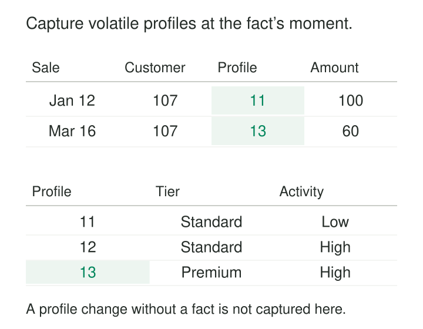

A customer dimension contains names, locations, account details, subscription tiers, engagement bands, and marketing segments. Most attributes change occasionally. A few change every week.

Tracking every change with a new Type 2 row repeatedly copies the entire customer description. Millions of customers become tens of millions of versions, largely because a handful of profile attributes keep moving.

[[data-mini-dimensions|Mini-Dimensions]] separates selected attributes into a compact dimension of reusable profiles. Each fact records both the customer key and the profile key appropriate to the event. Profile changes can then be captured without creating another wide customer row.

Kimball calls this **SCD Type 4: Add Mini-Dimension**. It addresses volatile attributes and can also help with frequently queried attributes in very large dimensions. [Kimball Group: Type 4 — Add Mini-Dimension](https://www.kimballgroup.com/data-warehouse-business-intelligence-resources/kimball-techniques/dimensional-modeling-techniques/type-4-mini-dimension/)

## One row represents a combination

The defining grain is **one row per distinct profile combination**.

A subscription profile might combine:

| Profile key | Plan | Engagement band |
|---|---|---|
| 11 | Standard | Low |
| 12 | Standard | High |
| 13 | Premium | High |

These rows describe possible customer characteristics. They contain no customer identifier because many customers can share the same profile.

If customer C-42 moves from Standard/Low to Premium/High, subsequent facts reference profile 13. If another customer already uses that profile, the same row is reused. Returning to Standard/Low reuses profile 11.

The base customer dimension retains its other attributes and their own change policies. Removing profile attributes does not eliminate legitimate Type 2 changes elsewhere in that dimension.

## Example: preserve the profile attached to each sale

Customer C-42 has customer key 107. A January sale occurs under Standard/Low; a March sale occurs under Premium/High.

The fact rows retain two independent references:

| Sale date | Customer key | Profile key | Revenue |
|---|---|---|---|
| January 12 | 107 | 11 | $100 |
| March 16 | 107 | 13 | $60 |

*Illustrative data. Profiles are shared combinations; facts associate them with customers at particular events.*

A report grouped by event-time engagement assigns $100 to Low and $60 to High. The profile remains directly accessible from each fact, even after the customer changes again.

This direct connection matters. Looking up a customer’s latest profile during reporting would reclassify old sales. Kimball’s design explicitly places both the base dimension key and mini-dimension key on the associated fact. [Kimball Group: Type 4 — Add Mini-Dimension](https://www.kimballgroup.com/data-warehouse-business-intelligence-resources/kimball-techniques/dimensional-modeling-techniques/type-4-mini-dimension/)

## Build profiles separately from assigning them

Loading involves two distinct jobs.

First, identify previously unseen combinations and create their profile rows. A practical approach extracts distinct combinations from incoming data, compares them with the mini-dimension, and inserts the missing combinations. Second, resolve the appropriate profile key for each fact. Kimball’s maintenance guidance describes this separation between maintaining combinations and looking up their keys. [Kimball Group: Creating and managing mini-dimensions](https://www.kimballgroup.com/2010/09/design-tip-127-creating-and-managing-mini-dimensions/)

Correctness requires consistent representations of codes, nulls, and unknown values. Concurrent loaders also need coordination or uniqueness enforcement so the same combination does not acquire several keys.

Once facts reference a profile, changing that row’s business values changes their historical interpretation. A customer’s movement therefore selects another profile; it does not rewrite a shared profile row.

The source must also establish which profile applied at the fact’s chosen event time. A late January sale cannot safely use March’s current profile. Use event-carried context or sufficient assignment history to resolve it.

## Keep the mini-dimension small enough to earn its name

The design works best when many entities repeatedly share a manageable number of profiles.

Three plan values, four engagement bands, and five tenure bands allow at most:

**3 × 4 × 5 = 60 combinations**

Adding exact timestamps, continuously varying scores, or customer-specific identifiers can destroy that reuse. A profile that is nearly unique to every observation offers little compression.

Create observed combinations as needed, or prepopulate a small, meaningful set. Generating the full Cartesian product becomes wasteful when possibilities multiply or combinations are invalid.

Bands introduce another responsibility: define their boundaries. If “High engagement” changes meaning, silently reusing the same code can mix incompatible classifications. Retain the relevant definition version when that distinction matters.

### Example: device operating profiles

A fleet operator could group observations using operating mode, battery band, and signal-quality band. Thousands of devices may share the same profile, and an observation can retain that profile alongside its device key.

Exact battery percentage and signal measurements can remain measures on the observation fact. Putting every precise reading into the profile would create unnecessary combinations. Microsoft similarly distinguishes rapidly changing measurements from descriptive dimension attributes and identifies fact measures as a common home for such values. [Microsoft: Star schema guidance](https://learn.microsoft.com/en-us/power-bi/guidance/star-schema)

## Event context is only part of the history

Return to C-42. Suppose the customer becomes Standard/High in February but makes no purchase until March, after moving to Premium/High.

The sales facts preserve profiles 11 and 13. They do not record the intervening assignment to profile 12.

Even if profile 12 exists, the mini-dimension says nothing about which customer held it or when. A catalog of combinations is not an assignment history.

If the business asks, “Which customers were highly engaged on February 20, including those who bought nothing?”, maintain a separate relationship history. A factless fact table can connect the customer and profile with effective and expiration boundaries. Kimball explicitly describes this supplement for profile changes occurring outside measurement events. [Kimball Group: Mini-dimensions and historical relationships](https://www.kimballgroup.com/2005/03/slowly-changing-dimensions-are-not-always-as-easy-as-1-2-3/)

That table introduces its own temporal responsibilities: coherent boundaries, handling late changes, and ensuring the intended number of assignments applies at each instant.

## Make current and historical perspectives explicit

A separate requirement is counting customers by their profile today.

An optional `current_profile_key` on the customer dimension can supply that relationship without requiring a sale. Updating it as a Type 1 attribute supports current customer counts and historical sales grouped by current characteristics.

Kimball names the combination of a mini-dimension and an overwritten current-profile reference **Type 5**. It recommends distinct labels for current attributes and attributes reached through historical facts. [Kimball Group: SCD Types 4 and 5](https://www.kimballgroup.com/2013/02/design-tip-152-slowly-changing-dimension-types-0-4-5-6-7/)

For example, **Engagement at Sale** and **Current Engagement** communicate two different questions. An unlabeled “Engagement” field invites accidental reclassification.

## A documented implementation example

Warren Thornthwaite’s Kimball Group design tip demonstrates extracting approximately 36,000 distinct eight-attribute profiles from a customer dataset containing 1.1 million rows.

The example then maintains new combinations and resolves surrogate keys for incoming records. It provides a concrete illustration of profile reuse: many customer rows share a much smaller vocabulary of combinations. Its reported size and timings describe that demonstration; they do not establish expected performance for another warehouse. [Kimball Group: Creating and managing mini-dimensions](https://www.kimballgroup.com/2010/09/design-tip-127-creating-and-managing-mini-dimensions/)

## The savings come with additional relationships

Mini-dimensions reduce repeated storage of wide descriptions when volatile profiles would otherwise drive Type 2 growth. Smaller profile tables can also make common filters easier to manage.

The costs include extra foreign keys on facts, profile lookups, combination maintenance, and more relationships for report authors to understand. Assignment history and current-profile support add further work.

Physical performance depends on the engine, compression, table sizes, and query workload. Benchmark the actual design. A small customer dimension with infrequent changes may be clearer and cheaper to maintain using ordinary Type 2 rows.

Common mistakes include allocating a new profile for every customer change, placing customer identity inside the profile, overwriting shared combinations, and assuming sales facts capture every intervening state.

## Neighboring patterns clarify the boundary

[[data-version-dimension-rows-scd-type-2|Version Dimension Rows — SCD Type 2]] versions an entity’s description; a mini-dimension reuses combinations while facts capture their association with the entity.

[[data-junk-dimensions|Junk Dimensions]] also consolidate combinations into surrogate-keyed rows, usually to organize miscellaneous flags and indicators. Mini-dimensions specifically address selected attributes separated from a larger dimension.

[[data-factless-fact-tables|Factless Fact Tables]] preserve customer-to-profile assignments when measurement events leave gaps. [[data-declare-the-grain|Declare the Grain]] keeps all three meanings explicit: a customer version, a reusable profile, and an event carrying both references.
