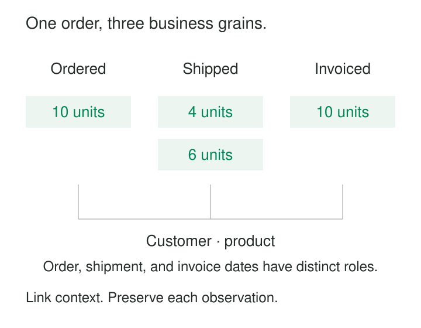

**What it is for**

Organize analytical data around the activities a business performs, so that measurements retain a clear meaning across systems, departments, and reports.

A retailer has three answers to a seemingly simple question: “How much did we sell?” Sales counts accepted orders. The warehouse counts dispatched goods. Finance counts issued invoices. Each report uses different dates, records, and rules.

The first temptation is to combine everything into a comprehensive sales table. But combining records does not resolve differences in meaning. An order can ship in several deliveries, an invoice can cover several orders, and a return can occur weeks later.

Model Around Business Processes gives each measurable activity an explicit place in the model. It becomes possible to connect ordering, shipping, invoicing, and returning while preserving what happened in each.

## Start with an activity people can recognize

A useful modeling boundary describes something the organization does: accepts an order, receives a delivery, registers a student, or settles a claim.

“Finance” identifies a department. “Customer” identifies an entity. “Monthly executive dashboard” identifies an output. None, by itself, establishes the activity being measured.

Margy Ross describes a business process for dimensional modeling as an activity or event that generates or collects performance measurements. The same process can support many analyses and interest several departments. [Identifying Business Processes](https://decisionworks.com/2005/07/design-tip-69-identifying-business-processes/).

This provides a practical starting point:

> What happened, and what can we measure about that occurrence?

Once that is clear, define what one record represents. An ordering model might record one accepted order line; a shipping model might record one dispatched shipment line.

Kimball’s dimensional design method follows this progression: choose the process, establish the grain, then determine its descriptive context and measurements. Business requirements and available source data both constrain those decisions. [Four-Step Dimensional Design Process](https://www.kimballgroup.com/data-warehouse-business-intelligence-resources/kimball-techniques/dimensional-modeling-techniques/four-4-step-design-process/).

## Separate the measurements, connect the context

The graphic shows three perspectives on a purchase. Their records describe different occurrences, so their row counts need not agree.

They can still share consistent descriptions of customers, products, and dates. Dates retain their roles: order date, shipment date, and invoice date answer different questions.

This combination—distinct measurements with shared context—supports comparison across activities. Kimball’s bus architecture uses business processes and conformed dimensions to organize incremental development while preserving integration across the warehouse. [Enterprise Data Warehouse Bus Architecture](https://www.kimballgroup.com/data-warehouse-business-intelligence-resources/kimball-techniques/kimball-data-warehouse-bus-architecture/).

## One order becomes two shipments

Consider an illustrative order, O-17, containing one line for ten chairs.

Four chairs leave the warehouse on Monday in shipment S-41. The remaining six leave on Thursday in S-42.

The ordering model contains one line with an ordered quantity of ten. The shipment model contains two lines with shipped quantities of four and six.

Now suppose an analyst joins the order line directly to both shipment lines:

| Order | Ordered quantity | Shipment | Shipped quantity |
|---|---:|---|---:|
| O-17 | 10 | S-41 | 4 |
| O-17 | 10 | S-42 | 6 |

Summing the joined columns reports twenty ordered chairs and ten shipped chairs. The order measurement has been repeated by the relationship.

Keeping the processes explicit makes the problem visible. Ordered quantity belongs to the order line. Shipped quantity belongs to each shipment line. For a comparison at order-line level, aggregate shipments to that level before combining the results.

The distinction also preserves useful timing information. On Tuesday, ten chairs have been ordered and four shipped. That difference describes outstanding work. It should not be “fixed” by forcing the two models to contain matching records.

A process model therefore does more than organize tables. It protects distinctions that make operational questions answerable.

## Shopify: planned work and performed work

Shopify’s public API provides a concrete example of separating related business concepts.

Its `FulfillmentOrder` represents items expected to be fulfilled from a location. A `Fulfillment` represents ongoing or completed fulfillment work. An order can have multiple fulfillment orders, including more than one at a location. [Shopify’s fulfillment model](https://shopify.dev/docs/api/admin-graphql/latest/objects/FulfillmentOrder).

Shopify also documents an operation that splits fulfillment orders by moving specified items and quantities into another fulfillment order. [Fulfillment order splitting](https://shopify.dev/docs/api/admin-graphql/latest/mutations/fulfillmentOrderSplit).

These distinctions matter to an analytical consumer. Counting orders, fulfillment assignments, and performed fulfillment work produces different measurements.

The public API documents operational concepts; it does not establish Shopify’s internal warehouse design. It does, however, demonstrate why reducing all related activity to one generic “order record” would lose meaning.

## Enrollment is different from attendance

Imagine a training provider whose reporting begins with a single student table. Each student has a course, enrollment date, and attendance count.

That structure becomes awkward when someone enrolls in several courses, transfers between classes, or attends individual sessions at different locations.

A process-oriented design separates registration from attendance.

One enrollment record might represent a student’s registration in a course offering. One attendance record might represent that student’s attendance at a particular scheduled session. Student, course offering, and location provide context.

Suppose a course has ten sessions and a student attends eight. There may be one enrollment and eight attendance occurrences. Repeating enrollment measures across attendance rows would inflate enrollment counts.

There is another important boundary: eight recorded attendances alone do not prove two absences. Establishing absence also requires the expected sessions and confidence that attendance recording is complete.

The model exposes what the evidence supports—and what additional data a question requires.

## What must remain true

Process names are only the beginning. Correctness depends on several agreements.

**An occurrence needs a consistent definition.** Does an order count when submitted, accepted, or paid? A label such as “orders” cannot settle that choice.

**Each dataset needs an explicit grain.** One business process can require several representations, including transaction records and periodic summaries. IBM’s dimensional modeling guidance explicitly allows multiple grains and recommends separate fact tables for them. [Identifying the grain](https://www.ibm.com/docs/en/ida/9.1.1?topic=phase-step-identify-grain).

**Relationships need defensible matching rules.** Customer and product mappings, source identifiers, and allocation rules determine whether cross-process comparisons are meaningful.

**Time and corrections need policies.** Cancellations, late arrivals, revised quantities, and returns can change the interpretation of earlier records. The model must explain whether it preserves an original event, updates current state, or records an adjustment.

Agreement requires people who understand the work. Source schemas provide evidence, but a status code cannot explain its business significance without context.

## The cost of clearer boundaries

Separate process models introduce more datasets, transformations, documentation, and tests. Shared dimensions require maintained definitions and mappings. For the split shipment, total shipped quantities by order line before comparing them with the ten ordered chairs. Other comparisons may require allocation rules or carefully defined joins.

That effort is useful when several teams repeatedly analyze the same activities, when one purchase crosses multiple systems, or when differences between events explain business performance.

It may be excessive for a small, single-purpose dataset with straightforward relationships. Process-oriented analysis can begin with a few well-defined tables; it does not require an enterprise-wide warehouse program.

Common mistakes include treating departments as process boundaries, creating a new model for every report, and assuming one process must equal exactly one table. The opposite mistake is defining a process so broadly—“manage the business”—that it supplies no useful boundary.

A process model also depends on available observations. A business may care deeply about delivery satisfaction while recording only dispatch events. Renaming the shipment dataset cannot supply the missing evidence.

The pattern is especially established in analytical modeling. Operational database design must additionally account for transaction boundaries, update behavior, and integrity constraints. Selecting a business activity gives the design direction; it does not determine every physical structure.

## Related patterns

[[data-declare-the-grain|Declare the Grain]] makes the selected process precise by specifying what one record represents.

[[data-conformed-dimensions|Conformed Dimensions]] connect process models through consistent descriptive context.

[[data-drill-across|Drill Across]] compares measurements from different processes after bringing them to a compatible reporting level.

[[data-accumulating-snapshots|Accumulating Snapshots]] provide a lifecycle view across milestones when the process and its progression support that representation.
