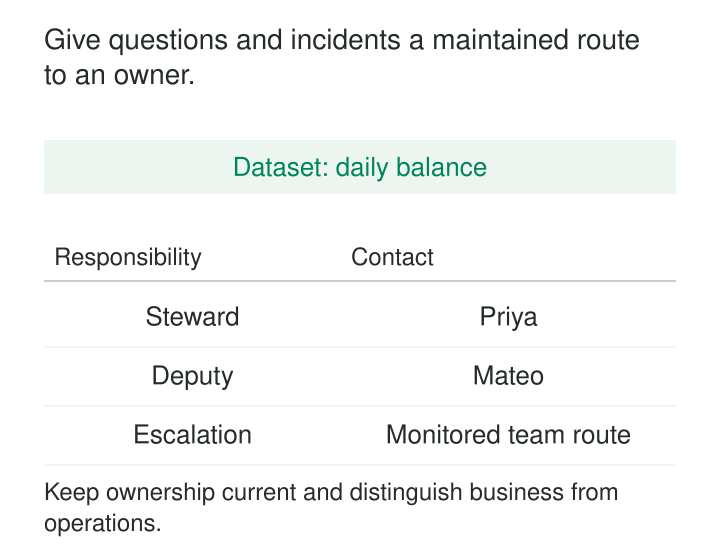

A dashboard suddenly reports that several warehouses have no stock. The pipeline is green. The table has an “owner” field, but it names the engineer who created it three years ago.

That engineer has left. The platform team can explain how the table refreshes, but nobody can say whether zero means an empty warehouse or a missing report.

**Named Dataset Stewardship gives each important dataset a discoverable, current point of responsibility for its meaning and day-to-day care.** The steward answers questions, coordinates investigation, maintains context, and brings decisions to the people authorized to make them.

The purpose is to make responsibility reachable and keep issues moving toward resolution.

## Give the assignment a real remit

A steward is more than a contact attached to a table. The assignment needs an understood scope, time to perform the work, and a route to people who can make business decisions or technical changes.

Typical responsibilities include maintaining definitions, investigating quality concerns, documenting limitations, coordinating changes, and communicating with consumers.

Organizations use role titles differently. A useful distinction separates business accountability, day-to-day stewardship, and technical operation. The UK government’s data ownership model explicitly distinguishes data owners, data stewards, and data custodians along these lines. [Government data ownership model](https://www.gov.uk/government/publications/data-ownership-in-government/data-ownership-model)

One person may perform several functions in a small team. The responsibilities still need to be clear.

The steward need not personally repair every problem. They need enough knowledge and organizational support to identify the right action, involve the right people, and follow through.

## Make the responsibility record useful

A consumer should be able to find the assignment from the dataset’s catalog entry, documentation, or published interface.

A practical record contains:

| Field | What it establishes |
|---|---|
| Dataset identity and scope | Which asset, versions, or subject area the assignment covers |
| Current steward and team | Who has accepted day-to-day responsibility |
| Contact route | Where questions and issues actually reach the team |
| Deputy or coverage arrangement | What happens during absence |
| Decision and technical contacts | Where the steward escalates beyond their remit |
| Review information | When the assignment was last confirmed |

A stable dataset identifier helps the assignment survive table renames and storage migrations. A team support route helps it survive an individual’s absence.

The name still matters. “Data team” can conceal uncertainty about who is currently handling the work. A named lead or an explicit duty rotation makes the team assignment actionable.

The UK government model provides a documented institutional example: it calls for named accountable owners for critical assets and metadata identifying responsible owners and stewards. [Critical data ownership requirements](https://www.gov.uk/government/publications/data-ownership-in-government/data-ownership-model#9-a-checklist-for-your-organisation)

## Example: zero stock or no report?

Consider an inventory dataset with these records:

| Warehouse | Quantity | Reporting status |
|---|---:|---|
| W1 | 0 | Count received |
| W2 | NULL | Report not received |

A dashboard replaces missing quantities with zero and displays both warehouses as empty.

The dataset’s steward, Priya, confirms that the two states have different meanings. She identifies the affected reports, records the interpretation, and works with their maintainers to preserve the distinction.

Data Engineering checks whether the missing report reflects an ingestion failure. The Inventory lead decides whether incomplete warehouse coverage permits publication under the business’s reporting policy.

Priya coordinates these activities and communicates the known limitation to consumers. She does not need to own the dashboard, operate the ingestion service, and approve business policy herself.

The issue can then close with evidence: the missing report was recovered or its absence remains visible, affected consumers understand the distinction, and documentation and checks reflect the agreed rule.

A name without this remit would merely identify somebody to blame.

## Example: a dataset assembled from several domains

An operations team publishes an on-time-delivery dataset combining order promises with carrier delivery events.

Orders owns the promised date. Logistics owns the delivery events. Neither upstream team automatically owns the combined interpretation of “on time.”

The derived dataset therefore has its own steward.

When consumers notice a drop in performance, that steward investigates whether the change comes from actual late deliveries, missing carrier events, timezone conversion, or a revised promise-date rule. Upstream stewards help explain their respective inputs.

The derived dataset’s responsibility record identifies its own definition, dependencies, and escalation contacts. It does not list three upstream teams as interchangeable owners and leave consumers to negotiate among them.

Lineage helps locate the source of a problem. Stewardship establishes who coordinates the explanation and response for the dataset being used.

This arrangement also makes limitations explicit. If one carrier provides events a day late, the steward can explain which reporting periods remain provisional and coordinate an agreed treatment.

## Use catalog roles deliberately

Catalogs can represent these assignments, but the role labels need to match the organization’s actual responsibilities.

DataHub’s documented ownership model supports distinct Technical Owner, Business Owner, and Data Steward categories, as well as custom ownership types. These provide a mechanism for recording different relationships to an asset. [DataHub ownership types](https://archive.docs.datahub.com/docs/1.7.0/generated/metamodel/entities/ownershiptype)

The metadata cannot establish that the assigned person understands the dataset, has accepted the remit, or has capacity to act.

Automatically assigning the table creator can provide a useful starting clue. It becomes unreliable when treated as a permanent stewardship decision. The same applies to assigning every table in a schema to the database administration team.

Confirm the assignment with the people responsible, and make exceptions visible.

## Turn questions into tracked action

A steward’s work should leave a usable trail: the issue, affected scope, agreed interpretation, action owner, next review point, and eventual outcome.

This prevents repeated investigations and distinguishes “somebody acknowledged the ticket” from “the underlying problem was resolved.”

The UK government’s data-quality action-plan guidance recommends assigning actions, target timeframes, resolution owners, and review dates. It also connects root-cause investigation with communication of quality limitations and improvements. [Data-quality action-plan guidance](https://www.gov.uk/government/publications/implement-a-data-quality-action-plan/data-quality-action-plan-implementation-guide)

Urgent incidents may need an operational response route separate from ordinary definition questions. State the coverage and response expectations. A business-hours steward assignment does not imply continuous incident support.

Common questions should improve documentation and examples so that consumers increasingly help themselves.

## Keep stewardship current through change

A dataset can outlive its project, funding arrangement, and original team. Stewardship must therefore be maintained as part of its lifecycle.

Review assignments after reorganizations, role changes, major interface changes, and prolonged failures to reach the listed contact. Periodic confirmation catches changes that did not trigger a formal handover.

A handover should include open issues, important consumers, known limitations, pending changes, and delegated authority. Updating a name alone transfers little practical context.

The government ownership model similarly recommends planned succession, handover, and updated records when responsibility changes. [Ownership transitions and review](https://www.gov.uk/government/publications/data-ownership-in-government/data-ownership-model)

If no replacement is available, record an interim responsible lead and escalate the coverage gap. Leaving the departed person’s name in place makes an unresolved responsibility look settled.

## Avoid a new bottleneck

Named stewardship is especially useful for shared datasets, reference data, inherited pipelines, and assets whose meaning depends on specialist knowledge. It can work within a centralized data team or a domain-owned product organization.

Its costs include investigation time, documentation, coordination, training, and backup coverage. These responsibilities need an explicit place in workload planning.

A steward should not become the mandatory approver for every query or minor technical change. Clear delegated decisions, accessible documentation, and defined escalation boundaries preserve flow.

Nor does stewardship guarantee correctness. It creates a route for understanding, prevention, and repair. Quality checks and operational monitoring still supply evidence.

Measure whether people can reach the right expertise, whether recurring problems are resolved, and whether assignments remain current. A catalog filled with names measures only the completion of a field.

## Related patterns

[[data-domain-owned-data-products|Domain-Owned Data Products]] establish broader team responsibility for useful data services. Named stewardship makes day-to-day responsibility discoverable for particular datasets.

[[data-shared-business-vocabulary|Shared Business Vocabulary]] captures meanings that stewards help clarify and maintain.

[[data-explicit-data-contracts|Explicit Data Contracts]] state the obligations against which questions and quality concerns can be assessed.

[[data-operational-service-objectives|Operational Service Objectives]] define measurable delivery expectations and help distinguish ordinary stewardship work from service incidents.
