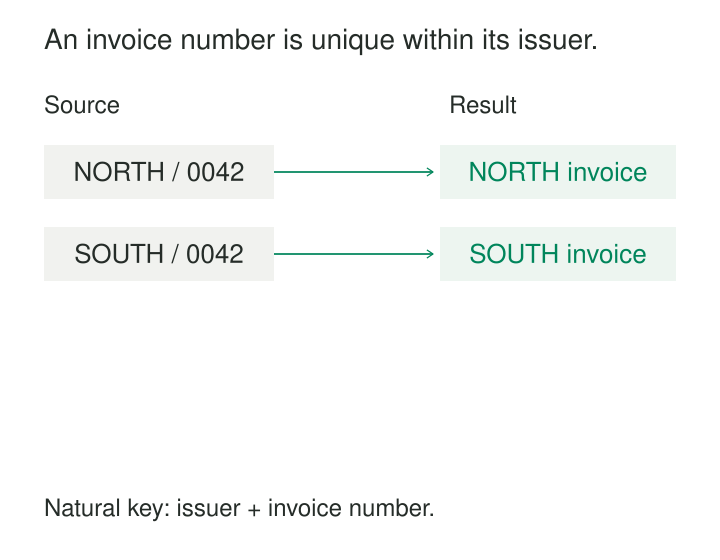

A payment arrives with the reference “0042.” The accounts team searches its invoice table and finds two matches: one from North Supplies and another from South Services. Both invoices are valid. The mistake was treating an invoice number as globally unique.

Natural keys connect records to identifiers already recognized by the business or an external authority. Used well, they make reconciliation, lookup, and data exchange straightforward. Their reliability depends on understanding exactly what the identifier identifies, who assigns it, and where its uniqueness holds.

## Business identity and database identity

A **natural key** is an attribute, or combination of attributes, that identifies something under the rules of the domain. Examples include an ISBN, an employee number, or an invoice number together with its issuer.

“Natural” does not mean unassigned or descriptive. An identifier can be generated automatically and still function as a business identifier. Its significance comes from its established role outside the particular table being designed.

A **surrogate key** is introduced to identify records independently of those business attributes. A database might assign invoice row `82716` while retaining the business identity `(NORTH, 0042)`.

This distinction is separate from the choice of **primary key**. A natural key can be the primary key, or it can be an alternate key protected by uniqueness constraints while a surrogate serves as the primary key.

The practical pattern is to recognize and preserve the business identity, then decide whether it is also suitable for internal references.



## Example: an invoice number needs its scope

Consider these illustrative invoice headers:

| Issuer code | Invoice number | Issue date |
|---|---|---|
| `NORTH` | `0042` | 2026-10-01 |
| `SOUTH` | `0042` | 2026-10-02 |

Neither column alone identifies an invoice. Under the assumed rule that each issuer assigns a number only once, the combination does.

A database can express that rule directly:

```sql
CREATE TABLE invoice (
    issuer_code    text NOT NULL,
    invoice_number text NOT NULL,
    PRIMARY KEY (issuer_code, invoice_number)
);
```

The composite primary key requires both values and rejects duplicate combinations. PostgreSQL supports primary keys spanning multiple columns; foreign keys can reference those combinations to maintain relationships between tables. [PostgreSQL: Constraints](https://www.postgresql.org/docs/current/ddl-constraints.html)

A payment referencing an invoice must carry both components, or resolve them through an authoritative mapping before linking.

The assumption matters more than the syntax. If an issuer restarts numbering for each invoice series or financial year, the key needs that additional scope. If the table contains invoice lines, the invoice identity alone cannot identify each row; a line identifier is also required.

Adding arbitrary columns until duplicates disappear does not establish a trustworthy key. The combination must reflect an actual identity rule.

## Uniqueness must be a rule, not an observation

A column containing no duplicates today is only a candidate for investigation.

For a natural key to identify records correctly, several conditions must hold.

**The identity boundary must be clear.** A customer account, a person, and a household are different things. An identifier unique to accounts cannot automatically establish person identity.

**Every identified record needs a complete key.** A missing component leaves the identity unresolved. In PostgreSQL, a plain unique constraint permits multiple nulls by default, so uniqueness alone does not establish a complete candidate key. [PostgreSQL: Unique Constraints](https://www.postgresql.org/docs/current/ddl-constraints.html#DDL-CONSTRAINTS-UNIQUE-CONSTRAINTS)

**Equality needs an agreed interpretation.** Leading zeros, punctuation, case, and whitespace may or may not matter. Store `0042` as text when those zeros belong to the identifier. Normalize according to the issuing authority’s rules rather than applying a convenient cleanup to every source.

**The assignment policy must cover time.** A number that is unique among active records may have belonged to someone else previously. Historical matching then needs assignment dates or another way to distinguish separate uses.

A natural candidate key is also minimal: removing any component would destroy its identifying power. Extra attributes such as a customer’s current address usually make a key more fragile without improving its meaning.

## A real implementation: ISBN identifies a publication product

ISBN provides a widely used example of a governed business identifier. Publishers, booksellers, libraries, and distributors use it to order publications, manage stock, and exchange catalog information. [International ISBN Agency: About ISBN](https://grp.isbn-international.org/content/about-isbn/349)

Its identity boundary is specific. Different editions, language editions, and publication formats require separate ISBNs. A paperback and a hardback of the same text therefore have different identifiers. Two physical copies of that paperback share an ISBN.

For a catalog, ISBN is a useful natural lookup key for the publication product. For a library’s individual copy records, it is insufficient: each copy needs its own identity.

The assignment rules also distinguish continuity from change. An unchanged reprint retains its ISBN; a substantially revised edition requires a new one. An ISBN belonging to an out-of-print publication must not be reassigned to a different publication. [International ISBN Agency: ISBN Assignment](https://www.isbn-international.org/node/88)

Even this governed scheme needs careful modeling. Joint publications can carry ISBNs assigned by both publishers. A catalog may therefore need an identifier table connecting several ISBNs to a publication record, rather than assuming one ISBN column captures every valid relationship.

The identifier works because its scope and assignment rules are maintained—not merely because its format looks distinctive.

## Example: an employee number changes

Suppose a person joins a company as employee `E-104`, leaves, and later returns as `E-889`.

If the analytical question concerns employment episodes, these identifiers may correctly distinguish two separate episodes. If the question concerns the person’s complete history, treating them as unrelated people loses continuity.

An illustrative mapping could retain:

| Source employee number | Employment episode | Durable person identity |
|---|---|---|
| `E-104` | First employment | `P-73` |
| `E-889` | Rehire | `P-73` |

The mapping requires authoritative evidence that both assignments concern the same person. Similar names or contact details do not establish that relationship.

Kimball describes this general problem: operational natural keys can change under business rules outside the warehouse’s control. A separate durable identity can preserve continuity across those changes. [Kimball Group: Natural, Durable, and Supernatural Keys](https://www.kimballgroup.com/data-warehouse-business-intelligence-resources/kimball-techniques/dimensional-modeling-techniques/natural-durable-supernatural-key/)

If an old employee number is later assigned to another person, the mapping must also preserve assignment intervals. Otherwise, a historical event carrying that number could be linked to its current holder.

## The benefits and the operating bill

Natural keys are especially useful when records arrive from external partners, people reconcile data against documents, or repeated imports need to recognize an existing business object.

They make discrepancies inspectable. “Invoice NORTH/0042 already exists” is often more useful than an unexplained collision between internal row identifiers.

The cost is dependence on assignment rules that may change. Corrections, reorganizations, system migrations, and identifier reuse can require mapping maintenance and updates to references. If a natural primary key changes, dependent relationships need coordinated handling.

Wide strings and composite keys can also enlarge indexes and repeated foreign-key columns. The performance effect depends on the database and workload, but reference width is a legitimate design consideration.

A common compromise retains the natural key with appropriate constraints while using a compact surrogate for internal relationships. This preserves business uniqueness while reducing the spread of mutable identifiers.

## Common mistakes and limits

Email addresses, names, and postal addresses are tempting identifiers because people recognize them. They may change, be shared, or be reassigned. Their usefulness as search attributes does not automatically make them reliable keys.

Likewise, prefixing a source identifier with its source system prevents cross-system collisions but does not prove that records from different systems represent different entities. Identity resolution remains a separate task.

Hashing a proposed natural key changes its representation. It cannot repair missing scope, unstable assignment rules, or ambiguous equality.

Historical tables need particular care. Several versions of one entity may legitimately share the same natural business key. Their row identities must also distinguish the versions. Applying entity-level uniqueness to a table whose grain is “entity version” would reject valid history.

## Related patterns

[[data-declare-the-grain|Declare the Grain]] establishes what each key must identify: an entity, relationship, event, or version.

[[data-surrogate-keys|Surrogate Keys]] provides an independent identity for internal references while retaining business identifiers.

[[data-bounded-contexts|Bounded Contexts]] makes the scope of an identifier and its meaning explicit.

Durable identity is a neighboring concept: it preserves continuity when business identifiers change. [[data-identity-crosswalks|Identity Crosswalks]] maintains explicit links when several source identifiers refer to the same entity.
