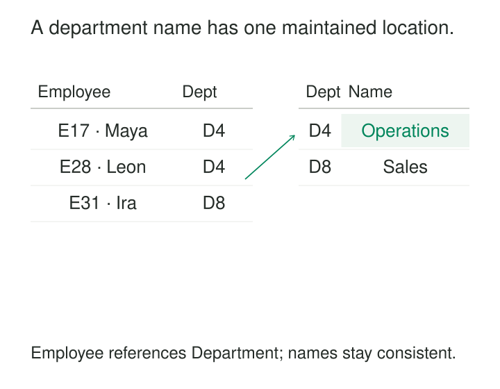

A department changes its name from “Operations” to “Service Operations.” The employee table contains the department name beside every employee. Most rows are updated, a few are missed, and reports now show two departments where the organization recognizes one.

Normalized Relations organizes data so that facts depend on the appropriate identifiers and can be maintained without repeatedly updating unrelated records. It reduces the opportunities for contradictory copies, accidental information loss, and awkward insertions.

The central question is: **what determines this fact, and where should that dependency be represented?**

## Follow the dependencies

A **functional dependency** describes a rule: whenever two rows agree on one set of attributes, they must agree on another.

For a simple model of current employment:

- `employee_id → employee_name, department_id`
- `department_id → department_name`

The first rule says an employee identifier determines one current name and department assignment. The second says a department identifier determines one current department name.

These are business assumptions. A sample containing no contradictions cannot prove that they always hold. University of Wisconsin’s normalization material explicitly distinguishes dependencies established by application semantics from patterns merely observed in existing rows. [University of Wisconsin: Schema Normalization](https://pages.cs.wisc.edu/~paris/cs564-f15/lectures/lecture-04.pdf)

Normalization uses these dependencies to place attributes in suitable relations—the logical structures commonly implemented as database tables.

Repeated identifiers are often necessary references. Repeated department names are different: they duplicate a fact that belongs to the department.

## Example: let departments exist independently of employees

The mixed relation contains:

| Employee ID | Employee name | Department ID | Department name |
|---|---|---|---|
| `E17` | Maya | `D4` | Operations |
| `E28` | Leon | `D4` | Operations |
| `E31` | Ira | `D8` | Sales |

Its structure creates three familiar anomalies.

An **update anomaly** occurs when renaming `D4` requires changing several employee rows. An **insertion anomaly** appears when a new department cannot be recorded without inventing an employee. A **deletion anomaly** appears when deleting Ira’s row also removes the only recorded definition of department `D8`.

Separate the relations:

`Employee(employee_id, employee_name, department_id)`

`Department(department_id, department_name)`

Each employee references a department. Renaming `D4` changes one department row. Departments can be created before hiring anyone, and deleting an employee no longer deletes their department’s definition.

This removes a dependency between two maintenance operations that should be independent. Microsoft’s database-design guidance describes normalization as a way to divide information appropriately and avoid redundant, inconsistent storage. [Microsoft: Database Design Basics](https://support.microsoft.com/en-us/access/database-design-basics)

Existing contradictions still need reconciliation. If two rows already give `D4` different names, splitting the table does not establish which name is correct.

## Example: some facts depend on a whole pair

A supplier catalog combines supplier details, part details, and an offered price:

| Supplier ID | Supplier name | Part ID | Part name | Price, USD per unit |
|---|---|---|---|---:|
| `S1` | North Supply | `P7` | M8 bolt | 0.12 |
| `S1` | North Supply | `P9` | M8 washer | 0.04 |
| `S2` | Harbor Parts | `P7` | M8 bolt | 0.11 |

Assume there is one current offer per supplier–part pair, with a fixed currency and quantity basis.

The dependencies differ:

`Supplier ID` determines the supplier name. `Part ID` determines the part name. The **combination** of supplier and part determines the offered price.

A suitable decomposition is:

`Supplier(supplier_id, supplier_name)`

`Part(part_id, part_name)`

`Offer(supplier_id, part_id, unit_price)`

The offer’s composite key preserves the relationship. Supplier names no longer repeat across all their offers, and part names no longer repeat across suppliers.

The assumptions must match reality. If prices vary by quantity tier, currency, contract, or effective period, the offer’s identifying context must include those distinctions. Normalization cannot repair a grain that combines several legitimate offers into one supposed row.

## Splitting must preserve the information

More tables do not automatically mean a better design.

A decomposition should be **lossless**: projecting a valid original relation into its components and joining them back should recover exactly the original information, without invented combinations.

In the employee example, the shared `department_id` identifies one Department row. Joining each Employee row to that unique department reconstructs its department name without multiplying employees.

A split that discards the relationship between employees and departments cannot recover it merely because both sets of records still exist.

A second objective is **dependency preservation**: the important dependencies should remain enforceable through constraints on the component relations, without repeatedly joining them to check compliance. These are separate design criteria, emphasized in relational normalization theory. [Stony Brook University: Relational Normalization Theory](https://www3.cs.stonybrook.edu/~kifer/Courses/cse532/slides/ch6.pdf)

Normal forms formalize the checks. **Boyce–Codd normal form (BCNF)** requires every determinant of a non-trivial functional dependency to identify the whole row. **Third normal form (3NF)** permits an additional case when the dependent attribute belongs to a candidate key.

A lossless, dependency-preserving 3NF design is sometimes preferable to a BCNF decomposition that makes dependencies harder to enforce. The checks concern all candidate keys and dependencies, not just the chosen primary key. [University of Wisconsin: Schema Normalization](https://pages.cs.wisc.edu/~paris/cs564-f15/lectures/lecture-04.pdf)

## A deployed example: PostgreSQL’s catalogs

PostgreSQL’s internal catalogs provide a concrete example of separating related facts.

The `pg_type` catalog maintains data-type information, including a type’s identifier and name. The `pg_attribute` catalog describes columns and references their types through `atttypid`. Multiple columns can therefore refer to the same type definition. [PostgreSQL: pg_type](https://www.postgresql.org/docs/18/catalog-pg-type.html), [PostgreSQL: pg_attribute](https://www.postgresql.org/docs/18/catalog-pg-attribute.html)

This illustrates the underlying mechanism: keep a shared definition under its identifier and reference it from dependent records.

The implementation also demonstrates a practical qualification. PostgreSQL documents several type properties copied into `pg_attribute`, including type length and pass-by-value information. Its physical design includes deliberate redundancy; the catalogs are not an assertion that every useful implementation must eliminate every repeated value.

Normalization supplies a disciplined baseline from which such exceptions can be understood.

## Constraints make the structure dependable

The employee decomposition assumes each employee has one current department and each department identifier has one current name. Historical assignments or simultaneous memberships require a different model.

Primary or unique constraints establish identifying combinations. Foreign keys prevent references to nonexistent parent rows, and appropriate non-null constraints make required relationships complete. PostgreSQL documents these as distinct mechanisms for enforcing database integrity. [PostgreSQL: Constraints](https://www.postgresql.org/docs/current/ddl-constraints.html)

The structure still needs meaningful identifiers, consistent attribute definitions, and transactions for changes that must succeed together.

Adding a surrogate row ID does not remove an existing dependency between department ID and department name. Likewise, moving every attribute into its own table can add joins without removing a problematic dependency.

## Where normalization earns its cost

Normalized relations are especially useful for mutable operational data, shared reference data, and systems where independent facts must be inserted, updated, or deleted reliably.

They can reduce repeated storage and simplify corrections. Their operating costs include more joins, indexes, constraints, migrations, and coordination across tables. Read-heavy workloads may benefit from views, materialized projections, or deliberately denormalized serving models.

Those projections need explicit refresh and ownership rules so that duplicated values remain controlled.

Time also changes the meaning of repetition. An invoice’s agreed price is a transaction fact; replacing it with today’s catalog price would change the record’s meaning. Similarly, historical department reporting needs historical assignments and names, not merely a join to the current department table.

Normalization does not choose correct business definitions, settle conflicting sources, or guarantee fast queries. Its contribution is narrower and valuable: it exposes dependencies and reduces anomalies caused by storing dependent facts in inappropriate places.

## Related patterns

[[data-declare-the-grain|Declare the Grain]] establishes what each relation represents.

[[data-composite-keys|Composite Keys]] identifies facts determined by a combination of attributes.

[[data-separate-definitions-from-instances|Separate Definitions from Instances]] separates shared descriptions from the records that reference them.

When several sources disagree, [[data-golden-records|Golden Records]] selects a governed profile. Normalization determines where independently maintained facts belong; it does not require a golden-record process for every relation.
