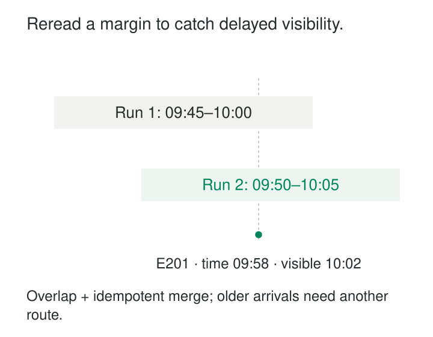

An extraction finishes at 10:00 and saves that time as its progress boundary. Two minutes later, a record becomes visible with a source timestamp of 09:58.

The next run asks for records timestamped after 10:00. It never sees the delayed record.

[[data-overlapping-extraction-windows|Overlapping Extraction Windows]] deliberately rereads a bounded interval before the previous successful boundary. Records already loaded appear again, while records that became visible late get another opportunity to arrive.

The pattern trades repeated reading for greater tolerance of delayed visibility, timestamp boundaries, and limited disorder. It works only when repeated input can be applied safely—and when the delay remains within the coverage provided by the lookback.

## Move the boundary, but reread behind it

A simple design uses three values:

- **W:** the previous successfully processed upper boundary.
- **L:** the lookback duration.
- **U:** the upper boundary chosen for the next run.

The next extraction reads **`[W − L, U)`**: include the lower boundary and exclude the upper boundary.

For example, with W at 10:00, a ten-minute lookback, and U at 10:05, the next run reads timestamps from 09:50 through, but excluding, 10:05.

```sql
WHERE source_updated_at >= :previous_upper_minus_lookback
  AND source_updated_at <  :this_run_upper
```

The upper boundary remains fixed while that run retrieves its pages. Only after the required data is durably accepted does the saved boundary advance to U.

Airbyte provides a documented implementation mechanism: its datetime-based cursor supports a configurable `lookback_window` that extends reading backward. [Airbyte: Lookback Windows](https://docs.airbyte.com/platform/connector-development/config-based/understanding-the-yaml-file/incremental-syncs#lookback-windows)



## Example: recover a record that appeared late

An event source contains these records:

| Event | Source timestamp | First visible to extraction | Amount |
|---|---|---|---:|
| E-200 | 09:56 | 09:57 | 60 |
| E-201 | 09:58 | 10:02 | 80 |
| E-202 | 10:03 | 10:03 | 25 |

The run ending at 10:00 loads E-200. E-201 is not yet visible.

The next run reads `[09:50,10:05)`. It receives E-200 again, plus E-201 and E-202.

With stable event identity, E-200’s repeated delivery has no additional business effect. The destination ends with three events totaling 165. Blindly appending all returned rows would instead count E-200 twice and produce 225.

The overlap is therefore only half the pattern. The other half is safe application of repeated records.

For immutable events, deduplication normally follows source event identity. Similar-looking payloads are not sufficient evidence of duplication: two legitimate events can have the same timestamp and amount.

## Example: an order changes inside the overlap

An order already stored as O-17 has an amount of 100. The source corrects it to 120, and the next overlapping extraction returns the updated row.

The destination should update O-17’s existing representation. It should not create another order merely because the record arrived in another run.

This differs from immutable-event deduplication. Deduplicating every record solely by order ID and keeping the first occurrence would discard the correction.

A current-state merge needs identity plus a rule for determining which version wins. That might use an authoritative source version or another documented ordering mechanism. Arrival order alone is unsafe when an older page can be replayed after a newer extraction.

If several versions of O-17 appear in one batch, the merge input may need to select the latest valid version first. dbt’s guidance discusses widening incremental filters for late arrivals, choosing the latest change per identity before merging, and using a unique key to update existing rows. [dbt: Incremental Models and Late Changes](https://docs.getdbt.com/best-practices/how-we-handle-cdc/2-choosing-incremental-or-snapshots)

A timestamp may not distinguish revisions made within the same clock tick. The source contract must resolve that ambiguity where correctness depends on version order.

## Boundary overlap is a real API behavior

Zendesk’s time-based incremental exports deliberately repeat records at page boundaries so items sharing a timestamp are not skipped. Its documentation explains that returned data can contain duplicates and gives resource-specific identity fields for recognizing them.

It also instructs clients to continue from the source-provided `end_time`, avoiding gaps between exports. [Zendesk: Time-Based Incremental Exports](https://developer.zendesk.com/documentation/api-basics/working-with-data/using-the-incremental-export-api/#time-based-incremental-exports)

This is a small boundary overlap rather than necessarily a long lookback, but the underlying tradeoff is the same: repeated delivery is preferable to silently losing records.

For a provider-managed API, follow its boundary and cursor rules. Do not subtract time from an opaque continuation token or assume that a locally chosen window can replace the provider’s synchronization protocol.

## Choose the right clock

Three timestamps can describe different things:

**Business event time** says when an activity occurred. **Source modification time** says when its stored representation changed. **Availability or loading time** says when the extraction system could observe it.

The lookback must operate on the field whose behavior the pipeline actually relies on.

A sale occurring in January but first uploaded in March will not be recovered by a two-day January-event-time lookback in March. If its modification or loading timestamp reliably advances in March, filtering on that field may capture it immediately.

Conversely, a source can assign `updated_at` before commit or before a search index exposes the record. That creates the delayed-visibility problem shown earlier.

Null timestamps, timestamps that fail to advance, and edits arbitrarily backdated beyond the lookback require another detection mechanism. Repeating a time filter cannot recover changes the filter never selects.

## Size the lookback around observed delay

The useful measurement is the gap between a record’s selected cursor timestamp and when extraction can first retrieve it.

Account for replication or indexing delays, long transactions, clock differences, polling intervals, extraction duration, and retries. Polling timing matters: a record must become visible before the last read whose window still includes its timestamp.

A ten-minute lookback is not a ten-minute completeness guarantee unless the source and scheduling assumptions support that guarantee.

Measure the delay distribution and investigate its long tail. A chosen percentile expresses a reliability tradeoff; it does not prove that later arrivals cannot occur.

For sources with occasional very late corrections, a practical design combines frequent narrow overlaps with broader periodic reconciliation or targeted backfills. Where missed mutations are unacceptable, a durable change feed may provide a stronger foundation.

## Preserve progress through failures

The lower boundary should normally derive from the last successful W, not simply from the current time.

Suppose a job is unavailable for six hours. Restarting with “now minus ten minutes” would discard almost the entire outage interval. Starting from W minus the lookback retains that unprocessed coverage.

Do not advance W because some pages succeeded or because one record has a particularly large timestamp. Save progress only after the run’s required coverage is durably accepted. Retries can then reread safely rather than skip unfinished work.

Hard deletes remain a limitation. Once a row disappears, a timestamp query over current rows cannot return it. Deletion records, soft-delete markers, change capture, or authoritative snapshot comparison are needed.

## The recurring cost is deliberate rereading

For uniformly distributed changes, a five-minute schedule with a ten-minute lookback selects roughly fifteen minutes of data per successful run: about three times the newly covered interval.

That estimate describes selected data, not necessarily physical scan cost. An unsuitable index or partition layout can make every run scan much more.

Costs include source reads, network transfer, staging storage, deduplication, merges, and downstream recomputation. Reapplying overlapping rows to an additive aggregate without correcting prior contributions can corrupt totals even when the detail table is deduplicated.

The pattern is useful for timestamp-based APIs, eventual source visibility, and incremental models with manageable late-arrival tails. It is a bounded recovery allowance, not a substitute for source history or a coherent snapshot.

## Related patterns

Field-based incremental extraction supplies the saved upper cursor that overlap deliberately revisits. This cursor is not an event-time **Watermark** or a guarantee that all earlier source changes have become visible.

[[data-idempotent-writes|Idempotent Writes]] makes repeated destination effects safe; [[data-transactional-inbox|Transactional Inbox]] coordinates consumption with a business update when delivery is message-based.

[[data-half-open-time-intervals|Half-Open Time Intervals]] makes window endpoints explicit while allowing intentional overlap between runs.

[[data-historical-restatement|Historical Restatement]] repairs periods beyond the routine lookback when later evidence changes their results.
