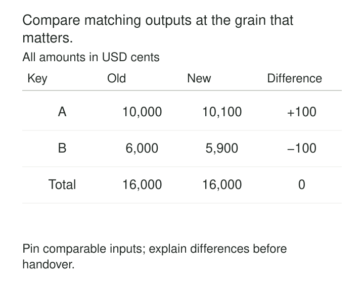

The replacement pipeline finishes successfully. It produces the same number of rows as the existing pipeline, and the grand total matches exactly.

Yet two customers receive different balances. One is 100 cents too high; the other is 100 cents too low. The errors cancel in the total.

**Parallel-Run Comparison checks whether two implementations produce corresponding business results under matched conditions.** It turns “the new system looks right” into reproducible evidence about agreement, differences, and untested cases.

The pattern is useful when replacing an engine, rewriting transformations, migrating storage, or changing business logic while preserving selected behavior.

## Compare a defined result

The mechanism is straightforward: run both implementations, retain their outputs, match corresponding results, and classify differences against explicit rules.

The difficult part is deciding what “corresponding” and “equivalent” mean.

Two customer tables might use different surrogate keys while representing the same customers. Two queries might return identical rows in different orders. A streaming system might publish several revisions before reaching the result another system publishes once.

The comparison needs a stated contract: the population, grain, matching keys, fields, timing boundary, and permitted differences.

A shadow pipeline is one way to obtain paired outputs. Controlled replays and separately scheduled batch runs also work. The executions need comparable conditions; they do not necessarily need to start at the same wall-clock instant.

## Establish what each run processed

Before interpreting a difference, establish that both runs had equivalent inputs and relevant state.

For batch processing, that may mean the same immutable file manifest or database snapshot. For streaming, it may mean corresponding source positions and sufficient history to initialize state.

Reference-data versions, timezone rules, configuration, and externally resolved values also matter. Comparing yesterday’s exchange-rate lookup with today’s introduces a different experiment from comparing two calculation engines.

Record these conditions alongside the code versions and output identifiers. Otherwise, a mismatch may be impossible to reproduce.

If the comparison deliberately changes a dependency, identify that change explicitly. “Same source table” is insufficient when the table changes between reads.

## Example: equal totals conceal misallocation

Consider a billing transformation producing one row per customer and billing period. Both implementations process the same snapshot, with amounts expressed in USD cents.

| Customer | Existing result | Candidate result | Candidate minus existing |
|---|---:|---:|---:|
| A | 10,000 | 10,100 | +100 |
| B | 6,000 | 5,900 | −100 |
| **Total** | **16,000** | **16,000** | **0** |

Row counts and totals agree. Customer-level results do not.

The comparator first checks that `(customer_id, billing_period)` uniquely identifies each result. It then matches records using that key and compares amounts exactly.

Checking uniqueness before joining is essential. Duplicate keys can multiply joined rows and make the comparison itself misleading.

The same principle applies beyond billing: matching total inventory can conceal stock assigned to the wrong warehouse, and matching total orders can conceal records assigned to the wrong day.

## Compare from coverage down to values

A useful comparison examines several layers:

| Layer | Question |
|---|---|
| Population | Did both runs process the intended inputs? |
| Coverage | Which business keys appear only on one side? |
| Grain | Are keys unique, and are duplicate frequencies correct? |
| Values | Do corresponding fields agree under their comparison rules? |
| Behavior | Do important downstream queries or decisions agree? |

An inner join alone misses records absent from either side. A full outer comparison can expose these gaps, provided the matching keys are valid.

Preserve duplicates when duplicates affect meaning. SQL set operations can silently remove them: PostgreSQL’s `EXCEPT` eliminates duplicates, while `EXCEPT ALL` preserves multiplicity in the difference. Checking both directions is necessary when establishing equality. [PostgreSQL set operations](https://www.postgresql.org/docs/current/queries-union.html)

A practical implementation is the open-source Data Validation Tool in GoogleCloudPlatform’s repository. It supports schema checks, grouped aggregates, row comparisons, and custom-query validation. Its row comparisons require keys that uniquely identify results. The project explicitly states that it is not an officially supported Google product. [Data Validation Tool](https://github.com/GoogleCloudPlatform/professional-services-data-validator)

## Example: a streaming difference is still pending

Two implementations calculate purchase totals for the interval from 10:00 to 10:10.

At 10:11, the existing implementation reports 900 and the candidate reports 850. The candidate is behind and has not processed the purchase contributing the remaining 50.

Calling this a calculation defect would confuse progress with correctness.

The comparison instead records source progress and compares corresponding results after both implementations have processed the agreed boundary. If late events can revise the interval, the comparison must also identify which correction boundary or result revision is being evaluated.

Waiting cannot continue indefinitely. A deadline separates “still pending” from “failed to produce a comparable result within the required time.”

AWS Database Migration Service illustrates this distinction in replication validation. It reports pending, mismatched, suspended, and validated states separately, and notes that continually changing records may be impossible to compare. An inability to validate is therefore visible rather than treated as agreement. [AWS DMS data validation](https://docs.aws.amazon.com/dms/latest/userguide/CHAP_Validating.html)

## Example: the candidate intentionally changes a definition

A business changes “active customer” from “purchased within 30 days” to “purchased within 90 days.”

Exact agreement is expected for some outputs, but not for the active-customer flag. A customer whose last purchase was 45 days ago should change classification.

The comparison separates unchanged obligations from intentional differences. Customer identity, purchase history, and unrelated measures should still agree. The changed classification is checked against independently specified examples and the new definition.

Simply excluding every differing flag would discard the evidence needed to validate the change.

The existing implementation provides a baseline, not an oracle. Both systems can share a defect. Business invariants, independent fixtures, and source reconciliation remain necessary.

## Define tolerances without erasing meaning

Exact comparison suits identifiers, categories, counts, and amounts represented in agreed integer minor units.

Floating-point calculations may require numerical tolerances. Define absolute and relative tolerances deliberately: relative tolerance scales with magnitude, while an absolute tolerance matters near zero. Python’s `math.isclose` documents this combined approach. [Python numerical comparison](https://docs.python.org/3/library/math.html#math.isclose)

Handle nulls explicitly. A missing value and zero may produce similar downstream totals while conveying different information.

Normalization also changes what the comparison can detect. Trimming whitespace, changing case, or rounding values may be appropriate for a particular contract, but can conceal defects when those differences matter. Inspect comparison-tool defaults; DVT documents normalization operations in its hash-based validation. [DVT comparison logic](https://github.com/GoogleCloudPlatform/professional-services-data-validator#validation-logic)

A matching hash is evidence about the encoded values. It cannot recover distinctions removed before hashing.

## Report the cases that could not be compared

Suppose 1,000 customer-period results were expected. Of these, 990 matched and ten candidate results were unavailable.

Reporting “100% agreement” over the available pairs hides incomplete coverage.

Keep separate counts for matching results, unexplained differences, approved intentional differences, missing outputs, and comparison errors. Retain enough lineage to investigate representative discrepancies.

Segment results by meaningful populations. A high overall agreement rate can conceal systematic failure for a small region, unusual product type, or late-arriving records.

Acceptance criteria should precede the final review. They should identify mandatory invariants, tolerated differences, required coverage, and who resolves unexplained cases.

## Pay for evidence proportionate to the change

Parallel runs add execution, storage, query, and investigation costs. Comparison queries themselves can burden both systems; AWS DMS explicitly documents additional source, target, and network consumption during validation. [AWS DMS validation costs](https://docs.aws.amazon.com/dms/latest/userguide/CHAP_Validating.html)

Grouped checks and hashes can narrow investigations, but do not replace appropriate detailed comparison. Sampling reduces cost while limiting conclusions about rare cases.

Cover representative operating conditions, including relevant period boundaries, corrections, and recovery behavior. Agreement on one quiet day establishes little about month-end processing.

Passing comparison supports a release decision. It does not automatically establish full-load performance, safe publication, or rollback readiness.

## Related patterns

[[data-shadow-pipelines|Shadow Pipelines]] provide an execution arrangement for collecting candidate results without making them authoritative.

[[data-source-to-target-reconciliation|Source-to-Target Reconciliation]] supplies complementary checks that outputs preserve the intended source population and measures.

[[data-segmented-quality-checks|Segmented Quality Checks]] reveal differences concentrated in populations that overall agreement rates conceal.

[[data-publication-quality-gates|Publication Quality Gates]] use comparison evidence, together with other required checks, to decide whether a candidate release may become visible.
