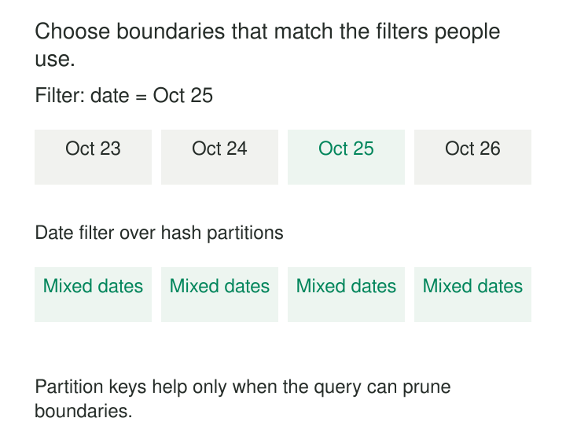

An events table is neatly divided into thousands of partitions by customer identifier. Yet the most common dashboard asks for activity during the last three days across every customer. Each refresh still touches nearly the entire layout.

Elsewhere, a service partitions incoming requests by date. Almost every write lands on today’s key, creating a bottleneck while older partitions sit idle.

Both layouts look organized. Neither matches the work being performed.

**Choose partition boundaries from the queries, writes, and lifecycle operations the system must serve.**

A useful partitioning scheme lets common operations locate a limited portion of the data while distributing load and keeping maintenance manageable. The best key depends on the workload, not simply on which column looks important in the business model.

## Connect predicates to physical work

Partitioning divides data into groups that an engine can locate, skip, distribute, or manage separately.

In analytical storage, the benefit often comes from *partition pruning*: a date predicate allows the engine to exclude unrelated dates before scanning their data. In an operational store, a partition key may route a request to a particular item collection or storage location.

These mechanisms differ across products. A warehouse partition, a hash bucket, and a distributed database partition are not interchangeable configuration units. They share a design question:

> Given this operation, how does the system determine which data could contain its answer?

A date filter cannot ordinarily identify an event-ID hash bucket. An equality lookup on a known identifier may route efficiently through that same hash scheme.



Partitioning changes storage and access behavior. It does not change what a row means or eliminate the need for keys and integrity rules.

## Begin with recurring operations

Look at actual predicates, query frequency, latency requirements, write distribution, and retention behavior.

“Find one tenant’s recent orders” suggests a different layout from “aggregate yesterday’s orders across all tenants.” A monthly rebuild and daily expiration policy may favor boundaries that point lookups alone would not reveal.

The important properties include:

- **Selectivity:** Can common predicates exclude most partitions?
- **Distribution:** Will a few values receive most writes or reads?
- **Granularity:** Will partitions contain useful amounts of data?
- **Maintenance scope:** Can repairs, replacements, and expiration operate on bounded groups?

One layout rarely optimizes every access path. Clustering, indexes, or derived serving tables may complement a partition key instead of forcing every requirement into it.

## Example: date partitions for time-bounded analytics

A usage table retains thirty days of events. Most reports aggregate the last three complete UTC days across all tenants.

Partitioning by `event_date` aligns storage boundaries with that recurring restriction:

```sql
SELECT tenant_id, SUM(event_count)
FROM usage_events
WHERE event_date >= DATE '2026-10-23'
  AND event_date <  DATE '2026-10-26'
GROUP BY tenant_id;
```

If the days contain similar volumes, the date restriction selects roughly one-tenth of the retained daily partitions. Actual bytes scanned and runtime also depend on selected columns, compression, clustering, and execution overhead.

BigQuery supports pruning through filters on a table’s partitioning column. Its documentation recommends predicates that let the engine determine eligible partitions without reading table data, and provides dry runs for checking pruning behavior. [BigQuery: Query partitioned tables](https://docs.cloud.google.com/bigquery/docs/querying-partitioned-tables)

Tenant-specific queries can use an additional mechanism. BigQuery allows clustering within partitions, which can narrow the blocks read after date pruning. Creating a separate partition for every tenant-date combination would often introduce unnecessary fragmentation. [BigQuery: Partitioned tables](https://docs.cloud.google.com/bigquery/docs/partitioned-tables)

The date choice also supports bounded operations such as rebuilding one day or expiring old data. Those benefits matter even when some queries scan a wider interval.

## Example: tenant history with a partition key and sort key

An operational service frequently retrieves one tenant’s events over a time range.

An illustrative DynamoDB design uses the tenant as the partition key and a timestamp plus event identifier as the sort key:

| Partition key | Sort key | Event |
|---|---|---|
| `TENANT#T7` | `2026-10-25T09:00:00Z#E901` | Order created |
| `TENANT#T7` | `2026-10-25T09:05:00Z#E902` | Order updated |
| `TENANT#T8` | `2026-10-25T09:02:00Z#E903` | Order created |

The application knows T7 and the requested interval. It can address that tenant’s collection and constrain the sort-key range.

DynamoDB’s `Query` operation requires equality on the partition key and optionally permits conditions on the sort key. This makes key design part of the query interface, rather than merely a storage optimization. Timestamp strings also need a consistent sortable representation. [DynamoDB: Key condition expressions](https://docs.aws.amazon.com/amazondynamodb/latest/developerguide/Query.KeyConditionExpressions.html)

A query for all tenants’ activity yesterday needs another access path or fan-out. The tenant key does not make that query local.

Skew introduces another tradeoff. One very busy tenant can concentrate requests. Adding a calculated shard suffix can spread its writes, but retrieving the tenant’s complete history may then require querying several keys and merging results.

AWS documents this exchange explicitly: write sharding increases distribution while adding read fan-out. [DynamoDB: Write sharding](https://docs.aws.amazon.com/amazondynamodb/latest/developerguide/bp-partition-key-sharding.html)

Logical key values define routing behavior; DynamoDB manages their physical placement.

## Example: evolve from monthly to daily partitions

A lakehouse logs table begins with modest volume. Monthly partitions keep the layout manageable, and most investigations cover several weeks.

Later, volume grows substantially and incident queries usually examine a few hours. Daily partitions become more useful, but rewriting years of history immediately would be expensive.

Apache Iceberg supports hidden partitioning: the table records a transform such as day-of-event-time, and compatible readers derive partition filters from predicates on the source column. Consumers can query `event_time` without manually maintaining a separate partition-date predicate. [Apache Iceberg: Hidden partitioning](https://iceberg.apache.org/docs/latest/partitioning/)

Iceberg also supports partition evolution. Old files retain their earlier specification, while new files use the revised layout; readers plan across both. Changing the specification does not eagerly rewrite existing files. [Apache Iceberg: Partition evolution](https://iceberg.apache.org/docs/latest/evolution/#partition-evolution)

This makes adaptation practical, but it does not give old monthly files daily granularity. Historical performance improves only when the relevant physical data is rewritten or another access mechanism helps.

## Keep pruning correct

Partition routing must never exclude valid answers.

If a writer derives `event_date` in UTC while a reader assumes local business dates, manually constructed partition filters can miss records around midnight.

Ingestion time and event time also differ. An event occurring October 25 may arrive October 27. Selecting only the October 25 ingestion partition would omit it from an event-date report.

Use the field whose meaning matches the workload. If an ingestion-partition filter supplements an event-time predicate, its bounds need a justified lateness contract or another completeness mechanism.

Hash-based routing similarly requires compatible hashing, encoding, and layout versions across writers and readers. Repartitioning needs a migration protocol so readers can find data in every relevant layout.

A partition filter is a performance restriction only when it remains logically safe.

## Pay for finer boundaries deliberately

More partitions can reduce data touched per query while increasing metadata, file counts, scheduling overhead, and maintenance work.

BigQuery specifically cautions that many small partitions increase metadata overhead and suggests considering clustering when partitions would contain relatively little data. Its approximate size guidance belongs to BigQuery, not every storage engine. [BigQuery: When to use partitioning](https://docs.cloud.google.com/bigquery/docs/partitioned-tables)

In file-based systems, highly granular keys combined with small writes can produce many tiny files. Updates spanning many partitions can also increase rewrite work and contention. In distributed stores, spreading writes can increase the number of requests needed for reads.

Measure representative workloads, including skew and concurrent activity. Compare bytes scanned, partitions or keys touched, request fan-out, write latency, maintenance effort, and tail latency. A partition count alone is not a performance result.

Small tables and unpredictable full-table scans may gain little from elaborate partitioning. Where access patterns diverge sharply, multiple maintained layouts can be more effective, at the cost of storage and synchronization.

[[data-declare-the-grain|Declare the Grain]] establishes row meaning before physical layout. [[data-partition-replacement|Partition Replacement]] uses boundaries for bounded rebuilds. [[data-aggregate-fact-tables|Aggregate Fact Tables]] provides another access path for recurring summaries. [[data-workload-isolation|Workload Isolation]] protects execution capacity when a good layout still receives competing demand.

The partition key earns its place when common operations can use it to avoid work—and the remaining write and maintenance costs stay acceptable.
