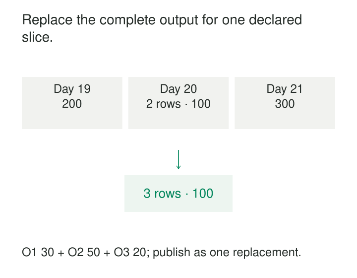

A daily orders dataset contains an incorrect amount, a missing order, and a record that should have been removed. Updating individual rows would require identifying every difference correctly.

The source can already produce the complete corrected day.

**Partition Replacement rebuilds a bounded slice of a dataset and replaces its existing contents with the complete new version.** Rows outside that scope remain intact. Within it, the replacement becomes authoritative—including the absence of records that no longer belong.

The pattern is useful when a complete slice is easier to calculate and verify than a sequence of individual changes.

## Declare the slice before replacing it

The replacement scope might be a day, an hour, a region, or a set of physical partitions. Its meaning must be precise.

For a table partitioned by business date, replacing October 20 means supplying every intended row for October 20. A batch containing only newly changed orders is insufficient: unchanged orders would disappear.

Conceptually, publication combines two sets:

- Existing rows outside the declared scope.
- Complete replacement rows inside the declared scope.

dbt describes this approach through its `insert_overwrite` strategy, which replaces affected partitions rather than matching individual records. See the [incremental strategy guide](https://docs.getdbt.com/docs/build/incremental-strategy).

Some engines also support predicate-based replacement independent of physical partition boundaries. Delta Lake’s [`replaceWhere`](https://docs.delta.io/delta-batch/#overwrite-rows-matching-a-predicate-with-replacewhere) atomically replaces rows matching a specified condition while retaining other rows.

The storage mechanism varies. The completeness requirement remains.



## A corrected day replaces all its records

Consider this illustrative October 20 partition:

| Order | Existing amount |
|---|---:|
| O1 | 30 EUR |
| O2 | 70 EUR |

The corrected source produces:

| Order | Replacement amount |
|---|---:|
| O1 | 30 EUR |
| O2 | 50 EUR |
| O3 | 20 EUR |

The replacement includes unchanged O1, corrected O2, and new O3. Publishing those three rows replaces the previous two-row partition.

Supplying only O2 and O3 would lose O1. Appending the replacement would duplicate existing orders.

Both versions total 100 EUR, which illustrates a limitation of validation by totals alone. Reconciliation should also consider identities, row counts, duplicates, and source completeness.

The partition grain and row grain are separate. “One partition per day” does not establish whether its rows represent orders, order lines, or events. The replacement must preserve the declared row grain unless the model itself is intentionally changing.

## Publish the replacement together

A robust implementation prepares the replacement before removing the published version.

It computes the complete slice against an identifiable source boundary, validates it, and commits the replacement through a transactional mechanism. Readers should not encounter a gap between deletion and insertion or a mixture of old and new files.

BigQuery documents partition replacement using a multi-statement transaction. With `@replace_day` supplied and the staging data already validated, a simplified example is:

```sql
BEGIN TRANSACTION;

DELETE FROM dataset.orders
WHERE business_date = @replace_day;

INSERT INTO dataset.orders (order_id, business_date, amount)
SELECT order_id, business_date, amount
FROM dataset.orders_replacement
WHERE business_date = @replace_day;

COMMIT TRANSACTION;
```

See [BigQuery’s partitioned-table DML examples](https://docs.cloud.google.com/bigquery/docs/using-dml-with-partitioned-tables#multi-statement_transaction).

Transactional table formats can publish through an atomic metadata commit instead. Apache Iceberg documents atomic overwrite operations in its [Spark write guidance](https://iceberg.apache.org/docs/latest/spark-writes/#insert-overwrite).

That guarantee applies to the supported table operation. It does not automatically coordinate several downstream tables, external exports, or manually copied object-storage files.

## A correction can leave a partition empty

Suppose a source event was assigned to October 20 but actually belongs to October 21. Rebuilding October 21 adds it there. October 20 must also be rebuilt to remove the old copy.

If that event was October 20’s only record, the correct replacement for October 20 is empty.

This exposes an important difference between replacement methods:

| Method | How it identifies scope | Empty-slice implication |
|---|---|---|
| Explicit scope | Predicate or supplied partition list | Can name a slice with zero replacement rows |
| Dynamic scope | Partition values present in incoming rows | An empty slice supplies no value to discover |

A dynamic overwrite may therefore leave stale data in a partition that should become empty.

Databricks explicitly documents different empty-input behavior among its selective overwrite operations: `REPLACE USING` and `REPLACE ON` do not delete rows for an empty source, while `REPLACE WHERE` can remove matching data. See [selective overwrite behavior](https://docs.databricks.com/aws/en/delta/selective-overwrite).

The pipeline needs an explicit distinction between “this slice is authoritatively empty” and “the extraction failed and returned nothing.” A declared scope, completion evidence, and expected-input checks help establish that distinction.

## A tenant delivery may be smaller than a physical partition

Imagine a table physically partitioned by date but containing several tenants. Tenant A supplies its complete October 20 export.

That delivery is complete for tenant A. It is incomplete for the entire date partition.

Overwriting the physical October 20 partition with only tenant A’s records would remove the other tenants. The pipeline must either reconstruct the whole physical partition or use a supported replacement predicate that includes both tenant and date.

The same problem appears with filtered logs, regional deliveries, and individual product feeds.

Scope validation needs two directions: every replacement row must belong inside the intended boundary, and the staged dataset must contain everything required within that boundary. A predicate check establishes the first condition; it cannot establish the second.

## Overwrite syntax needs explicit interpretation

An input query filtered to one day does not necessarily limit what the write removes.

Iceberg’s Spark documentation distinguishes static and dynamic overwrite behavior. In static mode, omitting the partition clause can replace all partitions even when the query returns only one day. Dynamic mode selects partitions represented in the query result. See [Iceberg overwrite behavior](https://iceberg.apache.org/docs/latest/spark-writes/#overwrite-behavior).

Dynamic scope also makes stray rows consequential. One incorrectly dated row can select an unintended partition for replacement. Delta Lake calls out this risk in its [dynamic partition overwrite guidance](https://docs.delta.io/delta-batch/).

Partition-layout changes can alter the physical scope of an overwrite. Date derivation, timezone interpretation, null partition values, and partition evolution therefore belong in the publication contract.

“Overwrite” is not a sufficiently precise description of the operation.

## Repeated publication needs freshness control

Replacing the same scope with the same complete logical contents can make retries straightforward. It does not prevent an older run from overwriting newer results.

Two workers might build October 20 from different source snapshots. Each replacement is complete relative to its snapshot, yet the slower, older run can publish last.

A dependable protocol records source versions and transformation versions, coordinates overlapping writers, and prevents stale publication. Progress checkpoints should advance only when the intended replacement is committed.

The input read may also extend beyond the output partition. A daily model using a seven-day window needs neighboring source days. Correcting one source day can affect several output partitions. Replacement handles publication; dependency analysis still determines what must be rebuilt.

## Trade detail-level work for bounded rebuilding

Partition replacement avoids identifying every row-level insertion, update, and deletion. It naturally removes obsolete records when the replacement scope is complete.

Its cost is rewriting unchanged data within that scope. Large partitions increase recomputation, staging storage, write volume, and recovery time. Very small partitions can create metadata and small-file overhead.

Retained table versions may support rollback, but recovery depends on the engine’s retention and cleanup policies. A previous partition is not recoverable merely because it once existed.

The pattern fits daily exports, corrected reporting periods, bounded backfills, and aggregates whose full slices are inexpensive to rebuild. Sparse changes across enormous partitions may favor keyed merge or another incremental strategy.

**Incremental Transformations** identifies the affected scope. [[data-manifest-based-file-ingestion|Manifest-Based File Ingestion]] supplies evidence that an input delivery is complete. [[data-deterministic-transformations|Deterministic Transformations]] makes rebuilding repeatable. [[data-historical-restatement|Historical Restatement]] governs publishing corrected periods.

The decisive promise is that the replacement contains the complete intended contents of exactly the slice being replaced.
