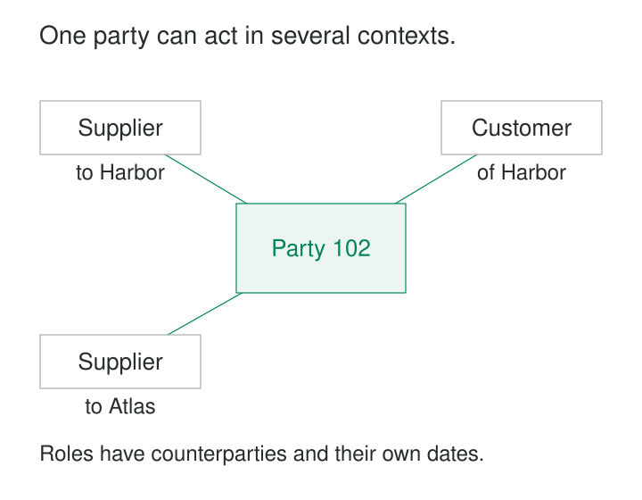

North Supplies sells equipment to Harbor Services. A few months later, it buys maintenance services from Harbor. The purchasing system calls North Supplies a supplier; the sales system calls it a customer. Each creates its own record, with separate names, addresses, and contacts.

Now a name change needs two updates. A report counts two organizations. Someone proposes a single `party_type` field, but North Supplies cannot fit into just one category.

**Party-Role Modeling separates who a person or organization is from how it participates in a particular business context.** One party can hold several roles, simultaneously or over time, without acquiring a new identity for each.

## Identity persists; participation varies

A **party** represents a person or organization recognized by the business. A **role** describes its participation: customer, supplier, employee, beneficiary, guarantor, or another defined responsibility.

A **role assignment** connects the party to that role in a context. It answers:

> Who participates, in what capacity, in relation to what, and when?

The context might be another organization, an account, a contract, a project, or a particular transaction. “Customer of Harbor” and “buyer on order O-42” are different claims, even when the same organization fills both roles.

Person and Organization can describe kinds of party. Customer and Supplier usually describe participation in business relationships. Ending a supplier relationship leaves the organization’s identity and its other relationships intact.

## Give each assignment a precise meaning

A practical model separates several concerns:

| Component | What it represents |
|---|---|
| Party | The person or organization |
| Role type | A defined capacity, such as supplier |
| Role assignment | A particular party holding that role |
| Context | The organization, agreement, account, or transaction involved |
| Effective period | When the assignment applies |

These are conceptual components; they do not require five universal tables. A purchase order with explicit `buyer_party_id` and `seller_party_id` fields can express the pattern directly. A workforce system may need a separate appointment entity because assignments have their own identifiers, dates, and attributes.

The important decision is the **grain of the assignment**. One row might mean “this organization is an approved supplier to Harbor under agreement A-17.” Another system might record only “this organization is classified as a supplier in our directory.”

Both can be useful. They support different conclusions. A directory classification alone does not establish an active agreement, eligibility for a purchase, or participation in a particular order.

Role-specific facts belong at the corresponding scope. A supplier account number belongs to the supplier relationship that issued it. A project contact belongs to that project assignment. Neither automatically describes the party everywhere.

## Example: one organization buys and sells

Return to North Supplies, represented by party `102`.

| Assignment | Party | Role | Counterparty | Agreement |
|---|---|---|---|---|
| R-17 | 102 | Supplier | Harbor | SUP-41 |
| R-18 | 102 | Customer | Harbor | CUST-08 |
| R-19 | 102 | Supplier | Atlas | SUP-73 |

Harbor’s purchasing team uses R-17. Its sales team uses R-18. Atlas’s supplier contact and commercial terms belong to R-19.

This allows North Supplies’ shared identity to remain consistent while each relationship retains its own details. Even where two assignments have the same role label, their terms may differ because the counterparties or agreements differ.

Apache OFBiz provides a verified implementation of the underlying separation. Its party management model supports people and groups, and its documentation explicitly allows a party to hold multiple roles, including customer, supplier, and employee. The example above illustrates a possible business design; it is not a transcription of the OFBiz schema. [Apache OFBiz: Parties and roles](https://cwiki.apache.org/confluence/pages/viewpage.action?pageId=62688497)

In analytics, these records represent three assignments and one participating organization. Counting role rows as parties would inflate the organization count.

## Example: a practitioner working at two clinics

A clinician works at Riverside Clinic on Mondays and at Hilltop Clinic on Thursdays. The telephone number, services offered, and availability differ.

Putting a single workplace and telephone number on the person loses information. Creating two unrelated person records makes identity maintenance harder.

A role assignment can capture each working context:

| Practitioner | Organization | Capacity | Contact |
|---|---|---|---|
| P-81 | Riverside Clinic | General practitioner | Riverside reception |
| P-81 | Hilltop Clinic | General practitioner | Hilltop reception |

HL7 FHIR’s `PractitionerRole` resource implements this distinction. It describes a practitioner’s roles, services, locations, and organizational context, with an applicable period. FHIR advises creating separate instances when details such as availability or contacts differ across locations or services. It also distinguishes qualifications from roles: having a qualification does not itself establish a role assignment. [HL7 FHIR R5: PractitionerRole](https://hl7.org/fhir/R5/practitionerrole.html)

The sample records above are illustrative. Their lesson is about scope: “contact this practitioner at Riverside” requires more information than the practitioner’s identity.

A reference to the assignment can preserve that context when a downstream record needs it.

## Example: buyer, recipient, and payer are different parties

A kindergarten orders toys. The kindergarten receives them, but the municipality settles the invoice.

A single `customer_id` cannot clearly express every responsibility. The transaction needs distinct participation roles:

| Transaction role | Party |
|---|---|
| Buyer | Kindergarten |
| Delivery recipient | Kindergarten |
| Accounting customer | Municipality |

One party fills two roles; another fills the settlement role. These assignments describe this transaction and should not automatically become permanent classifications of every party involved.

OASIS Universal Business Language explicitly distinguishes buyer, delivery party, and accounting customer. Its specification uses a kindergarten purchase paid for by a municipality to illustrate this separation. [OASIS UBL 2.3: Business parties and their roles](https://docs.oasis-open.org/ubl/os-UBL-2.3/UBL-2.3.html)

Here, explicit document fields may communicate the model more clearly than a generic role-assignment table.

## The assumptions that keep roles trustworthy

The pattern depends on reliable party identity. Two records with similar names are not necessarily the same organization. Combining roles requires justified identity matching, rather than treating the shared party table as proof.

Role definitions also need operational meaning. Does “customer” mean registered account holder, signed contracting party, or someone who purchased within the last year? An inferred classification and an explicitly approved assignment should remain distinguishable.

Context and direction must be unambiguous. “Supplier” needs a perspective: supplier to whom? References should identify existing parties and contexts. A generic pair such as `context_type` and `context_id` needs additional enforcement if ordinary foreign keys cannot validate it.

Time requires a documented convention. For example, an internal model might use inclusive starts and exclusive ends. Missing end dates must have a defined meaning, such as ongoing or unknown. Historical records should use the assignment applicable at the relevant business time.

Finally, uniqueness follows the assignment’s grain. A unique constraint on party and role alone would wrongly prevent the same supplier from working with several organizations. Where overlapping assignments are prohibited, that rule needs enforcement that remains correct under concurrent writes.

## Flexibility has a maintenance cost

Party-role models help when identities recur across departments, responsibilities overlap, or relationships change independently. They are especially useful in procurement, customer management, insurance, workforce systems, and transaction processing.

The costs include additional joins, role vocabulary maintenance, identity reconciliation, and historical queries. Indexes must support common paths through party, context, role, and effective period. Reporting often needs simplified views so routine questions do not require reconstructing the whole model.

Too much generality creates its own problems. A universal role table with arbitrary attributes can hide important constraints. Typed supplier agreements, employment appointments, or transaction participants may be clearer and easier to validate.

A business role also does not automatically grant application permissions. Access requires an explicit policy connecting the assignment, its scope, and the requested operation.

## Related patterns

**Supertype-Subtype Modeling** distinguishes kinds of party while Party-Role Modeling describes participation. [[data-relationships-with-attributes|Relationships with Attributes]] explains why terms, dates, and contacts often belong to the assignment. [[data-declare-the-grain|Declare the Grain]] determines what one assignment represents and how it should be counted. [[data-identity-crosswalks|Identity Crosswalks]] connects source-system customer, supplier, and employee identifiers to a justified shared identity.
