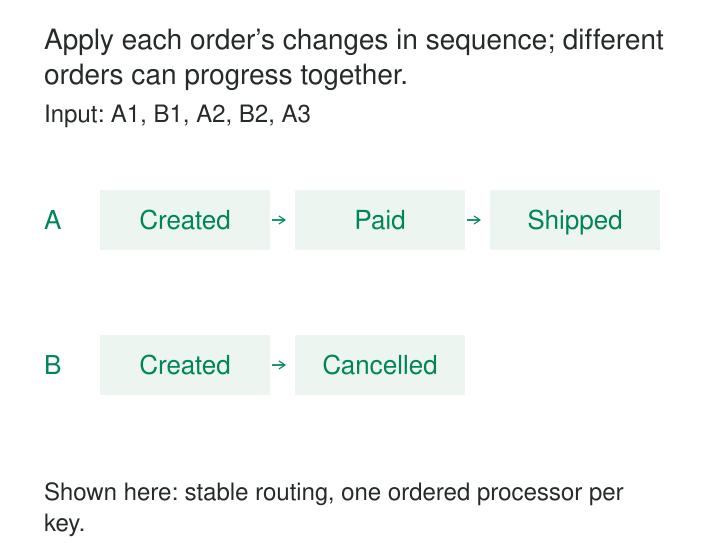

An order is created, paid, and shipped. Three events describe that sequence. Yet the warehouse view briefly shows “shipped,” then changes back to “paid.”

The messages arrived in order. Their handlers finished in reverse.

Per-Key Ordering protects sequences that matter to a particular entity—an order, device, account, or document—while allowing unrelated entities to move independently. Its purpose is to preserve meaningful progression without making the entire system wait in one line.

The central design question is: **Which events must take effect in sequence, and what key identifies that sequence?**

## Give each entity an ordered lane

Imagine two orders:

| Key | Sequence | Event |
|---|---:|---|
| Order A | 1 | Created |
| Order B | 1 | Created |
| Order A | 2 | Paid |
| Order B | 2 | Cancelled |
| Order A | 3 | Shipped |

Order A must progress through its own sequence. Order B must progress through its own sequence. There is usually no business requirement that B’s cancellation occur before or after A’s shipment.

The pattern routes events sharing an ordering key into the same logical lane. Each lane applies its events sequentially; independent lanes can run concurrently.

These lanes need not correspond one-to-one with physical partitions. A Kafka partition can contain many keys. Kafka preserves the log order within a partition, and consistent key-based routing places related events together. Producers must agree on the routing scheme. [Apache Kafka’s protocol documentation](https://kafka.apache.org/41/design/protocol/)

The ordering key should identify the smallest scope within which operations depend on one another. Choosing `order_id` permits different orders to proceed independently. Choosing `tenant_id` unnecessarily serializes every order belonging to that tenant.

## Specify which order you mean

“Ordered” can describe several different things:

- **Business order:** the sequence established by the authoritative application.
- **Publication order:** the sequence in which messages enter the transport.
- **Delivery order:** the sequence presented to a consumer.
- **Effect order:** the sequence in which state changes become durable or visible.

Correctness depends on connecting these stages.

A broker cannot infer that version 12 should precede version 13 if independent producers publish them in reverse. It can faithfully preserve the wrong business sequence. A source therefore needs an authoritative sequencing mechanism, such as serialized changes to an entity with a corresponding version number.

Event timestamps alone are often insufficient: clocks can disagree, timestamps can tie, and delayed publication can reverse arrival order.

Producer behavior matters too. Kafka documents that retries can reorder batches when idempotence is disabled and multiple requests are in flight. Its idempotent producer preserves ordering under its supported configuration constraints. That protects producer transmission; it does not establish business order across independent writers. [Kafka producer configuration](https://kafka.apache.org/41/configuration/producer-configs/)

Finally, the consumer must carry the sequence through to its effects. Starting asynchronous tasks in order does not ensure their writes finish in order.

## Example: keeping an order projection from moving backward

Suppose an order service emits:

| Order | Version | Resulting status |
|---|---:|---|
| O42 | 1 | Created |
| O42 | 2 | Paid |
| O42 | 3 | Shipped |

A Kafka producer uses `O42` as the message key. A consumer receives versions 1, 2, and 3, then submits all three to a general worker pool.

The version 2 handler calls a slow service. Version 3 writes “shipped” first. Version 2 eventually writes “paid,” overwriting the newer state.

An ordered log has become an incorrectly ordered projection.

A straightforward design processes each key’s state changes sequentially and waits for the relevant durable write before advancing that key. Independent orders can still proceed concurrently.

Google Pub/Sub documents this exact boundary: its StreamingPull client callbacks run to completion in order for an ordering key, but applications that schedule additional asynchronous work must preserve that work’s ordering themselves. Its ordering guarantee also requires the appropriate subscription setting and same-region publishing for the key. [Pub/Sub ordered messaging](https://docs.cloud.google.com/pubsub/docs/ordering)

Recovery must preserve the same discipline. Progress should advance only after the corresponding effects are durable. With Kafka offsets, completing a later record does not justify committing past an unfinished earlier record in the partition.

Worker handover also needs protection: an old worker must not keep writing after a replacement takes ownership. Depending on the sink, this can require fencing tokens, conditional updates, or transactional coordination.

## Example: a missing version cannot always be skipped

Consider inventory changes for one product at one location:

| Entity key | Version | Change |
|---|---:|---:|
| Warehouse 4 / SKU 88 | 7 | Starting stock established as 20 |
| Warehouse 4 / SKU 88 | 8 | −3 |
| Warehouse 4 / SKU 88 | 9 | −2 |

The consumer has applied version 7, but version 9 arrives before version 8.

A rule that accepts any version higher than the stored version would produce 18. If it subsequently rejects version 8 as stale, the correct stock of 15 is never reached.

For dependent changes, the consumer needs the next expected version. It can buffer version 9 while requesting or waiting for version 8. A timeout should trigger a defined response: pause the entity, reconcile against the source, or rebuild its state. Indefinite buffering merely hides the missing event.

This assumes versions are contiguous **within the subscribed entity stream**. A global database sequence or a filtered stream may contain legitimate gaps.

Complete replacement snapshots have different semantics. If version 9 contains the entire authoritative stock state, it may safely supersede version 8 for a current-state projection. That shortcut remains unsuitable when intermediate transitions trigger required actions.

The message contract must distinguish “apply this change” from “replace the state with this version.”

## Example: independent fulfillment workflows

A fulfillment system can assign each order its own Amazon SQS FIFO `MessageGroupId`.

Messages for Order A share one group; messages for Order B share another. SQS preserves ordering within groups and permits different groups to be processed concurrently.

There is an important implementation detail: a receive batch can contain several messages from the same group. The application must preserve their sequence within that batch. SQS also withholds additional messages for that group while the received messages remain in flight, subject to deletion and visibility-timeout behavior. [SQS FIFO delivery logic](https://docs.aws.amazon.com/AWSSimpleQueueService/latest/SQSDeveloperGuide/FIFO-queues-understanding-logic.html)

Suppose Order A’s address-validation message repeatedly fails. Later steps for A should wait if they depend on validation. Other orders can continue.

Moving the failed message aside and continuing changes the workflow’s semantics. A dead-letter queue provides somewhere to investigate the failure; it does not make skipping a prerequisite correct.

## The price of keeping a sequence

A single busy key remains a serial bottleneck. If each operation occupies its lane for 20 milliseconds, that lane can handle roughly 50 operations per second before overhead. Adding workers helps other keys but cannot remove this dependency.

Physical partitioning can broaden the impact. A consumer that processes an entire partition sequentially may make unrelated keys wait behind one slow record. More sophisticated scheduling can separate keys, but adds buffering, fairness rules, and progress-tracking complexity.

Operating costs include retained messages, per-key state, gap buffers, retry handling, ownership coordination, and monitoring. Useful signals include the oldest waiting event, backlog by key, sequence gaps, retry counts, and stale-write rejections. Overall throughput can look healthy while one important entity is stuck.

Ordering also remains separate from duplicate protection. Pub/Sub, for example, can redeliver an earlier message and subsequent messages for the same key. Replaying an ordered sequence must still avoid repeating its effects. [Pub/Sub redelivery behavior](https://docs.cloud.google.com/pubsub/docs/ordering)

## Boundaries that deserve care

Changing a key or its partition mapping can split an entity’s history between independently processed locations. Increasing partition counts, changing key serialization, or migrating producers therefore needs an explicit handover strategy.

Keys must also be unambiguous. If order numbers repeat across tenants, the ordering key needs both identifiers.

Per-key ordering is useful for lifecycle transitions, dependent updates, and projections whose results change with operation order. It offers less value for independent observations or commutative aggregations, where imposing sequence may add unnecessary waiting.

It cannot coordinate invariants spanning several keys. Reserving one scarce item across multiple orders requires an additional coordination mechanism at the inventory boundary.

## Related patterns

[[data-transactional-outbox|Transactional Outbox]] helps connect committed business changes to event publication; preserving their sequence still requires suitable relay behavior. [[data-stateful-stream-deduplication|Stateful Stream Deduplication]] prevents retries from repeating effects.

[[data-event-time-processing|Event-Time Processing]] assigns meaning according to when events occurred, which is distinct from their authoritative entity sequence. [[data-merge-and-upsert|Merge and Upsert]] can enforce version-aware writes at the destination, provided the rule matches whether messages contain dependent changes or complete replacement state.
