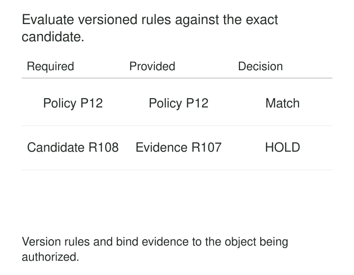

A data platform requires published datasets to have an owner, a sensitivity classification, and passing quality checks.

The requirements live in a document. One team follows them carefully. Another interprets “passing checks” as yesterday’s successful run. A third publishes through a script that bypasses the review process entirely.

The policy is shared. Its application is not.

**Policy as Code expresses rules in a machine-evaluable form, versions and tests those rules, and connects their decisions to controlled actions.** It makes recurring decisions consistent, explainable, and repeatable across data systems.

## Separate the rule, the facts, and the action

Three parts work together.

The **policy** states what is permitted or required. The **input facts** describe the dataset, request, deployment, or execution being evaluated. The **enforcement point** acts on the result: allowing publication, rejecting deployment, masking a value, or denying access.

Open Policy Agent illustrates this separation. An application supplies structured input, OPA evaluates policy, and the application uses the resulting decision. Policy evaluation and enforcement are distinct responsibilities. [Open Policy Agent](https://www.openpolicyagent.org/docs)

That distinction explains a common failure: a rule can evaluate correctly while having no effect because the caller merely logs the answer.

A useful implementation also records enough evidence to explain the decision later.



## Encode an obligation precisely

Start with the organizational obligation, then define the facts needed to evaluate it.

“Datasets must be trustworthy” is an aspiration. “A production release must have complete, passing results for its required checks, bound to the candidate artifact” is an evaluable rule.

The policy needs an owner, a stated scope, and a human-readable explanation. Code preserves an interpretation of the obligation; it does not establish that the interpretation is appropriate.

Parameters and reference data matter too. A rule that consults an approved-role list or classification registry can change behavior when that input changes, even if the rule file remains untouched.

Version the dependencies that affect the decision, and identify which facts must come from authoritative sources.

## Example: deciding whether a dataset may be published

Suppose a publication service evaluates this illustrative policy:

```text
allow_publication =
    owner_is_current
    AND classification_is_recognized
    AND evidence.candidate_digest == candidate.digest
    AND required_checks_are_complete_and_passed
    AND evidence_is_current
```

The service validates the input structure and permits publication only when the decision is explicitly true.

The evidence binding is essential. A green report for release R107 cannot authorize candidate R108. Nor should a missing check disappear from the required population and make an incomplete result look successful.

Useful fixtures distinguish several outcomes:

| Situation | Expected handling |
|---|---|
| Complete passing evidence for the exact candidate | Permit publication |
| Passing evidence for a different candidate | Hold publication |
| A required check failed | Hold publication |
| Evidence cannot be retrieved or evaluated | Record an evaluation failure and hold |

The final case is operationally different from a policy violation. Preserving that distinction helps responders fix the right problem.

The publication controller must also ensure that the artifact it publishes is the one evaluated. Replacing candidate contents after approval breaks the connection between evidence and action.

This policy governs admission to publication. It does not prove that every business fact is correct.

## Example: masking customer email during queries

An organization allows an approved support context to see customer email addresses while general analytics users receive masked values.

The rule belongs at a boundary that actually controls the returned data. A dashboard instruction asking analysts to avoid selecting email is insufficient.

Snowflake provides a native implementation through Dynamic Data Masking. Policies attached to table or view columns are evaluated at query time, using policy conditions and execution context to determine what values are visible. The feature requires Enterprise Edition or higher. [Snowflake Dynamic Data Masking](https://docs.snowflake.com/en/user-guide/security-column-ddm-intro)

In an illustrative policy, the approved context receives the original email; other contexts receive `NULL`.

Tests should exercise the intended roles and execution contexts, including nested role relationships where relevant. They should also examine calculations affected by masking: replacing values with nulls can change counts, joins, and grouping behavior.

The policy’s coverage needs verification. A protected column does not automatically protect an unrelated exported copy created elsewhere.

Here, the engine performs both evaluation and enforcement, but policy authors still need to manage assignments, context, and supported access routes.

## Example: checking infrastructure before deployment

A data team provisions storage for production exports. Its organizational policy requires particular public-access-block settings.

The team encodes those requirements and checks proposed infrastructure configuration before deployment. A template missing the required settings fails with a specific explanation.

AWS CloudFormation Guard implements this kind of evaluation. It checks structured JSON or YAML against declarative rules and includes a testing framework for the rules themselves. [CloudFormation Guard](https://docs.aws.amazon.com/cfn-guard/latest/ug/what-is-guard.html)

The deployment workflow must act on the failure. Guard alone does not provide server-side enforcement; AWS documents CloudFormation Hooks as a mechanism for server-side validation and enforcement. [Guard enforcement boundaries](https://docs.aws.amazon.com/cfn-guard/latest/ug/what-is-guard.html)

Checking a proposed template also differs from checking deployed reality. Later manual changes can introduce drift. Delivery checks and ongoing configuration assessment cover different points in the lifecycle.

## Test the policy as a decision system

Policy tests should demonstrate both permitted and prohibited behavior. A suite containing only rejected examples can pass even when the policy denies everything.

Include missing fields, invalid types, unknown categories, expired exceptions, and conflicting attributes. Test the boundary conditions that determine the outcome, rather than only realistic-looking happy paths.

OPA supports policy tests, including parameterized cases that evaluate multiple inputs and expected results. [OPA policy testing](https://www.openpolicyagent.org/docs/policy-testing)

Integration tests have a separate purpose: establish that the system submits the right facts and honors the result. A correct policy test cannot detect a deployment script that ignores a denial.

Tests should also cover what happens when evaluation is unavailable. For a required publication gate, holding the candidate may be appropriate. Other decisions need an explicitly chosen failure behavior, rather than an accidental default.

## Treat policy changes as releases

A small rule change can affect hundreds of datasets or users.

Review changes, retain the rationale, and evaluate representative cases before enforcement. Comparing a candidate policy with the current policy can reveal newly allowed or newly denied cases without immediately changing production behavior.

Distribution needs observation. A policy committed to a repository may not yet be active at every enforcement point.

OPA bundles can carry revision identifiers, and decision logs can record the bundle revision used during evaluation. These mechanisms help connect a decision to the policy that actually ran. [OPA bundles](https://www.openpolicyagent.org/docs/management-bundles), [OPA decision logs](https://www.openpolicyagent.org/docs/management-decision-logs)

Record the decision, reason, relevant resource identity, and policy revision. Keep diagnostic inputs proportionate: an audit trail should not become an unnecessary collection of sensitive payloads.

Rolling back a rule changes future decisions. It does not undo data already published or access already exercised.

## Keep exceptions and judgment visible

Some obligations require interpretation before they become executable. Deciding whether a dataset is suitable for a particular use may depend on context that no metadata field captures.

Use code for the repeatable part and retain a responsible decision-maker for unresolved cases.

Where exceptions are permitted, represent their scope, authority, expiry, and conditions explicitly. A broad permanent bypass weakens the policy while making the system appear governed.

Repeated exceptions can reveal a poorly chosen rule or missing platform capability. They deserve review rather than endless renewal.

## Pay for the enforcement you need

Policy as code is especially useful when the same decisions recur across many teams, datasets, or environments.

Its operating costs include rule maintenance, test fixtures, trusted metadata, deployment infrastructure, decision logging, and support for evaluation failures. Runtime policies can also add latency or become availability dependencies.

The main limitations are practical: inaccurate facts produce inaccurate decisions, uncovered paths bypass enforcement, and ambiguous obligations remain ambiguous after translation into code.

Success means that the right rules govern the intended actions, with understandable evidence—not simply that a repository contains policy files.

## Related patterns

[[data-federated-governance|Federated Governance]] determines which shared obligations and delegated decisions the code should implement.

[[data-controlled-vocabularies|Controlled Vocabularies]] give policy inputs consistent meanings across teams.

[[data-publication-quality-gates|Publication Quality Gates]] enforce selected policies before candidate data becomes visible.

[[data-version-transformation-logic|Version Transformation Logic]] supplies the broader discipline of identifying the executable version and dependencies responsible for a result.
