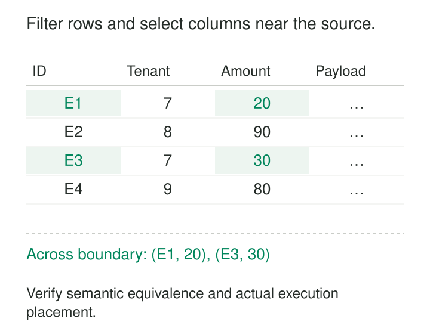

A live pipeline falls behind even though its transformation logic is simple. It fetches wide records, transfers them across the network, discards most of the rows, and keeps only three fields. The expensive part is carrying data that the next stage never needed.

**Predicate and projection pushdown move those reductions closer to the source, before unnecessary data is transferred or processed.** Predicate pushdown reduces rows. Projection pushdown reduces fields.

The purpose is to avoid paying repeatedly for data that contributes nothing to the answer—while preserving exactly what that answer means.

## Reduce data before the expensive boundary

A predicate is a condition such as `tenant_id = 7`. A projection identifies the fields needed for a calculation or result.

Without pushdown, a processing engine might retrieve complete records and apply these operations locally. With pushdown, it asks a database, connector, or file reader to perform supported reductions earlier. Trino explicitly supports both forms, with capabilities depending on the connector and underlying source. [Trino pushdown documentation](https://trino.io/docs/current/optimizer/pushdown.html)



There are several possible savings: fewer storage reads, fewer decoded values, less network traffic, smaller intermediate results, and less downstream state.

These savings are distinct. A remote database might scan every table page but return only matching rows. Network traffic falls even though source storage reads remain substantial. A columnar reader may avoid reading unnecessary columns altogether.

The useful question is therefore: **which work disappears, and at which boundary?**

## Example: filter a database extraction at the database

An ingestion job needs event identifiers and amounts for tenant 7 within a bounded extraction interval. The source also holds diagnostic text, request headers, and other tenants’ records.

Fetching the entire interval and filtering after transfer wastes bandwidth. The intended source operation is:

```sql
SELECT event_id, amount
FROM events
WHERE tenant_id = 7
  AND recorded_at >= :start_time
  AND recorded_at <  :end_time;
```

The database needs `tenant_id` and `recorded_at` to evaluate the predicate, but those fields do not have to appear in the returned result.

Spark’s JDBC reader supports predicate pushdown and enables it by default, attempting to send supported filters to the database. Its documentation also recognizes that source-side filtering is not always faster than filtering in Spark. [Spark JDBC data sources](https://spark.apache.org/docs/latest/sql-data-sources-jdbc.html)

The distinction matters on a busy operational database. A suitable index may make this a cheap selective read. An expensive expression evaluated over millions of rows may instead consume source CPU needed for transactions.

Pushdown changes where work occurs. It does not automatically make the source work inexpensive.

A connector may also push only part of the condition. The processing engine must retain any remaining filter needed to produce the exact result. Removing that final check merely because “filter pushdown is enabled” can admit incorrect rows.

## Example: read fewer columns and skip irrelevant file regions

A live analytics service queries recently published Parquet files. Each event has dozens of fields, but a revenue query needs only tenant, timestamp, and amount:

```sql
SELECT SUM(amount)
FROM read_parquet('events/*.parquet')
WHERE tenant_id = 7
  AND event_time >= TIMESTAMP '2026-10-26 00:00:00'
  AND event_time <  TIMESTAMP '2026-10-27 00:00:00';
```

Assume the timestamps use a documented UTC convention.

DuckDB automatically pushes required-column selection into its Parquet reader. It also pushes supported filters into the scan and can use file statistics to skip irrelevant regions. [DuckDB Parquet reading](https://duckdb.org/docs/2.0/data/parquet/overview#partial-reading)

Suppose one row group contains tenant identifiers from 1 through 4. A query for tenant 7 can exclude it using those bounds. Another group spanning tenants 1 through 20 cannot be excluded that way; the reader still needs to determine which rows actually match.

**Metadata pruning establishes that a region cannot match. It does not establish that every row in a retained region does match.**

Projection provides an independent saving: large diagnostic columns need not be read for this query. The timestamp and tenant columns remain necessary for filtering even though only the sum appears in the output.

BigQuery likewise recommends explicit column selection and warns that adding `LIMIT` to `SELECT *` does not reduce the amount of table data read. A small returned result is not proof of a small scan. [BigQuery query computation guidance](https://docs.cloud.google.com/bigquery/docs/best-practices-performance-compute#avoid_select_)

## Example: filtering a changing table requires removals

Early filtering becomes more subtle when a live stream represents updates to current records.

An order changes state:

| Update | Order | Status |
|---|---|---|
| 1 | O-17 | open |
| 2 | O-17 | closed |

A downstream table should contain only open orders.

If an upstream filter forwards the first update and simply discards the second, the downstream table retains O-17 forever. The second update does not belong in the final result, but it carries information required to remove an earlier result.

Kafka Streams distinguishes these semantics. Filtering a `KTable`, which represents a changing keyed table, can emit tombstones for records that no longer satisfy the condition. This differs from filtering independent records in a `KStream`. [Kafka Streams KTable filtering](https://kafka.apache.org/42/javadoc/org/apache/kafka/streams/kstream/KTable.html#filter(org.apache.kafka.streams.kstream.Predicate))

The safe reduction preserves changes to membership, including departures. A connector filtering change data must provide equivalent behavior if downstream consumers maintain current state.

Projection has a similar constraint. Dropping an operation type, record key, version, or ordering field too early can make correct update handling impossible. A field may be absent from the final display while remaining essential to the processing contract.

## Move operations only when their meaning survives

Pushdown is correct when the earlier operation preserves the required result under the source’s semantics.

Outer joins provide a familiar trap. “Keep every customer and attach an open order if one exists” differs from “join customers to orders, then retain only rows whose order is open.” Moving a condition between `ON` and `WHERE` can remove customers without matching orders. PostgreSQL documents this difference explicitly. [PostgreSQL join conditions](https://www.postgresql.org/docs/current/queries-table-expressions.html#QUERIES-JOIN)

Cross-system comparisons introduce another boundary. String ordering, time zones, numeric conversions, and null handling must remain compatible. Trino’s PostgreSQL connector, for example, normally avoids pushing textual range comparisons because PostgreSQL may sort strings differently from Trino. [Trino PostgreSQL predicate support](https://trino.io/docs/current/connector/postgresql.html#predicate-pushdown-support)

Aggregations, ranking, limits, and deduplication also constrain movement. Filtering to open records before selecting the latest version can produce an older open record whose newest version is closed.

Projection must retain fields needed by every intervening operation: join keys, filter inputs, grouping columns, ordering values, and update metadata. Remove a field after its last required use.

## Where it pays—and what to measure

Pushdown is especially useful across network boundaries, over wide records, before expensive joins, and where selective predicates can exploit indexes or storage statistics. In live systems, smaller intermediate records can also reduce serialization, buffering, and downstream pressure.

The benefit weakens when almost every row qualifies, predicates are expensive, or the source lacks suitable access paths. Filtering a sequential text file may reduce downstream work while still requiring the whole file to be read.

Common mistakes include assuming every connector supports every expression, hiding searchable fields inside opaque functions, and confusing fewer returned rows with fewer scanned bytes.

Verify execution rather than SQL appearance. Trino documents how `EXPLAIN` reveals pushed predicates and the columns accessed by a table scan. [Trino pushdown verification](https://trino.io/docs/current/optimizer/pushdown.html)

Compare source reads and CPU, transferred bytes, downstream memory, and end-to-end lag. Preserve equivalent results, including duplicate multiplicity, nulls, updates, and deletions. A faster plan that changes those results is a different computation.

## Nearby patterns

[[data-columnar-storage|Columnar Storage]] makes projection physically valuable by allowing readers to access selected columns.

[[data-covering-indexes|Covering Indexes]] can supply filter and output values from an index, complementing early reduction.

[[data-preserve-raw-inputs|Preserve Raw Inputs]] retains replayable source material while individual consumers receive narrower data.

[[data-backpressure|Backpressure]] controls flow when downstream capacity is insufficient. Pushdown reduces unnecessary demand on that capacity.
