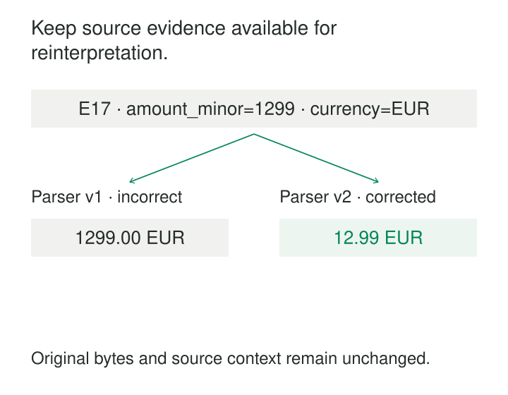

A dashboard’s revenue jumps overnight. The source system looks normal. Somewhere between ingestion and reporting, a parser treated minor currency units as whole amounts. The pipeline kept only the converted values, so the team cannot easily determine what arrived or rebuild the affected period.

Fetching the source again may return different records. Some have changed; others are no longer available.

**Preserve Raw Inputs retains incoming data before transformations discard or reinterpret information.** It gives later processing a durable starting point for investigation, correction, and replay.

The purpose is to preserve what the pipeline received closely enough to support the recovery and verification it promises.

## Keep a recoverable starting point

The pattern separates capture from interpretation.

Capture records the incoming payload and its provenance. Later stages parse fields, enforce types, resolve identities, deduplicate events, apply business rules, and build analytical models. When those decisions change, the retained input provides another opportunity to process the data.

Databricks describes this separation in its medallion architecture: the bronze layer retains raw, unvalidated source data, while subsequent layers clean and model it. Its guidance recommends limiting early transformations and using flexible representations to reduce information loss from unexpected schemas. See the [Databricks medallion architecture](https://docs.databricks.com/aws/en/lakehouse/medallion).

A raw layer can be a collection of original files, an append-only event table, or stored message payloads with associated metadata. The arrangement matters less than the preservation contract.

That contract should state where capture begins. An API response preserves what the API returned. It does not necessarily preserve every change that occurred inside the source database before the request.

## Decide what “raw” must preserve

There are two useful levels of fidelity.

**Byte preservation** retains the received file or payload bytes, together with information needed to interpret them, such as encoding, compression, and content type. This supports investigating malformed input and comparing exact payloads.

**Record preservation** retains source fields and values in a flexible representation. It can make querying and reprocessing easier, but parsing may already have changed the representation.

For example, Snowflake documents that parsing JSON and converting it back to text can change whitespace and object-key order. A parsed `VARIANT` value therefore does not guarantee reproduction of the original text. See the [PARSE_JSON usage notes](https://docs.snowflake.com/en/sql-reference/functions/parse_json).

Neither level is universally sufficient. If exact file reconstruction matters, retain the file. If the requirement is to rebuild a business model from faithfully captured records, record preservation may be enough. Many systems retain original objects alongside a queryable ingestion table.

A column named `raw_payload` establishes little by itself. The important question is which information has already been lost before that column is populated.

## A conversion bug becomes repairable

Consider an illustrative payment event:

| Source field | Received value |
|---|---|
| `event_id` | `E17` |
| `amount_minor` | `1299` |
| `currency` | `EUR` |
| `schema_version` | `2` |

The source contract defines 100 minor units per major unit for this example. The correct amount is therefore 12.99 EUR.

Parser version 1 mistakenly publishes 1,299.00 EUR. Because the original event survives, the team can identify affected inputs, run corrected parser version 2, and compare the resulting totals before replacing the published data.

The retained input stays unchanged. Processing results carry their own transformation version and run identity.

This distinction prevents a subtle mistake: “fixing” the raw event to match the desired output. The received value was already correct; the interpretation was wrong.

If the supplier later corrects the event itself, that correction should arrive as another identifiable input, with explicit rules determining how it supersedes the earlier one.

## An unexpected field survives schema drift

A device feed adds `battery_health` and starts sending a previously numeric field as text. A rigid ingestion schema may reject records, discard the new field, or convert unexpected values to null.

A preservation-oriented boundary keeps the received information available while refined processing decides how to handle it.

Databricks Auto Loader provides a documented mechanism through its rescued-data column. Depending on configuration, it captures fields absent from the schema and values affected by type or case mismatches. The rescued data also includes the source file path. See [Auto Loader schema inference and evolution](https://docs.databricks.com/aws/en/ingestion/cloud-object-storage/auto-loader/schema).

This is useful protection, but it has a defined scope. Malformed JSON or CSV is handled differently from a valid record containing an unexpected field. Retaining the original file provides recovery options when parsing itself fails.

The refined dataset can quarantine unsupported records with a reason. Keeping those inputs does not require presenting them as valid analytical data.

## A corrected file remains distinguishable from its predecessor

An illustrative supplier sends `orders.csv` on Monday and replaces it on Tuesday after correcting several rows.

A pipeline that continually overwrites its local copy cannot reliably explain Monday’s report. Preserving each received version allows the team to compare deliveries and apply the correction deliberately.

Useful capture metadata includes:

| Metadata | What it establishes |
|---|---|
| Source identity | Where the input originated |
| Object version, file identity, or stream position | Which delivery was captured |
| Original receipt time | When the platform received it |
| Batch or capture ID | Which ingestion attempt recorded it |
| Content digest | Whether retained bytes have changed |
| Source schema identifier | How the input was described |

Snowflake supports carrying file provenance into loaded tables through metadata columns including filename, file row number, and file content key. Its [staged-file metadata documentation](https://docs.snowflake.com/en/user-guide/querying-metadata) demonstrates loading these alongside record values.

Provenance should distinguish receipt from replay. Reprocessing Monday’s file on Friday should not make it appear that the original delivery occurred on Friday.

## Preservation must survive ingestion failure

The durable capture boundary needs careful coordination with source progress.

If a consumer acknowledges a message or advances its extraction checkpoint before preserving the payload, a crash can lose the input. Preserving first avoids that gap, but a crash before checkpoint advancement can cause repeated capture.

Stable source identities and explicit duplicate handling make that recovery manageable. Where supported, capture and progress updates can share a transaction; otherwise the protocol must tolerate repeated delivery.

A content hash alone is not always a business-event identity. Two legitimate events can contain identical payloads. Removing every repeated byte sequence could change event counts or erase meaningful repetition.

Completeness also needs separate evidence. Retaining every received file does not prove that every expected file arrived. Manifests, source positions, control totals, and reconciliation establish different parts of that claim.

## Replay needs more than stored payloads

Raw inputs make rebuilding possible only when the required context remains available.

A transformation may depend on a historical exchange-rate table, an identity crosswalk, configuration, or an external service response. Replaying old inputs against today’s reference data can produce a different result even with unchanged code.

Reproducible processing therefore needs identifiable logic, configuration, schemas, and relevant reference-data versions. Databricks’ [reliability guidance](https://docs.databricks.com/aws/en/lakehouse-architecture/reliability/best-practices) describes retained raw data as a foundation for rebuilding downstream layers; the surrounding dependencies still determine what that rebuild means.

Replay should also use controlled outputs. Blindly appending reconstructed records can duplicate facts, and replaying operational events can repeat notifications or other external actions.

## Retention buys options at a cost

Preservation consumes storage, cataloging effort, access-management work, and replay capacity. Small files can create substantial operational overhead. Long retention may reduce storage prices through colder tiers while increasing retrieval latency and recovery cost.

The raw layer can also retain sensitive fields that refined models exclude. Its retention and access rules need deliberate ownership. Preserving inputs does not imply keeping everything forever or overriding required deletion.

The pattern is especially useful when sources are difficult to reread, transformation logic evolves, schemas drift, or historical outputs must be explained. It offers less value for disposable data that can be regenerated cheaply and reliably.

[[data-separate-source-facts-from-derived-interpretations|Separate Source Facts from Derived Interpretations]] explains the conceptual boundary. [[data-manifest-based-file-ingestion|Manifest-Based File Ingestion]] declares complete deliveries. [[data-historical-restatement|Historical Restatement]] governs publishing corrected results. [[data-deletion-tombstones|Deletion Tombstones]] help ensure that replay respects later removals.

A useful raw archive has a clear recovery promise: which inputs survive, at what fidelity, for how long, and with enough context to build a trustworthy result again.
