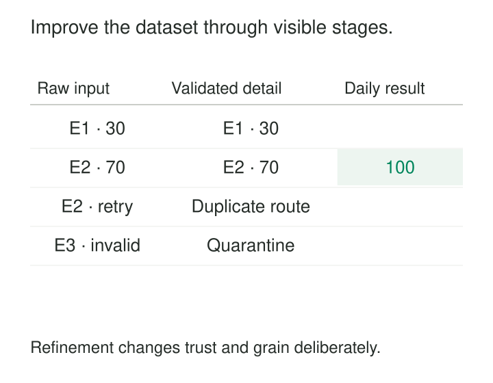

A dashboard depends on a single transformation that parses files, removes duplicates, joins customer records, applies reporting rules, and calculates daily totals. When the number looks wrong, every step becomes a suspect.

Other teams copy parts of the transformation because there is no reusable dataset between the source and the report. Soon, several versions of “clean orders” coexist.

**Progressive Refinement turns captured inputs into dependable data products through successive, explicit transformations.** Each stage adds useful structure, guarantees, or meaning. Intermediate results become understandable foundations for later work.

The purpose is to make increasing usefulness traceable—and corrections manageable.

## Each stage makes a specific promise

A common progression is:

| Stage | Promise |
|---|---|
| Capture | Preserve what arrived and where it came from |
| Validate | Establish usable types, identities, and quality indicators |
| Integrate | Resolve relationships under explicit rules |
| Publish | Provide a defined product at a declared grain |

These are responsibilities rather than mandatory folder names. A small pipeline might combine some steps; a larger one might separate them further.

Databricks’ **medallion architecture** is a documented implementation of this idea. Bronze retains raw inputs, silver provides validated and refined representations, and gold organizes data for business consumption. See the [medallion architecture documentation](https://docs.databricks.com/aws/en/lakehouse/medallion).

The progression does not make every later table universally “better.” A daily aggregate is convenient for reporting but contains less detail than its contributing events. Its stronger promise concerns a particular use.

A useful stage therefore needs more than a name. It needs a declared grain, transformation rules, quality expectations, provenance, and an explanation of unresolved records.

## Four deliveries become one explainable total

Consider an illustrative sales batch:

| Delivery | Event ID | Received amount | Interpretation |
|---|---|---|---|
| 1 | E1 | `"30.00"` | Sale |
| 2 | E2 | `"70.00"` | Sale |
| 3 | E2 | `"70.00"` | Repeated delivery |
| 4 | E3 | `"oops"` | Unparseable amount |

All amounts belong to the same store, reporting day, and currency, EUR.

Capture preserves all four deliveries. Validation parses the amounts, uses the documented event identity to recognize the repeated E2 delivery, and quarantines E3 with its failure reason.

The accepted dataset contains two unique sale events totaling 100 EUR. Its reconciliation explains the transition:

**Four deliveries = two accepted events + one repeated delivery + one quarantined event.**

Integration resolves the store reference through a lookup that has one applicable match per sale. It preserves the two-event grain. Publication then produces one store-day row with the named sales measure.

If the lookup accidentally matches two store records, the integration stage can detect the resulting multiplication before it becomes a dashboard discrepancy. If E3 is later corrected, the retained input and exception record identify what needs reprocessing.

The final total remains qualified: it includes accepted events and excludes one unresolved event. A polished output should not conceal that limitation.

## Reusable preparation supports several products

The refined event dataset can feed more than the daily report. A transaction investigation needs individual events. A monthly summary needs aggregation. A forecasting pipeline may need calendar and product relationships.

These branches can share preparation without sharing every interpretation.

dbt expresses a similar progression through source-oriented [staging models](https://docs.getdbt.com/best-practices/how-we-structure/2-staging), optional purpose-built [intermediate models](https://docs.getdbt.com/best-practices/how-we-structure/3-intermediate), and business-defined marts.

Its fictional Jaffle Shop project provides inspectable code: the [orders mart](https://github.com/dbt-labs/jaffle-shop/blob/main/models/marts/orders.sql) consumes staged orders, aggregates item information, joins the results, and derives order classifications.

The value comes from reusable boundaries. Creating five tables that merely rename one another adds maintenance without establishing a stronger contract.

## A sensor reading gains context in stages

Consider an illustrative device message containing a measurement, unit, device identifier, and event timestamp.

Capture retains the message and receipt metadata. Preparation parses the timestamp, interprets the documented unit, and flags malformed values. Integration links the reading to the applicable device installation and calibration version.

A monitoring product can then classify operating conditions. A maintenance product can summarize trends. Both reuse the same prepared observations while applying different rules.

The calibration lookup introduces a correctness requirement: it must use the version applicable to the reading, rather than whichever calibration happens to be current during processing.

If a conversion bug is discovered, the affected preparation stage can be rebuilt from retained messages. Dependent products then need controlled refreshes. This is easier to reason about than independently correcting several dashboards that each embedded their own conversion.

Earlier layers remain valuable because they preserve information that later interpretations depend on.

## Live results can become more complete over time

Progressive refinement also applies when inputs arrive late.

Suppose a store-day product initially contains the two accepted sales totaling 100 EUR. A delayed sale of 20 EUR arrives afterward. The prepared event layer accepts it, and the reporting product revises the total to 120 EUR.

The output contract must explain whether the first result was provisional, which late arrivals are accepted, and how corrections reach consumers.

Apache Beam provides documented mechanisms for event-time processing, early outputs, and later corrections through watermarks, triggers, and allowed lateness. Its [programming guide](https://beam.apache.org/documentation/programming-guide/#triggers) includes an example with early and late firings.

Repeated outputs also need defined semantics. A consumer receiving revised totals of 100 and 120 must know whether to replace the earlier result or apply a delta. Adding both would produce 220.

Advancing through layers and becoming more complete over time are related dimensions. A well-structured product can still be incomplete for its reporting window.

## Refinement requires evidence at every transition

Several assumptions make the progression trustworthy.

**Inputs must remain identifiable.** Stable event identities, file versions, or source positions let the system distinguish new data from repeated processing.

**Changes in grain must be deliberate.** Deduplication, joins, flattening, and aggregation can all change row counts. Each transition needs reconciliation appropriate to its operation.

**Unresolved data needs an explicit destination.** A failed cast or missing lookup should produce a visible failure, quality indicator, or quarantine path. Databricks’ [pipeline expectations](https://docs.databricks.com/aws/en/ldp/expectations) demonstrate configurable retain, drop, and fail behaviors, with additional quarantine patterns.

**Published versions need coherent inputs.** A report combining refreshed sales with an older customer mapping may violate its intended contract. Batch boundaries, source progress, transformation versions, and publication identifiers help establish what a result represents.

**Corrections must propagate safely.** Rebuilding an intermediate table does not automatically refresh every stored descendant. Recovery needs an explicit dependency and publication process that avoids exposing partially rebuilt products.

Layer names alone establish none of these guarantees.

## More boundaries bring operating costs

Each materialized stage consumes storage, refresh computation, orchestration, and monitoring. Sequential stages can add latency. Views reduce stored copies but may repeat expensive work.

Shared intermediates can also become bottlenecks or acquire too many unrelated responsibilities. Conversely, bypassing them to satisfy one urgent dashboard can recreate duplicated parsing and inconsistent definitions.

The pattern works especially well when inputs are messy, several products reuse preparation, business definitions change, or historical results need rebuilding. A small, stable, single-purpose pipeline may need only a few clearly named transformations.

Retaining earlier representations also requires ownership and lifecycle rules. Keeping every intermediate indefinitely is rarely necessary. Preserve the evidence and dependencies needed for the recovery promise, then materialize additional stages where reuse, isolation, or performance justifies them.

[[data-preserve-raw-inputs|Preserve Raw Inputs]] supplies a recoverable starting point. [[data-standardize-at-staging|Standardize at Staging]] establishes reusable representations. [[data-separate-cleaning-business-logic|Separate Cleaning from Business Logic]] keeps preparation distinct from policy. [[data-historical-restatement|Historical Restatement]] governs replacing previously published results.

A refinement stage earns its place when consumers can state what new promise it provides—and trace the evidence supporting that promise.
