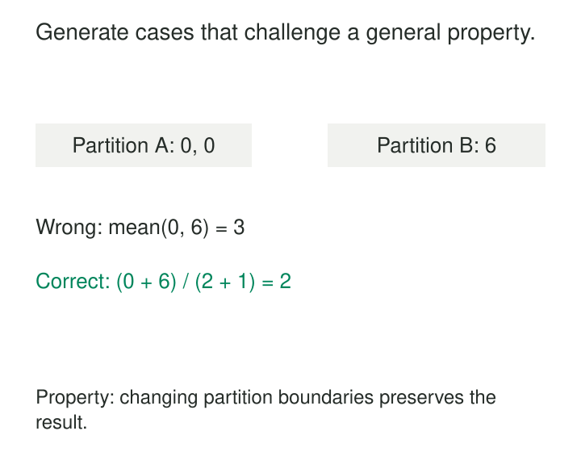

A transformation passes every test in the repository, then fails when a customer has two updates with the same timestamp. Another produces correct averages until the processing engine changes partition sizes. The examples were accurate; they did not explore the conditions that exposed the mistake.

[[data-property-based-data-tests|Property-Based Data Tests]] check general claims about a transformation across many generated inputs. Instead of specifying only “these five rows should produce this answer,” specify a rule: repartitioning the same rows must preserve an aggregate, replaying an event must preserve an idempotent result, or incremental processing must agree with full recomputation.

The purpose is to uncover cases people did not think to write—and turn failures into small, understandable examples.

## Turn the contract into something executable

A property describes behavior that must hold throughout a defined input domain. A generator constructs cases within that domain, and a test runs the actual transformation against them.

For example, a generator might produce order lines containing repeated product codes, zero quantities, nullable discounts, and different partition boundaries. The property could require the combined order total to equal an independent calculation under the same rounding policy.

The process has four parts:

1. **Define the domain.** Specify valid values, relationships, and exceptional cases.
2. **Generate inputs.** Explore combinations, including awkward boundaries.
3. **Check the property.** Compare results with an independent reference or a required relationship.
4. **Reduce failures.** Simplify a failing input while preserving the failure.

[Hypothesis](https://hypothesis.readthedocs.io/en/latest/quickstart.html), for example, implements this approach through generated arguments supplied to ordinary test functions. Its strategies describe the values to explore, including collections and dependent structures.

This differs from checking whether today’s production table contains duplicate keys. That assertion evaluates one observed dataset. A property-based test can manufacture duplicates, timestamp ties, and repeated deliveries to discover whether the transformation handles them correctly. Both forms of testing are useful.

## A small failure can explain a large bug

Suppose a pipeline calculates average delivery duration separately in each partition, then averages those results.

A useful property is:

> Processing the same rows under different partitions must preserve the specified overall average.

The generator varies durations, partition sizes, and boundaries. Each row must appear exactly once across the partitions; otherwise the test has changed the population.

An illustrative counterexample is:

| Partition | Durations | Sum | Count | Average |
|---|---|---:|---:|---:|
| A | 0, 0 | 0 | 2 | 0 |
| B | 6 | 6 | 1 | 6 |

Averaging the two averages gives **3**. Combining the sums and counts gives **6 ÷ 3 = 2**, the correct overall average.

The failure exposes a modeling error: an average cannot generally be combined without its weight. The implementation should carry additive components—sum and count—and divide at the required reporting grain.

The property still needs precise assumptions. What happens for empty input? Do null durations contribute to the count? Are values exact decimals or floating-point numbers? Floating-point reassociation can change results slightly, so equality may require a justified tolerance.

Reduction, often called **shrinking**, helps explain failures by searching for simpler failing cases. It does not guarantee the globally smallest example. Hypothesis documents how different [strategies simplify their generated values](https://hypothesis.readthedocs.io/en/latest/reference/strategies.html).

## Test deduplication against ties and permutations

Consider a model that chooses the latest customer update using only `updated_at`. Its fixtures contain distinct timestamps, so every test passes.

Generate two different versions with the same timestamp, then vary their input order. The selected row may change between runs.

If the contract says physical input order is irrelevant, a useful property is:

> Reordering candidate rows must preserve the selected winner for each business key.

A second property checks idempotence:

> Deduplicating an already deduplicated result must preserve that result.

These properties catch different mistakes. “Keep the first row” can be idempotent while remaining dependent on input order.

A deterministic winner might use the greatest source version, followed by an event identifier under an explicit tie-breaking rule. But the rule must reflect the domain. If two records with the same event identifier contain conflicting payloads, silently choosing one may conceal corruption; rejecting the conflict may be the correct behavior.

The generator should deliberately produce ties, multiple versions, and exact redeliveries. Generating only unique business keys removes the very conditions the deduplicator must handle.

Permutation invariance is also inappropriate when sequence order carries business meaning. The property comes from the contract, not from a universal preference for order-independent processing.

## Compare incremental state with a simpler model

Incremental transformations are particularly suitable because their behavior depends on sequences.

Suppose a table maintains the latest source version for each account, including deletion tombstones. Generate operations such as:

| Step | Delivered operation | Expected visible state |
|---|---|---|
| 1 | Insert account A, version 1 | A exists |
| 2 | Update A, version 2 | Updated A exists |
| 3 | Delete A, version 3 | A is absent |
| 4 | Replay A, version 1 | A remains absent |

A pipeline that physically removes every trace of version 3 may resurrect the old record at step 4.

The property compares incremental state with a simple reference model that selects the latest version from the same complete source history and applies its deletion status. Compare after each completed operation—or after the documented convergence boundary for asynchronous processing.

[Hypothesis’s stateful testing](https://hypothesis.readthedocs.io/en/latest/stateful.html) generates sequences of actions and supports comparison with a reference model. Its documented database example compares database operations against an in-memory model. The same mechanism can exercise inserts, corrections, retries, and deletions in a data pipeline.

The reference must be independent enough to expose implementation mistakes. Copying the incremental algorithm into the expected-result calculation can reproduce the same bug twice.

## Generators define what the test can discover

A generator is an executable statement about possible inputs.

For related tables, generate parent records first, then child records referencing them. Test invalid references separately when rejection behavior is part of the contract. Specify units, numeric ranges, timestamp precision, and whether nulls are permitted.

Favor deliberate coverage of consequential cases: empty batches, unequal groups, boundary timestamps, repeated identifiers, and late versions. Randomness alone does not ensure these appear. Excessive filtering can also discard precisely the difficult cases worth exploring.

Execute the real transformation whenever practical. A Python approximation of warehouse SQL may miss differences in null handling, collation, decimal arithmetic, or timestamp conversion.

Comparison needs equal care. SQL results without an ordering contract should usually be compared as unordered **multisets**, preserving duplicate counts. Converting results to sets can hide accidental duplication.

Control clocks, reference data, and external dependencies so failures can be reproduced. Give each generated case isolated state.

## Keep discovered failures as durable examples

Once a generated case reveals a bug, retain the understandable example as a regression test.

Hypothesis can save and replay failures through its example database, but its documentation recommends [explicit examples for cases that must remain covered](https://hypothesis.readthedocs.io/en/latest/tutorial/replaying-failures.html). A cache or random seed is less durable than a small fixture with a clear expected result.

For SQL models, that fixture can complement generated testing. [dbt unit tests](https://docs.getdbt.com/docs/build/unit-tests) provide static inputs and expected outputs for model logic; generating and executing many cases requires an additional testing harness.

## Pay for exploration where mistakes matter

This pattern is useful for intricate transformations, parsers, deduplication, incremental updates, and computations that should survive changes in batching or partitioning.

Its operating costs include generator maintenance, reference-model maintenance, isolated test environments, and execution time. Database setup and warehouse round trips can dominate small computations. Use a bounded exploration budget for routine changes and broader runs for high-risk transformations.

Passing many generated cases is evidence, not proof. Tests cannot discover failures outside their generated domain, and small cases may miss memory pressure, distributed races, or production-scale behavior. Keep performance tests, operational checks, and real dataset validation alongside them.

Related patterns strengthen different parts of the approach: [[data-deterministic-transformations|Deterministic Transformations]] make reproduction reliable; [[data-store-additive-components|Store Additive Components]] enables correct aggregation properties; **Incremental Transformations** benefit from comparison with full recomputation; and [[data-business-invariant-checks|Business Invariant Checks]] enforce domain rules on the data actually produced.
