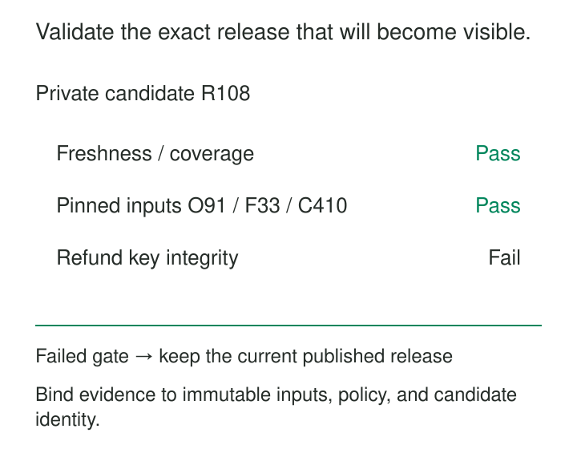

The daily sales pipeline finishes successfully. Every table exists, the dashboard refreshes, and customers immediately see revenue fall by half. A refund feed was duplicated, and the quality check reported the problem only after the new tables became visible.

The check detected the error. Publication had already happened.

[[data-publication-quality-gates|Publication Quality Gates]] make validation part of the release decision. A candidate dataset, export, or model becomes available to consumers only when the required evidence satisfies an explicit policy.

The purpose is to prevent a successfully executed pipeline from publishing an unacceptable result. The central question is concrete: **may these exact artifacts become the published release?**

## Give publication a boundary

A gate needs a candidate that can be inspected before consumers depend on it.

That candidate might be a table snapshot, a dated export directory, a model artifact, or a manifest identifying several related datasets. Its identity must remain stable throughout validation and publication.

The mechanism has four parts:

1. **Build a candidate** outside the normal consumer path.
2. **Collect evidence** against its exact contents and declared source boundaries.
3. **Evaluate the publication policy**, including required coverage and evidence validity.
4. **Promote the approved candidate** through a controlled publication operation.

The publication boundary might be a database transaction, an atomic table commit, or a conditional update to a release pointer. Consumers must use that boundary consistently. If they can discover candidate files by listing a shared directory, the gate can be bypassed accidentally.

For a release containing several tables, a manifest can pin their individual versions. Readers resolve the release once and use those versions together. Independently reading each table’s latest version can recreate the mixed-release problem.

## Require evidence, not the absence of errors

A publication policy should name its required checks. “No check failed” is insufficient when a check never ran.

Required evidence has three meaningful outcomes:

| Outcome | Meaning | Publication decision |
|---|---|---|
| Pass | The requirement was evaluated and satisfied | Eligible to proceed |
| Fail | The requirement was evaluated and violated | Hold |
| Unresolved | Evidence is missing, incomplete, expired, or unavailable | Hold |

A validator timeout does not prove the data is defective. It does mean the release lacks the evidence required for publication.

Each result should identify the candidate, rule version, evaluated scope, observation time, and relevant reference-data versions. A passing result from yesterday’s candidate cannot approve today’s rebuild.

Coverage is itself a requirement. An empty table can contain no duplicate keys and no invalid amounts while still being an incomplete delivery. Expected partitions, source feeds, or business populations need explicit checks.

Separate mandatory conditions from advisory observations. A new category might warrant investigation without blocking publication; duplicate invoice identifiers might be unacceptable. Combining everything into one weighted quality score can allow several minor successes to conceal a critical failure.

## Publish orders and refunds as one sales release

Suppose a sales report combines orders and refunds through an agreed source cut.

Candidate `R108` identifies orders version `O91`, refunds version `F33`, and publication policy `v12`. Schema, source coverage, and freshness checks pass. Refund-key uniqueness fails.

The gate holds `R108`. Consumers continue reading `R107`, with its publication time and data coverage visible. Repair produces `R109`; its changed contents require new evidence.

Apache Iceberg documents a concrete implementation of this approach through an [audit-branch workflow](https://iceberg.apache.org/docs/latest/branching/#audit-branch): write to a separate branch, validate that state, then advance the main branch after validation. Its [table specification](https://iceberg.apache.org/spec/#optimistic-concurrency) describes the atomic metadata replacement underlying table commits.

The scope matters. A table-level commit does not automatically publish an entire collection of tables together. A release spanning orders and refunds needs an appropriate transaction or a manifest that consumers honor. Schema changes also need separate care: Iceberg documents that table schemas are shared across branches.

Orchestration must enforce the decision. [Dagster’s asset checks](https://dagster.io/docs/guides/test/asset-checks#blocking-downstream-materialization) can block downstream materialization when configured as blocking checks. That provides a control point; the workflow still needs to keep candidates outside the published consumer path until approval.

## Hold an export even when totals agree

A billing export contains three invoices. Its row count and total amount match the source:

| Position | Source invoice | Candidate invoice |
|---|---|---|
| 1 | I1 — 100 USD | I1 — 100 USD |
| 2 | I2 — 100 USD | I2 — 100 USD |
| 3 | I3 — 100 USD | I2 — 100 USD |

Both sides contain three rows totaling 300 USD. The candidate duplicates `I2` and omits `I3`.

A publication gate requiring identifier uniqueness and source-to-target coverage holds the export. Aggregate agreement alone would have approved it.

The publication unit should match the consumer’s obligation. If the recipient expects one complete billing run, dropping the duplicate row and releasing the remainder produces an incomplete run. Holding the whole export is appropriate until the discrepancy is resolved.

Partition-level publication can be useful when partitions are genuinely independent. It needs an explicit completeness contract so consumers can distinguish “not published” from “published with zero records.”

## Gate a model on the behavior that matters

A candidate classifier improves overall accuracy but performs worse for a critical language group. An overall-only gate approves it; a policy with required subgroup thresholds may hold it.

The evidence must identify the exact model, preprocessing artifacts, evaluation dataset, baseline, and configured slices. Otherwise, a passing evaluation can become detached from the artifact being deployed.

TensorFlow Extended implements this separation through [Evaluator](https://www.tensorflow.org/tfx/guide/evaluator), which can validate configured metrics and slices against developer-defined thresholds and a baseline model. It produces a model blessing when the criteria pass. [Pusher](https://www.tensorflow.org/tfx/guide/pusher) consumes validation blessings to decide whether to push the model, with infrastructure validation available as an additional check.

The evaluation policy still needs sound assumptions. Too few examples in a required slice may leave the evidence unresolved. Passing thresholds on an unsuitable evaluation dataset offers little assurance about production behavior.

## Close the gap between checking and publishing

Validation becomes unreliable if a candidate changes while checks run. Freeze the candidate, or pin immutable snapshots for every check and verify that publication references those same snapshots.

Time-sensitive evidence can expire without any content changing. A candidate that met a five-minute freshness requirement at validation time may miss it after waiting twenty minutes for another check. Re-evaluate time-dependent conditions at promotion.

Concurrent releases introduce another race. A slow older candidate must not overwrite a newer publication simply because its checks finish later. Use a conditional promotion that verifies the expected current release and applies the policy’s source-ordering rules.

A conflict requires a new decision. Combining a candidate with intervening changes can create a state that was never validated.

Record the publication outcome durably. If the publisher crashes after a successful switch, a retry should recognize the completed release rather than publish a different state.

## Budget for held releases and recovery

Gates add scan costs, evaluation time, candidate storage, and release latency. Full reconciliation may be expensive; cheaper structural checks can reject obvious failures before deeper validation runs. Incremental checks are useful only when their coverage includes affected deletions, corrections, and dependencies.

Holding publication also creates an operational obligation. The previous release becomes older. Define how long consumers may use it, how staleness is communicated, and when the product should report unavailable data.

Exceptions need bounded authority: identify the candidate, failed requirement, reason, approving owner, and expiry. Preserve the failed evidence alongside the exception. Reclassifying failure as success destroys the record of what was accepted.

A gate cannot establish requirements nobody encoded. Post-publication monitoring remains necessary, and reverting a pointer cannot retract an export already downloaded or undo decisions already made.

[[data-atomic-publication|Atomic Publication]] controls visibility. [[data-source-to-target-reconciliation|Source-to-Target Reconciliation]] supplies evidence of completeness and agreement. [[data-segmented-quality-checks|Segmented Quality Checks]] prevent aggregate results from hiding local failures. [[data-run-ledgers|Run Ledgers]] preserve which candidate, evidence, policy, and decision produced each release.
