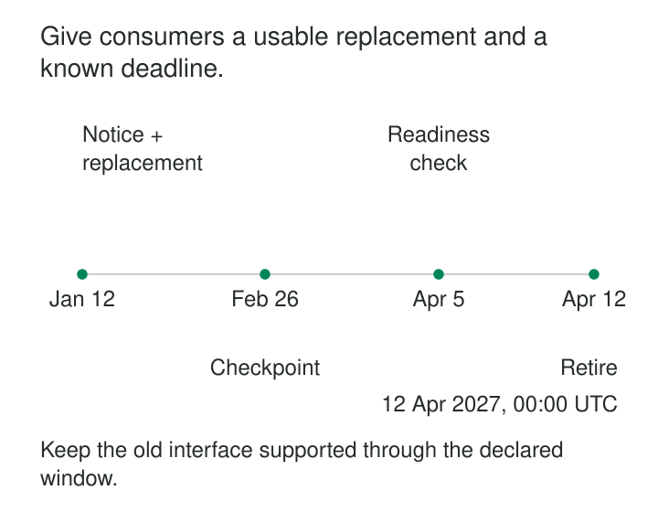

A data team introduces a better customer model. The replacement is documented, tested, and available. Three months later, the team deletes the old table.

A quarterly reporting job fails the following morning.

The producer believed three months was generous. The consumer never knew a countdown had started.

**Published Deprecation Windows make retirement an explicit, discoverable commitment.** They identify what is being withdrawn, explain the migration path, and state how long existing consumers can rely on the old interface. This gives consumers time to change while placing a visible boundary on the producer’s maintenance obligations.

## Deprecation starts a transition

Deprecation means an interface is being discouraged or scheduled for withdrawal. Retirement is the action that ends its availability or support.

These are separate events. An interface can remain operational throughout a migration window, and a deprecation announcement should explain exactly what support continues.

HTTP makes this distinction explicit. RFC 9745 defines a `Deprecation` response header and a link relation for deprecation documentation; declaring deprecation does not itself change resource behavior. RFC 8594 separately defines `Sunset`, which communicates when a resource is expected to become unavailable. [RFC 9745](https://www.rfc-editor.org/rfc/rfc9745.html), [RFC 8594](https://www.rfc-editor.org/rfc/rfc8594.html)

The pattern applies equally to warehouse tables, event formats, file deliveries, metrics, and feature datasets. The essential mechanism is a shared period during which consumers can migrate under stated conditions.

## Publish a commitment consumers can act on

“Deprecated—please migrate soon” leaves too much unresolved. A useful notice answers concrete questions:

| Element | What consumers need to know |
|---|---|
| Affected interface | Exact dataset, endpoint, field, topic, or version |
| Timing | Announcement date, deprecation date, and planned retirement boundary |
| Continued support | Freshness, availability, corrections, and assistance during the window |
| Replacement | Where it is available and how its meaning differs |
| Migration | Required changes, validation examples, and known limitations |
| Ownership | Who handles blockers and unresolved dependencies |
| Retirement policy | What happens at the deadline and how exceptions are published |

Use an explicit timezone for a timed cutoff. Distinguish a firm removal date from an earliest permissible removal date or a target subject to readiness review.

The notice also needs a durable home: an interface catalog, versioned documentation, or another location consumers can revisit. Runtime warnings and direct notifications help people discover it.

## Example: retiring a warehouse model

Suppose `customer_summary_v1` contains a single address per customer. Its replacement, `customer_summary_v2`, distinguishes billing and delivery addresses.

In an illustrative schedule, the producer publishes the replacement and deprecation notice on 12 January 2027. Retirement is planned for 12 April at 00:00 UTC. During that interval, v1 continues refreshing daily under its existing freshness commitment.

The migration guide explains the semantic change. A report that groups customers geographically must choose which address serves its purpose. Renaming a table reference is insufficient.

A progress check finds that daily dashboards have migrated, but a quarterly export still uses v1. Its owner tests the export against the replacement before the next scheduled run.

dbt provides mechanisms for this approach. Model versions allow consumers to reference a specific version during migration. Its `deprecation_date` property produces warnings for upcoming or past deprecations. The date communicates lifecycle intent; it does not automatically remove the warehouse relation. [dbt model versions](https://docs.getdbt.com/docs/mesh/govern/model-versions), [dbt deprecation dates](https://docs.getdbt.com/reference/resource-properties/deprecation_date)

Keeping the old table name while stopping its refresh would violate this example’s promise. Continued support must describe usable behavior, including data freshness.

## Example: retiring an API endpoint

An inventory service replaces `/v1/stock` with `/v2/inventory`. The replacement introduces separate quantities for physical stock and stock available for allocation.

The notice identifies the affected endpoint, gives the retirement timestamp, and links to examples showing how existing `available` values map to the new representation.

Responses from v1 can carry deprecation information and a link to the migration guide. A `Sunset` header can advertise expected withdrawal. However, the header itself is a signal: RFC 8594 explicitly treats its timestamp as a hint rather than a guarantee of availability until that instant. Any stronger support commitment must come from the provider’s published policy. [The Sunset HTTP header](https://www.rfc-editor.org/rfc/rfc8594.html)

Usage telemetry helps locate callers that still need attention. Kubernetes demonstrates this combination: requests to deprecated APIs generate warnings, audit annotations, and metrics that identify deprecated API usage and the removal release. [Kubernetes deprecation policy](https://kubernetes.io/docs/reference/deprecation-policy/)

Warnings expose remaining dependencies. They do not migrate those dependencies or prove their owners received the notice.

## Example: stopping an old event format

A shipment producer plans to stop emitting v1 events after a published transition period. All live consumers have moved to v2.

That does not necessarily make v1 decoding expendable.

Retained messages, archived files, dead-letter queues, and recovery snapshots may still contain v1 payloads. A backfill six months later could need the old schema even though no producer has emitted v1 recently.

The lifecycle therefore has separate boundaries:

- When producers stop creating v1 events.
- When live consumers must understand the replacement.
- How long historical v1 data remains replayable.

In Confluent Schema Registry, soft deletion retains schema IDs for lookup, while hard deletion removes the associated metadata, including IDs. Retiring a live format therefore needs a separate decision about historical decoding dependencies. [Confluent schema deletion guidelines](https://docs.confluent.io/platform/current/schema-registry/schema-deletion-guidelines.html)

A notice that simply says “v1 ends in April” conceals these differences.

## Give the window enough usable time

A migration window is useful only if consumers can perform the migration during it.

If the replacement lacks production access, historical coverage, necessary fields, or a working migration guide, much of the apparent notice period may be unusable. A credible policy makes replacement readiness a condition of the promised migration period.

Choose the duration around consumer realities: release schedules, validation effort, procurement or partner coordination, and infrequently executed jobs. A daily pipeline and an annual reporting process expose dependencies on different timescales.

There is no universal number of days. Predictable policy matters more than an impressive-looking interval. Consumers should understand what notice applies to their interface and what circumstances can alter it.

The assumptions are practical: the producer can sustain the promised overlap, consumers can discover the notice, and somebody owns unresolved migration work.

## A quiet interface may still have consumers

Before retirement, combine several kinds of evidence: dependency declarations, query or access history, contract tests, consumer confirmations, and targeted checks of recovery procedures.

No recent traffic is useful evidence, but it can miss quarterly jobs, disabled disaster-recovery environments, or applications restored from older backups. Nor does a successful migration acknowledgment prove that every deployed instance changed.

A readiness review should happen early enough to resolve these gaps. If an extension is necessary, publish the revised date and affected scope before the previous deadline. Keep exceptions explicit and bounded; an undocumented private extension makes the public policy unreliable.

After retirement, retain the notice and migration explanation so that an unexpected failure has a discoverable cause.

## The cost of keeping promises

Overlap costs money and attention. Producers may maintain duplicate transformations, storage, monitoring, tests, documentation, and support paths. Longer windows reduce urgency for consumers while extending those obligations.

Repeated postponements can also teach consumers that deadlines are optional. Conversely, removing an interface merely because a date passed can turn an avoidable migration problem into an incident.

This pattern is especially useful for shared interfaces with independent release schedules. It is less valuable for disposable internal models whose users can change together.

A published window coordinates change. It cannot make an unsuitable replacement adequate or reveal every hidden dependency.

## Related patterns

**Versioned Dataset Interface** provides parallel interfaces that consumers can adopt independently. Published windows explain when an older version’s support ends.

**Expand-Migrate-Contract** supplies the technical transition: add the replacement, migrate consumers, then remove the old interface. The window makes that sequence visible.

**Consumer-Driven Contract-Tests** expose requirements that a replacement must satisfy. They provide migration evidence for known consumers.

[[data-replayable-backfills|Replayable Backfills]] reveal why historical compatibility can outlive live service support. Their requirements need a separate retention decision.
