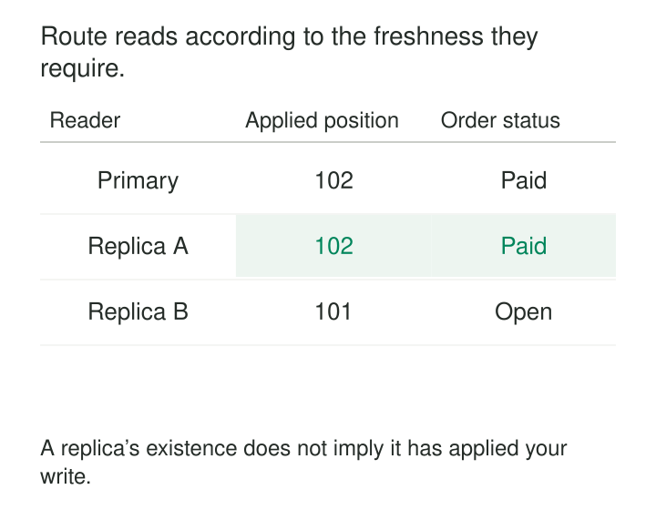

A live application handles writes comfortably until reporting traffic arrives. Dashboard refreshes, customer-history queries, and exports compete with transactions for CPU, memory, and storage bandwidth. The database becomes slow even though the write workload has barely changed.

**Read Replicas provide additional database copies that serve read traffic while a primary accepts writes.** Replication carries changes to those copies, allowing suitable queries to run on separate capacity.

The pattern works when read demand is substantial and the application can distinguish reads that tolerate delay from reads that must observe particular committed changes.

## Add read capacity behind a replication boundary

A replica receives changes from its source and applies them locally. Applications or routing infrastructure direct selected queries to it.

In a common asynchronous arrangement, a successful commit on the primary does not wait for every replica to catch up. Different replicas can therefore expose different committed states at the same moment.

That difference is not necessarily corruption or partial transaction visibility. PostgreSQL hot standbys, for example, make a transaction’s changes visible to new snapshots after replaying its commit record. The replica can present a consistent database snapshot that is simply behind the primary. [PostgreSQL hot standby](https://www.postgresql.org/docs/current/hot-standby.html)

Three stages matter: a change can be **received**, **stored durably**, and **applied for queries**. These are not interchangeable milestones.

A healthy connection proves that a server can answer. It does not prove that the server can answer with the version this request needs.

## Example: an order appears to lose its payment

A checkout service commits order O17’s payment on the primary. The confirmation page then reads from a replica.

| Location | Applied state | O17 status |
|---|---|---|
| Primary | Through illustrative position 102 | paid |
| Replica A | Through 102 | paid |
| Replica B | Through 101 | open |

Routing the confirmation page to replica B makes the payment appear unsuccessful even though it committed.

Amazon RDS DB instance read replicas use asynchronous replication and support routing read-heavy workloads away from the primary. That makes them useful for reporting, but the application must account for delayed propagation. [Amazon RDS read replicas](https://docs.aws.amazon.com/AmazonRDS/latest/UserGuide/USER_ReadRepl.html)

A straightforward policy keeps the immediate post-write read on the primary, using an appropriate new query or transaction snapshot. Less sensitive browsing can use replicas.

A fixed delay—“wait one second, then use any replica”—is only a heuristic. Replication lag can exceed the usual interval during load or disruption.

Switching between replicas introduces another problem: a user might first see `paid` on A, then `open` on B. Balancing requests without considering observed progress can move the user backward in database history.

## Make routing reflect the required guarantee

Useful routing policies distinguish several needs:

- **Lag-tolerant reads:** reporting can use replicas within a stated freshness budget.
- **Read-after-write:** a request must observe a particular completed write.
- **Monotonic reads:** later requests must not fall behind state already observed.
- **Reads governing writes:** checks and mutations remain together under the primary’s transaction and concurrency rules.

Where supported, a stronger replica-read protocol carries an engine-specific replication marker known to cover the required commit. The selected replica must prove it has applied that marker before the application starts a fresh read snapshot.

PostgreSQL exposes replay progress through `pg_last_wal_replay_lsn()`. Obtaining a suitable post-commit marker, comparing it correctly, and handling failover require an engine-aware protocol; a wall-clock timestamp or ordinary transaction identifier is not a substitute. [PostgreSQL recovery information functions](https://www.postgresql.org/docs/current/functions-admin.html#FUNCTIONS-RECOVERY-INFO)

The check and subsequent read must refer to the same selected replica and compatible replication history. A connection pool that silently switches destinations can invalidate the check.

Waiting also needs a deadline. If a replica cannot satisfy the requirement, route to approved capacity or fail according to the workload’s policy. Sending every delayed read to the primary can overload the system precisely when it is already under pressure.

## Example: reporting competes with PostgreSQL replay

A team moves a long-running daily report to a PostgreSQL hot standby. Primary query load falls, but the report occasionally gets canceled.

The replica must both answer queries and replay changes. Some replay operations conflict with an existing reader’s snapshot or locks. PostgreSQL may delay replay or cancel a conflicting query so recovery can progress. [PostgreSQL standby query conflicts](https://www.postgresql.org/docs/current/hot-standby.html#HOT-STANDBY-CONFLICT)

Increasing allowed replay delay can help the report finish while allowing the replica to fall further behind. Enabling `hot_standby_feedback` can reduce cleanup conflicts, but it may delay removal of dead rows on the primary and increase table bloat.

The replica therefore provides useful execution isolation, not complete independence from the writer.

A practical design may separate low-lag application reads from long analytical queries. Those workloads have different tolerances for query cancellation, replay delay, and resource consumption.

## Example: route an analytics connection in Azure SQL

An application has a transactional connection pool and a separate analytics pool. In supported Azure SQL configurations, setting `ApplicationIntent=ReadOnly` routes the analytics connection to a readable secondary.

The routing decision happens when establishing the connection. It is not an instruction to distribute individual statements arbitrarily.

Microsoft documents that replica reads can lag even where changes are persisted synchronously. Applying the transaction’s log records is still necessary before its changes become visible. Reconnecting can also land on a replica at a different point in time. [Azure SQL read scale-out](https://learn.microsoft.com/en-us/azure/azure-sql/database/read-scale-out?view=azuresql)

This arrangement suits a dashboard whose freshness requirement permits propagation delay. It does not automatically satisfy an immediate confirmation read.

**Synchronous replication is not a universal freshness promise.** PostgreSQL illustrates the distinction explicitly: ordinary synchronous commit can wait for remote durability, while `remote_apply` waits for replay on the required synchronous standbys. That stronger setting adds commit waiting and must be paired with routing to an appropriately acknowledged standby. [PostgreSQL synchronous replication](https://www.postgresql.org/docs/current/warm-standby.html#SYNCHRONOUS-REPLICATION)

## The operating bill includes replay

Replicas add compute, storage, networking, connection management, and operational work. Each must keep up with incoming changes while serving its assigned reads.

A replica sized for yesterday’s reporting demand may struggle when write volume doubles. Additional replicas improve aggregate read capacity but do not divide the primary’s write execution across independent writers.

Useful candidates include repeated history queries, dashboards, and read-heavy services with explicit consistency policies. Write-bound workloads or applications requiring every read to observe recent commits may gain less.

Monitor applied progress, replay throughput, retained logs, query latency, cancellations, and routing behavior. Amazon RDS exposes replication status and lag metrics; lagging replication can also increase retained-log storage. [RDS replication monitoring](https://docs.aws.amazon.com/AmazonRDS/latest/UserGuide/USER_ReadRepl.Monitoring.html)

Understand metric semantics. PostgreSQL warns that reported replication lag intervals are measurements for recent WAL activity, not predictions of catch-up time. Idle systems can also report null lag values. [PostgreSQL replication statistics](https://www.postgresql.org/docs/current/monitoring-stats.html#MONITORING-PG-STAT-REPLICATION-VIEW)

## Separate read scaling, recovery, and backup

A readable replica may also be a failover candidate, but those roles need explicit policies. Promoting an asynchronous copy can lose acknowledged changes that never reached it. Routing, connection recovery, and prevention of competing writers remain part of failover design. [PostgreSQL standby replication](https://www.postgresql.org/docs/current/warm-standby.html)

Service terminology also matters. An RDS Multi-AZ **DB instance** standby does not serve reads; other deployment types have different capabilities. [RDS deployment distinctions](https://docs.aws.amazon.com/AmazonRDS/latest/UserGuide/USER_ReadRepl.html#USER_ReadRepl.MultiAZ)

A replica is also not an independent historical backup: an accidental deletion can replicate successfully.

Common mistakes are routing every `SELECT` to replicas, equating low average lag with a freshness guarantee, and treating read scaling as automatic failover.

## Nearby patterns

[[data-workload-isolation|Workload Isolation]] separates competing work; read replicas provide one database-specific mechanism.

[[data-freshness-monitoring|Freshness Monitoring]] determines whether a replica remains eligible for a workload.

[[data-materialized-views|Materialized Views]] reduce repeated computation rather than merely adding another place to execute it.

[[data-log-based-change-data-capture|Log-Based Change Data Capture]] can feed independently modeled read systems when a database-shaped replica no longer suits the consuming workload.
