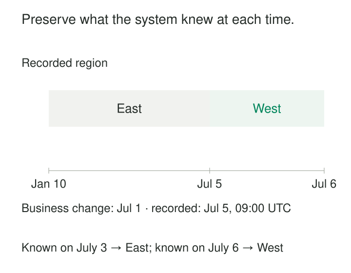

A report published on July 3 assigns an account to East territory. On July 5, the warehouse receives a notice saying the account moved to West on July 1.

The corrected territory is clear. The earlier report is harder to explain: why did it show East?

Overwriting the record removes the evidence. Backdating its history to July 1 can make the warehouse appear to have known something before it received the information.

[[data-recorded-time-history|Recorded-Time History]] preserves successive states according to when a particular system recorded them. It supports questions such as “What information did this warehouse hold when that report was produced?”

Fowler distinguishes this **record history** from the history of when information applied in the business. Both can change independently. [Martin Fowler: Bitemporal History](https://martinfowler.com/articles/bitemporal-history.html)

## Preserve the changing record of knowledge

A recorded-time version typically contains an entity identifier, its recorded attributes, and a period such as:

- `recorded_from`: when this version entered the system’s recorded state.
- `recorded_to`: when another version superseded it, or it ceased to be recorded as current.

The conceptual interval is half-open: the start is included and the end is excluded.

A correction creates a later recorded version. It does not make the earlier recorded state disappear. Historical values may have been mistaken, incomplete, or subsequently superseded; they remain evidence of what the system represented.

Database system-versioning provides a concrete implementation. IBM Db2, for example, supports system-period tables with generated period columns and an associated history table. [IBM: Creating a system-period temporal table](https://www.ibm.com/docs/en/db2-for-zos/13.0.0?topic=tables-creating-system-period-temporal-table)

## Example: a territory change arrives late

Account A42 is recorded as belonging to East. Its business assignment changes on July 1, but the warehouse accepts the notice on July 5 at 09:00 UTC.

Under an illustrative warehouse acceptance-time policy, the recorded history becomes:

| Recorded from | Recorded to | Recorded territory |
|---|---|---|
| January 10, 09:00 | July 5, 09:00 | East |
| July 5, 09:00 | Open end | West |

All dates here are in 2026 and times are UTC.



*The recorded timeline preserves the delay between the business change and warehouse acceptance.*

A July 3 recorded-time lookup returns East. That explains the warehouse’s representation, although West was already the correct business assignment.

A July 6 lookup returns West.

These answers concern the system’s knowledge at the requested time. Answering “Which territory actually applied on July 3, according to what we know now?” requires business-effective dates as well.

## Specify whose knowledge the clock represents

“Recorded” needs an explicit boundary.

The source application may record a change at 08:00, an ingestion service receive it at 08:05, and the warehouse publish it at 09:00. A dashboard might refresh at noon.

Those timestamps describe different availability points. A source’s history cannot, by itself, prove when a downstream report could use its values.

Choose the boundary that serves the question. Name additional timestamps separately—for example, `source_recorded_at`, `received_at`, and `published_at`. Avoid loading an old source timestamp into a warehouse recording field and thereby backdating local knowledge.

Rebuilds need the same care. Preserve original recording boundaries when reconstructing an existing history. Assigning every rebuilt row today’s timestamp destroys the earlier availability sequence; inventing earlier boundaries falsely extends it.

Periodic snapshots have another limitation: they preserve observed states at snapshot times. Changes overwritten between snapshots remain unavailable unless another source captured them.

## A system timestamp has implementation-specific meaning

Database-generated periods are useful because applications cannot casually supply arbitrary recording dates. However, their precise semantics matter.

SQL Server system-versioned temporal tables use the **transaction begin time**, in UTC, for their period boundaries. Several rows changed within one transaction can therefore share a boundary. That boundary is not necessarily the commit time or the moment another session first saw the change. [Microsoft: Temporal tables](https://learn.microsoft.com/en-us/sql/relational-databases/tables/temporal/overview?view=sql-server-ver17)

Consequently, an “as of” result should not automatically be interpreted as a literal trace of every historical reader’s visibility.

If exact report reproduction matters, retain the snapshot, release, or batch identifiers actually used. Long-running reports can otherwise combine reads made at different moments.

The correctness promise should match the mechanism: a versioned database representation, a warehouse publication history, or a captured decision input.

## A documented implementation: SQL Server temporal queries

SQL Server maintains current rows and previous versions in linked current and history tables. Its temporal query syntax can retrieve a prior state:

```sql
SELECT AccountId, Territory
FROM dbo.Account
FOR SYSTEM_TIME AS OF '2026-07-03T12:00:00'
WHERE AccountId = 'A42';
```

This example assumes `dbo.Account` is configured as a system-versioned temporal table. The timestamp supplied to `AS OF` is interpreted as UTC. [Microsoft: Query system-versioned temporal data](https://learn.microsoft.com/en-us/sql/relational-databases/tables/temporal/query-data?view=sql-server-ver17)

For a report involving several temporal tables, apply the intended recording cutoff consistently. Combining historical accounts with today’s classifications can produce a state that never existed as a coherent reporting input.

Microsoft also documents applying `AS OF` to a view containing temporal tables, propagating the time condition to those temporal inputs. Non-temporal inputs still require separate consideration. [Microsoft: Query system-versioned temporal data](https://learn.microsoft.com/en-us/sql/relational-databases/tables/temporal/query-data?view=sql-server-ver17)

## Example: prevent later knowledge entering an earlier prediction

A customer-retention model makes a prediction on April 2. The feature store then contains a Low activity classification.

On April 10, a delayed feed adds activity from March 31 and changes the classification to High.

A retrospective training dataset built from today’s corrected activity history might give the April 2 prediction the High classification. In this example, that introduces information unavailable to the original prediction process.

Recorded-time history can identify the earlier recorded state—provided its boundary represents availability to that process. A warehouse acceptance timestamp is insufficient if feature publication happened later.

Reproducing the actual prediction also requires the feature definitions and model version used. Recorded values preserve one part of the explanation; they do not reconstruct the entire computation automatically.

## Corrections, deletions, and explanations

Corrections should preserve the previous recorded version and introduce the revised state at the appropriate recording boundary. Keep a backdated business-effective date separate.

Deletions also need history. A current-state query may return no row after deletion, while an earlier recorded-time query should still retrieve the retained version. Absence before the first retained record must not automatically be interpreted as proof that the entity did not exist.

Recorded row versions usually explain **what changed**. They do not necessarily explain who requested it, why it changed, or which source message justified it. Retain actor, reason, provenance, and correlation identifiers when those questions matter.

Fowler’s temporal-pattern discussion distinguishes queryable historical models from audit logs and notes that a saved calculation trace can sometimes satisfy an explanation requirement more directly. [Martin Fowler: Temporal Patterns](https://martinfowler.com/eaaDev/timeNarrative.html)

## Retention defines the usable history

Every update can add storage, index maintenance, and historical query work. Wide records and frequent changes increase the cost. Plan which history must remain queryable, which can be archived, and how archived states will be recovered.

Microsoft explicitly identifies retention duration and update-heavy workloads as drivers of temporal history growth. Its retention mechanisms can remove aged versions, limiting the period available for historical queries. [Microsoft: Manage temporal history retention](https://learn.microsoft.com/en-us/sql/relational-databases/tables/manage-retention-of-historical-data-in-system-versioned-temporal-tables?view=sql-server-ver17)

Use this pattern for explaining earlier reports, investigating corrections, reconstructing recorded states, and controlling historical input availability. Its usefulness depends on complete capture at the chosen boundary, stable identities, retained versions, and consistent queries.

[[data-effective-dated-records|Effective-Dated Records]] tracks when information applies in the business. **Bitemporal Modeling** combines that timeline with recorded time. [[data-separate-source-facts-from-derived-interpretations|Separate Source Facts from Derived Interpretations]] preserves evidence for later reconstruction. **SCD Type 2** provides a versioned-row structure, but its dates must explicitly identify which timeline they represent.
