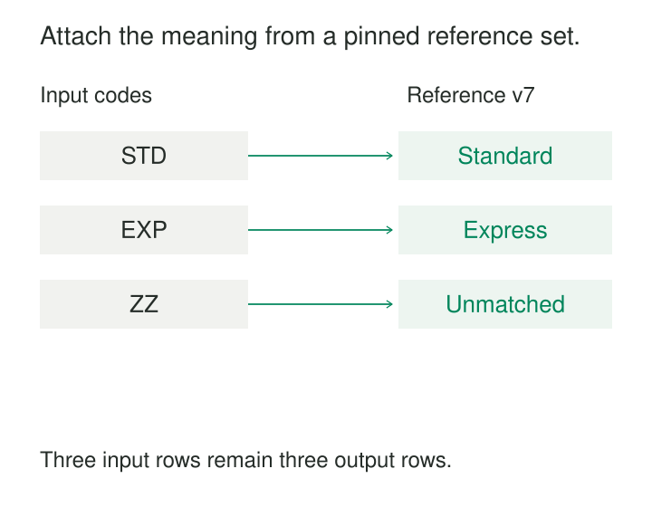

A shipment record contains a service code, a destination code, and a package weight. The operations dashboard needs service names, delivery regions, and handling categories.

Those descriptions live elsewhere. One report hard-codes them; another maintains a spreadsheet; a third joins a lookup table and accidentally doubles several shipments.

**Reference-Data Enrichment attaches governed context to records using explicit lookup rules.** It turns compact identifiers and codes into usable descriptions, classifications, or calculation inputs while preserving the identity and meaning of the original records.

The lookup may be small. Its effect on the result can be substantial.

## A lookup adds a dependency

Enrichment usually combines a primary dataset with reference data:

| Primary record supplies | Reference data supplies |
|---|---|
| Service code | Service name and category |
| Customer identifier | Applicable region |
| Currency and event time | Selected conversion rate |
| Device identifier | Installation and calibration context |

The enriched output should retain the original identifiers and codes, plus enough provenance to identify the reference data used.

Azure Data Factory’s lookup transformation provides a documented implementation. It appends matching reference columns to the primary stream, with behavior similar to a left outer join. Its configuration also exposes how multiple matches are handled. See [lookup transformations](https://learn.microsoft.com/en-us/azure/data-factory/data-flow-lookup).

That last detail matters. Adding columns is straightforward; establishing the correct match requires a contract covering identity, cardinality, time, and missing values.

## Service codes become readable without losing shipments

Consider an illustrative carrier feed:

| Shipment | Service code |
|---|---|
| S1 | STD |
| S2 | EXP |
| S3 | ZZ |

Reference version 7 maps `STD` to Standard and `EXP` to Express. It contains no entry for `ZZ`.

A useful enriched result is:

| Shipment | Original code | Service name | Lookup status |
|---|---|---|---|
| S1 | STD | Standard | Matched |
| S2 | EXP | Express | Matched |
| S3 | ZZ | Unresolved | Unmatched |

An inner join would remove S3. That might be appropriate for a deliberately filtered product, but it should not quietly reduce the shipment population during preparation.

A left join preserves the shipment while making the missing context visible. The pipeline can then quarantine it, publish it with a quality indicator, or pause a downstream calculation according to the product’s requirements.

Azure Data Factory documents an `isMatch()` function and a conditional split for separating matched and unmatched records. This makes lookup failure an explicit outcome rather than an invisible loss.

The original code remains valuable: once `ZZ` is defined or corrected, the affected shipments can be identified and reprocessed.

## One applicable match protects the grain

Suppose the service table contains two applicable `STD` rows. A normal join can produce two outputs for S1.

If the shipment carries a charge or weight, later sums may count it twice. Every output row can look plausible even though the lookup changed the grain.

For single-valued enrichment, each primary row should have at most one applicable reference match. A mandatory lookup requires exactly one; an optional lookup permits zero.

The key often needs more than the visible code. Two carriers can both use `STD` with different meanings. The reference identity might therefore include carrier, service code, and applicable version.

Selecting an arbitrary matching row conceals ambiguity. A “first” or “last” option needs meaningful ordering, and overlapping validity intervals may indicate a reference-data defect.

If several matches are legitimate—such as a product belonging to multiple categories—the model needs an explicit multivalued relationship. Row expansion and any allocation of measures must be intentional.

## Historical context differs from current context

Consider an illustrative customer-region history:

| Customer | Region | Valid interval |
|---|---|---|
| C17 | North | January 1 to April 1 |
| C17 | South | April 1 onward |

A sale occurred on March 20 but arrived on April 3.

A report describing the region at the time of sale should assign North. A report grouping all sales by each customer’s current region might assign South. Both can be useful, but they answer different questions.

Kimball’s guidance for [late-arriving facts](https://www.kimballgroup.com/data-warehouse-business-intelligence-resources/kimball-techniques/dimensional-modeling-techniques/late-arriving-fact/) explicitly calls for finding dimension keys effective when the measurement event occurred.

An event-time lookup therefore needs an identity match and a temporal match. Half-open validity intervals—start inclusive, end exclusive—help ensure that an event on a boundary belongs to one version.

The reference history must also be complete enough to support the lookup. Knowing today’s region cannot reconstruct March’s region.

If historical reference values are later corrected, reproducing a previously published report may require identifying what reference version was known at the original run, as well as what was effective on the event date.

## A rate lookup introduces calculation semantics

An illustrative transaction contains an amount of 100 in currency A. A reference record defines a rate of 1.10 units of currency B per unit of A. The derived amount is 110 B.

Matching only on currency A is insufficient if the reference table contains multiple target currencies, providers, rate types, or effective times. The enrichment contract must select the intended record and establish multiplication direction, precision, and rounding.

The original amount and currency should survive alongside the rate, reference identity, and derived amount.

Apache Flink documents this mechanism through an event-time temporal join between orders and a versioned currency-rate table. It also distinguishes processing-time lookups, which use context available when processing occurs. See [Flink temporal joins](https://nightlies.apache.org/flink/flink-docs-release-2.3/docs/sql/reference/queries/joins/#temporal-joins).

Choosing a temporal join does not define the business rate policy. It implements the selected policy once its keys and timing are established.

## Streaming lookups need a freshness contract

A streaming pipeline can enrich records from an in-memory reference snapshot, a changing table, or a remote service.

These choices produce different behavior. A periodically refreshed cache may serve older context until refresh. A live service lookup may return different values when the same event is replayed.

Apache Beam warns that its slowly updating global-window side-input pattern matches processing-time reference updates to event-time records nondeterministically. See [Beam side-input patterns](https://beam.apache.org/documentation/patterns/side-inputs/).

A pipeline requiring reproducible historical enrichment needs identifiable reference versions or another stable temporal selection mechanism.

Reference updates also raise a propagation question. Should they affect only newly processed records, or revise previously enriched outputs? That decision belongs in the model. An append-only enrichment pipeline does not automatically revisit old facts when a lookup changes.

## Treat failure modes separately

“No matching key” differs from “reference service unavailable.” Both differ from “multiple applicable matches.”

Collapsing them into the same null value makes diagnosis and recovery difficult. Useful outcomes include matched, unmatched, ambiguous, temporarily unavailable, and invalid lookup key.

Preserving a record does not require treating every enrichment as successful. A downstream product can require complete context while the ingestion layer retains unresolved records for repair.

Verification should examine match rates, ambiguous matches, reference freshness, and row counts before and after enrichment. For grain-preserving lookups, unchanged measures should reconcile as well.

Reference-data publication needs ownership. Even a small mapping change can reclassify millions of facts or alter derived amounts.

## Context has an operating cost

Broadcasting a small reference table can avoid repeated network access, but consumes worker memory. Large joins can require shuffles and significant computation.

Remote lookups add latency, service capacity requirements, retries, and potentially request charges. Apache Beam’s [Enrichment transform](https://beam.apache.org/documentation/transforms/python/elementwise/enrichment/) provides documented support for remote key-value lookups, throttling, retries, batching, and caching.

Caching reduces requests but adds freshness and invalidation decisions. Cache keys may need reference version or effective time as well as entity identity.

The pattern fits governed code translation, dimensional context, classifications, and reusable calculation inputs. It cannot resolve uncertain identity merely by joining similar names, nor can it repair an incorrect reference definition.

[[data-controlled-vocabularies|Controlled Vocabularies]] supplies governed meanings. [[data-as-of-joins|As-of Joins]] selects temporal context. [[data-inferred-dimension-members|Inferred Dimension Members]] supports facts whose descriptive context arrives later. [[data-deterministic-transformations|Deterministic Transformations]] makes replay dependencies explicit.

A dependable enrichment explains which reference record was used, why it applied, and what happened when no unique match was available.
