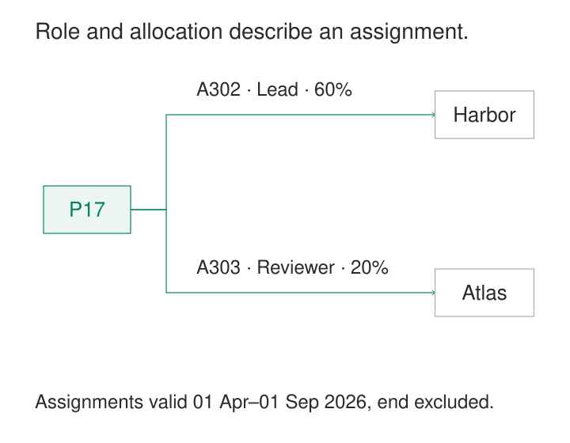

Maya is a lead on Project Harbor and a reviewer on Project Atlas. Her allocation is different on each project, and her Harbor role changed in April. A single `role` field on Maya’s profile cannot describe this situation. Neither can a role field on either project.

The facts belong to the assignments connecting Maya to those projects.

Relationships with Attributes places information on the particular connection it describes. It makes roles, quantities, dates, conditions, and evidence interpretable without turning them into misleading properties of either participant.

## Find the subject of the fact

A relationship identifies participants playing particular roles: a person assigned to a project, a carrier serving a route, or an actor appearing in a film.

Its attributes qualify that connection. “Lead” describes Maya’s participation in Harbor. “60%” describes her allocation to that assignment under a defined capacity measure.

A useful test is whether the value could differ across relationships while both endpoint entities remain unchanged. Maya can have two assignments with different roles without becoming two people.

[[data-associative-entities|Associative Entities]] provides a common relational structure for representing these connections. This pattern focuses on the meaning and placement of their attributes. It also applies to relationships whose current cardinality is one-to-many.

Property graphs can represent the idea directly. Neo4j relationships have a type, direction, endpoints, and their own properties. [Neo4j: Graph Database Concepts](https://neo4j.com/docs/getting-started/appendix/graphdb-concepts/)

## Example: a role applies within an assignment

Consider these illustrative assignments for Maya:

| Assignment | Project | Role | Allocation | Valid from | Valid until |
|---|---|---|---:|---|---|
| `A301` | Harbor | Reviewer | 20% | 2026-01-01 | 2026-04-01 |
| `A302` | Harbor | Lead | 60% | 2026-04-01 | 2026-09-01 |
| `A303` | Atlas | Reviewer | 20% | 2026-04-01 | 2026-09-01 |

Here, each row describes a period with one role and allocation. Intervals include their start and exclude their end.

The model can answer “What was Maya’s role on Harbor in March?” and “How was she allocated across projects in May?” Overwriting her profile with `role = Lead` would lose both distinctions.

The allocation also needs a denominator. In this example it means a percentage of Maya’s contracted work capacity, rather than a share of the project budget or team headcount.

Changing a role creates a new assignment period under this design. Another design could preserve a durable assignment ID and store its changing versions separately. Either approach needs a clear account of what each record identifies.

If multiple simultaneous roles on one project are allowed, the uniqueness rule must accommodate them. A model should not prohibit legitimate overlap merely because the first implementation assumed one role.

## Example: direction changes the attribute’s meaning

Two warehouses use a defined transport service in both directions:

| Origin | Destination | Estimated transit time |
|---|---|---:|
| East warehouse | West warehouse | 2 days |
| West warehouse | East warehouse | 3 days |

The estimate belongs to the directed service connection. Neither warehouse has an intrinsic transit time of two or three days.

The relationship should name its endpoint roles explicitly, such as `origin_warehouse_id` and `destination_warehouse_id`. Swapping them changes the question.

The service context matters too. If several carriers or service levels connect the same warehouses, the endpoint pair does not identify one estimate. Carrier, service level, timetable period, or a service identifier must distinguish the applicable connection.

An estimate should also remain distinguishable from an observed shipment duration or a contractual guarantee. Those facts have different subjects and evidence.

A relationship attribute becomes useful when its scope is precise enough to tell a consumer which journey, conditions, and direction it describes.

## A published implementation: qualifying an acting contribution

Schema.org’s `Role` mechanism explicitly adds information to relationships. Its published `PerformanceRole` example connects Bill Murray to *Ghostbusters* and attaches the character name “Dr. Peter Venkman” to his acting contribution.

The character name describes that contribution. It is not Murray’s personal name, and it is not the film’s title. Schema.org uses an intermediate Role object to preserve this distinction. [Schema.org: Role](https://schema.org/Role)

Neo4j’s documentation demonstrates the corresponding property-graph approach: its film example places a character-role value on an `ACTED_IN` relationship between an actor and a movie. [Neo4j: Relationship Properties](https://neo4j.com/docs/getting-started/appendix/graphdb-concepts/#graphdb-relationship)

These are alternative representations of the same modeling requirement. The implementation can use an intermediate entity or properties on an edge, provided the contribution and its context remain identifiable.

## Separate relationship meaning from evidence about it

Some attributes describe the relationship itself: role, allocation, start date, or service conditions. Others describe an assertion about the relationship: who reported it, when it was recorded, or how confidently it was inferred.

Those categories should remain distinguishable.

A project assignment effective from 1 April might be entered on 5 May. The effective date tells us when the assignment applied; the recorded date tells us when the system learned about it.

Likewise, a source’s confidence that two organizations collaborate does not measure the strength of their collaboration. A confidence score describes an inference or claim.

Wikidata’s deployed statement model illustrates this separation through contextual qualifiers and supporting references. Qualifiers can specify time periods, roles, methods, or scope beyond a simple property–value connection. [Wikidata: Qualifiers](https://www.wikidata.org/wiki/Help:Qualifiers)

When sources disagree, separate assertions may be needed. Collapsing them into one relationship with one unexplained value conceals the disagreement.

## What must hold for correctness

**The relationship type and endpoint roles must be clear.** “Assigned to,” “manages,” and “reviews” express different connections. Direction should follow the domain’s meaning.

**Each attribute needs a defined scope.** A rate requires units and a basis; an allocation requires a denominator; a date requires an interpretation.

**The relationship instance must be identifiable.** The same participants may have several contracts, roles, episodes, or versions. Endpoint identifiers alone are not always sufficient.

**Temporal boundaries must be explicit.** Define whether intervals include their endpoints and whether a missing end means ongoing, unknown, or uncollected. Queries must select the period relevant to their question.

**Constraints must reflect actual multiplicity.** Overlap can be an error for one relationship type and legitimate for another. Rules about total allocations, exclusive roles, or permitted participants require deliberate enforcement.

The attributes also need a coherent grain. A monthly summary of an assignment and an individual assignment-change event should not be stored as interchangeable relationship records.

## Choose a representation that preserves the meaning

A relational model commonly uses an associative table containing participant references and relationship attributes. A property graph may attach simple attributes directly to an edge.

An explicit relationship entity becomes useful when the connection needs its own documents, approvals, events, participants, or history. It provides somewhere for those further references to attach.

The pattern does not require a separate table for every connection. If a child has exactly one current parent, some relationship-scoped attributes can be stored on the child without losing information. Their meaning still needs to be documented, especially if history or multiplicity later changes.

Avoid a universal relationship table containing generic endpoints and an unrestricted property bag unless its validation and query requirements genuinely justify that flexibility. Named relationship types make permitted participants and attributes easier to understand.

## Costs, mistakes, and useful situations

This pattern is especially useful for affiliations, staffing, contracts, routes, contributions, ownership claims, and other connections whose meaning depends on context.

Its operating costs include additional records or edges, temporal queries, indexes, validation, and history maintenance. Source assertions and corrections add provenance and reconciliation work.

Common mistakes include storing a contextual role globally on a person, copying inverse relationships without defining their consistency, and treating the newest recorded relationship as the historically applicable one.

Aggregation also requires care. Multiple relationship periods can duplicate participants in a query. Allocation percentages can only be combined across compatible periods and measurement bases. A richly described connection still needs an explicit rule for counting it.

Where a connection has no additional context or lifecycle, a simple reference or bare association may be sufficient.

## Related patterns

[[data-associative-entities|Associative Entities]] supplies a structure for giving relationships their own records.

[[data-declare-the-grain|Declare the Grain]] distinguishes a relationship, its episodes, and its versions.

[[data-make-units-explicit|Make Units Explicit]] makes rates, quantities, and allocations interpretable.

[[data-separate-source-facts-from-derived-interpretations|Separate Source Facts from Derived Interpretations]] distinguishes reported connections from inferred or selected claims.
