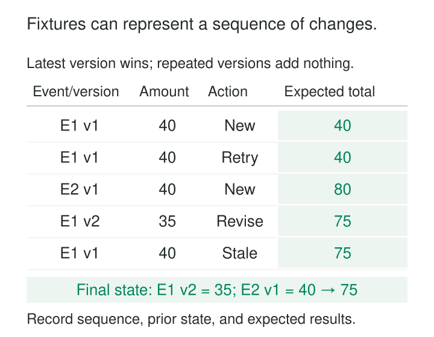

A pipeline passes its tests using ten tidy orders. Every customer exists, every identifier is unique, and every event arrives in order.

Production introduces a customer identifier reused by another tenant, a correction delivered after a retry, and a record exactly on a history boundary. The pipeline produces plausible but incorrect results.

The tests exercised easier conditions than the system needed to handle.

**Representative Test Fixtures preserve small, controlled examples of the conditions that materially affect processing behavior, together with their expected outcomes.** Their purpose is to make those conditions repeatable, understandable, and available whenever the system changes.

Here, “representative” means representative of consequential behavior. A fixture collection deliberately containing difficult cases does not estimate their frequency in production.

## Preserve a scenario, not just some rows

A useful fixture describes the starting conditions of a test.

Those conditions may include several related tables, exact file bytes, existing destination state, configuration, reference-data versions, timestamps, or an ordered sequence of changes. Expected results explain what correct handling means.

A fixture for a customer join needs both sides of the relationship. A fixture for an incremental update may need an existing destination. A streaming fixture may need arrival order and watermark progress.

The boundary determines what must be preserved. Parsed records can test business calculations, while a file importer may require the original encoding, delimiters, and line endings.

dbt provides a concrete implementation for SQL model fixtures through inline dictionaries, CSV, and SQL representations. The choice affects how clearly a case can express its data and types. [dbt unit-test data formats](https://docs.getdbt.com/reference/resource-properties/data-formats)

Choose the smallest representation that retains the behavior being tested.

## Example: identifiers are only unique within their namespace

A transformation enriches orders with customer details. Customer identifiers are unique within a tenant.

The customer fixture contains:

| Tenant | Customer ID | Name |
|---|---:|---|
| A | 7 | Ada |
| B | 7 | Ben |
| B | 8 | Cora |

The order fixture then introduces four distinct situations:

| Tenant / order | Customer reference | Expected handling |
|---|---|---|
| A / 17 | A / 7 | Match Ada |
| B / 17 | B / 7 | Match Ben |
| A / 18 | A / 8 | Report missing reference |
| A / 19 | NULL | Retain as a permitted guest order |

These expectations follow an explicit contract: supplied customer references must resolve within the same tenant, while guest orders may omit the reference.

Joining only on customer ID creates cross-tenant matches. Checking whether customer 8 exists anywhere incorrectly accepts A / 18. Rejecting every null reference incorrectly removes the guest order.

A fixture containing one tenant and complete references would expose none of these mistakes.

The value comes from the relationships among records. Adding hundreds of unrelated customers would make the example larger without necessarily making it more useful.

## Example: place observations on both sides of a boundary

Customer A / 7 has two historical region versions:

- Key 107: East during `[2026-01-01, 2026-07-01)`.
- Key 208: West from `2026-07-01` onward.

The intervals include their starts and exclude their ends. This notation follows the usual distinction between inclusive and exclusive range bounds. [PostgreSQL range types](https://www.postgresql.org/docs/current/rangetypes.html)

A fixture using second-resolution UTC timestamps contains:

| Sale time | Expected customer key |
|---|---:|
| June 30, 23:59:59 | 107 |
| July 1, 00:00:00 | 208 |
| July 1, 00:00:01 | 208 |

The middle case is essential. A join that includes both ends of each interval can match two versions at midnight. Another implementation might exclude both boundaries and match neither.

Record the time zone and precision alongside the values. If production timestamps have finer precision, add cases appropriate to that contract.

The same fixture can distinguish event time from arrival time: a June sale received in August still belongs to the version valid when the sale occurred.

## Example: include retries, corrections, and stale arrivals

A versioned event-total transformation keeps the highest version of each event within one source. Duplicate deliveries of an unchanged version have no additional effect.

Begin with empty state and retain it throughout this fixture:

| Arrival | Expected logical total |
|---|---:|
| E1, version 1, value 40 | 40 |
| Retry E1, version 1, value 40 | 40 |
| E2, version 1, value 40 | 80 |
| E1, version 2, value 35 | 75 |
| Stale E1, version 1, value 40 | 75 |

E2 is a separate event despite having the same value as E1. The correction replaces E1’s previous contribution. The final stale delivery cannot undo it.

*Arrival order and retained state are part of this fixture. The expected totals describe logical state; emitted results depend on the processing contract.*

An unordered collection of these records cannot establish that the stale update was handled after the correction. The test must preserve the relevant sequence and observation points.

For streaming calculations, fixtures may also control watermark and processing-time advances. Apache Beam’s `TestStream` expresses these actions explicitly; Google’s Dataflow testing guidance describes using it with assertions to test timing-dependent behavior. [Beam TestStream](https://beam.apache.org/blog/test-stream/), [Dataflow pipeline testing](https://docs.cloud.google.com/dataflow/docs/guides/develop-and-test-pipelines)

## Build coverage around consequential differences

Start with an ordinary case that establishes intended behavior. Add cases for boundaries, missing information, invalid relationships, repeated identities, corrections, and previously observed failures.

Include interactions when they matter. A late event may behave differently when it also revises an existing identity. A missing lookup may require different handling for an optional relationship.

Each case should explain why it exists. Names such as “same local identifier in different tenants” or “correction followed by stale replay” communicate more than `sample_17`.

Avoid combining every difficult condition into one enormous scenario. Small cases make failures easier to diagnose. A few broader scenarios can then check important combinations across processing boundaries.

## Give expected results an independent basis

Fixtures need reviewed expectations grounded in a specification, business rule, standard, or independently worked example.

Saving whatever the current implementation produces creates a baseline, but it does not establish that the baseline is correct. Automatically accepting every changed expectation can turn regressions into the new definition of success.

Compare the aspects that matter: identities, values, duplicate counts, rejected records, and relevant ordering. A row-count assertion alone can miss one omitted record balanced by one duplicate.

PostgreSQL’s regression infrastructure provides a real example of maintaining reference outputs and comparing them with actual results. Its documentation also describes differences caused by locale, time zones, floating-point behavior, and row ordering—conditions a fixture and its comparison rules may need to address. [PostgreSQL test evaluation](https://www.postgresql.org/docs/current/regress-evaluation.html)

## Preserve realism while keeping examples safe

Production incidents are valuable sources of fixture ideas. Extract the smallest case that retains the failure, then remove unnecessary sensitive content.

Sanitization must preserve the relevant structure. Replacing every customer with a different identifier can erase a collision. Removing repeated rows can erase a retry. Shifting timestamps independently can destroy an interval boundary.

Synthetic examples work well when the important relationships can be constructed explicitly. Keep enough explanation to show why the example reflects a real requirement.

Store exact files when serialization matters. Record generator seeds, reference versions, configuration, and starting state where applicable. A fixture regenerated from changing live data is no longer a stable example.

## Costs, uses, and limitations

This pattern is useful when changing schemas, parsers, join logic, historical models, deduplication rules, or incremental processing. Fixtures also make reviews more concrete by exposing the cases a change must preserve.

Costs include curation, expectation review, storage, execution, and maintenance as contracts evolve. Shared mutable fixtures can create hidden coupling between tests; isolated or freshly constructed state makes results easier to interpret.

A curated collection cannot establish production failure rates, performance at scale, or exhaustive correctness. Use broader generated cases, operational checks, and load tests for those questions.

## Related patterns

[[data-transformation-unit-tests|Transformation Unit Tests]] executes production logic against controlled fixtures. [[data-property-based-data-tests|Property-Based Data Tests]] explores beyond the fixed collection and can contribute new regression cases.

[[data-representative-text-fixtures|Representative Text Fixtures]] specializes this pattern for encoding, parsing, normalization, and document structure.

[[data-deterministic-transformations|Deterministic Transformations]] helps keep expected outcomes reproducible from the fixture’s explicit inputs and configuration.
