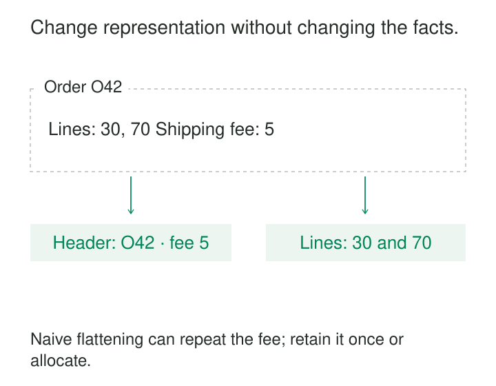

A supplier sends orders as nested documents. The warehouse needs order lines as rows. An application wants each order returned as a document again, while a finance export requires one column for each month.

Soon, every consumer contains its own flattening, grouping, and pivoting logic. A supplier changes its payload, and several pipelines break. One report doubles shipping charges because an order-level amount was repeated across its lines.

**Reshape at Boundaries places structural transformations where data crosses an explicit interface.** Incoming data becomes a representation suited to internal work; outgoing data becomes the representation a consumer requires. Each transformation declares what it preserves, what it changes, and what one output record means.

## Let interfaces own their shapes

A boundary is where responsibility or a data contract changes: a partner feed enters a platform, a reusable model becomes a report, or stored records become an API response.

Reshaping at that boundary can mean unpacking arrays, nesting related rows, pivoting categories into columns, unpivoting columns into observations, or assembling an output envelope.

The established **Message Translator** pattern provides the underlying integration mechanism: an adapter translates between representations expected by different systems. Reshape at Boundaries applies that idea specifically to data structure and record organization. [Enterprise Integration Patterns](https://www.enterpriseintegrationpatterns.com/patterns/messaging/MessageTranslator.html)

The internal representation should suit its workload. It might use normalized relations, dimensional tables, or nested records. The pattern does not prescribe one universal shape. It gives each interface a clear place to adapt that shape, so consumer-specific formatting does not spread throughout the system.



## Unpack an order without multiplying its charges

Consider an illustrative partner document containing order `O42`, shipping cost `5`, and two items:

| Line | Item amount |
|---|---:|
| L1 | 30 |
| L2 | 70 |

An ingestion adapter can produce one order record containing shipping cost and two line records containing item amounts. The relationships remain explicit through `order_id` and `line_id`.

In BigQuery, the line extraction can be as short as:

```sql
SELECT
  o.order_id,
  item.line_id,
  item.amount
FROM raw_orders AS o
CROSS JOIN UNNEST(o.items) AS item;
```

BigQuery documents `UNNEST` as a way to turn array elements into rows. It also warns that flattening does not preserve array order automatically; offsets can retain positional information when that matters. [BigQuery array documentation](https://docs.cloud.google.com/bigquery/docs/arrays)

The important change is the grain: one input document becomes two line records. Item amounts still total `100`. Shipping remains an order-level amount of `5`.

If shipping is copied onto both lines, summing that column produces `10`. Such repetition can be useful for display, but the column needs an explicit aggregation rule. Allocating shipping across lines would require a separate business decision.

An order with no items also needs deliberate handling. It belongs in the order dataset even when it produces zero line records. An outer flatten can retain a parent with null child fields, but that placeholder must not be counted as a real item.

## Turn monthly columns into observations

A planning system exports this row:

| Store | Jan 2026 | Feb 2026 | Mar 2026 |
|---|---:|---:|---:|
| S7 | 100 | 120 | null |

At ingestion, an adapter can turn the month columns into a reusable observation structure:

| Store | Month | Budget |
|---|---|---:|
| S7 | 2026-01 | 100 |
| S7 | 2026-02 | 120 |
| S7 | 2026-03 | null |

A new month can then arrive as another observation rather than requiring another internal column. A reporting boundary can pivot these observations back into the layout finance expects.

Several assumptions determine whether this is safe. The column labels must identify the year and period unambiguously. The values must share compatible units and definitions. The target key—perhaps store, month, scenario, and currency—must capture all distinctions in the input.

Missing values deserve particular attention. SQL Server’s documented `UNPIVOT` removes null-valued entries. If “March budget not supplied” must remain distinguishable from “no March observation,” the adapter must preserve that distinction explicitly. Its documentation also explains that `PIVOT` can aggregate multiple rows, so unpivoting the result cannot generally reconstruct the original records. [SQL Server PIVOT and UNPIVOT documentation](https://learn.microsoft.com/en-us/sql/t-sql/queries/from-using-pivot-and-unpivot?view=sql-server-ver17)

A pivot containing `SUM` therefore needs an aggregation contract. Unexpected duplicate observations should not disappear merely because the chosen operator combines them.

## Assemble documents without creating combinations

An application wants one order document containing two arrays: its lines and its payments.

Suppose the order has two lines and three payments. Joining both child tables directly through the order produces six combinations. Aggregating that joined result into arrays repeats each line three times and each payment twice.

A serving adapter can instead collect lines per order and payments per order independently, then attach the two collections to the order header. The output contains two lines and three payments.

If array order matters, define it using a stable ordering field and a tie-breaker. PostgreSQL’s aggregate documentation explicitly notes that array and JSON aggregation order is unspecified by default and can be controlled inside the aggregate. It also distinguishes a null aggregate result from an empty array. [PostgreSQL aggregate functions](https://www.postgresql.org/docs/current/functions-aggregate.html)

The output contract must therefore decide whether an order with no payments contains `payments: []`, `payments: null`, or no payments field. Those representations may carry different meanings for the consumer.

## State what must survive the transformation

A reliable boundary contract makes several properties explicit.

**Identity and grain.** Define one input record and one output record. Preserve parent and child identifiers. Array position can describe order, but usually makes a fragile long-term identity when elements can be inserted or reordered.

**Cardinality.** Declare expected expansion or grouping. Two child arrays of lengths two and three might represent independent collections, six combinations, or positional pairs. The structure alone does not establish which interpretation is correct.

**Information loss.** Grouping, deduplication, projection, and aggregation may prevent reconstruction. A reversible transformation requires enough retained keys, values, ordering information, and presence indicators. Original payloads remain useful evidence.

**Update semantics.** A complete document can define a complete child collection. A partial update cannot safely imply that omitted children were deleted. Incremental reshaping needs a policy for additions, replacements, removals, and reordered elements.

**Consistency.** An assembled document should use a coherent version of its components when consumers rely on their agreement. Reading a header before an update and its children afterward can produce a document that never existed as a consistent business state.

Verification should compare the properties that matter: identities, child counts, measure totals, empty collections, and representative round trips where reversibility is promised.

## Choose boundaries that earn their cost

This pattern is useful when partner formats change independently, several consumers require different layouts, or repeated structural logic is becoming difficult to maintain.

Its costs include parsing, serialization, grouping, memory, and data movement. Flattening can greatly increase row counts; packing very large collections can create oversized records and expensive rewrites. Repeating a reshape on every read may justify materializing a serving model, with the added cost of storage and refresh management.

Some workloads benefit from keeping data nested internally. BigQuery, for example, documents nested and repeated fields as useful for hierarchical relationships frequently queried together. Flattening everything early can introduce avoidable processing. [BigQuery nested-data guidance](https://docs.cloud.google.com/bigquery/docs/best-practices-performance-nested)

A boundary can be a view or transformation module; it does not require another service or pipeline stage. Place it where a real contract changes, and give that adaptation a clear owner.

## Related patterns

[[data-declare-the-grain|Declare the Grain]] establishes what each record means before and after reshaping.

[[data-canonical-mapping|Canonical Mapping]] reconciles source meanings, codes, and units. Reshaping arranges those meanings into the required structure; many adapters perform both responsibilities.

[[data-document-aggregates|Document Aggregates]] helps determine which related records belong together in a document.

[[data-preserve-raw-inputs|Preserve Raw Inputs]] retains the source evidence needed when a structural assumption changes or an adapter must be corrected.
