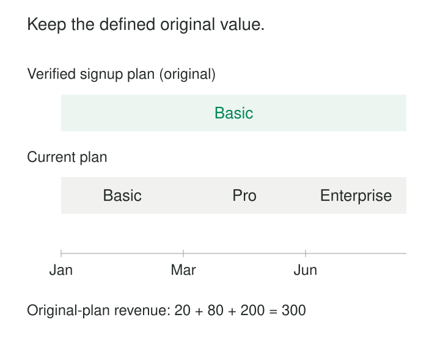

A customer signs up for Basic, upgrades to Pro, and eventually becomes an Enterprise customer. Each time, the warehouse replaces their plan with the latest value. Then someone asks: “How much revenue have customers who started on Basic generated?”

The answer keeps changing for the wrong reason. Successful customers disappear from the Basic cohort as they upgrade. Their starting point has been overwritten.

**Retain Original Values** preserves an attribute’s accepted original value throughout the entity’s lifetime. In dimensional modeling, this is **Slowly Changing Dimension Type 0**: subsequent business changes leave that attribute unchanged. It supports questions about origins, initial conditions, and stable cohorts. Kimball identifies explicitly named original attributes, such as original credit score, as a natural application. [Kimball Group: SCD Types 0, 4, 5, 6, 7](https://www.kimballgroup.com/2013/02/design-tip-152-slowly-changing-dimension-types-0-4-5-6-7/)

## Freeze the starting point you intend to study

Type 0 is a policy for a particular attribute. It does not require freezing every property of a customer, product, or account.

A customer dimension might contain:

| Attribute | Meaning | Change policy |
|---|---|---|
| `original_plan` | Plan accepted at signup | Retain the original value |
| `current_plan` | Latest known plan | Overwrite when it changes |
| `current_email` | Latest contact address | Overwrite when it changes |

The names make the analytical perspectives visible. An original plan answers a cohort question; a current plan answers a present-state question.

A dimension can combine change policies across its attributes. Type 0 can also coexist with Type 2 versioning: when other attributes create new dimension rows, the original value must remain consistent across versions belonging to the same durable entity. Microsoft’s dimensional-modeling guidance describes choosing change treatments at the attribute level. [Microsoft: Star schema guidance](https://learn.microsoft.com/en-us/power-bi/guidance/star-schema)

*The original plan provides a stable grouping for later activity. All amounts and records are illustrative.*

In this example, the customer generates $300 across three plans. Grouping by original plan assigns all $300 to the Basic signup cohort.

That result means “revenue generated by a customer who started on Basic.” Revenue earned while the customer actually held Basic requires a different perspective. Type 0 alone cannot reconstruct the sequence of later plans; Type 2 history or appropriately modeled subscription events can supply that information. [Microsoft: Temporal table usage scenarios](https://learn.microsoft.com/en-gb/sql/relational-databases/tables/temporal-table-usage-scenarios?view=sql-server-ver17)

## “Original” needs a business definition

The difficult part is deciding which value deserves to be retained.

Suppose a warehouse begins receiving customer data in March. Customer 42 already has Pro. Freezing that first incoming value establishes **first observed plan**, which may differ from **signup plan**.

Calling both `original_plan` hides a consequential assumption.

A trustworthy baseline needs three agreements:

- **An anchor:** signup, first activation, first paid contract, or another defined business moment.
- **An identity:** the customer, account, subscription, or product whose beginning is being described.
- **Authoritative evidence:** the event, source record, or historical extract that establishes the value at that moment.

These agreements determine whether the resulting cohort is meaningful. A customer with several subscriptions may have several original subscription plans but only one first customer signup. Reused account numbers can accidentally give a new account an old account’s baseline.

Arrival order also matters. Two parallel feeds may deliver different records for the same entity. Allowing whichever insert happens first to establish the original value makes warehouse timing determine business meaning. Resolve the baseline using the agreed source authority and ordering rules.

If trustworthy origin data does not exist, retain a clearly named first-observed value and expose that limitation.

## Initialize once, then protect the baseline

A typical load establishes the original value when the entity first becomes sufficiently known. Subsequent loads update other attributes while preserving the accepted baseline.

However, an early placeholder is not necessarily an accepted original value.

A fact may arrive before its customer details. The warehouse creates an inferred customer member with unknown attributes so the fact can load. When authoritative signup details arrive, filling the original plan completes initialization. Treating the placeholder’s unknown value as permanently frozen would preserve an ingestion gap.

Microsoft’s SQL Server Integration Services supports inferred members whose missing details can be populated later. This provides an implementation mechanism, but the organization still has to decide which incoming details establish the baseline. [Microsoft: Slowly Changing Dimension transformation](https://learn.microsoft.com/en-us/sql/integration-services/data-flow/transformations/slowly-changing-dimension-transformation)

This distinction should survive rebuilding the warehouse. A full reload from today’s customer profiles cannot recreate signup plans that those profiles no longer contain. Retain the authoritative origin records or a protected baseline dataset.

An attribute is only reliably original if its origin survives recovery, migration, and reprocessing.

## Example: preserve a product’s launch category

A retailer wants to compare the long-term performance of products introduced in different categories.

Product P-81 launches under Accessories. Six months later, merchandising moves it into Electronics.

| Product | Original launch category | Current category |
|---|---|---|
| P-81 | Accessories | Electronics |

Retaining `original_launch_category` allows later sales to remain associated with the product’s launch cohort. Updating `current_category` supports today’s merchandising reports.

These fields answer different business questions. A third question—“Which category owned this product when each sale occurred?”—requires historical category assignments.

The product’s identity must remain stable. If the retailer reuses P-81 for a completely different product, carrying the original category forward corrupts the cohort. Identity management is part of correctness, even when the attribute update rule looks simple.

## A documented implementation: fixed attributes in SSIS

SQL Server Integration Services offers **fixed attributes** in its Slowly Changing Dimension transformation. These represent attributes expected to remain unchanged. When an incoming record differs, the transformation can direct it to a **Fixed Attribute Output**. [Microsoft: Slowly Changing Dimension transformation](https://learn.microsoft.com/en-us/sql/integration-services/data-flow/transformations/slowly-changing-dimension-transformation)

This is a useful operational interpretation of Type 0: a conflicting value becomes something to examine.

The output does not come with an automatically completed handling flow. Teams must configure what happens next—for example, recording the discrepancy and sending it for review.

A fixed-attribute mechanism cannot decide whether the incoming value reflects a legitimate later change, an incorrect original value, or a mistaken identity match. Those are business and data-quality decisions.

## Separate later changes from original mistakes

A customer upgrading from Basic to Pro does not invalidate Basic as their signup plan. Discovering that the signup record incorrectly said Basic when the customer actually started on Pro does.

Kimball distinguishes genuine business changes from corrections to erroneous data, with different consequences for historical reporting. [Kimball Group: Slowly Changing Dimensions](https://www.kimballgroup.com/2008/08/slowly-changing-dimensions/)

Under strict Type 0 behavior, the accepted value remains unchanged. If the organization permits correcting an erroneous baseline, treat that as an explicit restatement outside routine change handling.

Record the previous value, replacement, supporting evidence, and reason. Review dependent cohort extracts and aggregates: correcting an original classification can move an entity’s entire accumulated activity between groups.

If both “what we originally recorded” and “our corrected understanding of the original state” matter, represent both perspectives explicitly. One frozen field cannot provide both histories.

## Stable cohorts have continuing costs

Type 0 avoids creating additional dimension versions for changes to the protected attribute. It also keeps origin-based reports interpretable as entities evolve.

Its operating costs concentrate around establishing and defending the baseline: finding historical evidence, resolving identities, investigating discrepancies, and preserving values through rebuilds. Track conflicting updates even when they do not alter the dimension. A sudden increase can reveal a broken source contract or widespread identity problem.

Common mistakes include freezing the first non-null value without checking its meaning, treating every dimension attribute as immutable, and naming a current classification “original.” Another is assuming stable cohorts prove causation: keeping a signup cohort intact does not establish why its customers performed well.

Use this pattern when the beginning is itself analytically important—original acquisition source, initial service tier, launch category, or starting organizational assignment.

Pair it with [[data-shared-business-vocabulary|Shared Business Vocabulary]] to define the anchor, [[data-identity-crosswalks|Identity Crosswalks]] to preserve the entity across systems, and [[data-separate-source-facts-from-derived-interpretations|Separate Source Facts from Derived Interpretations]] to distinguish original evidence from later classification rules. Use Type 1 for the latest perspective and Type 2 when the sequence of changing states must remain queryable.
