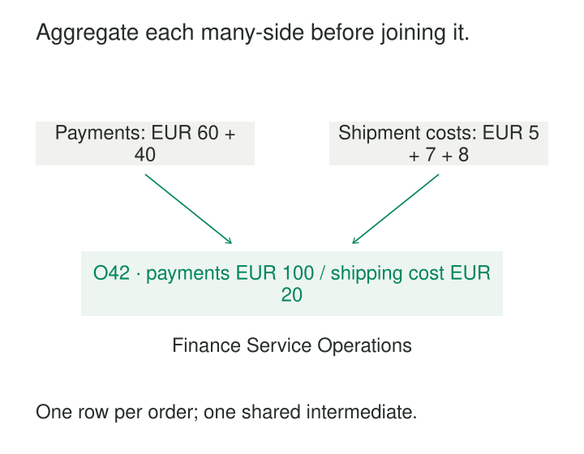

Three reports calculate captured payments per order. Each contains a slightly different query. One excludes failed payments, another includes authorizations, and a third accidentally multiplies payment amounts when joining shipment records.

The repeated code looks like an inconvenience. The repeated decisions are the larger problem.

**Reusable Intermediate Models turn a focused transformation into a named dependency that several downstream models can use.** They provide a common place to prepare relationships, change grain, or apply an agreed rule before assembling final data products.

The aim is to share a dependable result without making every consumer inherit an oversized model.

## Extract a meaningful transformation

An intermediate model usually sits between source-oriented preparation and consumption-ready models. Typical purposes include:

- Summing payments to one row per order.
- Resolving source identifiers into a shared identity.
- Assigning events to sessions.
- Preparing an effective-dated relationship.
- Allocating a shared amount under an agreed method.

A useful name describes the operation and its result: `payments_summed_to_orders` communicates more than `intermediate_07`.

dbt’s [intermediate-model guidance](https://docs.getdbt.com/best-practices/how-we-structure/3-intermediate) describes this layer as purpose-built preparation for marts, including aggregation, pivoting, row expansion, and isolating complex logic.

Reuse is a strong reason to extract a model, but it is not the only one. A difficult transformation with one current consumer can deserve its own boundary for testing and explanation. Conversely, two short, superficially similar queries may represent different concepts and should remain distinct.

The extraction earns its place when someone can state what the model represents, why its grain is useful, and which decisions its consumers can safely reuse.

## Aggregate before a shared join

Consider an illustrative order, O42, with these records:

| Input | Detail amounts | Correct total |
|---|---|---:|
| Captured payments | 60 EUR, 40 EUR | 100 EUR |
| Shipment costs | 5 EUR, 7 EUR, 8 EUR | 20 EUR |

Joining the two payment rows directly to the three shipment rows on order ID creates six combinations. Summing that result produces 300 EUR of payments and 40 EUR of shipment costs.

A reusable transformation first creates one payment summary per order and one shipment summary per order. It then joins those summaries to a one-row-per-order foundation.

The resulting order activity model exposes captured amount, shipment cost, and relevant counts at a declared grain. An orders mart, customer rollup, and operations report can reuse it.

This follows the cardinality principle behind Kimball’s [multipass approach to avoiding fact-to-fact joins](https://www.kimballgroup.com/data-warehouse-business-intelligence-resources/kimball-techniques/dimensional-modeling-techniques/multipass-sql/): prepare compatible summaries before combining measures.

The example assumes one currency per order. Multiple currencies require a richer grain or an explicit conversion rule. Missing summaries also need interpretation: “no shipment recorded” should not silently become “shipping cost is known to be zero.”

Centralizing the safe join prevents each consumer from rediscovering these conditions.

## Share the definition, including its boundaries

A column called `captured_amount` needs a precise definition. It might include successful captures, exclude authorizations, and report refunds separately. Those choices belong in the model’s documented contract.

Consumers can then derive different measures without rewriting the shared preparation. One might calculate payment coverage; another might analyze fulfillment costs. Neither should quietly reinterpret captured amount as recognized revenue.

If another application needs authorized amount, expose that concept separately. Adding parameters until one model can mean several incompatible things makes dependencies difficult to understand.

The same principle applies to identity resolution and allocation. Reusing an intermediate model means accepting its decisions, including their scope and limitations. Similar column names are insufficient evidence that two consumers need the same result.

## A session definition becomes reusable—and correctable

Consider an illustrative activity feed with events at 09:00, 09:10, and 09:50 for one user. The agreed rule starts a new session when the gap between consecutive events exceeds 30 minutes.

An intermediate model assigns the first two events to one session and the third to another. Funnel analysis and engagement reporting can reuse those assignments.

The contract must specify the user identity, timestamp interpretation, tie-breaking order, inactivity threshold, and treatment of late events.

Suppose an event for 09:30 arrives later. It bridges the previous gap: the consecutive gaps are now 10, 20, and 20 minutes. Under this rule, all four events belong to one session.

An append-only implementation that processes only the new event can leave earlier assignments wrong. Correct reuse therefore requires a correction strategy for affected sessions and dependent outputs.

The value of sharing this model is substantial: consumers inherit one session definition. The responsibility is equally substantial: a correction affects every consumer.

## Keep preparation distinct from a public product

Intermediate models are often internal interfaces. They may contain implementation details, incomplete relationships, or measures that require further interpretation before business use.

GitLab provides a documented operational example of this distinction. Its platform handbook separates `raw`, `prep`, and `prod`, describes preparation data as undergoing verification and transformation, and directs Tableau consumers toward production datasets. See [GitLab’s data platform documentation](https://handbook.gitlab.com/handbook/enterprise-data/platform/).

An internal model still needs ownership and dependable semantics. “Intermediate” should not mean undocumented or disposable while downstream production models depend on it.

If analysts begin querying an intermediate directly, its role may have changed. The appropriate response may be to publish a supported data product with clearer guarantees rather than leave a hidden interface to become permanent.

## Reusing logic does not guarantee reusing computation

The logical boundary and its physical implementation are separate choices.

| Implementation | Benefit | Operating consequence |
|---|---|---|
| View | Queryable shared definition | Computation may repeat |
| Persisted table | Reuses stored results | Storage, refresh work, and latency |
| Ephemeral model | Reuses code without another relation | Logic is embedded in dependent queries |
| Incremental table | Limits repeated processing | Corrections and deletions need explicit handling |

dbt documents these alternatives in its [materialization guidance](https://docs.getdbt.com/docs/build/materializations). Its ephemeral models become common table expressions inside dependent models; they do not create a shared stored result.

A complex model referenced by ten descendants can therefore remain expensive despite having only one definition. Materialization should follow measured workload, freshness needs, and recovery requirements.

Persisting everything is also costly. Some intermediates are cheap enough to calculate where needed, and unnecessary tables add orchestration and maintenance.

## Give shared dependencies a real contract

A dependable intermediate model declares its grain, keys, units, time interpretation, inclusion rules, freshness, and unresolved conditions.

Verification should target the transformations that could invalidate those promises. For the order example, useful evidence includes unique output order IDs, reconciled payment totals, and proof that joining shipments does not multiply orders. Schema checks alone cannot establish those properties.

dbt’s [model contracts](https://docs.getdbt.com/docs/mesh/govern/model-contracts) provide mechanisms for declaring output structure. Semantic guarantees still require documentation and suitable validation.

Changes need coordination. Renaming a field is visibly disruptive; changing a qualifying-payment rule while preserving the schema can be equally consequential. Where compatibility matters, [model versioning](https://docs.getdbt.com/docs/mesh/govern/model-versions) supports migration between definitions.

Refresh boundaries matter too. A stored customer rollup does not automatically become current because its intermediate dependency was corrected. Dependency management must include rebuilding and publishing affected descendants.

## Avoid a universal middle layer

The pattern works well when repeated transformations share a stable meaning, expensive preparation serves several products, or complex logic needs an inspectable boundary.

It works poorly when a model accumulates unrelated joins and consumer-specific filters. Such models become difficult to refresh, risky to change, and expensive for consumers that need only a small portion.

Other warning signs include speculative extraction before a second use is understood, long chains of trivial pass-through models, and combining consumers with incompatible freshness requirements.

[[data-declare-the-grain|Declare the Grain]] establishes the output boundary. [[data-standardize-at-staging|Standardize at Staging]] supplies prepared inputs. [[data-progressive-refinement|Progressive Refinement]] explains how reusable transformations form a larger pipeline. [[data-drill-across|Drill Across]] provides a disciplined approach to combining separately aggregated measures.

A useful intermediate model has a narrow promise strong enough that downstream authors can rely on it—and clear enough that they know when they need a different model.
