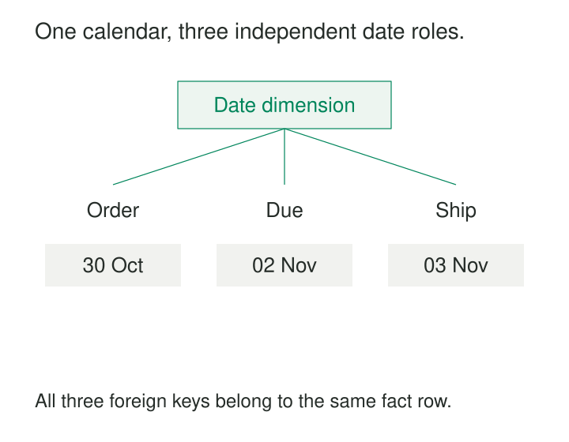

An operations manager asks which orders placed in October shipped in November. The dashboard offers one filter labeled “Month.” Selecting October shows when orders were placed; selecting November replaces that choice. The calendar is consistent, but the report cannot express the relationship between two different dates.

[[data-role-playing-dimensions|Role-Playing Dimensions]] let one dimension serve several distinct business roles, each with its own relationship to the facts. Order Date and Ship Date share calendar definitions while remaining independently available for filtering and grouping.

The same idea applies to departure and arrival airports, buying and paying organizations, or employees who request and approve purchases.

## Reuse the dimension; name the relationship

A dimension describes a class of things: dates, airports, people, organizations. A role explains how one of those things participates in a particular fact.

An order-line fact might therefore contain three foreign keys:

- `order_date_key`: when the order was placed.
- `due_date_key`: when fulfillment was promised.
- `ship_date_key`: when dispatch occurred.

All three reference the same maintained Date dimension. Each reference becomes a separate logical role, exposed through a query alias, database view, or reporting-model table. Kimball emphasizes that these roles must provide independent references to the dimension, with distinct attribute names. [Kimball Group: Role-Playing Dimensions](https://www.kimballgroup.com/data-warehouse-business-intelligence-resources/kimball-techniques/dimensional-modeling-techniques/role-playing-dimension/)

The fact row can reference the same dimension member through several roles. An order placed and shipped on the same day still has two relationships: the matching dates do not make their meanings interchangeable.



*Shared calendar attributes support consistent interpretation. Separate roles preserve the questions each date answers.*

## Ask two calendar questions at once

Consider an illustrative order-line model. For simplicity, each line ships once.

| Order line | Order date | Due date | Ship date |
|---|---|---|---|
| L1 | 2026-10-30 | 2026-11-02 | 2026-11-03 |
| L2 | 2026-10-31 | 2026-11-04 | Not yet shipped |
| L3 | 2026-11-01 | 2026-11-04 | 2026-11-03 |

“Ordered in October” selects L1 and L2. “Shipped in November” selects L1 and L3. Applying both conditions selects L1.

The dimension roles make that intersection explicit. In SQL, the same physical table can appear twice under separate aliases:

```sql
SELECT
    ordered.calendar_month AS order_month,
    shipped.calendar_month AS ship_month,
    COUNT(*) AS order_lines
FROM fact_order_line AS f
JOIN dim_date AS ordered
  ON f.order_date_key = ordered.date_key
LEFT JOIN dim_date AS shipped
  ON f.ship_date_key = shipped.date_key
GROUP BY
    ordered.calendar_month,
    shipped.calendar_month;
```

Here, `calendar_month` contains a year and month, such as `2026-10`. Each alias describes its own relationship. The left join preserves lines whose shipment date has not been recorded, assuming the model represents that condition with a null key.

The result counts order lines. It does not automatically count distinct orders or shipment events. Role-playing dimensions preserve context around the existing grain; they do not change what a fact row represents.

Microsoft’s AdventureWorksDW sample implements this structure directly. Its `FactInternetSales` and `FactResellerSales` tables each have `OrderDateKey`, `DueDateKey`, and `ShipDateKey` foreign keys referencing `DimDate`. This is an inspectable implementation in a fictitious sample business. [Microsoft: AdventureWorksDW Schema](https://github.com/microsoft/sql-server-samples/blob/master/samples/databases/adventure-works/data-warehouse-install-script/instawdbdw.sql)

## Treat departure and arrival as independent endpoints

Dates are common examples, but the pattern is equally useful for directional relationships.

Suppose a flight fact records one row per flight leg:

| Flight leg | Departure airport | Arrival airport |
|---|---|---|
| F1 | Melbourne | Sydney |
| F2 | Melbourne | Brisbane |
| F3 | Sydney | Melbourne |

Both airport keys reference one Airport dimension containing airport names, locations, and other descriptive attributes.

Filtering **Departure Airport = Melbourne** selects F1 and F2. Grouping those flights by **Arrival Airport** shows Sydney and Brisbane separately.

A generic “Airport = Melbourne” filter leaves the intended relationship unclear. Does it mean departing, arriving, or either? The last interpretation is a separate calculation combining roles; it should be defined explicitly.

Microsoft uses this departure-and-arrival structure in its documented Power BI modeling example, demonstrating how independently exposed airport roles support simultaneous filtering and grouping. [Microsoft: Active and Inactive Relationships](https://learn.microsoft.com/en-us/power-bi/guidance/relationships-active-inactive)

## Distinguish warehouse reuse from reporting behavior

A relational query can join one dimension repeatedly using aliases. A reporting model may require a different physical arrangement to provide the same independence.

In Power BI, only one relationship between a pair of model tables can be active. A single Date table connected to several date keys therefore has a default filter path. Other relationships can be activated within particular calculations using `USERELATIONSHIP`.

That arrangement can suit a model where almost every report uses Order Date and only a few measures use Ship Date. When users need independent Order Month and Ship Month filters, Microsoft recommends separate role tables with active relationships. These can derive from the same maintained calendar rather than introduce independently authored calendars. [Microsoft: Star Schema Guidance](https://learn.microsoft.com/en-us/power-bi/guidance/star-schema)

Other platforms expose reuse differently. Analysis Services multidimensional models allow one database dimension to appear through multiple cube dimensions. [Microsoft: Dimensions in Multidimensional Models](https://learn.microsoft.com/en-us/analysis-services/multidimensional-models/dimensions-in-multidimensional-models)

The implementation should preserve one semantic agreement while providing the independent relationships the reporting interface needs.

## Make each role correct before making it convenient

Every role needs a precise business definition. “Ship Date” might mean first dispatch, final dispatch, carrier acceptance, or warehouse departure. A clear label cannot compensate for an ambiguous event.

Each populated foreign key must resolve to exactly one intended dimension row. Joining a versioned Customer dimension using only a nonunique business identifier can multiply facts. The load process must select the appropriate version key.

Historical interpretation also belongs to the role. A purchasing organization might be described as it existed when an order was placed, while a paying organization is described at payment time. The same underlying organization can legitimately resolve to different historical versions.

Dates require an explicit timestamp-to-date policy. An event near midnight can fall on different calendar days depending on the relevant time zone. Reusing Date does not decide whether the business uses warehouse-local time, customer-local time, or UTC.

Missing values need equally careful treatment. “Not yet shipped,” “shipment date unknown,” and “shipping not applicable” represent different conditions. Substituting Order Date for every missing Ship Date invents same-day fulfillment. An inner join can instead remove pending lines entirely. Nulls or special dimension members can represent these conditions, provided reports retain their distinctions.

## Pay for additional roles where they help

The pattern is especially useful when a process contains several milestones, directional endpoints, or named participants. It supports questions about delays, routes, handoffs, and combinations of business roles without duplicating dimension maintenance.

Its costs include additional foreign keys, joins, reporting relationships, labels, and validation. Imported role tables can also consume extra storage and refresh time. Views and aliases avoid separate base-table maintenance, but each exposed role still needs understandable names and correct behavior.

Common mistakes include displaying several attributes simply as “Year,” letting a default relationship silently determine a measure’s meaning, and maintaining separate calendars that gradually disagree.

The model also has limits. A line fulfilled through several shipments needs shipment facts or explicitly defined first and last shipment milestones. A single Ship Date cannot describe every dispatch. Likewise, repeated approvals or changing promises may require separate events or history rather than more columns on one row.

[[data-conformed-dimensions|Conformed Dimensions]] establishes shared descriptive meaning across models and processes; role-playing dimensions give that meaning distinct relationships within a model. [[data-declare-the-grain|Declare the Grain]] determines which roles can be represented once per fact row. **Party-Role Modeling** describes participants acting in business capacities. [[data-distinguish-missing-unknown-inapplicable|Distinguish Missing, Unknown, and Inapplicable]] keeps incomplete roles from becoming misleading observations.
