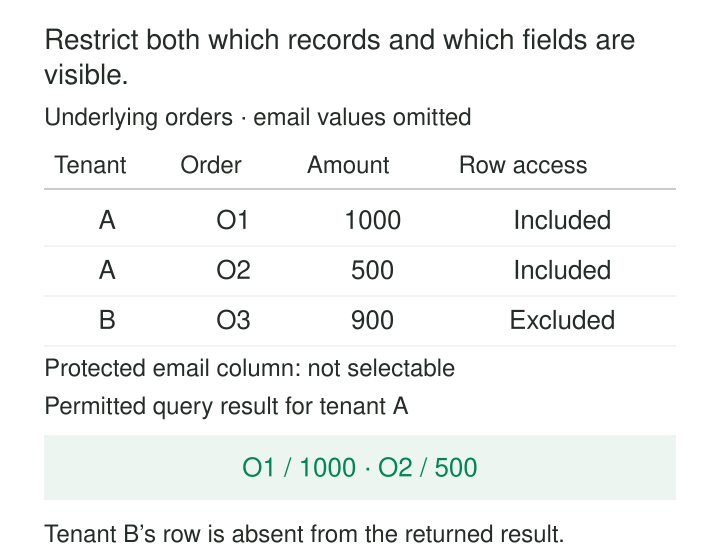

An analyst needs sales figures for one tenant. The shared orders table contains every tenant’s orders, customer email addresses, and operational details.

Granting access to the whole table exposes too much. Creating a separate physical copy for every audience adds duplication, refresh work, and opportunities for permissions to drift.

**Row- and Column-Level Access restricts which records a caller may use and which fields they may read.** It allows a shared dataset to serve different audiences through controls evaluated against authenticated identity and authorized context.

The two dimensions solve different problems. Restricting rows does not automatically protect sensitive fields within those rows.

## Combine record scope with field permissions

Row-level access determines the records available to a caller. A policy might limit orders to an authorized tenant, employees to an organizational unit, or sales to assigned regions.

Column-level access determines whether a caller may reference particular fields. Someone permitted to read order amounts may still be denied customer email addresses.

Masking provides another behavior: a caller can query a field but receives a substituted value under the applicable policy.

| Control | Typical result |
|---|---|
| Row filtering | Unauthorized records are absent from the query’s accessible population |
| Column denial | A query referencing a protected field is rejected |
| Dynamic masking | A query receives a policy-defined substitute for the protected value |

These behaviors should be explicit. A denied field and a field returned as `NULL` have different effects on consumer code and calculations.

BigQuery documents row-level policies coexisting with column-level and broader access controls. Its column-level controls require both ordinary dataset access and permission for the protected column’s policy tag. [BigQuery row-level security](https://docs.cloud.google.com/bigquery/docs/row-level-security-intro), [BigQuery column-level access](https://docs.cloud.google.com/bigquery/docs/column-level-security-intro)

## Example: one orders table, two tenants

Consider a shared table containing:

| order_id | tenant_id | amount_minor | customer_email |
|---|---|---:|---|
| O1 | A | 1000 | a@ex.test |
| O2 | A | 500 | b@ex.test |
| O3 | B | 900 | c@ex.test |

Amounts are USD cents.

Tenant A’s analyst may read A’s orders and approved analytical fields. A query selecting order identifiers and amounts returns O1 and O2. Its total is 1,500 cents.

Tenant B’s order does not enter that caller’s accessible population. Under this example’s column-denial policy, asking for `customer_email` produces an authorization error.

PostgreSQL provides row-security policies that can restrict normal reads and modifications. Row security must be enabled; when enabled without an applicable policy, its default behavior denies rows. Ordinary privileges remain relevant. [PostgreSQL row security](https://www.postgresql.org/docs/current/ddl-rowsecurity.html)

The tenant association must come from trusted authorization context. A request parameter saying `tenant=A` is not evidence that the caller belongs to A.

Filtering a dashboard after retrieving unrestricted results leaves the underlying retrieval unprotected.

## Example: employee reporting without salary access

An operations analyst needs employee identifiers, departments, and employment status. Payroll staff also need salary.

A column-level policy permits the analyst’s operational fields while restricting salary. The analyst can query the approved projection; requesting salary fails under a column-denial arrangement.

This distinction matters beyond the visible output. Authorization should cover references used in predicates, joins, sorting, and calculations, according to the engine’s supported behavior. Hiding a column in a reporting tool does not establish that direct queries cannot reference it.

BigQuery implements column authorization using policy tags associated with columns and checks access when protected data is queried. The tags provide a shared classification mechanism, but their assignment and permissions must match the intended audience. [BigQuery column-level controls](https://docs.cloud.google.com/bigquery/docs/column-level-security-intro)

If managers should see employees only within their departments, that requires an additional row-level rule. Salary authorization and departmental scope are separate decisions.

## Example: support sees email, analytics sees a mask

A support workflow legitimately needs customer email addresses for authorized accounts. An analytical workflow needs order trends but does not need the original email values.

A masking policy can return clear email values in the approved support context and a substitute, such as `NULL`, in the analytical context.

Snowflake’s Dynamic Data Masking implements query-time masking on table and view columns. The visible value depends on policy conditions, execution context, and role hierarchy. The feature requires Enterprise Edition or higher. [Snowflake Dynamic Data Masking](https://docs.snowflake.com/en/user-guide/security-column-ddm-intro)

The row policy still applies independently: support authorization for email does not imply access to every tenant.

Masking also changes query semantics. If email becomes null, counting non-null email values can produce a different answer. Joins and grouping can change too. Consumers need to understand the permitted representation rather than assume masked values behave like their originals.

A masking policy governs presentation through the protected query path. It does not automatically govern an unrelated export or copy.

## Identity is part of the mechanism

The engine must receive enough trustworthy context to distinguish callers.

If every dashboard uses one unrestricted service credential, the database sees that service identity. End-user permissions do not materialize automatically. The architecture must propagate trusted context or enforce restrictions at another controlled boundary that users cannot bypass.

Connection pooling deserves particular attention. A tenant or role setting left on a reused connection can affect the next request. Context establishment, cleanup, and failure handling need deliberate implementation and testing.

Entitlements can change. Removing someone from a team should affect the intended access routes, including cached authorization decisions and long-lived sessions according to the platform’s behavior.

The policy is only as accurate as the identity and entitlement information it evaluates.

## Check how policies compose

Multiple policies do not necessarily combine into progressively narrower access.

PostgreSQL combines permissive row policies with `OR` and restrictive policies with `AND`. An added permissive policy can therefore widen the accessible population. [PostgreSQL policy composition](https://www.postgresql.org/docs/current/ddl-rowsecurity.html)

Privileged execution also matters. PostgreSQL superusers and roles with `BYPASSRLS` bypass row security. Table owners normally bypass it too, unless configured otherwise with `FORCE ROW LEVEL SECURITY`. [PostgreSQL privileged roles](https://www.postgresql.org/docs/current/ddl-rowsecurity.html)

Testing only through an administrative account can consequently give a misleading picture of consumer access.

Where writes are allowed, verify both which existing rows may be targeted and which resulting rows are permitted. A user should not be able to move a record into another tenant merely because they could initially read it.

## Test the permitted and prohibited results

Use small fixtures containing deliberately similar records across tenants or departments. Exercise the actual roles, service accounts, views, and query routes used in production.

A useful test matrix includes:

| Caller | Expected row scope | Expected sensitive-field behavior |
|---|---|---|
| Tenant A analyst | A’s records | Denied or masked as specified |
| Tenant B analyst | B’s records | Denied or masked as specified |
| Authorized A support context | A’s authorized records | Clear values where approved |
| Caller without entitlement | No authorized access | No accidental fallback access |

Test direct queries, aggregates, joins, and applicable writes. Test missing context and role changes as well as successful access.

Verification should establish that authorized work remains possible. A policy that blocks everyone prevents exposure but does not deliver a usable data service.

## Follow the data beyond the base table

Views, materializations, extracts, caches, and downstream tables can create additional access paths. Verify which controls propagate and which require separate assignments.

A cache serving restricted results needs an authorization boundary that prevents one audience receiving another’s result. A privileged pipeline producing an unrestricted copy must give that output an appropriate policy of its own.

Fine-grained controls also have limits. Permitted aggregates can disclose information about very small groups, and some systems expose information through errors or integrity checks. Additional disclosure controls may be needed for those use cases. PostgreSQL explicitly notes information-leak considerations around integrity checks that bypass row security. [PostgreSQL security considerations](https://www.postgresql.org/docs/current/ddl-rowsecurity.html)

## Account for the operating cost

The pattern is useful for shared analytical tables, regional reporting, departmental data, and tenant-scoped applications.

Its costs include entitlement management, policy testing, query overhead, support for confusing results, and maintenance across derived assets. Complex predicates and lookup tables can affect performance, so representative workload testing matters.

For stronger isolation requirements, separate datasets or environments may be easier to reason about. Fine-grained policies require sustained operational care; they are not a one-time table setting.

## Related patterns

[[data-policy-as-code|Policy as Code]] makes access rules versioned, testable, and traceable.

[[data-controlled-vocabularies|Controlled Vocabularies]] keep sensitivity categories and entitlement attributes consistent.

[[data-stable-logical-interfaces|Stable Logical Interfaces]] provide maintained access boundaries whose behavior includes authorization.

[[data-named-dataset-stewardship|Named Dataset Stewardship]] gives consumers and operators a route for resolving unclear scope, classification, and permitted use.
