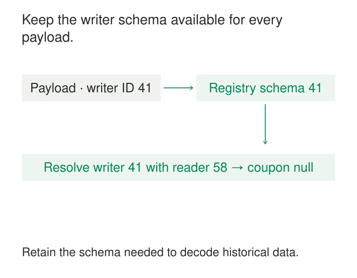

A producer adds a field to an event. Its own tests pass, but an older consumer fails when the new messages arrive. Months later, a backfill encounters records written under a schema nobody kept.

Both failures come from treating a data format as something that exists only in the current application code.

[[data-schema-registries|Schema Registries]] maintain identifiable schema versions and make them available to writers, readers, and compatibility checks. They help applications evolve independently while preserving the information needed to interpret historical records.

The purpose is to answer two questions reliably: **which schema describes these bytes, and can this proposed change coexist with the readers and data we still support?**

## Connect the schema to the record

A registry stores schema definitions, their identities, and their version histories. It commonly exposes operations for registration, retrieval, and compatibility checking.

In a typical streaming implementation:

1. A producer registers or retrieves its writer schema.
2. Its serializer encodes the record and attaches a schema identifier.
3. A consumer extracts that identifier and retrieves the corresponding schema, often from a local cache.
4. The reader decodes the record and applies any supported writer-to-reader resolution.

[AWS Glue Schema Registry](https://docs.aws.amazon.com/glue/latest/dg/schema-registry-works.html) documents this sequence, including producer validation, schema-version identifiers in records, and consumer-side caching.

The identifier’s representation depends on the implementation. It might appear in a payload prefix or message header. Producers and consumers must agree on that envelope as well as the serialization format.

A registry lookup identifies how the record was written. The application may separately choose a reader schema representing the structure it wants to use now.



## Keep identity separate from version history

A schema identifier and a version number serve different purposes.

In Confluent terminology, a **subject** groups a schema’s evolution history and defines a compatibility boundary. Under the common topic-based naming strategy, a topic’s key and value have separate subjects, such as `orders-key` and `orders-value`.

Subject version 2 is the second registered version in that history. Its schema identifier might be 58. The same schema can also appear under other subjects with the same identifier.

Confluent’s [subject naming strategies](https://docs.confluent.io/platform/current/schema-registry/fundamentals/serdes-develop/index.html#subject-name-strategy) support grouping by topic, record name, or both. That choice determines which changes are checked together.

Grouping unrelated event types into one compatibility history creates unnecessary conflicts. Grouping shared types too narrowly can allow different interfaces to evolve apart unintentionally.

Choose the boundary deliberately, and keep naming configuration consistent across producers, deployment checks, and any broker-side enforcement.

## Add a field without rewriting old events

Suppose an Avro order record contains `order_id` and `amount_minor`. Version 2 adds a nullable `coupon` field with a default of null:

```json
{"name": "coupon", "type": ["null", "string"], "default": null}
```

An old record contains no coupon field. A version 2 reader can read it using the version 1 writer schema and supply the reader’s default.

The [Avro specification](https://avro.apache.org/docs/1.12.0/specification/#schema-resolution) defines this resolution behavior. It also distinguishes a reader default from making a field optional during encoding.

The registry preserves the writer schema and can check the proposed evolution. The serialization library performs the actual resolution.

The application still needs a meaningful interpretation of null. For historical orders, null may mean “coupon information was not recorded,” rather than “no coupon was used.” A structurally compatible upgrade can introduce an incorrect business assumption.

Test old records with new readers and new records with supported old readers. Registration success alone does not exercise every application branch.

## Check the history that replay actually needs

Compatibility has direction:

| Policy | Question |
|---|---|
| Backward | Can a newer reader process older data? |
| Forward | Can an older reader process newer data? |
| Full | Are both directions supported? |
| Transitive | Does the check cover all preceding versions rather than only the latest? |

The exact rules depend on Avro, Protobuf, or JSON Schema. [Confluent’s compatibility documentation](https://docs.confluent.io/platform/current/schema-registry/fundamentals/schema-evolution.html) describes these distinctions.

Consider an illustrative backward-only history. Version 1 has a string field named `priority`. Version 2 removes it. Version 3 reintroduces `priority` as an integer with a default.

A version 3 reader can supply its default when reading version 2. But version 1 contains an incompatible string value. Checking only neighboring versions can therefore miss a replay failure that checking the complete retained history would expose.

The relevant history follows the data’s lifetime. A consumer reading a year of archived events needs more than compatibility with yesterday’s producer.

Retain historical schemas and their referenced definitions for as long as records, backups, dead-letter messages, or recovery procedures depend on them. Confluent’s [registry API documentation](https://docs.confluent.io/platform/current/schema-registry/develop/api.html) distinguishes soft deletion from hard deletion, which removes schema-ID metadata. Deletion policy belongs in the recovery design.

## Move records together with their decoding dependencies

A disaster-recovery exercise copies Kafka records to another environment. The messages still carry numeric schema ID 41, but the destination registry has assigned that number to a different schema.

Copying the bytes did not preserve their interpretation.

Treat numeric identifiers as scoped to the registry environment and context that issued them. Independent registration in another environment need not reproduce the same mapping.

A migration must preserve the required identity mappings or use a supported translation mechanism. It must also carry referenced schemas, subject histories, and the policies needed for continued evolution.

Confluent documents [schema migration](https://docs.confluent.io/platform/current/schema-registry/installation/migrate.html) and [Schema Linking](https://docs.confluent.io/platform/current/schema-registry/schema-linking-cp.html), including requirements for consuming mirrored records with matching schema IDs.

Test recovery with cold consumers and historical messages. A warm process may keep decoding from its cache while a newly started consumer cannot retrieve a required schema.

## Verify where validation actually happens

A registry can reject an incompatible schema registration without inspecting every record sent to the transport.

Record validation depends on the serializer, gateway, broker feature, or other enforcement path. A producer that bypasses the approved serializer may bypass its checks.

The distinction is explicit in Confluent’s [broker-side Schema ID Validation](https://docs.confluent.io/platform/current/schema-registry/schema-validation.html): it checks that the supplied identifier belongs to an appropriate registered subject; it does not inspect the payload’s contents. Null keys and values can also pass, supporting tombstone behavior.

Keep three questions separate: was the schema admitted, does the record conform to it, and does the content satisfy business rules?

A registered integer cannot establish whether an amount represents cents or dollars. A valid timestamp cannot establish that an event occurred when claimed. Those meanings require broader contracts and evidence.

## Operate the registry as a dependency

Caching reduces lookups, but it does not eliminate dependency on the registry. New schema versions, cache misses, and fresh application instances still need access.

Monitor lookup failures, registration errors, authentication, latency, and recovery readiness. Test both warm-cache operation and cold starts.

Distinguish infrastructure failure from malformed data. An unavailable registry does not prove that a record is invalid. Preserve recoverable work and use bounded retries or backpressure according to the pipeline’s delivery contract.

Automatic registration is convenient during development. In production, preregistration and compatibility checks during deployment can make changes reviewable and reduce runtime surprises. Control who can register schemas, alter policies, and delete history.

The costs include service operation or managed-service usage, client integration, compatibility testing, schema retention, and managing shared references. A shared type can reduce duplication while coupling several interfaces to its evolution.

Registries are especially useful for independently deployed producers and consumers, compact serialized events, and long-lived replayable data. A small application with a coordinated release and self-contained files may need simpler schema management.

[[data-explicit-data-contracts|Explicit Data Contracts]] supplies meaning and operational promises. [[data-schema-validation-boundaries|Schema Validation at Boundaries]] checks actual records. [[data-representative-text-fixtures|Representative Text Fixtures]] exposes format-specific edge cases. [[data-replayable-backfills|Replayable Backfills]] depends on retaining the schema history needed to interpret old inputs.
