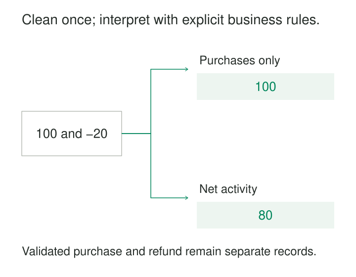

A reporting pipeline removes negative transaction amounts because they look invalid. The resulting tables are tidy, and every amount is positive. Unfortunately, the removed records were refunds.

A technical cleanup has quietly become a business decision. Every downstream report now inherits it, including reports that need those refunds.

**Separate Cleaning from Business Logic gives data preparation and business interpretation distinct responsibilities.** Cleaning makes source records consistently usable. Business logic determines what those records mean for a particular process, model, or metric.

The separation makes both kinds of rules easier to explain, test, reuse, and change.

## Make the boundary about meaning

Cleaning commonly includes parsing, explicit type conversion, documented unit normalization, and translating source codes into their established meanings. It should preserve enough identity, detail, and provenance for later interpretation.

Business logic introduces definitions such as qualifying purchases, active customers, attribution windows, allocation methods, or operational thresholds.

Both require judgment. A cleaning rule still needs evidence: a source contract, a documented encoding, or an agreed constraint. Labeling a transformation “cleaning” does not make it neutral.

A useful distinction is how the rule changes. A correction to timestamp parsing should improve every consumer’s representation of the source. Changing an activity window from 30 to 90 days changes a business definition while leaving the underlying events intact.

dbt’s [staging guidance](https://docs.getdbt.com/best-practices/how-we-structure/2-staging) illustrates this separation through lightweight, source-oriented preparation. Its [mart guidance](https://docs.getdbt.com/best-practices/how-we-structure/4-marts) then organizes data into business-defined entities and concepts.



## A refund survives preparation

Consider this illustrative transaction feed:

| Event | Source type | Received amount | Currency |
|---|---|---|---|
| E1 | `purchase` | `"100.00"` | EUR |
| E2 | `refund` | `"-20.00"` | EUR |

The source contract specifies signed amounts: purchases are positive and refunds negative.

Cleaning parses the amounts into exact decimals, validates the currency code, and retains event identities and types. Both records are valid under that contract.

Two explicitly named calculations can then use them:

- **Purchase-only total:** include purchase events, producing 100 EUR.
- **Net transaction amount:** include purchases and refunds, producing 80 EUR.

Neither calculation requires deleting the refund from the shared prepared dataset.

If the source instead represents refunds as positive amounts with a refund indicator, converting them to the agreed signed representation can be source-specific preparation. Deciding which refunds count toward a particular reporting period remains a separate rule.

This distinction also protects zero-valued transactions. A free order may be a valid process event even when a paid-order metric excludes it.

## “Active customer” belongs to a definition

An illustrative customer last performed a qualifying activity 40 days before a fixed reporting date.

| Named definition | Result |
|---|---|
| Active within 30 days | Inactive |
| Active within 90 days | Active |

Cleaning can standardize customer identifiers, parse activity timestamps, preserve event types, and flag malformed records. It should not remove all customers outside a 30-day window from the reusable foundation.

The business definition must specify which activities qualify, how identity is resolved, which reporting date applies, and how the window boundary works. A purchase, login, and support request might have different significance.

Named definitions allow legitimate differences to remain visible. Two teams can share prepared events while using clearly distinguished concepts such as `purchasing_customer_90d` and `engaged_user_30d`.

The distinction must not become permission for accidental disagreement. When two outputs claim to measure the same concept, they should share the same rule. dbt’s [mart guidance](https://docs.getdbt.com/best-practices/how-we-structure/4-marts) similarly recommends making genuinely different concepts explicit rather than hiding them behind departmental names.

## An unusual reading can be a valid observation

Suppose an illustrative sensor’s documented measurement range is −40°C to 150°C. It reports:

```text
temperature = "095.0"
unit = "C"
```

Cleaning can parse this as 95.0°C and establish that it lies within the instrument’s stated range. A machine-monitoring rule might flag temperatures above 80°C.

The reading is therefore usable and alarming at the same time. Removing it as an “outlier” during shared cleaning would erase precisely the condition the monitoring model needs.

A different reading outside the instrument’s range deserves a quality flag or quarantine path. Even then, retaining the original observation can help diagnose equipment or transmission problems.

The same issue appears in imputation. Replacing a missing temperature with zero changes the observation. Filling it from a neighboring sensor or historical average introduces an estimate whose method and purpose should remain identifiable.

## Real implementations make responsibilities inspectable

dbt Labs’ fictional **Jaffle Shop** project demonstrates a concrete division. Its [order staging model](https://github.com/dbt-labs/jaffle-shop/blob/main/models/staging/stg_orders.sql) renames identifiers and exposes converted monetary values. Its downstream [orders mart](https://github.com/dbt-labs/jaffle-shop/blob/main/models/marts/orders.sql) aggregates item information, joins it to orders, and derives classifications such as whether an order contains food.

These are separately inspectable transformations. A reviewer can distinguish preparation of source fields from calculations describing the business entity.

Data-quality tooling also makes an important choice visible: detection and treatment are different decisions. Databricks pipeline expectations support retaining violating records with metrics, dropping them, or failing an update; documented quarantine patterns provide another option. See [pipeline expectations](https://docs.databricks.com/aws/en/ldp/expectations).

A condition such as “amount is negative” does not determine the correct treatment by itself. The dataset contract and intended use determine whether that condition identifies an error, an ordinary refund, or something requiring investigation.

## Separate responsibilities without multiplying layers

The pattern does not require a fixed number of schemas or stored tables. A small pipeline can use named transformations or clear query stages. A larger project may publish reusable cleaning models and place business rules in intermediate models, marts, or a semantic layer.

dbt’s [intermediate-model guidance](https://docs.getdbt.com/best-practices/how-we-structure/3-intermediate) describes purpose-built transformations between staging and final outputs. Databricks’ [medallion architecture](https://docs.databricks.com/aws/en/lakehouse/medallion) uses broader layer responsibilities, including enrichment within silver. Layer names alone therefore cannot establish this boundary.

The interface needs substance: declared grain, types, units, quality indicators, provenance, and treatment of unresolved values. Business models must be able to consume that interface without quietly reparsing the source.

Correctness also depends on preserving necessary distinctions. A cleaning step that merges identifiers, removes repeated records, or collapses missing and unknown values may constrain every later interpretation.

Deduplicating a repeated delivery using a reliable event identity is different from merging two customers because their names match. Those operations need different evidence and recovery rules.

## Test the representation and the decision separately

Cleaning checks should establish that preparation follows its contract: amounts parse correctly, identifiers retain meaningful characters, units convert accurately, and failures remain observable.

Business checks should establish the intended interpretation: refunds reduce the named net measure, activity windows use the agreed boundary, and operational classifications follow the applicable threshold version.

Reconciliation connects the two. Counts and amounts should explain which records were retained, quarantined, excluded by a named rule, or transformed into another grain.

Versioning matters when rules change. A new classification threshold may apply only from a particular date, or it may require historical restatement. Keeping the cleaned observations stable makes that choice explicit instead of disguising it as data repair.

## The cost of a reusable foundation

Separation adds interfaces, documentation, and dependency management. Materialized preparation tables consume storage and refresh capacity; views can repeat computation. Shared cleaning errors also have a wide impact because many models depend on them.

The benefit grows when sources serve multiple purposes, business definitions evolve, or corrections require replay. For a small, single-purpose dataset, a clear logical boundary may provide most of the value without additional infrastructure.

[[data-standardize-at-staging|Standardize at Staging]] supplies a common preparation boundary. [[data-preserve-raw-inputs|Preserve Raw Inputs]] retains evidence for correcting cleaning errors. [[data-separate-source-facts-from-derived-interpretations|Separate Source Facts from Derived Interpretations]] explains why estimates and classifications need identifiable origins. [[data-shared-metric-definitions|Shared Metric Definitions]] keeps business rules consistent once their meaning has been agreed.

The boundary succeeds when a changed business definition can reuse the prepared observations—and a corrected parser can improve those observations without silently rewriting policy.
