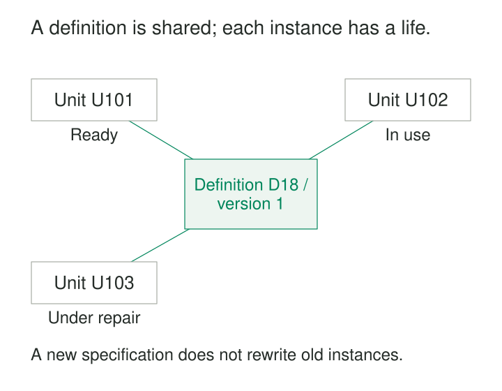

**What it is for**

Represent shared specifications separately from the particular objects, offerings, or executions that follow them.

An equipment-rental company lists a drill model as available. In reality, one unit is ready in the workshop, another is being used on a building site, and a third is under repair.

A single model record cannot describe those circumstances. Creating a separate product description for every physical drill creates another problem: the same specifications are copied repeatedly and gradually diverge.

Separate Definitions from Instances gives each level its own identity. The definition describes the shared model. Instance records describe the particular things the business owns, operates, schedules, or executes.

## A description of a kind and a record of a particular thing

A definition captures characteristics intended to apply across instances: a product specification, course curriculum, document template, or workflow configuration.

An instance represents a particular realization: an individually tracked tool, a scheduled course offering, a completed form, or a workflow run.

The relationship allows shared characteristics to be maintained coherently while individual circumstances remain independent. This approach is closely related to the **Item Description Template** cataloged in Michael Blaha’s *Patterns of Data Modeling*. [Publisher’s overview](https://www.routledge.com/Patterns-of-Data-Modeling/Blaha/p/book/9781439819890).

A useful question is:

> Does this information describe the shared specification, or this particular realization?

The answer determines where a field belongs—and what changing it should affect.

## One drill model, three individual tools

Consider an illustrative drill model, D-18. Its specification includes an 18-volt rating and a two-speed gearbox.

The rental company owns three units:

The model’s rated voltage belongs to the definition. A unit’s location and operational condition belong to its instance record.

Marking U-103 as under repair should not make the entire D-18 model unavailable. Updating a catalog description should not move U-101 out of the workshop.

The distinction also makes different counts possible. The company has one model, three units, and one unit currently ready for rental. Counting catalog records cannot establish physical stock or availability.

A definition can exist before any instances do. The company may add a new model to its purchasing catalog without yet owning one.

The shared specification also has limits. An 18-volt rating does not establish the present condition of an individual battery. Declared characteristics and observations of actual equipment remain different information.

## HL7 FHIR: device definitions and actual devices

HL7’s FHIR R5 resource model makes this separation explicit.

`DeviceDefinition` describes common characteristics and capabilities of a device model or kind. `Device` represents an actual instance, with instance-specific information such as location, lot information, and operational status. [FHIR DeviceDefinition](https://hl7.org/fhir/R5/devicedefinition.html).

The Device resource can reference its definition. Its detailed specification also distinguishes model information from individual identifiers and notes that instance properties need not always match those documented in an associated definition. [FHIR Device details](https://hl7.org/fhir/R5/device-definitions.html).

This is a published data-model example, rather than a claim that every device-management system uses an identical design. It demonstrates why a catalog description and an individually tracked item need distinct representations.

## A course continues while offerings come and go

An illustrative training provider offers “Introduction to Data Modeling.”

The course definition contains its learning objectives, prerequisites, and planned instructional content. Particular offerings have dates, instructors, rooms, and enrollment limits.

| Offering | Definition version | Instructor | Capacity |
|---|---|---|---:|
| O-101 | Data Modeling v1 | Nora | 12 |
| O-102 | Data Modeling v1 | Mina | 18 |
| O-103 | Data Modeling v2 | Nora | 12 |

O-101 and O-102 follow the same definition but have different operational circumstances.

Version 2 introduces additional material. Linking O-103 to it should not silently alter what participants in O-101 were taught.

This reveals a third concern: **which version of the definition applies?** A reference to a mutable “current course” may be insufficient for historical interpretation.

The business may also need another level. One course offering can contain several scheduled sessions, each with its own room or attendance. The pattern does not prescribe exactly two tables. It encourages separating levels that have different identities, responsibilities, and change rules.

## GitHub Actions: a workflow and its runs

GitHub Actions provides a documented example involving execution.

A workflow is a configurable automated process defined in a repository’s YAML file. A workflow run is a particular execution of that workflow, with its own progress and outcome. GitHub’s API supports inspecting, canceling, and rerunning those executions. [Workflow concepts](https://docs.github.com/en/actions/concepts/workflows-and-actions/workflows), [Workflow runs API](https://docs.github.com/en/rest/actions/workflow-runs).

Two runs can therefore have different outcomes without implying two different workflow definitions.

GitHub also documents that a run uses the workflow version associated with the triggering event’s commit or reference. That version link matters when investigating an older result. Reading today’s workflow file may not explain yesterday’s execution. [Workflow version selection](https://docs.github.com/en/actions/concepts/workflows-and-actions/workflows).

Versioning is necessary for that explanation, but may not be sufficient for complete reproducibility. Inputs, dependencies, and execution environments can also affect results.

A run can itself have a lifecycle: queued, running, completed. It is an instance whose progress can generate events. Definition versus instance and entity versus event are different distinctions.

## Make changes affect the intended level

Correctness depends on more than introducing a reference column.

**Instances need their own identity.** A model number identifies a kind of tool, not which individual unit was damaged or returned.

**The relationship needs a clear meaning.** Does an instance follow a specification, originate from a template, or merely belong to a classification? Those relationships should not be treated as interchangeable.

**Version policy must match the business.** Correcting a spelling mistake may reasonably update a shared description. Changing a course’s required content or a workflow’s behavior can require a new version.

**Defaults and observations need separation.** A specification may supply an expected configuration. An actual inspection may report something different. Replacing the observation with the default conceals the difference.

**Exceptions need explicit rules.** An instance-specific modification may require a configuration record, a revised definition relationship, or a documented override. An unrestricted collection of overrides can make the shared definition misleading.

Not every instance must fit a known definition immediately. An imported asset with an unresolved model should retain that uncertainty rather than acquire an invented match.

## Reuse has an operating cost

The separation adds relationships, joins, version management, and decisions about where attributes belong. Definitions need owners, and instance records need validation against their applicable specifications.

It is useful when many instances share meaningful characteristics, when definitions exist independently of inventory or execution, and when individual items have different lifecycles.

It offers less benefit when every record is genuinely unique and no reusable specification influences behavior. A simple classification may also be enough when the business needs only broad categories.

Common mistakes include treating a stock-keeping unit as a serialized physical item, storing an instance’s condition on its model, and allowing edits to a current template to rewrite historical interpretation.

The opposite mistake is building a universal template system before the domain requires one. Separate concrete concepts first. More abstract configuration machinery should earn its complexity.

## Related patterns

[[data-declare-the-grain|Declare the Grain]] distinguishes one definition, one version, one offering, and one individually tracked item.

[[data-separate-entities-from-events|Separate Entities from Events]] distinguishes those continuing records from occurrences involving them.

[[data-effective-dated-records|Effective-Dated Records]] establishes when a definition or its relationship to an instance applies.

[[data-normalized-relations|Normalized Relations]] reduces repeated shared facts while preserving independent instance information.
