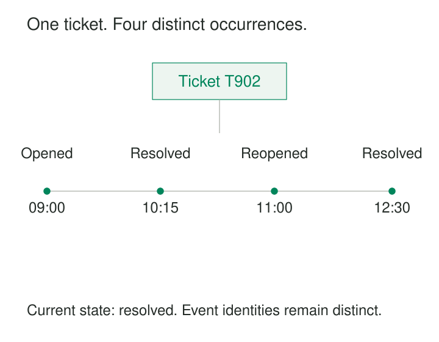

**What it is for**

Preserve both identity and history by distinguishing things that continue to exist from meaningful occurrences involving them.

A support ticket is marked resolved. Its record contains a customer, an assigned agent, and a resolution timestamp. The dashboard looks complete.

Then someone asks whether it was resolved on the first attempt. Another person wants to know how often it reopened. A manager asks which agent handled each resolution.

The current record cannot answer. Updating its status preserved the latest condition but replaced information about the path taken to reach it.

Separate Entities from Events gives those two kinds of information distinct roles. The ticket identifies the continuing case. Events record particular occurrences: it opened, someone resolved it, the customer reopened it, and someone resolved it again.

## Identity continues; occurrences accumulate

An **entity** is something the model needs to recognize as the same thing through change. A customer can change address. A tool can change location. A ticket can change status without becoming a different ticket.

An **event** represents a meaningful occurrence involving one or more entities. It answers what happened, when it happened, and which things participated.

Eric Evans’s Domain-Driven Design reference describes entities through continuity and identity, and domain events through activity that domain experts want to represent explicitly. It distinguishes meaningful domain activity from events that merely describe software operation. [Domain-Driven Design Reference](https://www.domainlanguage.com/wp-content/uploads/2016/05/DDD_Reference_2015-03.pdf).

A useful distinction is:

> An entity record identifies the thing. An event record identifies an occurrence involving it.

Both can have identifiers. Giving an event an ID does not turn its meaning into a current-state description. Nor does every entity need to be a physical object: an agreement or service account can have a continuing identity and lifecycle.

## One ticket, two resolutions

Consider an illustrative ticket, T-902. It opens at 09:00, is resolved at 10:15, reopens at 11:00, and is resolved again at 12:30.

At 12:30, the entity’s current status is resolved. That is useful for a queue showing outstanding work.

The event history supports different questions. There was one ticket, four recorded occurrences, and two resolution occurrences. First resolution took seventy-five minutes. Elapsed time from opening to the latest resolution was three and a half hours.

Neither duration is automatically “resolution time.” That metric still needs a definition, including how reopened periods and non-working hours are treated.

The second resolution must have its own occurrence identity. Deduplicating by ticket and event type would incorrectly merge the two resolutions.

Conversely, receiving the notification for the first resolution twice should not create another resolution occurrence. The model must distinguish repeated business activity from repeated delivery of information about that activity.

## A tool can move without becoming a new tool

An illustrative equipment register stores tool T-17 with its current custodian, Mina.

That answers who is responsible now. It does not establish who held the tool when damage was reported earlier.

A handover history can preserve the relevant occurrences:

| Event | Tool | Occurrence | Time |
|---|---|---|---|
| H-101 | T-17 | Assigned to Nora | 09:00 |
| H-102 | T-17 | Returned by Nora | 12:00 |
| H-103 | T-17 | Assigned to Mina | 13:00 |

The tool keeps the same identity throughout. Each handover involves additional entities, such as a staff member and possibly a location.

These records support custody analysis, but they do not prove when damage occurred. They establish recorded responsibility and movement, not causation.

An equipment loan may also deserve its own entity record if the business manages approval, due dates, extensions, and closure. Events can then describe that loan’s lifecycle.

The distinction depends on the question being modeled. “Loan” is not permanently classified as either a thing or an occurrence simply because of its name.

## Stripe: resources and notifications about change

Stripe’s public API makes the separation visible.

Its snapshot events represent changes involving other API resources. A `charge.succeeded` event, for example, contains information about the affected Charge. The event is a separate object describing the occurrence, rather than the Charge itself. Some actions generate multiple events. [Stripe Events API](https://docs.stripe.com/api/events).

The event’s specific meaning matters. Stripe documents `invoice.paid` as occurring when an invoice payment attempt succeeds **or** an invoice is marked paid outside Stripe. Treating every such notification as evidence of a new payment processed by Stripe would overstate what it establishes. [Stripe event types](https://docs.stripe.com/api/events/types).

Delivery adds another distinction. Stripe warns that webhook events can arrive more than once and are not guaranteed to arrive in generation order. Its guidance recommends tracking event IDs to recognize duplicate deliveries. [Stripe webhook behavior](https://docs.stripe.com/webhooks).

An integration therefore needs to distinguish the resource, the reported occurrence, and receipt of its notification. Counting incoming requests as business events confuses those levels.

## Give events enough context to remain meaningful

A useful event record normally identifies its occurrence, type, participants, and relevant time. Depending on the domain, it may also need an actor, amount, reason, source, or correlation with a larger process.

The entity reference alone is rarely sufficient. “T-902 changed” cannot explain whether the ticket was reassigned, reopened, or corrected.

Time also has more than one role. An occurrence may happen at 10:15 and reach the analytical platform at 10:22. The occurrence time supports business chronology; the received time helps explain processing delay. Fowler discusses this distinction between when an event happened and when the system noticed it. [Focusing on Events](https://martinfowler.com/eaaDev/EventNarrative.html).

A request and its outcome need separate meanings. `ResolveTicket` asks for an action. `TicketResolved` states that the action occurred. A rejected request must not be counted as a completed resolution, although the request itself may be worth recording.

Historical interpretation also needs care. Joining an old assignment event to an employee’s current department answers a different question from identifying their department when the assignment happened.

## What must remain true

**Entity identity must survive legitimate change.** A tool changing custodian should not acquire a new identity merely because an attribute changed.

**Event identity must distinguish occurrences from deliveries.** CloudEvents formalizes one approach: the combination of an event’s source and ID identifies a distinct event and can identify repeated transmissions. [CloudEvents specification](https://github.com/cloudevents/spec/blob/main/cloudevents/spec.md#id).

**Recorded activity must have defined coverage.** A partial history cannot reliably reconstruct every previous state. An event stream beginning halfway through a ticket’s life may require a baseline.

**State and history need coordinated writes.** If updating a ticket succeeds but recording its resolution fails, the two views disagree. A transaction or an appropriate reliable publication design is needed where both changes must stay aligned.

**Corrections need explicit treatment.** A mistaken event is evidence of what was recorded, not proof that the occurrence happened. Corrections, superseding records, and derived views need policies that consumers can understand.

## Useful history has an operating cost

Event records increase storage, indexing, retention, and interpretation work. Histories require schemas and version handling. Derived current-state views may need rebuilding, and copied personal details need deliberate handling.

The pattern helps when occurrences can repeat, when transitions matter, or when users need to investigate sequences and distinguish current condition from past activity.

It does not require a message broker or streaming platform. An entity table and a related event table can provide the distinction within one database.

It also does not require full Event Sourcing. Keeping useful events alongside authoritative current-state records is a smaller commitment than making an event history the sole authority for reconstructing application state.

Common mistakes include treating every database update as a meaningful business event, deduplicating by entity ID, and assuming an append-only history must be complete or correct.

Current-state records remain useful. The aim is to preserve the occurrences needed for the business’s questions without making every routine read reconstruct an entire history.

## Related patterns

[[data-declare-the-grain|Declare the Grain]] specifies whether one record represents an entity, a version, an occurrence, or another defined observation.

[[data-version-dimension-rows-scd-type-2|Version Dimension Rows — SCD Type 2]] preserves versions of selected entity attributes. Those versions complement events but do not necessarily explain the business meaning of each change.

[[data-transactional-outbox|Transactional Outbox]] helps coordinate a committed state change with reliable publication of information about it.

[[data-event-sourcing|Event Sourcing]] goes further by making recorded events the authoritative basis for deriving state.
