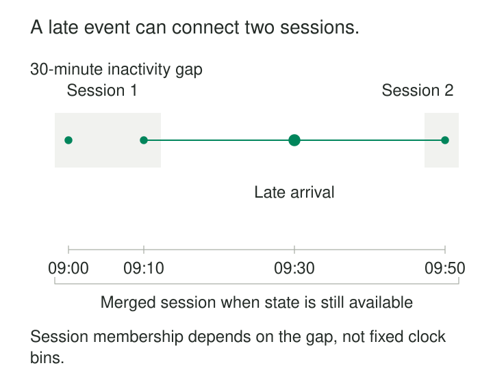

A visitor browses a product, adds it to a cart, pauses, and returns to checkout. The activity crosses a clock-hour boundary, but it still feels like one visit. Another visitor returns several hours later, and that feels like a separate visit.

Fixed time buckets cannot express this distinction well. They can split a continuous interaction or combine unrelated bursts simply because their timestamps share an interval.

**Session Windows group events for the same key into periods of activity separated by a defined inactivity gap.** Their boundaries emerge from the data. A session can last seconds or hours, provided activity keeps connecting its events.

The pattern turns irregular activity into units that can be counted and summarized. Its central assumption is that silence is a useful signal of separation.

## Let gaps determine the groups

A session definition needs three decisions: which events belong together, which timestamp orders them, and how much inactivity separates sessions.

For a visitor analysis, the key might be a visitor identifier. For equipment activity, it might be a device identifier. Event time usually provides the relevant chronology when records can arrive late.

Within each key, events connect through consecutive gaps. With a thirty-minute threshold, activity at 09:00, 09:20, and 09:40 can form one session even though the first and last events are forty minutes apart. The threshold limits the separation between neighboring events, rather than the total session duration.

Apache Beam documents session windowing as a per-key mechanism suited to irregular activity, including bursts of user interaction separated by idle periods. [Apache Beam session-window documentation](https://beam.apache.org/documentation/programming-guide/#windowing)

The exact threshold boundary needs a contract too. Decide whether a gap of exactly thirty minutes starts another session, and verify the engine’s behavior at its timestamp precision.

## A checkout event reconnects a visit

Consider these illustrative events for one visitor, initially received in this order:

| Event | Event time | Activity |
|---|---|---|
| E1 | 09:00 | Product view |
| E2 | 09:10 | Add to cart |
| E3 | 09:50 | Purchase |

With a thirty-minute inactivity gap, E1 and E2 form one session. E3 forms another because the observed gap from 09:10 to 09:50 is forty minutes.

The initial result describes two sessions: one containing browsing and cart activity, another containing a purchase.

A delayed event then arrives:

| Event | Event time | Activity |
|---|---|---|
| E4 | 09:30 | Begin checkout |

In event-time order, the gaps are now ten, twenty, and twenty minutes. E4 connects both sides, producing one session—if retained state and the late-data policy still permit the merge.

This changes more than an event count. Session count falls from two to one. The purchase now shares a session with the earlier product view. Funnel measures and observed duration may change.

Flink explicitly documents late events bridging previously separate session windows. Its session implementation merges windows and requires functions and triggers that support merging. [Apache Flink session-window documentation](https://nightlies.apache.org/flink/flink-docs-release-2.3/docs/dev/datastream/operators/windows/)

A batch reconstruction can discover the connected group by sorting the complete event history. A streaming implementation must maintain enough state to revise its earlier interpretation.

## Distinguish activity span from the inactivity deadline

After the merge, the first observed event is at 09:00 and the last is at 09:50. Their observed activity span is fifty minutes.

With a thirty-minute gap, 10:20 is the next inactivity deadline. It is not another observed interaction, and it does not establish eighty minutes of active engagement.

These fields should remain distinct:

| Field | Meaning |
|---|---|
| First event time | Earliest observed activity |
| Last event time | Latest observed activity |
| Observed span | Difference between those timestamps |
| Inactivity deadline | Point used to assess separation from later activity |

A one-event session has an observed span of zero. That does not prove the underlying visit or task took no time; the instrumentation may simply provide no further evidence.

Engine representations also differ. Some session windows include a trailing gap in their technical bounds, while other APIs expose session bounds based on event timestamps. Inspect those definitions before labeling a window-bound difference as “engagement time.”

## A product implementation: Google Analytics sessions

Google Analytics provides a familiar use of inactivity-based sessions. Its documentation states that sessions time out after thirty minutes of inactivity by default, allows timeout adjustment, and places no overall limit on how long a session can last.

It also associates events with generated session identifiers. For external analysis, Google recommends combining the session identifier with a user identifier or pseudonymous user identifier to distinguish sessions. [Google Analytics session documentation](https://support.google.com/analytics/answer/9191807?hl=en)

This demonstrates two practical points: the inactivity threshold is a policy choice, and session identity needs a scope.

Reproducing a product’s session metrics requires its event-collection and identification rules as well as its timeout. A generic thirty-minute grouping over exported timestamps may not reproduce every reported result.

## Device activity exposes the importance of event selection

Suppose a machine sends a heartbeat every ten seconds. A sessionizer uses a two-minute inactivity gap to identify operating episodes.

As long as heartbeats continue, the session can remain open for days. That may accurately describe connectivity, but it may be useless for identifying production cycles. The machine could be idle while its network connection remains healthy.

A different definition might sessionize meaningful work events, or use explicit cycle-start and cycle-end records when available. The resulting groups describe different phenomena.

The same problem occurs with websites: background polling can keep an apparent visit alive after a person stops interacting.

Sessionization therefore requires a definition of qualifying activity. A gap threshold cannot compensate for events that measure the wrong behavior.

## Published sessions need a revision strategy

Session identity is harder than a fixed window key because late data can move the start, extend the end, or merge groups.

In the checkout example, publishing one merged row is insufficient if both earlier rows remain in the destination. The system must retire the superseded results and publish their replacement, or expose a change stream that consumers can apply correctly.

Using the session start timestamp as an identifier does not eliminate the problem. An earlier event can change that timestamp. Numbering sessions sequentially within each visitor can also shift identifiers during historical reconstruction.

Kafka Streams provides session-window aggregation with a merger function for combining session aggregates. Its documentation illustrates out-of-order records merging previously separate sessions. [Kafka Streams session-window documentation](https://kafka.apache.org/41/streams/developer-guide/dsl-api/#windowing)

The publication contract should state whether identifiers are provisional, how superseded sessions are represented, and whether downstream measures receive corrections. Preserving event-to-session assignments or lineage can make those changes explainable.

## Closure depends on progress and retained evidence

For event-time processing, thirty minutes without newly received records does not necessarily establish thirty minutes of event-time inactivity. A source could be delayed or offline.

Watermarks help an operator assess event-time progress. Triggers control publication, and lateness policies determine how long earlier results remain open to correction. Flink documents retaining window state for allowed lateness and removing it when that retention expires. [Apache Flink late-data documentation](https://nightlies.apache.org/flink/flink-docs-release-2.3/docs/dev/datastream/operators/windows/#allowed-lateness)

After relevant state is gone, a bridging event may require historical recomputation rather than an immediate streaming merge.

This distinction matters operationally: a session can be provisionally published before the system stops accepting revisions. “Published” and “final under our policy” need separate meanings.

## Choose the gap for the question

Session windows help with visits, interaction bursts, device connectivity, and other behavior whose boundaries are better described by inactivity than clock alignment.

Their costs include per-key state, timers, merge processing, checkpoints, and downstream corrections. Hot keys or uninterrupted activity can create very long sessions. Retaining raw events costs more than maintaining small mergeable summaries.

A shorter gap produces more sessions; a longer gap combines more activity. Changes to that policy can alter conversion rates and duration distributions without any change in underlying behavior. Version the definition and make comparisons across policy changes explicit.

Identity quality is equally important. Shared accounts can combine different people, while changing device identifiers can split one person’s activity. Duplicate delivery still requires its own handling.

Verify exact-threshold behavior, long chains of activity, late bridges, and reconstruction from complete input. Most importantly, treat a session as a defined analytical grouping. Silence alone does not prove that a business process finished.

## Related patterns

[[data-event-time-processing|Event-Time Processing]] establishes chronology, progress, and late-event handling.

[[data-tumbling-windows|Tumbling Windows]] supplies fixed, disjoint reporting intervals when clock alignment is the desired boundary.

[[data-sliding-windows|Sliding Windows]] measures recent history over a moving horizon rather than separating activity into episodes.

[[data-historical-restatement|Historical Restatement]] repairs session assignments and dependent measures when corrections exceed streaming retention.
