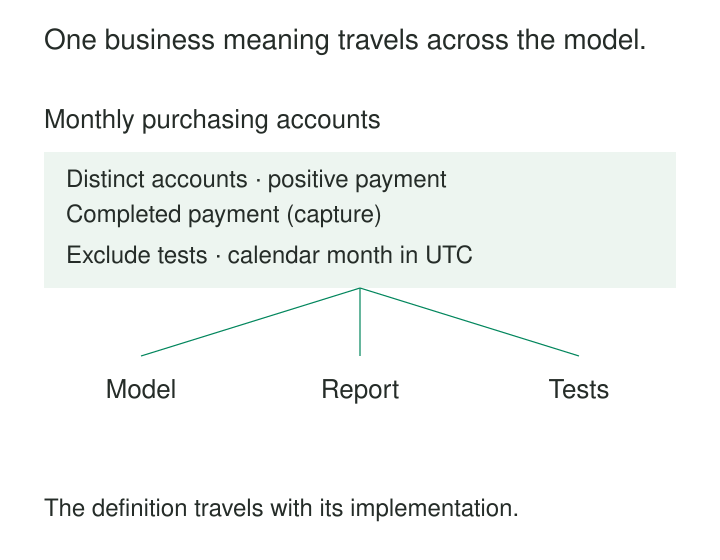

**What it is for**

Give business terms precise, agreed meanings that remain recognizable in conversations, data models, transformations, and reports.

A team asks for the number of active customers. Sales counts accounts with an ongoing commercial relationship. Product counts people who used the service recently. Finance counts accounts that made a payment.

The disagreement appears to concern three queries. In fact, it begins before anyone writes one.

Renaming every result “active customers” cannot make the measurements equivalent. Choosing one calculation without discussing its meaning merely hides the disagreement inside the implementation.

Shared Business Vocabulary makes that discussion explicit. People agree on the concepts their work depends on, name them clearly, and carry those meanings into the systems that represent them.

## Agreement that reaches the implementation

A useful vocabulary contains more than definitions in a glossary. It connects language to distinctions people actually use.

In Domain-Driven Design, the closely related practice of **Ubiquitous Language** develops a rigorous common language between domain experts and developers. Conversations test whether the language expresses the domain adequately, and the model evolves as understanding improves. [Ubiquitous Language](https://martinfowler.com/bliki/UbiquitousLanguage.html).

The practical test is whether someone can follow a concept from a business discussion into its implementation without silently changing its meaning.

If a meeting discusses “captured payments,” the data should distinguish captures from authorizations. If a report promises “delivered shipments,” its calculation should not count labels merely printed.

Consistent terminology makes those differences visible. It also makes errors easier to challenge: “This includes authorized payments, but our definition requires captures” is a specific objection that both business and engineering can investigate.

## Replace an ambiguous label with an answerable question

Consider an illustrative commerce business trying to define “active customers.”

Its immediate question is commercial: how many customer accounts made a qualifying payment during a month? After discussion, the team adopts a more specific term:

> **Monthly purchasing accounts:** distinct non-test customer accounts with at least one positive payment capture during the calendar month, measured in UTC. Refunds do not remove an account from this count.

This is a business choice for this example, not a universal definition of customer activity.

The term now specifies the entity being counted, the qualifying occurrence, the period, an exclusion, and the treatment of refunds.

Suppose the month contains these illustrative account histories:

| Account | Activity | Included? |
|---|---|---|
| A-12 | Two positive payment captures | Yes, once |
| A-24 | Payment authorized but never captured | No |
| A-35 | Positive capture on a test account | No |
| A-48 | Positive capture followed by a refund | Yes, once |

The result is two purchasing accounts.

Counting captures would produce a different result. Counting authorizations would include A-24. Subtracting refunded accounts would exclude A-48. Each alternative might serve another question, but it would need a different definition.

Product can still measure monthly engaged users. Sales can still measure established accounts. Clear vocabulary preserves these useful distinctions instead of forcing unrelated questions into one attractive label.

## “Dispatched” needs an observable boundary

A vocabulary also governs operational work, not just metrics.

Imagine a delivery business whose warehouse marks a shipment “dispatched” when its label is printed. Customer support interprets the same word as confirmation that the carrier has taken possession.

A customer receives a dispatch notification, asks the carrier for an update, and discovers that the parcel is still waiting at the warehouse.

The ambiguity has crossed from reporting into a promise.

For this operation, the team separates three concepts: **ready for dispatch**, **carrier accepted**, and **delivered**. Label creation supports the first. A handover record or acceptance scan provides evidence for the second. Delivery requires its own evidence.

The vocabulary must also accommodate uncertainty. A missing scan does not prove that handover never happened. “Handover unconfirmed” can preserve that distinction while staff investigate.

Once these terms appear in warehouse screens, support guidance, event names, and reports, the business can distinguish preparation delays from transport delays. The language improves because it expresses the work more faithfully.

## Shopify: a return is not every reversal

Shopify’s sales-report documentation provides a concrete example of refining an implemented reporting vocabulary.

It distinguishes **sales reversals** from physical returns. Reversals include negative order adjustments arising from circumstances such as refunds, cancellations, edits, and changes to charges. Its documentation explains the replacement of several return-related reporting terms with reversal-related terms and separately identifies metrics for physically returned quantities. [Shopify sales reports](https://help.shopify.com/en/manual/reports-and-analytics/shopify-reports/report-types/default-reports/sales-report).

The distinction changes what a reader can infer.

An order canceled before dispatch can produce a negative adjustment without any product coming back. Calling every such adjustment a return encourages people to read a financial change as evidence of physical movement.

A separate physical-return measure supports questions about goods coming back. A reversal measure supports questions about reductions to recorded sales.

This is vocabulary doing substantive modeling work: the names expose differences that matter to decisions.

## Define concepts, examples, and exceptions

A useful definition usually needs a scope, a plain-language explanation, and examples that establish its boundaries.

Counterexamples are particularly valuable. “An authorization is not a capture” prevents a plausible mistake. “A canceled order need not involve a physical return” prevents another.

The vocabulary also needs to distinguish synonyms from neighboring concepts. “Client” and “customer” may be interchangeable in one setting. “Payer,” “buyer,” and “service user” may describe different roles and should not be merged merely because the same person sometimes performs all three.

W3C’s SKOS provides a formal model that separates concepts from their preferred and alternative labels, with definitions and scope notes. That distinction is useful even when a team maintains its vocabulary in an ordinary document. [SKOS Primer](https://www.w3.org/TR/skos-primer/).

The purpose is to preserve meaning while allowing people to find it through familiar words.

## What must remain true

**The agreement needs an explicit scope.** A definition can be shared within a product, process, or bounded context without becoming mandatory everywhere. Genuine differences need qualified terms or documented mappings.

**The evidence must support the distinction.** Defining “delivered” precisely does not create delivery evidence. Missing or unreliable observations remain data-quality problems.

**The implementation must follow the definition.** Filters, identifiers, time boundaries, exclusions, and aggregation rules need to match the stated concept. Tests should include cases where a plausible alternative interpretation would produce a different answer.

**Someone must resolve changes.** Vocabulary develops through use. An accountable owner or steward needs a way to involve domain experts, settle disputed cases, and communicate revisions.

**Historical meaning needs protection.** If the purchasing-account definition changes to exclude refunded payments, an apparent trend may reflect the new rule. Consumers need to know whether history was recalculated, the definition changed prospectively, or both versions remain available.

Agreement does not guarantee truth. People can agree on an unsuitable measure. The definition must still be evaluated against the decision it serves.

## The cost of keeping language shared

Vocabulary work consumes time from people whose knowledge is often already in demand. Definitions require maintenance, and changes can affect pipelines, dashboards, interfaces, and training.

The work is most useful where ambiguity creates repeated reconciliation, incorrect actions, or expensive handovers. Start with terms whose misunderstandings have consequences. A small vocabulary used consistently can be more valuable than an extensive glossary detached from daily work.

Common mistakes include circular definitions, treating a source-system field as the final authority, and declaring agreement after only one team has participated.

Another mistake is substituting naming rules for understanding. Consistent capitalization and column suffixes help readers, but cannot decide whether an account, organization, or person is being counted.

Definitions should be precise enough to resolve meaningful disagreements and simple enough for people to use. Repeated difficulty explaining a term may indicate that the model itself needs revision.

## Related patterns

[[data-bounded-contexts|Bounded Contexts]] establishes the scope within which a vocabulary and model remain coherent.

[[data-declare-the-grain|Declare the Grain]] specifies what an individual record represents, making terms such as account, purchase, and observation operationally precise.

[[data-shared-metric-definitions|Shared Metric Definitions]] carries agreed concepts into reusable calculations and reporting rules.

[[data-controlled-vocabularies|Controlled Vocabularies]] governs permitted category values once their meanings are understood.

[[data-explicit-data-contracts|Explicit Data Contracts]] communicates the semantics that producers and consumers rely on across an interface.
