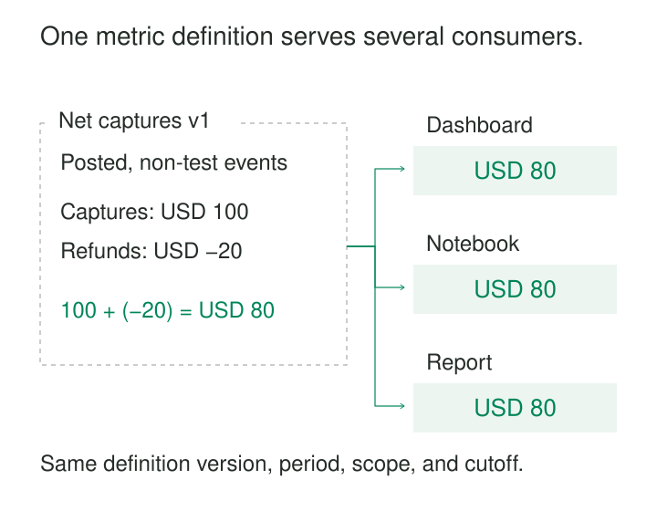

The sales dashboard says revenue increased. Finance’s spreadsheet says it fell. Both teams queried the same warehouse, but one counted orders when placed, another counted payments when captured, and each handled refunds differently.

Shared Metric Definitions make important measurements consistent, explainable, and reusable across tools. They establish what a metric means and connect that meaning to a maintained calculation, so each dashboard does not quietly invent its own rules.

The purpose is to make agreement—and legitimate disagreement—visible.

## A metric is more than a formula

“Conversion rate equals conversions divided by visitors” looks precise until someone asks which visitors, which conversions, and over what period.

A usable definition specifies the population being measured, the qualifying events or states, the calculation, and its time semantics. It also identifies units, exclusions, supported dimensions, and rules for combining results.

For example, a seven-day trial conversion metric must explain whether it counts accounts or people, when a trial enters the cohort, what qualifies as conversion, and how unfinished observation windows are treated.

These decisions should have a named owner and a stable metric identifier. The readable definition explains the business meaning; a reusable implementation carries it into queries, models, or services.

A semantic layer is one implementation option: software that translates requests for named metrics and dimensions into calculations over underlying data. MetricFlow, for example, constructs SQL from declared semantic models and metric definitions. The pattern also works through maintained database views or shared transformation models. [dbt: About MetricFlow](https://docs.getdbt.com/docs/build/about-metricflow)

## Example: make the cash measurement explicit

Consider an illustrative payment dataset:

| Event | Type | Status | Test record? | Signed amount, USD |
|---|---|---|---|---:|
| P-101 | Capture | Posted | No | +100 |
| P-102 | Refund | Posted | No | −20 |
| P-103 | Capture | Posted | Yes | +60 |
| P-104 | Capture attempt | Failed | No | +30 |

Define **Net captured amount, USD** as the sum of signed amounts for posted, non-test capture and refund events, attributed to their posting dates in UTC.

For the period containing these events, the answer is **USD 80**. The test capture and failed attempt do not qualify.

This definition also settles a less obvious question: a refund posted today reduces today’s result, even if the original capture occurred last month. Attributing refunds back to the original purchase period would produce a different metric and needs an explicit definition.

The metric measures payment activity. Booked sales and recognized revenue answer different questions and should have distinct names and rules.

Consumers can request this metric by day or another supported dimension while reusing its eligibility and calculation logic. A dashboard that adds an undocumented filter has changed the question, even if it retains the same title.

## Example: conversion rates must combine correctly

Suppose a software company defines **Seven-day trial conversion**:

The denominator is eligible accounts starting their first trial during the selected period, excluding staff and test accounts. The numerator is those same accounts making a qualifying paid purchase within seven days of trial start. Results are attributed to the trial-start cohort.

For cohorts whose observation windows have completed:

| Acquisition channel | Eligible accounts | Converted accounts | Conversion rate |
|---|---:|---:|---:|
| Direct | 100 | 20 | 20% |
| Paid search | 900 | 90 | 10% |
| Combined | 1,000 | 110 | 11% |

Averaging the displayed percentages gives 15%, which answers a different question: the equally weighted average of two channel rates.

The combined account conversion rate is `110 / 1,000 = 11%`. The shared definition must preserve the numerator and denominator and divide after aggregating them. Kimball’s guidance similarly recommends retaining additive components when calculating non-additive measures such as ratios. [Kimball Group: Additive, Semi-Additive, and Non-Additive Facts](https://www.kimballgroup.com/data-warehouse-business-intelligence-resources/kimball-techniques/dimensional-modeling-techniques/additive-semi-additive-non-additive-fact/)

This result assumes each account belongs to one acquisition channel under a stated attribution rule. Overlapping channel assignments would prevent simple addition.

Time matters just as much. Yesterday’s trial starters have not had seven days to convert. The metric should exclude incomplete cohorts from a finalized result or clearly mark their values as provisional. A zero denominator should produce an explicit undefined result rather than a fabricated zero conversion rate.

## What must hold for the result to be correct

Shared logic can distribute the same error widely. Its correctness depends on several properties of the underlying model.

**The input grain must match the measurement.** Payment events need reliable identities and duplicate handling. Counting accounts requires account identity rules. A join from one payment to several associated records must not multiply its amount. Supported joins and dimensions are part of the metric’s design.

**Time must have an agreed meaning.** Event time, posting time, ingestion time, and cohort-start time are different clocks. Calendar boundaries, time zones, late arrivals, and correction policies can change the answer.

**Units and populations must remain compatible.** Summing currencies requires a defined conversion policy. Filtering a conversion numerator without applying the corresponding population rule to its denominator can create a misleading ratio.

**Comparisons need matching query context.** The same metric can legitimately differ across tools because of filters, access restrictions, refresh times, or cached results. Reconciliation requires the definition version, requested dimensions, period, filters, access scope, and data cutoff.

Historical reproduction requires more than retaining old metric code. The underlying data and relevant dimension values must also be recoverable, through snapshots, versioned inputs, or another explicit history mechanism.

Small reference datasets can verify important boundaries: a refund crossing a month boundary, a duplicate event, an unfinished cohort, or a join that would otherwise duplicate a payment.

## A published implementation: Airbnb’s Minerva

Airbnb described the organizational form of this problem in its 2021 account of Minerva. Different teams sometimes answered basic booking questions differently because they used different tables, definitions, and business logic.

Minerva connected maintained metric definitions to computation and downstream consumption. Airbnb reported centralized definitions in a shared repository, with code review, static validation, and test runs. Its ecosystem exposed metrics through discovery and exploration tools and supported uses including experimentation and executive reporting. [Airbnb Engineering: How Airbnb Achieved Metric Consistency at Scale](https://medium.com/airbnb-engineering/how-airbnb-achieved-metric-consistency-at-scale-f23cc53dea70)

The useful lesson is the connection between definition, execution, discovery, and ownership. A glossary entry alone cannot keep separately written dashboard calculations aligned. Consumers need a practical route to reuse the maintained implementation.

## Changes need a visible boundary

A team may decide that trial conversion should require a settled payment rather than an initial authorization. That changes who qualifies.

Replacing the old logic silently can make an apparent business trend out of a definition change. A maintained metric needs a change policy: identify material revisions, explain their effects, and decide whether historical results will be recomputed.

During migration, old and new versions can run together so users can inspect the difference. Reports should distinguish a restated history from a series whose definition changed partway through.

Ownership can remain with domain teams. Shared definitions require coordinated interfaces and review; they do not require one central team to make every business decision.

## Where reuse earns its cost

This pattern is especially useful when measurements cross team boundaries, drive recurring decisions, appear in several tools, or support experiments and reporting that must reconcile.

Its costs include definition review, migration of existing reports, reference tests, lineage maintenance, and resolving disputed edge cases. Query services introduce operational dependencies; precomputed results and caches introduce storage, refresh, and invalidation work. A definition change may require expensive historical recomputation.

Overcentralization can also slow exploration. Analysts need room to develop provisional measurements before promoting them into maintained definitions. Distinct business questions deserve distinct metrics with explicit relationships.

The common mistakes are sharing only a name, documenting rules without connecting them to execution, averaging ratios, permitting unsafe joins, and changing meaning without notice. Even a perfectly consistent metric can be a poor proxy for the outcome people care about.

## Related patterns

[[data-shared-business-vocabulary|Shared Business Vocabulary]] establishes what business terms mean; shared metric definitions specify how particular quantities are measured.

[[data-declare-the-grain|Declare the Grain]] makes the counted unit explicit and exposes duplication risks.

[[data-make-units-explicit|Make Units Explicit]] prevents incompatible quantities from being combined.

[[data-separate-source-facts-from-derived-interpretations|Separate Source Facts from Derived Interpretations]] preserves the evidence beneath a metric and makes later reinterpretation possible.
