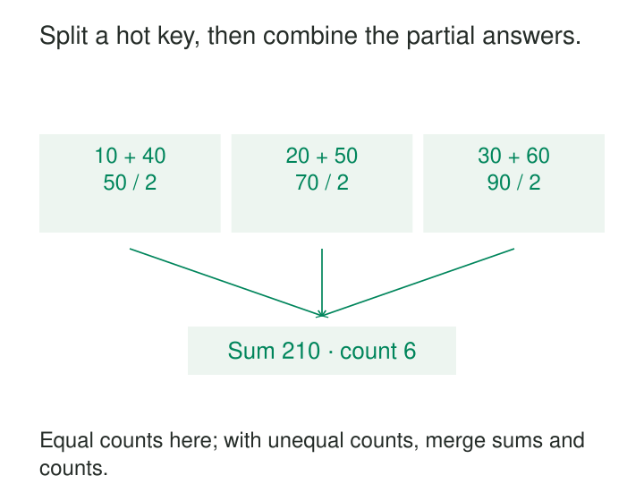

A live pipeline has twenty workers, but one falls steadily behind. Most workers finish their batches quickly. One merchant, customer, device, or category owns so much traffic that its partition determines the entire pipeline’s progress.

Adding workers barely helps: the partitioning rule still sends that key’s work to one place.

**Skew Splitting divides an overloaded unit of work into smaller pieces that can run in parallel, while preserving the original operation’s result.** For aggregations, that usually means merging partial results. For joins, it means arranging the pieces so every required pair still meets.

The difficult part is defining a split that preserves meaning.

## Split within the hot key

Ordinary hash partitioning distributes different keys. It does not divide records that share one key. Increasing the partition count may spread other merchants more widely while leaving merchant M7 concentrated in one partition.

A common technique adds a secondary routing value, sometimes called a *salt*. Instead of grouping only by merchant, the pipeline temporarily groups by merchant and bucket:

```text
bucket = stable_hash(event_id) mod fanout
split_key = (merchant_id, bucket)
```

The varying input matters. Hashing only `merchant_id` again sends every M7 record to the same bucket.

Not every key needs splitting. Hot keys can receive several buckets while ordinary keys retain one. The execution engine must then distribute those buckets across available tasks; creating sixteen subkeys does not guarantee sixteen dedicated workers.

Google’s Dataflow guidance describes hot keys as a limit on parallelism and recommends partial combination or key salting followed by a second aggregation. [Dataflow parallelism](https://docs.cloud.google.com/dataflow/docs/concepts/parallelism)

The three lanes shown have equal counts. Their means happen to combine without weighting bias; [[data-store-additive-components|Store Additive Components]] demonstrates why unequal counts require combining sums and counts instead.



## Find the concentration before changing the keys

A slow worker does not automatically prove key skew. It might have a failing disk, an expensive individual record, or a source partition containing disproportionate work.

Measure the distribution at the stage that is falling behind. Compare records, bytes, processing time, state size, and backlog by key or partition. Equal record counts can conceal large differences in record size or computational cost.

Dataflow’s streaming troubleshooting guidance specifically connects uneven worker utilization with hot keys and insufficient key parallelism. [Troubleshooting streaming parallelism](https://docs.cloud.google.com/dataflow/docs/guides/troubleshoot-slow-streaming-jobs#troubleshoot-parallelism)

Also inspect why the key is hot. A legitimate large customer needs a capacity strategy. Millions of unrelated records accidentally assigned the placeholder `unknown` may instead reveal a modeling or data-quality problem.

## Example: parallel totals for a busy merchant

Merchant M7 produces six sales within the same minute:

| Subkey | USD amounts | Partial sum | Count |
|---|---|---:|---:|
| M7 #0 | 10, 40 | 50 | 2 |
| M7 #1 | 20, 50 | 70 | 2 |
| M7 #2 | 30, 60 | 90 | 2 |

The first aggregation processes the subkeys independently. The second removes the bucket from the grouping and merges the partial states:

**USD 50 + 70 + 90 = USD 210, across six sales.**

The final stage still groups by merchant, but it receives compact partial results instead of every original sale.

Apache Beam provides this mechanism through `CombinePerKey.with_hot_key_fanout`. It supports a constant fanout or a function selecting fanout by key, and explicitly introduces two levels of aggregation. Its documentation also warns that additional grouping and reduced local combining can increase shuffle traffic. [Beam hot-key fanout](https://beam.apache.org/releases/pydoc/current/apache_beam.transforms.core.html#apache_beam.transforms.core.CombinePerKey.with_hot_key_fanout)

Correctness requires mergeable state. Sums and counts combine naturally. An average needs total sum and count; averaging bucket averages fails when bucket sizes differ. Distinct counts require a suitable mergeable representation rather than adding each bucket’s distinct count.

The merge must preserve the same logical key, currency, and window. Floating-point sums may also differ slightly when parallel execution changes addition order.

### Streaming partials need update semantics

Suppose a bucket first reports 50, then reports an updated cumulative total of 70. Adding both reports produces 120.

A custom merger must either replace the earlier bucket state using an appropriate version or consume correctly defined deltas. Late events, retries, and corrections must follow that contract too.

Stable routing helps retries reach the same bucket, but does not itself remove duplicate deliveries. Splitting and deduplication solve different problems.

## Example: split a hot join without losing matches

An event table joins to merchant attributes. M7 has millions of events but only a few matching attribute rows.

A manual split can assign each M7 event to exactly one bucket and copy every applicable M7 attribute row into every bucket. Each event then encounters its required matches locally.

The asymmetry is essential:

- Splitting both sides independently can prevent matching records from meeting.
- Copying both sides to every bucket can produce duplicate matches.
- Splitting one side and replicating the corresponding other-side rows can preserve each original pair once.

This reasoning assumes an appropriate join shape and complete handling of duplicates. Outer joins need particular care: replicated unmatched rows can otherwise appear repeatedly.

Spark’s adaptive skew-join optimization implements an engine-managed form of this approach for supported sort-merge joins, splitting skewed work and replicating data where necessary. Its detection uses both an absolute partition-size threshold and a size comparison with the median partition. [Spark skew-join optimization](https://spark.apache.org/docs/latest/sql-performance-tuning.html#optimizing-skew-join)

Engine-managed splitting is often preferable to hand-written salting because the planner can account for join semantics.

Splitting also cannot eliminate a genuinely huge result. If one hot key has a million matching rows on each side, the required many-to-many output remains enormous. Parallelism spreads that work; it does not reduce its cardinality.

## Example: spread a hot storage key

A live ingestion service stores events under a daily partition key. Today’s date receives nearly every write, making one logical key disproportionately busy.

A calculated suffix can distribute events across keys such as:

```text
2026-10-26#00
2026-10-26#01
...
2026-10-26#15
```

AWS documents both random and calculated suffixes for DynamoDB write sharding. A suffix derived from an accessible identifier allows readers to calculate an individual item’s destination. Reading the whole day still requires querying all relevant suffixes and merging the results. [DynamoDB write sharding](https://docs.aws.amazon.com/amazondynamodb/latest/developerguide/bp-partition-key-sharding.html)

The read path is part of the design. Queries, backfills, retention jobs, and repair tools must understand the expanded keyspace.

Changing the bucket count later also changes calculated routing. Existing records remain under their old keys, so migration needs a versioned routing scheme or another explicit way to locate both old and new data.

## Know what cannot be divided safely

Some operations require one ordered history.

An account balance transition, sequence-sensitive detector, or state machine may depend on the previous event’s result. Arbitrarily salting those events creates independent histories that cannot simply be added back together.

Sometimes the work can be redesigned: perform independent enrichment in parallel, then serialize only the final state transition. Sometimes the sequential requirement is fundamental.

Skew splitting therefore requires a decomposition rule: independent pieces, a valid merge, or a join strategy preserving all matches. “This key is slow” is not enough.

## Pay for parallelism deliberately

More splits introduce scheduling, shuffle, replication, state, checkpoint, and coordination costs. Excessive fanout can turn one bottleneck into thousands of tiny tasks or overwhelm the merge stage.

Choose fanout from measured work and available capacity, then verify it under representative traffic. Watch the slowest tasks, backlog, replicated bytes, state growth, and final-stage load.

Keep semantic checks alongside performance measurements: totals, counts, join multiplicities, and behavior under duplicate, late, and corrected records. A balanced workload that loses contributions has changed the computation.

## Nearby patterns

[[data-co-located-joins|Co-Located Joins]] keeps matching inputs together; skew splitting may deliberately divide a hot placement group and replicate selected matches.

[[data-broadcast-small-inputs|Broadcast Small Inputs]] supplies the replication mechanism when one side of a split join is compact.

[[data-store-additive-components|Store Additive Components]] provides partial state that can be merged correctly.

[[data-per-key-ordering|Per-Key Ordering]] identifies the sequential guarantees that splitting must preserve or explicitly redesign.
