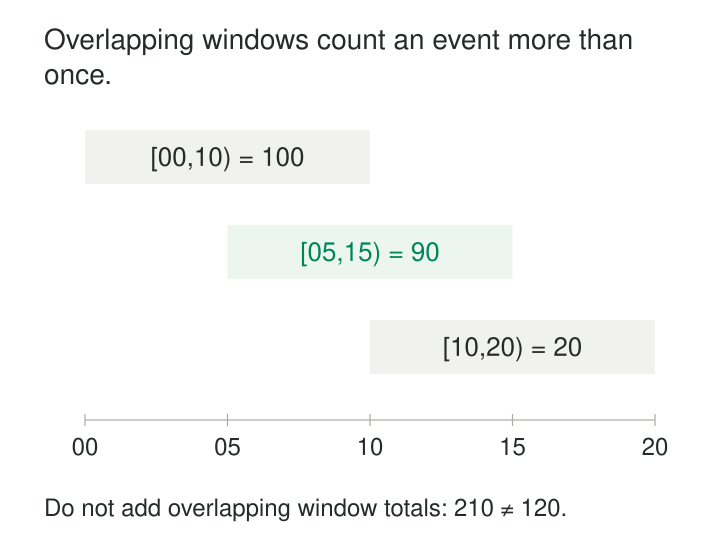

A service dashboard reports errors in five-minute blocks. A burst begins just before one block ends and continues into the next. Each block looks tolerable, even though users experience one concentrated incident.

The operational question is about recent history: how much activity occurred during a moving interval?

**Sliding Windows repeatedly evaluate a fixed-duration horizon as its position moves through time.** Neighboring windows usually overlap, so an event can contribute to several results. That overlap preserves context across reporting boundaries and supports rolling counts, rates, averages, and thresholds.

The essential choices are how much history to include, where to evaluate it, and how results change as records enter or leave.

## Establish what “sliding” means

Streaming systems use the name for different mechanisms.

**Periodic sliding windows**, often called **hopping windows**, have a fixed duration and a fixed advance. A ten-minute window advancing every five minutes produces intervals such as `[10:00, 10:10)`, `[10:05, 10:15)`, and `[10:10, 10:20)`. Apache Beam calls this sliding windowing; Flink exposes it through `HOP`. [Apache Beam windowing guide](https://beam.apache.org/documentation/programming-guide/#windowing), [Apache Flink windowing reference](https://nightlies.apache.org/flink/flink-docs-release-2.3/docs/sql/reference/queries/window-tvf/)

**Event-driven sliding windows** evaluate positions determined by the data. Azure Stream Analytics describes considering all possible windows logically, while emitting results when window contents change as events enter or exit. [Azure Stream Analytics sliding-window reference](https://learn.microsoft.com/en-us/stream-analytics-query/sliding-window-azure-stream-analytics)

Kafka Streams explicitly distinguishes hopping windows from its record-timestamp-based sliding windows. Its sliding-window endpoints are both inclusive, unlike the start-inclusive, end-exclusive convention used in this article’s periodic examples. [Kafka Streams windowing documentation](https://kafka.apache.org/41/streams/developer-guide/dsl-api/#windowing)

A pipeline contract therefore needs more than `window_type = sliding`. It must identify the duration, evaluation positions, time basis, alignment, and endpoint convention.

## Keep duration separate from advance

For periodic windows, **duration** answers “how much history?” and **advance** answers “how far apart are the views?”

A ten-minute duration with a five-minute advance overlaps neighboring windows by five minutes. Equal duration and advance produce tumbling windows. An advance larger than the duration leaves gaps.

Alignment determines the actual boundaries. Two systems can both use ten-minute windows advancing every five minutes while disagreeing because their starting offsets differ.

The grouping key completes the definition. “Requests per endpoint over ten minutes” and “requests across the whole service over ten minutes” have different output grains.



## Three purchases, three overlapping views

Consider three illustrative purchases, all in UTC and the same currency:

| Event | Event time | Amount |
|---|---|---:|
| E1 | 10:03 | 30 |
| E2 | 10:07 | 70 |
| E3 | 10:12 | 20 |

Three selected ten-minute windows produce:

| Window | Included events | Total |
|---|---|---:|
| `[10:00, 10:10)` | E1, E2 | 100 |
| `[10:05, 10:15)` | E2, E3 | 90 |
| `[10:10, 10:20)` | E3 | 20 |

E2 contributes to two results because both intervals contain 10:07. That is intentional membership.

Flink’s documented `HOP` function expresses this arrangement directly:

```sql
SELECT
  window_start,
  window_end,
  SUM(amount) AS rolling_amount
FROM HOP(
  TABLE purchases,
  DESCRIPTOR(occurred_at),
  INTERVAL '5' MINUTES,
  INTERVAL '10' MINUTES
)
GROUP BY window_start, window_end;
```

The interval arguments specify advance first, then duration. Streaming use requires the appropriate time attribute configuration. [Apache Flink HOP reference](https://nightlies.apache.org/flink/flink-docs-release-2.3/docs/sql/reference/queries/window-tvf/#hop)

The three displayed totals add to `210`, while the distinct purchases total `120`. Overlapping results cannot be added as though they partitioned the input. Each result describes a view of history, and adjacent views share evidence.

## A moving average still needs a measurement definition

A temperature sensor reports `20°C` at 10:00 and `80°C` at 10:08.

For `[10:00, 10:10)`, the arithmetic mean of those two samples is `50°C`. But if the contract says each reading remains valid until the next reading, the time-weighted mean is `32°C`:

- Eight minutes at `20°C`.
- Two minutes at `80°C`.

Moving the window does not resolve this distinction. A sample average weights observations equally; a time-weighted average weights their represented durations.

Later windows may also need a reading from before their start to establish the value at the boundary. Filtering exclusively to timestamps inside the interval would lose that context.

The same issue appears in service metrics. Rolling mean latency should usually come from total latency divided by request count. Averaging previously calculated means can misweight periods with different traffic volumes.

## Periodic evaluation can miss a rolling threshold

Suppose a device records seven failures at 10:04 and another seven at 10:11.

A rule asks whether more than ten failures occurred within any ten-minute period.

Ten-minute windows advancing every five minutes can miss this:

| Evaluated interval | Failures |
|---|---:|
| `[10:00, 10:10)` | 7 |
| `[10:05, 10:15)` | 7 |

Yet `[10:02, 10:12)` contains all fourteen failures.

A smaller advance improves temporal coverage, but a sampled grid does not automatically implement “any possible interval.” An event-driven rolling calculation can evaluate the relevant positions as records change membership.

Azure Stream Analytics provides a documented example of this style: counting vehicles per toll booth over a sliding five-minute horizon and filtering results by a threshold. [Azure Stream Analytics sliding-window reference](https://learn.microsoft.com/en-us/stream-analytics-query/sliding-window-azure-stream-analytics)

The choice depends on the question. Periodic views suit regularly refreshed dashboards. Threshold detection may require evaluation tied to incoming events, expirations, or both.

## Membership and publication remain separate

An event-time sliding window uses occurrence timestamps to determine membership. Processing-time windowing uses the processor’s clock. The selected basis must match the intended question.

Suppose E2, timestamped 10:07, arrives late. It can affect both `[10:00, 10:10)` and `[10:05, 10:15)`. Whether either result is revised depends on retained state and the late-data policy.

Watermarks describe progress through event time; triggers govern result emission. A five-minute advance defines window positions, not a guarantee that results appear precisely every five wall-clock minutes. Beam documents these mechanisms separately. [Apache Beam model basics](https://beam.apache.org/documentation/basics/)

Results need stable identities containing the business key and window boundaries. Revised totals should update the corresponding result or use an explicit change protocol. An alerting consumer may also need to distinguish a new incident from repeated qualifying windows during the same incident.

Expiration matters even when no new event arrives. A recent-activity count should eventually decrease as old events leave the horizon. The implementation needs timers or progress mechanisms that support that behavior; input silence alone does not guarantee event-time advancement.

## Pay for overlap deliberately

Sliding windows are useful for recent activity, operational monitoring, rolling demand, and smoothing noisy measurements. They reduce dependence on a single set of reporting boundaries.

Overlap also increases work. With a one-hour duration and a one-minute advance, an event can logically contribute to sixty periodic windows. Engines may share partial aggregates, so this does not necessarily mean sixty complete computations or stored copies.

Efficient maintenance depends on the measure. Counts and sums can often add entering contributions and remove expired ones. Distinct counts need enough information to know whether another occurrence remains. Minimums, maximums, and quantiles require suitable retained state or specialized summaries.

Long horizons, many grouping keys, and generous lateness allowances increase memory, checkpoint size, recovery time, and correction traffic. Frequent evaluations also produce strongly correlated neighboring results; repeated threshold crossings are not independent observations.

Verification should cover exact boundaries, out-of-order arrivals, duplicate delivery, expiration without new activity, and results compared with a bounded recomputation. Overlap does not supply deduplication or completeness by itself.

## Related patterns

[[data-tumbling-windows|Tumbling Windows]] provides disjoint intervals when each event should contribute to one temporal partition.

[[data-event-time-processing|Event-Time Processing]] establishes timestamp meaning, progress, and late-data handling.

[[data-store-additive-components|Store Additive Components]] preserves the sums and counts needed for correct rolling ratios and averages.

[[data-session-windows|Session Windows]] groups activity by gaps of inactivity when a fixed-duration horizon does not match the behavior being studied.
