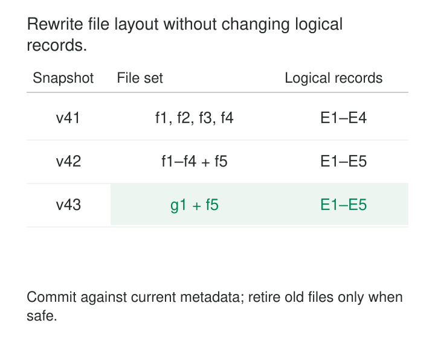

A streaming pipeline makes new data available every few seconds. Each write succeeds quickly, but it leaves behind another collection of small files. After several days, queries spend noticeable time planning tasks and opening files before doing much useful computation.

**Small-File Compaction combines small data files into fewer, larger files while preserving the table’s logical contents.** It lets ingestion favor timely publication while a separate maintenance process improves the layout for readers.

The important boundary is between changing how records are stored and changing what the table means.

## Pay less overhead per record

Files carry costs beyond their data bytes: metadata entries, open requests, footer reads, scheduling, and reader initialization. When files contain little data, those fixed costs become a large part of query execution.

Apache Iceberg explicitly identifies metadata growth and file-open overhead as reasons to combine small files. Its maintenance API supports parallel data-file rewriting. [Iceberg data-file maintenance](https://iceberg.apache.org/docs/latest/maintenance/#compact-data-files)

For illustration, a writer committing every thirty seconds across eighty active partitions could create 9,600 files per hour if each commit produces one file per partition. The data volume might be modest; the object count is not.

Compaction amortizes those costs across larger units. It may also improve compression, but fewer files do not necessarily mean fewer logical records or substantially fewer bytes.

## Rewrite the representation, preserve the rows

For ordinary file-layout compaction, the correctness rule is:

> Each row must appear the same number of times after compaction as before. This layout rewrite is not deduplication.

Compaction does not automatically deduplicate events, repair business values, or aggregate transactions. Those operations change the data and need separate rules.



A typical transactional implementation selects committed input files, writes replacements privately, validates that the rewrite remains valid, and publishes a metadata change removing the old references and adding the new ones.

Readers must use that committed metadata. Reading every physical file under the table directory can count both generations.

The rewrite must also honor the table’s schema, partition rules, and deletion semantics. Copying physical records without applying the format’s rules can resurrect deleted data.

## Example: compact frequent Delta Lake writes

An event pipeline writes a Delta table partitioned by `event_date`. Frequent microbatches leave yesterday’s partition with thousands of small files.

A targeted maintenance operation can compact that partition:

```sql
OPTIMIZE events
WHERE event_date = '2026-10-25';
```

Delta Lake’s bin-packing optimization combines small files into larger ones. Its documentation states that the operation changes layout without changing the table’s data, and snapshot readers continue without interruption. It also supports tables being consumed as streaming sources. [Delta Lake compaction](https://docs.delta.io/optimizations-oss/#compaction-bin-packing)

The practical benefit is separation of concerns. Ingestion can publish promptly; readers subsequently encounter fewer files.

Yesterday’s partition is not necessarily immutable, however. Late events may still arrive, and corrections may rewrite existing records. Compaction must participate in the table’s concurrency protocol.

Delta uses optimistic validation before committing staged files. Compaction can conflict with updates or other compaction operations affecting the same files. [Delta Lake concurrency control](https://docs.delta.io/concurrency-control/)

## Example: preserve an append during an Iceberg rewrite

Consider the diagram’s simplified table history:

| Stage | Active files |
|---|---|
| Version 41 | f1, f2, f3, f4 |
| Version 42: live append | f1, f2, f3, f4, f5 |
| Version 43: compaction commits | g1, f5 |

The compactor selected f1 through f4 and wrote g1 containing their records. Meanwhile, ingestion committed f5.

The safe change replaces the selected files while preserving f5. Publishing a complete file list copied from version 41 would lose the concurrent append.

Iceberg structures commits around assumptions and actions. Its documented compaction example validates that the files being replaced still exist before removing their references and adding the replacement. If a conflicting operation removed an input, that assumption no longer holds. [Iceberg retry validation](https://iceberg.apache.org/docs/latest/reliability/#retry-validation)

This allows compatible concurrent work without treating every newer commit as a reason to discard the rewrite. It also prevents blindly publishing a replacement built from obsolete inputs.

Iceberg’s `rewriteDataFiles` action can select a subset of data and specify a target file size. Data-file rewriting is distinct from rewriting manifests, which optimizes metadata organization. [Iceberg maintenance operations](https://iceberg.apache.org/docs/latest/maintenance/)

## Example: recognize Hudi’s different terminology

A Hudi ingestion job also accumulates small files. The equivalent layout service is called **clustering**: it can stitch small files into larger ones and optionally reorganize records by sort keys. [Hudi clustering](https://hudi.apache.org/docs/clustering/)

Hudi uses **compaction** for another operation: merging update logs into base files in Merge-on-Read tables. Both improve read efficiency, but they address different structures.

That distinction affects freshness. Hudi snapshot queries merge applicable logs with base files, while read-optimized queries use base files and can therefore omit changes not yet compacted into them. [Hudi table and query types](https://hudi.apache.org/docs/table_types/)

Operational instructions should name the intended outcome—consolidate small files, improve sorting, or merge update logs—rather than assume the word “compaction” means the same thing everywhere.

## Choose a useful size, not the largest possible file

There is no universal ideal file size. The appropriate target depends on the engine, compression, row groups, storage service, query selectivity, and available execution parallelism.

Very small files amplify overhead. Excessively large files can increase rewrite scope and make useful pruning harder, depending on their contents. Forcing all output through one task can also make maintenance itself a bottleneck.

Compaction and clustering are related but separate decisions. Packing records together does not necessarily organize them around query predicates. Combining previously narrow value ranges can even weaken file-level statistics.

Start with the platform’s defaults or automatic tuning, then measure the workload. Databricks, for example, automatically tunes file sizes for supported managed-table workloads and distinguishes optimized writes, auto compaction, and scheduled optimization. [Databricks file-size controls](https://docs.databricks.com/aws/en/tables/tune-file-size)

## Control the production of small files too

Compaction cannot permanently overcome a layout that creates tiny partitions faster than maintenance can consolidate them.

A partition receiving only a few megabytes per day cannot produce large daily files without changing the partitioning scheme. Excessive writer parallelism and very short write intervals can also multiply output files.

Possible adjustments include better writer distribution, optimized writes, or a longer publication interval where latency requirements permit it. These choices have costs: Databricks notes that optimized writes can add latency because they shuffle data before writing. [Optimized writes](https://docs.databricks.com/aws/en/tables/tune-file-size#optimized-writes)

A useful operating policy compacts eligible file groups after enough small files accumulate, rather than repeatedly rewriting every active partition on a rigid schedule.

## Delete later, under a separate retention policy

Publishing replacements does not make the original files immediately disposable.

An existing reader may still reference them. Time-travel queries, recovery procedures, or a lagging stream may also need older versions.

Delta’s `VACUUM` removes eligible unreferenced files after retention. Its documentation requires retention to account for long-running transactions and how far streams can lag. Deleting too aggressively can break readers or remove files still involved in writes. [Delta Lake retention and cleanup](https://docs.delta.io/delta-utility/#remove-files-no-longer-referenced-by-a-delta-table)

Failed rewrites can leave unpublished outputs too. Iceberg provides orphan-file cleanup, with an explicit warning against retention intervals shorter than an in-progress write may take. [Iceberg orphan-file cleanup](https://iceberg.apache.org/docs/latest/maintenance/#delete-orphan-files)

Compaction initially increases storage use because old and new generations coexist.

## Measure the maintenance bill

Compaction spends compute, storage bandwidth, object requests, and temporary capacity to improve future reads. Frequent rewrites can compete with ingestion and repeatedly process the same data.

Track active file counts and size distributions by partition, planning time, files opened per query, rewrite bytes, conflicts, and ingestion lag. Compare those costs with the reader workload actually benefiting.

Common mistakes include treating compaction as deduplication, deleting source files immediately, bypassing table metadata, and forcing a target size onto partitions too small to support it.

## Nearby patterns

[[data-microbatch-processing|Microbatch Processing]] influences how frequently files are produced.

[[data-partition-by-access-pattern|Partition by Access Pattern]] establishes boundaries within which compaction can work effectively.

[[data-cluster-related-records|Cluster Related Records]] improves locality and pruning; compaction primarily consolidates file layout.

[[data-atomic-publication|Atomic Publication]] provides the visibility rule that lets readers switch safely between file generations.
