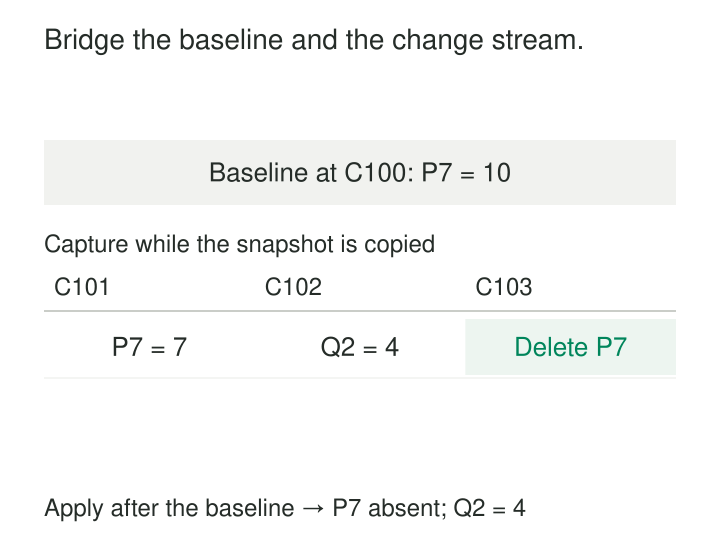

A new warehouse needs every existing customer, then every subsequent change. Starting with the change stream misses customers who never change. Copying the tables first and switching on capture afterward leaves a gap: updates made during the copy can disappear.

[[data-snapshot-then-stream|Snapshot Then Stream]] combines a baseline copy with ongoing change capture through a coordinated boundary. The snapshot establishes existing state; the stream carries changes beyond that state.

The name describes the logical order of application. Capture usually needs to be established while the snapshot is being copied, with changes retained or buffered until they can be applied safely.

## The handoff is the pattern

Two independently successful jobs do not necessarily make a correct pipeline.

The essential contract is:

**State at boundary B + all committed changes after B through H = state at H.**

Here, B and H represent positions defined by the source’s synchronization protocol. They are not arbitrary timestamps taken from the extractor’s clock. Real database protocols must account for transactions that span the boundary.

A simple implementation establishes a consistent snapshot and its corresponding stream position, copies the baseline, applies retained changes, and continues consuming new changes.

PostgreSQL provides a concrete mechanism: creating a logical replication slot through its streaming interface can export a snapshot corresponding to the state after which changes appear in the stream. Its documentation explicitly describes using that snapshot to initialize a replica without losing intervening changes. [PostgreSQL: Exported Snapshots](https://www.postgresql.org/docs/18/logicaldecoding-explanation.html#LOGICALDECODING-EXPORTED-SNAPSHOTS)

## Example: inventory changes while the copy runs

At the coordinated baseline, product P-7 has quantity 10 and Q-2 does not exist.

While the snapshot is being copied, three transactions commit:

| Illustrative position | Change | State after applying it |
|---|---|---|
| C101 | Update P-7 to quantity 7 | P-7: 7 |
| C102 | Insert Q-2 with quantity 4 | P-7: 7; Q-2: 4 |
| C103 | Delete P-7 | Q-2: 4; P-7 absent |

The snapshot still describes the baseline: P-7 at 10. Once loaded, replaying the retained changes produces the correct state through C103.

Starting the stream only after the copy finishes could miss all three changes. Ignoring deletes would leave P-7 behind. Treating the update as an additional quantity would produce another incorrect result.

Debezium’s PostgreSQL connector documents this initialization structure: establish the snapshot transaction, record a log position, scan the captured tables, record completion, and continue streaming from the recorded position. Its isolation configuration determines the initial read’s consistency guarantees. [Debezium: PostgreSQL Snapshots](https://debezium.io/documentation/reference/stable/connectors/postgresql.html#postgresql-snapshots)

The positions above are explanatory labels, not a recipe for calculating real log offsets.

## Example: a search rebuild overwrites a newer value

A search index is being rebuilt from product records. The snapshot contains product A with the title “Travel Mug.”

During the rebuild, the source changes the title to “Insulated Travel Mug.” A live change reaches the new index before its slower snapshot worker writes the old title.

If both writes are accepted in arrival order, the snapshot overwrites the newer value. A similar race can resurrect a product whose delete arrived before its snapshot row.

The simplest prevention is phase ordering: finish loading the baseline, then apply changes beyond its boundary.

For large datasets, a system may instead copy chunks while streaming continues. That requires a protocol for resolving collisions between snapshot rows and newer mutations. Debezium’s incremental snapshot mechanism documents chunk windows and buffering that prevent superseded snapshot records from winning over captured changes. [Debezium: Incremental Snapshots](https://debezium.io/documentation/reference/stable/connectors/postgresql.html#postgresql-incremental-snapshots)

Parallel operation is therefore a different coordination problem, not merely a faster version of two uncoordinated writers.

## Example: initialize a destination while applications keep writing

An organization creates a reporting database from an operational system. Existing tables must be loaded, but the applications continue accepting orders throughout the migration.

AWS Database Migration Service offers a documented `full-load-and-cdc` task type for this situation. It captures changes during the initial migration and applies captured changes as the existing-data load progresses or completes according to the task’s behavior and settings, then continues replication. [AWS DMS: Creating a Task](https://docs.aws.amazon.com/dms/latest/userguide/CHAP_Tasks.Creating.html)

The reporting database still needs a readiness decision. “All tables copied” does not mean “caught up.”

A useful publication boundary identifies a source position H and establishes that the required tables have been initialized and changes through H applied. Validation should compare equivalent states at that boundary. Comparing a moving source’s current row count with a lagging destination’s count can produce differences without identifying an error.

If readers require related tables to agree, readiness must also account for transaction boundaries rather than treating each table’s completion independently.

## Recovery needs more than a stream offset

The pipeline has several kinds of progress: baseline scope, snapshot completion, buffered-change coverage, and applied-stream position.

Saving only the latest stream offset can be dangerous. After a restart, the system might continue streaming into a destination whose baseline was only half loaded.

A recoverable design records whether initialization completed and ties its state to a particular destination generation. It either resumes using a supported snapshot protocol or discards the incomplete candidate and initializes again.

Once changes are being applied, progress must follow durable acceptance. A crash between writing data and checkpointing can cause replay, so destination writes need duplicate handling and appropriate ordering. PostgreSQL explicitly notes that logical decoding can resend recent changes after a crash. [PostgreSQL: Replication Slots](https://www.postgresql.org/docs/18/logicaldecoding-explanation.html#LOGICALDECODING-REPLICATION-SLOTS)

Rebuilding into a fresh destination generation also avoids carrying obsolete rows from an earlier copy. Merely upserting the new snapshot into an old target leaves rows that disappeared before the new baseline unless a separate reconciliation removes them.

## Catch-up capacity determines completion

The pattern adds temporary work: a full scan, retained changes, baseline loading, and replay alongside continuing source activity.

Suppose the source produces 1,000 changes per second during a 30-minute copy. If none are applied during that phase, roughly 1.8 million changes accumulate.

A destination applying 5,000 changes per second has an ideal net catch-up rate of 4,000 per second while new changes continue arriving. Clearing the backlog would take about 7.5 minutes, excluding other overhead.

If sustained application capacity does not exceed the arrival rate, the destination cannot catch up under those conditions.

Retention must cover initialization, catch-up, and plausible interruptions. PostgreSQL replication slots can retain required log resources while consumers lag, increasing source storage use. Other systems can expire required history, forcing reinitialization. [PostgreSQL slot retention](https://www.postgresql.org/docs/18/logicaldecoding-explanation.html#LOGICALDECODING-REPLICATION-SLOTS)

Monitor snapshot progress, retained-data growth, capture lag, application lag, and remaining recovery headroom separately. One “running” indicator hides too much.

## What must remain consistent

Snapshot and stream must cover compatible tables, keys, filters, and columns. A baseline containing active customers paired with a stream that never signals customers leaving that scope will drift.

Schema changes need a supported policy during initialization. Snapshot readers, buffered records, and destination writers must agree on how each payload is interpreted.

A single-database protocol also does not automatically establish one consistent boundary across independent databases.

Finally, the baseline supplies state, not the events that originally created it. Loading an old order today must not count as a new order today. Snapshot provenance should remain distinguishable from subsequent mutations, and neither should automatically be mistaken for business event time.

The pattern is useful for new replicas, warehouses, indexes, and rebuilds that need existing state plus continuing freshness. It cannot recover historical transitions absent from both the baseline and retained stream.

## Related patterns

[[data-full-snapshot-extraction|Full Snapshot Extraction]] supplies the baseline and its completeness guarantees.

[[data-log-based-change-data-capture|Log-Based Change Data Capture]] supplies mutations needed during and after the copy.

**Idempotent Processing** makes replay safe across failures and overlapping delivery.

[[data-historical-restatement|Historical Restatement]] may use a newly initialized dataset to publish corrected history; the initialization protocol and publication decision remain separate responsibilities.
