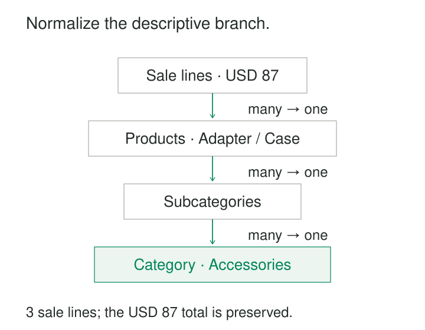

A product dimension contains thousands of products, each repeating its subcategory, category name, and category description. The category team wants to maintain those definitions centrally. Planning also needs monthly targets at subcategory level, while sales arrives one transaction line at a time.

Keeping everything in one flat dimension makes reporting straightforward, but some hierarchy levels now have their own identity, attributes, and uses.

**A Snowflake Schema separates selected parts of a dimension into related tables.** Products reference subcategories; subcategories reference categories. Facts retain their declared grain while reporting queries follow the hierarchy to broader context.

The pattern offers more explicit structure and less repeated descriptive data, at the cost of additional joins and maintenance dependencies.

## Separate the dimension’s levels

In a flat Product dimension, a row might contain:

**Product key, product name, subcategory name, category name, category description.**

A snowflaked version separates these responsibilities:

| Table | What one row describes |
|---|---|
| Product | A product, with a reference to its subcategory |
| Subcategory | A subcategory, with a reference to its category |
| Category | A category and its descriptive attributes |

The sales fact still references Product. It reaches Category through Subcategory.



This decomposition follows dependencies: in the illustrated hierarchy, each product belongs to one subcategory, and each subcategory belongs to one category.

A model can snowflake one dimension while leaving others flat. There is no requirement to turn every repeated label into a separate table.

## Example: product sales rolling up to category

The illustrated products are:

| Product key | Product | Subcategory key |
|---|---|---|
| 101 | Adapter | 10 |
| 102 | Case | 20 |

Subcategory 10 is Connectivity; subcategory 20 is Protection. Both reference category 1, Accessories.

Three posted sale lines contain USD 50.00 and USD 25.00 for Adapter, and USD 12.00 for Case. The category total remains USD 87.00.

The query follows the keys:

```sql
SELECT c.category_name,
       SUM(f.net_sales_usd) AS net_sales_usd
FROM fact_sales AS f
JOIN dim_product AS p
  ON p.product_key = f.product_key
JOIN dim_subcategory AS s
  ON s.subcategory_key = p.subcategory_key
JOIN dim_category AS c
  ON c.category_key = s.category_key
GROUP BY c.category_key, c.category_name;
```

Category attributes live once, rather than being copied onto every product. Updating a category description therefore changes one descriptive record.

That convenience introduces a dependency: every query using category context must resolve the complete relationship chain.

Microsoft’s AdventureWorks relational warehouse provides a verified implementation. Its product hierarchy is stored in `DimProduct`, `DimProductSubcategory`, and `DimProductCategory`, as documented in Microsoft’s modeling guidance. AdventureWorks is a published sample database. [Microsoft: Snowflake dimensions](https://learn.microsoft.com/en-us/power-bi/guidance/star-schema#snowflake-dimensions)

## Every join must preserve the facts

For the simple hierarchy above, each sale line must reach exactly one category.

That requires unique keys, valid references, and the intended many-to-one cardinality at every step. Duplicate category keys can multiply facts. An unresolved subcategory can cause sales to disappear from an inner-join result.

Missing context therefore needs an explicit policy. Unknown or inapplicable members can preserve observations while making their status visible. The policy must work through the entire chain, not just the Product table.

Labels are not necessarily identifiers. Two divisions might both use a subcategory named “Accessories.” Joining by name could combine unrelated members.

The hierarchy must also match the domain. If products legitimately belong to several categories, the model needs a multivalued relationship, usually with a bridge and an explicit counting or allocation rule. Adding another ordinary join does not resolve that ambiguity.

Snowflaking preserves a fact table’s grain only when these relationship assumptions hold.

## Example: sales at product level, targets at subcategory level

Suppose October’s Connectivity target is USD 100.00. Actual sales for its Adapter product total USD 75.00.

The observations have different grains:

| Fact table | Grain | Relevant hierarchy key |
|---|---|---|
| Sales | One posted sale line | Product key |
| Target | One month and subcategory | Subcategory key |

A separate Subcategory table gives the target a direct relationship to the level at which it was defined.

To compare actuals with targets, sales is first aggregated to month and subcategory. That result can then be aligned with the target:

| Month | Subcategory | Actual | Target |
|---|---|---|---|
| October | Connectivity | USD 75.00 | USD 100.00 |

Copying the target onto every product or sale line would repeat the same planned amount. Directly joining the target to all matching sale lines would create the same risk unless aggregation carefully respected its grain.

Microsoft identifies access to higher-grain facts as one reason to consider snowflaked dimensions. [Microsoft Fabric: Snowflake dimensions](https://learn.microsoft.com/en-us/fabric/data-warehouse/dimensional-modeling-dimension-tables#snowflake-dimensions)

The reporting comparison still needs compatible definitions. Actuals and targets must agree on currency, period, hierarchy interpretation, and business scope. Kimball describes combining separately aggregated facts through common dimensional attributes as drilling across. [Kimball Group: Drilling Across](https://www.kimballgroup.com/data-warehouse-business-intelligence-resources/kimball-techniques/dimensional-modeling-techniques/drilling-across/)

## Shared hierarchy rows make history consequential

Suppose Connectivity moves from Accessories to Electronics.

If the existing Subcategory row is updated in place, the Adapter’s earlier USD 75.00 now rolls up under Electronics. No sale fact changed, but its interpretation did.

That can be correct when the requirement is to report all activity using today’s organization. It is incorrect when the requirement is to preserve the category assignment at the time of sale.

Historical reporting needs a deliberate versioning strategy. Options include dimension-version keys linked through historically consistent rows, or effective-dated relationships resolved for the fact’s business time.

Versioning Product alone is insufficient if its hierarchy still points to shared rows whose assignments are overwritten.

A correction to a misspelled category name may intentionally affect every period. A business reclassification may need preserved history. Both change descriptive data, but they need different treatment.

## Where the savings and costs appear

Snowflaking is useful when higher-level members have substantial attributes, need independent management, serve facts at different grains, or have historical requirements that justify separate records.

It can reduce repeated descriptive values and localize changes. However, those savings must be measured against additional keys, indexes, tables, and processing.

Repeated text may already compress efficiently. Normalization therefore does not guarantee a smaller physical model. Extra joins can add processing and, in distributed systems, data movement.

Loading also becomes more dependent on sequence and integrity. Category records must be available before their subcategories can resolve them; products depend on those subcategories. Late arrivals and corrections can affect several tables.

Operating work includes validating keys, checking unresolved relationships, coordinating history, monitoring query plans, and reconciling totals before and after joins.

Kimball generally advises flattened dimensions because snowflakes can be harder for business users to navigate and can impair query performance. [Kimball Group: Snowflaked Dimensions](https://www.kimballgroup.com/data-warehouse-business-intelligence-resources/kimball-techniques/dimensional-modeling-techniques/snowflake-dimension/)

The appropriate boundary depends on the dimension’s size, workload, history, and reporting interface.

## Keep the reporting interface understandable

A warehouse can maintain normalized hierarchy tables while exposing a flattened Product view to analysts.

That view presents product, subcategory, and category attributes together. An ordinary view hides join syntax but still performs the joins. A materialized projection can move that work into refresh processing, while adding storage and freshness obligations.

Microsoft’s Power BI guidance notes that snowflakes introduce longer relationship paths and more tables for report authors to navigate. It also explains why combining the dimension into one model table often improves usability. [Microsoft: Snowflake dimensions in semantic models](https://learn.microsoft.com/en-us/power-bi/guidance/star-schema#snowflake-dimensions)

Avoid splitting dimensions solely to eliminate every repeated string. Each separation should support a meaningful dependency or operating requirement. Likewise, a fixed Product–Subcategory–Category chain becomes awkward when the business introduces variable-depth or overlapping classifications.

## Related patterns

[[data-star-schema|Star Schema]] provides the surrounding fact-and-dimension structure and a common flattened presentation. [[data-normalized-relations|Normalized Relations]] explains the dependencies behind the decomposition. [[data-declare-the-grain|Declare the Grain]] keeps product sales and subcategory targets distinct. [[data-controlled-vocabularies|Controlled Vocabularies]] governs category meanings and codes, whether those values are stored in separate hierarchy tables or flattened into dimensions.
