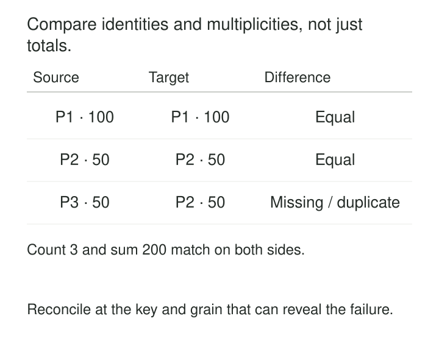

A pipeline finishes successfully. The destination contains the expected number of rows, and its payment total matches the source. Yet one payment is missing and another appears twice.

The execution succeeded. The transfer did not.

**Source-to-Target Reconciliation compares what a source supplied with what a destination contains, accounting for the transformations between them.** Its purpose is to reveal losses, duplicates, unintended changes, and unexplained differences that successful execution alone cannot detect.

The central question is: **Can we account for the same business population on both sides?**

## Define what should survive the journey

Reconciliation starts with a comparison contract.

For a direct copy, the contract may require identical keys, record multiplicities, and selected values. For a reporting pipeline, fewer target rows may be intentional because records are filtered or aggregated. Equality must then be expressed through preserved measures and documented dispositions.

A useful contract identifies:

- **Population:** included tables, tenants, files, records, or business periods.
- **Boundary:** the source snapshot or change position and corresponding target version.
- **Meaning:** keys, units, currencies, filters, and transformation rules.
- **Acceptance:** required comparisons, permitted differences, and incomplete checks.

“Yesterday’s orders” is insufficient without a timezone, a relevant date field, and a policy for later corrections.

Evidence must also originate far enough upstream. Comparing staging with the final table cannot reveal records lost before staging. Source-generated manifests or independently queried source controls can establish a stronger starting point.

## Example: matching totals conceal a broken copy

Consider a payment table copied into a warehouse:

*Equal counts and totals are useful evidence. They do not establish that the same records arrived.*

Both sides contain three rows totaling USD 200. The missing `P3` is offset by an extra `P2`, so those controls pass.

A stronger comparison distinguishes four outcomes: records missing from the target, unexpected target records, differences in occurrence counts, and differences in corresponding values.

Check uniqueness before treating a key-based join as a one-to-one comparison. Where duplicates are legitimate, compare their multiplicities rather than silently deduplicating both sides. Compare in both directions: checking only that source keys exist in the target overlooks unexpected target keys.

AWS Database Migration Service provides a concrete implementation. Its data validation compares corresponding source and target rows and reports mismatches. Its documented requirements include a primary key or unique index, and continuously modified rows may remain unvalidated. The result therefore needs to describe coverage as well as failures. [AWS DMS data validation](https://docs.aws.amazon.com/dms/latest/userguide/CHAP_Validating.html)

A green execution status and a completed comparison are different pieces of evidence.

## Example: reconcile a transformation through its accounting

A retailer receives a closed batch of 1,000 uniquely identified order lines. All amounts are valid USD values. Some lines are excluded by policy; others have invalid customer references.

| Disposition | Source lines | Original amount |
|---|---:|---:|
| Accepted for reporting | 900 | USD 9,000 |
| Excluded by documented policy | 70 | USD 700 |
| Quarantined for investigation | 30 | USD 300 |
| **Total supplied** | **1,000** | **USD 10,000** |

For this batch:

**Supplied = accepted + excluded + quarantined**

The relationship assumes that every source line receives exactly one disposition and that the amounts retain their original meaning. Repeated delivery attempts need separate tracking so they do not become additional business records.

The reporting target aggregates the 900 accepted lines into 120 daily product summaries. Comparing raw row counts would fail even when the transformation is correct.

Instead, compare the target’s summed `source_line_count` with 900 and its amount with USD 9,000. Reconcile by product and business day, then verify expected group coverage. A global total could otherwise hide revenue assigned to the wrong product.

Currency conversion, rounding, allocations, and joins require their own accounting rules. A one-to-many join can inflate measures even while every source key remains present.

The open-source Data Validation Tool in GoogleCloudPlatform’s repository supports grouped aggregates, row comparisons, and custom-query validation. Those mechanisms allow comparisons at an agreed business grain across different physical layouts. The project states that it is not an officially supported Google product. [Data Validation Tool](https://github.com/GoogleCloudPlatform/professional-services-data-validator)

The batch is fully accounted for, but reporting delivery remains incomplete while the quarantined lines are unresolved.

## Example: compare replication at a meaningful boundary

An account balance is USD 120 at source position `C42`. At `C43`, it becomes USD 150. The target has applied changes only through `C42`.

Comparing the live source with the target produces a USD 30 difference. That can indicate lag rather than corruption.

A precise comparison needs corresponding states: a source snapshot tied to a known boundary and a target state representing that boundary. Merely waiting until the target has passed `C42` is insufficient if later changes are already visible there.

Depending on the system, this requires historical reads, retained snapshots, a coordinated replication boundary, or a controlled pause during cutover.

PostgreSQL’s read-only Repeatable Read transactions provide a stable view across successive queries within a transaction. They do not automatically synchronize that view with a snapshot in another database. [PostgreSQL transaction isolation](https://www.postgresql.org/docs/current/transaction-iso.html)

For continuous replication, repeated validation may distinguish pending comparisons from confirmed mismatches. AWS DMS’s CDC validation retries discrepancies and delays revalidation based on replication latency. Pending or suspended work must remain visible rather than being counted as success. [AWS DMS CDC validation](https://docs.aws.amazon.com/dms/latest/userguide/CHAP_Validating.html)

Also distinguish events from state. Ten updates to one account can legitimately leave one current-state row. Reconciliation must cover the intended representation, including deletions.

## Build confidence in layers

Counts, totals, null counts, and minimum or maximum values provide inexpensive initial controls. Segment them by source, tenant, date, or key range to expose differences that cancel in a global aggregate.

Then compare key coverage, multiplicity, and values where the required assurance justifies the cost.

Google’s Spanner migration guidance describes checks covering schema mappings, table counts, sampled records, column aggregates, and row-level hashes, with custom validations for more specific requirements. [Spanner migration validation](https://docs.cloud.google.com/spanner/docs/data-validation)

Each layer has limits. Equal sums can hide offsetting errors. A non-null column count differs from a row count. Sampling establishes agreement only for sampled records.

Hashes can reduce comparison payloads, but both systems must use compatible representations. Define field order, unambiguous field boundaries, null encoding, timestamp conventions, and numeric normalization. A matching hash provides evidence under those assumptions; collisions remain possible.

Avoid normalization that erases meaningful differences. Uppercasing identifiers or trimming text can make distinct values appear equivalent. Tolerances should express an approved numerical or business rule, with explicit treatment of zero denominators and missing values.

## Keep the evidence independent and reproducible

Record the source boundary, target version, mapping version, filters, compared fields, expected and actual controls, and affected identities. Include excluded columns and checks that could not finish.

Preserve enough evidence to investigate later. Re-running against moving tables may produce a different answer.

Independence matters too. Reusing the production transformation’s erroneous filter in the expected-result query can manufacture agreement. Reconciliation should challenge the pipeline’s accounting rather than merely repeat its output logic.

Define the consequence of a discrepancy: hold publication, delay cutover, investigate, or repair and recheck. Automatically copying source values over every target difference can destroy legitimate changes or conceal a faulty mapping.

## Pay for the assurance you need

Reconciliation is especially useful during migrations, backfills, replication, file ingestion, and transformations that change grain.

Full comparisons consume source reads, destination scans, network capacity, and comparison memory. Partitioning the comparison makes large checks manageable, provided the partitions cover the intended population without gaps.

Changed-key reconciliation reduces recurring work, but updates, deletions, late corrections, and target-side changes must enter its scope. Periodic broader checks help catch omissions in incremental coverage.

A completed reconciliation establishes agreement under the tested contract and boundary. It does not prove that the source itself is correct or that the datasets will remain equal after further changes.

[[data-consistent-snapshot-reads|Consistent Snapshot Reads]] stabilizes the evidence. [[data-segmented-quality-checks|Segmented Quality Checks]] localizes discrepancies. [[data-run-ledgers|Run Ledgers]] preserves scope and outcomes across attempts. [[data-atomic-publication|Atomic Publication]] exposes the exact target version that passed reconciliation.
