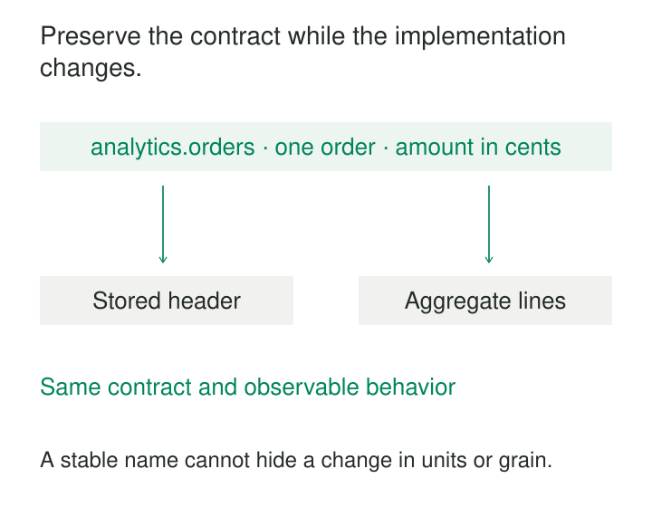

A team reorganizes its warehouse to improve performance. Tables move into new schemas, intermediate models are renamed, and order data is split into headers and lines.

The migration works. Dozens of dashboards break.

Those dashboards depended on the producer’s implementation details. Every internal improvement became a downstream migration.

**Stable Logical Interfaces give consumers a durable way to request data while allowing producers to change how that data is stored and computed.** The interface preserves agreed meaning and behavior; a controlled mapping connects it to the current implementation.

The result is room to improve the system without repeatedly rewriting its consumers.

## Put a maintained boundary between producers and consumers

A logical interface might be a published SQL view, a public model, an API resource, an index alias, or another named access point.

Consumers depend on that interface. Producers maintain the implementation behind it.

For example, reports query `analytics.orders` while its backing data moves from a precomputed table to an aggregation of order headers and lines. The producer absorbs the mapping work that would otherwise spread across every report.

This depends on two commitments: consumers use the published boundary, and producers preserve its contract. A stable name without a stable contract provides little protection.

## Stability includes what the data means

An interface can keep its name and column types while changing its meaning.

Changing `amount` from cents to dollars breaks consumers. Changing one row per order into one row per shipment breaks counts. Replacing an established customer identifier with a new warehouse-generated number can break joins even when both columns are integers.

A useful interface makes its obligations explicit:

| Contract area | Example obligation |
|---|---|
| Identity | Consumers address `analytics.orders` |
| Shape | Named fields have agreed types and nullability |
| Grain and keys | One row per order, uniquely identified by `order_id` |
| Meaning | Amounts use stated units and currency |
| Time | Order timestamps and reporting dates have defined semantics |
| Operation | Freshness, availability, and correction behavior are understood |
| Access | Supported consumers retain the required access |

Stability does not mean frozen contents. New orders can appear, corrections can arrive, and partitions can refresh. Those changes occur within the interface’s stated behavior.

## Example: preserve an order view through a redesign

Suppose the existing implementation stores this summary:

| order_id | customer_id | total_minor | currency |
|---|---|---:|---|
| O17 | C8 | 1000 | USD |

The replacement stores O17 as a header plus two lines worth 400 and 600 cents.

The public interface still produces one order row worth 1,000 cents. Its query aggregates lines before exposing the result and preserves the established customer identity.

The mapping needs to handle more than addition. Discounts, order-level charges, cancelled lines, and empty orders must follow the published definition. Joining several detail tables before aggregation can multiply rows and inflate totals.

PostgreSQL views provide a concrete implementation mechanism. A view exposes a query through a named relation. `CREATE OR REPLACE VIEW` allows its defining calculation to change while requiring existing column names, order, and types to remain compatible; additional columns may be appended. [PostgreSQL views](https://www.postgresql.org/docs/current/sql-createview.html)

Those structural checks do not prove semantic compatibility. The database can accept a replacement query that accidentally duplicates orders. Grain, key coverage, and business values still need validation.

Explicitly selecting published columns also prevents an internal field addition from automatically becoming part of the public interface.

## Example: publish a customer model across teams

A customer-data team maintains several staging and intermediate models. Marketing needs a customer summary, not a dependency on each step of its construction.

The team publishes `customer_summary` with an owner, stable customer identifiers, and documented attributes. It can then consolidate staging models, rename intermediate relations, or change deduplication machinery behind that boundary.

dbt supports this distinction through model access modifiers. Public models can be referenced across supported project boundaries, while private models are intended for dependencies within their group. This provides a mechanism for distinguishing shared interfaces from implementation details. [dbt model access](https://docs.getdbt.com/docs/mesh/govern/model-access)

The model’s contract can check column names and data types during building, with additional constraint support depending on materialization and platform. It does not independently establish the business meaning of “customer” or the correctness of identity resolution. [dbt model contracts](https://docs.getdbt.com/docs/mesh/govern/model-contracts)

Reference controls also differ from database permissions. Marking a dbt model public does not automatically grant warehouse access, and making it private does not prevent every direct SQL query. The intended boundary needs corresponding database access management. [dbt access and permissions](https://docs.getdbt.com/docs/mesh/govern/model-access)

If consumers continue querying intermediate tables directly, those dependencies remain exposed to internal changes.

## Example: replace a search index behind an alias

An application searches the logical name `products`. The physical index is `products_build_42`.

The producer builds and validates `products_build_43`, then changes the alias so callers continue using `products`.

Elasticsearch supports aliases pointing to indices or data streams and provides an aliases API for changing their associations. Its documentation describes an atomic remove-and-add swap. It also documents partial action failures, so a controlled switch needs appropriate failure conditions and inspection of the operation’s result. [Elasticsearch aliases](https://www.elastic.co/docs/manage-data/data-store/aliases)

The alias preserves the access name. It does not establish that the replacement index contains every product or interprets queries identically.

Changing mappings, analyzers, filters, or ranking behavior can change application-visible results. The replacement must therefore satisfy the intended search behavior as well as the naming arrangement.

If both old and new copies are accidentally included in the alias, queries may see duplicate business records. The mapping itself is part of the interface’s correctness.

## Change the mapping with evidence

A stable boundary makes replacement easier to coordinate. It does not make replacement self-validating.

Before redirecting consumers, compare candidate results at matching input boundaries. Check the declared grain, keys, relevant values, permissions, and representative consumer queries.

Operational behavior matters too. Replacing a precomputed table with a complex live query can preserve every value while making reports unusably slow. Replacing a live source with a stale cache can violate freshness expectations.

Preserve enough lineage to identify which implementation served a release or request. The public name can remain stable while internal implementation versions and data releases remain traceable.

Where consumers need several datasets to represent one coherent release, coordinate those mappings together or let consumers pin a shared release identifier. Several independent aliases do not automatically provide cross-dataset consistency.

## Keep the interface small enough to maintain

A useful interface exposes what consumers need and defines what the producer is prepared to support.

Publishing every intermediate field enlarges the compatibility obligation. Building many layers of views can obscure lineage, complicate debugging, and create expensive query plans. An API or proxy can introduce another availability dependency.

The operating cost includes maintaining mappings, testing compatibility, managing permissions, documenting semantics, and observing service behavior. PostgreSQL’s ordinary views execute their underlying queries when referenced, so a view does not inherently remove computation cost. [PostgreSQL view behavior](https://www.postgresql.org/docs/current/sql-createview.html)

Stable interfaces are especially useful for widely shared datasets and systems undergoing internal modernization. They may add unnecessary ceremony to disposable models whose consumers change together.

## Recognize when the promise must change

An adapter cannot always preserve an old interface honestly.

If the replacement no longer retains required history, cannot reproduce established identifiers, or introduces a different business grain, preserving the old name can conceal a breaking change.

Sometimes a compatibility mapping remains possible but becomes expensive. That is a decision about continued support, not proof that the mapping should live forever.

When meaning or required behavior changes incompatibly, introduce an explicitly versioned interface and a migration path. Keep the old interface’s obligations clear during the transition.

## Related patterns

[[data-explicit-data-contracts|Explicit Data Contracts]] state the guarantees that make a logical interface dependable.

**Versioned Dataset Interface** provides separate supported contracts when one stable interface cannot accommodate an incompatible change.

[[data-incremental-replacement|Incremental Replacement]] transfers implementation responsibility behind established boundaries in manageable slices.

**Consumer-Driven Contract-Tests** make known consumer dependencies executable, helping detect when an internal change would break the published promise.
