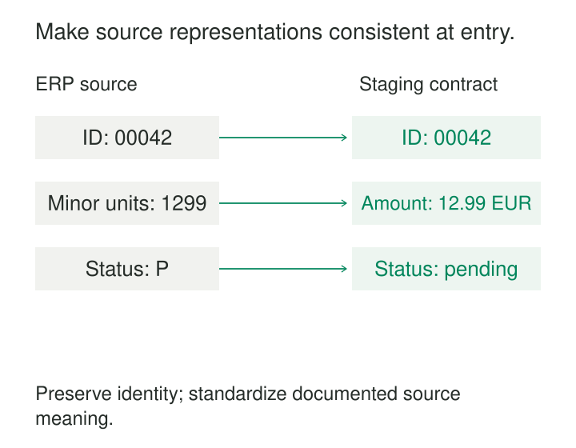

Three dashboards read the same order feed. One divides amounts by 100, another leaves them unchanged, and a third converts them twice. Each query also contains its own interpretation of status codes and timestamps.

The source data is shared. The preparation rules are scattered.

**Standardize at Staging gives source data a consistent, reusable representation before downstream models assemble it into business products.** Names, types, units, and source-specific codes are prepared in one place, so every consumer does not have to rediscover them.

The aim is to create dependable building blocks while preserving what each source record means.

## Give each source a clear entry point

A staging model sits between retained inputs and the models that join, aggregate, allocate, and calculate business metrics. Here, *staging* means a logical preparation layer; it need not be temporary storage.

Typical transformations include descriptive column names, explicit data types, documented unit conversions, and translations of source codes. Source identifiers, row grain, and provenance remain available.

dbt Labs describes staging models as lightweight, source-oriented preparation: generally one model per source table, with renaming, casting, basic computations, and categorization. More substantial relationships and aggregations usually belong downstream. See [dbt’s staging guidance](https://docs.getdbt.com/best-practices/how-we-structure/2-staging).

The boundary is semantic as well as structural. Translating an ERP code into its documented meaning is preparation. Deciding whether the order qualifies as recognized revenue requires a broader business definition.

Those decisions can both be shared, but they need different ownership and context.

## An order gets usable names, types, and units

Consider an illustrative ERP record:

| Received field | Received value | Staged representation |
|---|---|---|
| `ORD_ID` | `"00042"` | `order_id = "00042"` |
| `TOTAL_CENTS` | `"1299"` | `order_amount_minor = 1299` |
| `CURRENCY` | `"EUR"` | `currency_code = "EUR"` |
| `STATUS` | `" P "` | `source_order_status = "pending"` |

The source contract establishes that this amount uses 100 minor units per major unit. Staging can therefore expose an exact decimal amount of 12.99 EUR while retaining the minor-unit value.

The identifier remains text. Converting `"00042"` to integer `42` could destroy a distinction that the source considers meaningful. Renaming an identifier does not require changing its representation.

Currency remains attached to the amount. Converting minor units to major units is different from converting EUR into another currency, which introduces exchange-rate and valuation-date decisions.

A documented implementation appears in dbt Labs’ **Jaffle Shop** sample project. Its [order staging model](https://github.com/dbt-labs/jaffle-shop/blob/main/models/staging/stg_orders.sql) renames source identifiers, retains cent-denominated fields, and exposes converted amounts. It is an instructional implementation based on a fictional business.

Once these rules have one owner, downstream models can reuse the prepared columns instead of repeating arithmetic and aliases.

## A shared code needs source-specific interpretation

Suppose two systems both emit status `P`.

| Source | Code | Documented meaning |
|---|---|---|
| Order ERP | `P` | Pending |
| Payment processor | `P` | Paid |

A universal replacement rule—“change `P` to `pending`”—would corrupt the payment feed.

Each staging model should interpret codes within its source contract. The order model can expose `source_order_status = pending`; the payment model can expose `source_payment_status = paid`.

A later integrated model can define relationships between payment and order states. It should not assume that similarly named fields describe the same lifecycle.

Unexpected codes also need visible handling. If the ERP starts emitting `X`, staging might retain `status_code = X`, leave the translated value unresolved, and attach an unmapped-code indicator. Mapping it to `pending` merely to satisfy an accepted-values check hides the source change.

This principle applies to text cleanup too. Trimming padding may be appropriate for a documented code field. Lowercasing case-sensitive identifiers or stripping punctuation from account numbers can create collisions.

Standardization requires evidence about equivalence.

## Timestamps need an interpretation before a format

Two events can share the same displayed local time while representing different instants:

| Received timestamp | Corresponding UTC instant |
|---|---|
| `2026-10-25T02:30:00+02:00` | `2026-10-25T00:30:00Z` |
| `2026-10-25T02:30:00+01:00` | `2026-10-25T01:30:00Z` |

Removing the offset and keeping only `02:30` loses information.

A staging contract can expose a UTC instant while retaining the original timestamp or source-zone information. A timestamp without an offset needs a documented source timezone. Ambiguous local times may require additional source information rather than a guessed conversion.

Database behavior also matters. Snowflake documents cases where timezone conversion depends on the timestamp type and session timezone. Explicit interpretation prevents the same input from changing meaning across execution environments. See [CONVERT_TIMEZONE](https://docs.snowflake.com/en/sql-reference/functions/convert_timezone).

Business dates can remain separate. Converting an instant to UTC does not determine which local trading day, billing day, or fiscal period should contain it.

## Failed conversion is a data condition

Casting is not validation by itself.

Suppose `TOTAL_CENTS` contains `"unknown"`. A strict cast may stop processing. A tolerant cast may return null and let the pipeline continue. Both behaviors can be appropriate, depending on the contract, but neither should silently erase the distinction between an absent amount and a malformed one.

For example, Snowflake’s [TRY_TO_DECIMAL](https://docs.snowflake.com/en/sql-reference/functions/try_to_decimal) returns null for conversion failures. A staging model using it should also retain enough evidence to identify the failed input and count affected records.

Precision and scale need explicit choices. A successful conversion can still round a value or discard fractional detail. An integer minor-unit field should be checked against that expectation before conversion normalizes away the discrepancy.

Useful staging checks therefore examine conversion failures, unmapped codes, identifier collisions, row counts, and documented invariants. Invalid records can be flagged or quarantined according to an explicit policy.

## Preserve grain while preparing the record

A staging model should normally retain the declared source grain. An order-line feed should remain understandable as order-line records after cleanup.

Joining customer history without selecting the correct version can multiply rows. Aggregating orders into daily totals removes detail needed by other consumers. Blanket deduplication can erase legitimate repeated events.

Exceptions exist. A source may require combining a separate deletion table or unioning equivalent shards before it forms a usable concept. dbt’s [base-model guidance](https://docs.getdbt.com/best-practices/how-we-structure/2-staging#staging-other-considerations) acknowledges such cases. The resulting grain and reconciliation rules still need to be explicit.

Layer names are conventions. Databricks’ silver layer, for example, can include joins, deduplication, and enrichment alongside standardization. Its [medallion documentation](https://docs.databricks.com/aws/en/lakehouse/medallion) describes a broader responsibility than the narrow staging boundary used here.

## Centralized logic changes the operating tradeoff

Staging reduces duplicated definitions and gives source changes a clear place to be handled. It also concentrates dependency: an incorrect conversion can affect every downstream consumer.

Changes therefore need review against representative inputs and downstream expectations. Renaming a source field behind a stable staging interface may be straightforward. Changing the meaning of a published column may require a coordinated migration. dbt’s [model-governance guidance](https://docs.getdbt.com/docs/mesh/govern/about-model-governance) distinguishes contracts for model shape from versioning for breaking changes.

Storage and computation depend on implementation. Views avoid another stored copy but may repeat conversions during downstream queries. Materialized staging tables add refresh cost and latency while potentially reducing repeated work.

“Standardize once” describes ownership of the rule. It does not guarantee that the warehouse computes it only once, or that existing downstream tables refresh automatically after a correction.

## A foundation for shared models

This pattern is especially useful when several models reuse a source, source formats are awkward, or cleanup rules repeatedly diverge. A small pipeline may need only a simple preparation view.

[[data-preserve-raw-inputs|Preserve Raw Inputs]] retains the evidence behind staging decisions. [[data-make-units-explicit|Make Units Explicit]] defines converted values. [[data-controlled-vocabularies|Controlled Vocabularies]] supplies documented code mappings. [[data-declare-the-grain|Declare the Grain]] protects row meaning as data moves downstream.

A strong staging layer makes each source easier to use without pretending that different sources already agree on the business.
