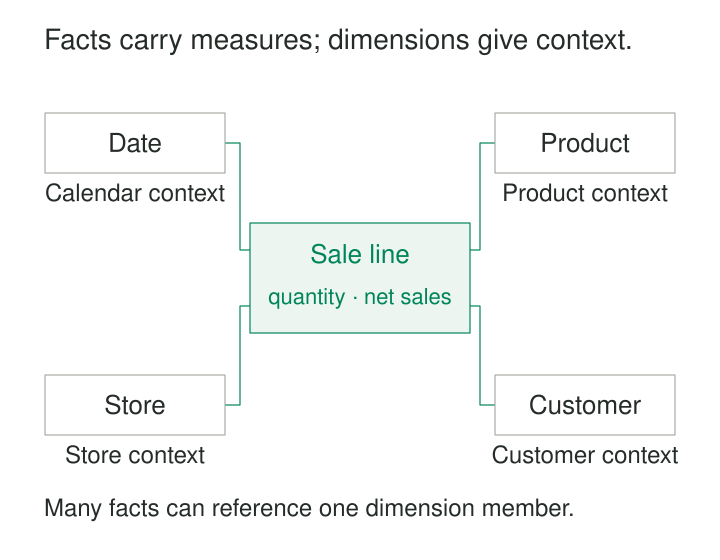

The sales report works until someone adds product category. Its total increases. Another analyst groups the same transactions by customer region and gets a different answer.

The source system contains orders, lines, products, category assignments, addresses, and historical records. Each relationship makes operational sense, but assembling them for analysis creates opportunities to duplicate measurements or select the wrong business context.

**A Star Schema organizes measurements around a clearly defined business process, with descriptive dimensions connected directly to a fact table.** It gives analysts a predictable way to filter, group, and summarize observations.

Its value comes from the agreement between the fact table’s grain, the dimensions’ keys, and the measures’ aggregation rules.

## Measurements at the center, context around them

A **fact table** records observations at a declared grain: one posted sale line, one account balance per day, or one shipment event.

It usually contains measurements and keys linking to **dimension tables**. Dimensions provide the descriptive context used in reports: product category, customer segment, store region, calendar month, and similar attributes.

The resulting arrangement resembles a star.



Dimensions are typically broad, descriptive tables. Product name, brand, subcategory, and category can sit together in a Product dimension, allowing analysts to group measurements without following several additional relationships. Kimball describes dimension tables as generally flat and denormalized, with attributes supplying report filters and labels. [Kimball Group: Dimension Table Structure](https://www.kimballgroup.com/data-warehouse-business-intelligence-resources/kimball-techniques/dimensional-modeling-techniques/dimension-table-structure/)

A warehouse can contain several stars. Shared, consistently defined dimensions let separate business processes be compared without forcing their observations into one fact table.

## Example: sales by month and product category

Consider this illustrative extract from one sales system. Its grain is **one posted sale line**. Date, store, and customer keys are omitted here for readability.

| Sale | Line | Product key | Quantity | Net sales, USD |
|---|---|---|---|---|
| O-17 | 1 | 101 | 2 | 50.00 |
| O-17 | 2 | 102 | 1 | 12.00 |
| O-18 | 1 | 101 | 1 | 25.00 |

Product 101 is an adapter; product 102 is a case. Both belong to Accessories. All three lines occurred in October 2026.

The facts contain three sale lines, four individual items, two distinct sales, and USD 87.00 in net sales. Those are four different measurements.

The category total comes from joining each fact to its Product row:

```sql
SELECT d.year_month,
       p.category,
       SUM(f.net_sales_usd) AS net_sales_usd
FROM fact_sales AS f
JOIN dim_date AS d ON d.date_key = f.date_key
JOIN dim_product AS p ON p.product_key = f.product_key
GROUP BY d.year_month, p.category;
```

The result is October 2026, Accessories, USD 87.00.

Here, net sales means the line amount after discounts and before tax, expressed in USD. Another definition requires another explicit calculation or measure name.

## Declare the grain before choosing columns

The grain describes what one fact row represents. It governs every dimension and measurement added to that table.

An order-level shipping charge cannot simply be copied onto every line and then summed: an order with five lines would contribute its shipping charge five times. It needs an explicit allocation rule, a separate fact at order grain, or a calculation that respects its original scope.

Similarly, monthly targets should not be mixed casually with individual sale lines. They describe a different observation.

Kimball treats grain as the binding contract of dimensional design and recommends declaring it before choosing dimensions or facts. [Kimball Group: Grain](https://www.kimballgroup.com/data-warehouse-business-intelligence-resources/kimball-techniques/dimensional-modeling-techniques/grain/)

Dimension keys alone do not necessarily identify a fact row. Many sales can involve the same date, product, store, and customer. The model still needs a reliable way to distinguish observations and prevent duplicate ingestion.

## The join must preserve the measurement

For a simple star, each fact row matches exactly one row in each dimension role.

That requires unique dimension keys and valid fact references. Duplicate dimension keys multiply facts during joins. Missing matches can make facts disappear from inner-join results.

An explicit unknown-member policy can retain unresolved observations while their context is repaired. Silently dropping them changes the reported business activity.

History adds another decision. If a customer moves from North to South, should last year’s sales appear under the old region or the current region?

Overwriting the dimension gives a current classification. Preserving dimension versions lets facts retain historical context. A Type 2 design commonly assigns each version a surrogate key, and fact loading selects the version appropriate to the observation’s effective time. Microsoft documents both approaches and the required time-based lookup. [Microsoft: Slowly changing dimensions](https://learn.microsoft.com/en-us/power-bi/guidance/star-schema#slowly-changing-dimensions)

A star does not choose the historical interpretation automatically. The model must declare it.

## Example: daily stock balances need different arithmetic

An inventory star might have one row per product, store, and snapshot date.

| Date | Product | Store | Closing stock |
|---|---|---|---|
| Monday | Adapter | Central | 10 units |
| Tuesday | Adapter | Central | 8 units |

Adding these rows produces 18, but that is not Tuesday’s stock. The rows describe balances at different times.

For compatible products and units, stock can be summarized across stores at the same instant. Across dates, a report might need the last balance, an average balance, or another defined calculation.

These are **semi-additive** measurements. Ratios need care too: an overall discount rate generally requires aggregating its numerator and denominator before division, rather than averaging row percentages. Kimball distinguishes additive, semi-additive, and non-additive facts and recommends retaining additive components where possible. [Kimball Group: Fact additivity](https://www.kimballgroup.com/data-warehouse-business-intelligence-resources/kimball-techniques/dimensional-modeling-techniques/additive-semi-additive-non-additive-fact/)

The star shape supports the analysis; the measure definition determines valid arithmetic.

## Verified implementation: Microsoft’s AdventureWorks model

Microsoft’s Power BI tutorial provides a working sample built around an AdventureWorks sales fact table, with Product, Customer, Reseller, Sales Territory, and Date context.

The sample also demonstrates date roles. Sales has order, due, and ship date keys referencing the date dimension. In the tutorial, the order-date relationship is active by default; analysis by another date role requires the appropriate relationship behavior.

“Sales in October” therefore needs a declared meaning: ordered in October, due in October, or shipped in October. [Microsoft: Dimensional model report tutorial](https://learn.microsoft.com/en-us/power-bi/create-reports/desktop-dimensional-model-report)

AdventureWorks is a published sample implementation. It illustrates the mechanism without establishing that every real sales process should use its exact schema.

## Several stars need careful integration

Sales, returns, shipments, and inventory often deserve separate fact tables because their grains and processes differ.

Joining sales lines directly to return lines on product and customer can multiply both sides when several rows match. Shared dimension keys do not make the facts one-to-one.

A safer comparison aggregates each fact independently to a compatible reporting grain, then combines those results using consistently defined dimensions. Kimball describes this as drilling across with multipass queries. [Kimball Group: Avoiding fact-to-fact joins](https://www.kimballgroup.com/data-warehouse-business-intelligence-resources/kimball-techniques/dimensional-modeling-techniques/multipass-sql/)

Multivalued context also needs explicit handling. A product assigned to several categories may require a bridge and allocation rules rather than an ordinary dimension join.

## Simpler reporting requires maintained structure

Star schemas are useful when many reports repeatedly analyze the same business processes through different combinations of attributes.

They concentrate complexity in preparation: reconciling identifiers, assigning dimension keys, preserving history, handling late arrivals, deduplicating facts, and validating totals. Flattened dimensions repeat descriptive values, while historical versions increase storage and lookup work.

Large fact tables still require suitable storage, partitioning, indexing, or clustering for the platform and workload. A star makes queries understandable; it does not guarantee that every scan is inexpensive.

Operational costs include refresh latency, backfills, reconciliation, and semantic-model maintenance. Changes to categories, currencies, or metric definitions can require decisions about whether historical results should be restated.

The pattern is less direct for arbitrary network exploration or transactional workflows. It deliberately organizes data around selected observations and analytical context.

## Related patterns

[[data-model-around-business-processes|Model Around Business Processes]] identifies the activity a fact table measures. [[data-declare-the-grain|Declare the Grain]] establishes its row contract. [[data-surrogate-keys|Surrogate Keys]] support controlled dimension identity, including historical versions. [[data-shared-metric-definitions|Shared Metric Definitions]] specifies how measurements should be filtered and aggregated consistently across reports.
