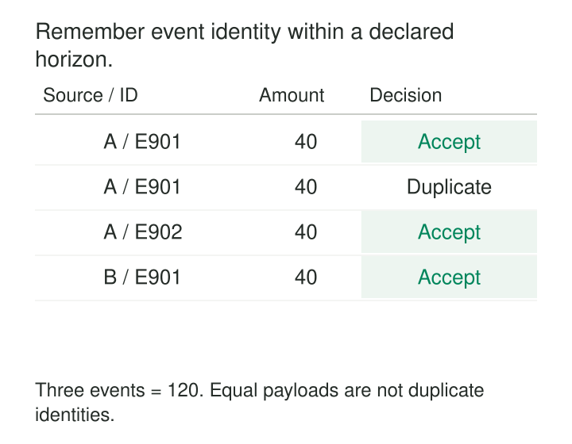

A producer publishes a purchase event, loses the acknowledgment, and sends it again. Both deliveries reach the analytics pipeline.

The records are valid. Their schemas match. Their timestamps look reasonable. Counting both doubles one purchase.

Removing duplicates within each processing batch helps only when both copies land in that batch. A retry arriving later requires memory across batches.

**Stateful Stream Deduplication remembers event identities and uses that retained state to suppress repeated deliveries.** Its guarantee depends on what identifies an event, how long that identity remains recognizable, and how state and outputs recover after failure.

The central question is: *Have we already accepted this event within the scope of our guarantee?*

## Remember identities across processing boundaries

A basic deduplicator routes records with the same identity to the same logical state owner. For each eligible record, it checks whether that identity is already remembered.

An unseen identity is recorded and its event is emitted. A remembered identity is suppressed, assuming the repeated payload satisfies the source contract.

That check must be coordinated. Two workers independently checking an external “seen” table can both observe absence and emit the same event. Keyed stream processing provides one way to serialize decisions for an identity; a shared store needs an equivalent atomic operation.

Spark documents streaming deduplication as maintaining state from previous records, with watermark-based cleanup available when the duplicate horizon can be bounded. [Spark Structured Streaming deduplication documentation](https://spark.apache.org/docs/latest/streaming/apis-on-dataframes-and-datasets.html#streaming-deduplication)

This retained memory distinguishes the pattern from a stateless filter or a batch-local `DISTINCT`.



## Equal purchases can still be different events

Consider these illustrative deliveries:

| Delivery | Source | Event ID | Amount |
|---|---|---|---:|
| 1 | Shop A | E901 | 40 |
| 2 | Shop A | E901 | 40 |
| 3 | Shop A | E902 | 40 |
| 4 | Shop B | E901 | 40 |

The correct output contains three events, totaling `120`.

Delivery 2 repeats the first event. Delivery 3 represents another purchase despite its identical amount. Delivery 4 uses an identifier that is unique only within Shop B.

The deduplication key is therefore `(source, event_id)`.

A key based on amount and timestamp could collapse legitimate purchases. A key based only on `event_id` could incorrectly combine independent sources. A delivery identifier regenerated on every retry would fail to recognize repetition.

Missing identifiers need explicit handling. Treating every null identifier as the same key can suppress unrelated records.

Payload differences also matter. If two deliveries claim the same immutable event identity but disagree on amount, that is a conflict requiring a policy. If the source legitimately publishes revisions, process those revisions according to its update contract—for example, by distinguishing event versions or applying a changelog.

## Specify what “keep one” means

For identical repeated payloads, retaining the first eligible delivery is often sufficient.

For differing records, arrival order may not establish authority. Keeping the latest business version requires version comparison and potentially revised downstream output.

Flink documents streaming deduplication through a `ROW_NUMBER()` pattern partitioned by the deduplication key and ordered by a processing-time or event-time attribute. Ascending and descending order select first and last records respectively. [Apache Flink deduplication documentation](https://nightlies.apache.org/flink/flink-docs-release-2.3/docs/sql/reference/queries/deduplication/)

The ordering rule is part of the meaning. “First processed” and “earliest occurrence” can select different records when input arrives out of order.

A simple seen-ID set cannot implement every winner policy. Replacing an earlier winner requires retaining enough information to compare candidates and correcting any affected output.

## Bounded memory creates a bounded guarantee

Suppose a custom deduplicator remembers an identity for ten processing-time minutes after its first acceptance, without refreshing that deadline on repeated delivery.

| Processing time | Delivery | Outcome |
|---|---|---|
| 10:00 | First E901 | Remember and emit |
| 10:05 | Repeated E901 | Suppress |
| After 10:10 | Identity expires | No longer remembered |
| 10:11 | Replayed E901 | May be emitted again |

The final outcome follows from this particular expiry policy. The system has forgotten the evidence that E901 was previously accepted.

Processing-time expiry and event-time cleanup behave differently. Flink’s documented keyed-state TTL uses processing time and exposes choices about refreshing expiry and returning expired values. [Apache Flink state TTL documentation](https://nightlies.apache.org/flink/flink-docs-release-2.3/docs/dev/datastream/fault-tolerance/state/#state-time-to-live-ttl)

A watermark-based deduplicator can instead reject an old record because its event timestamp is outside the accepted horizon. That may suppress a delayed duplicate, but it can also reject a legitimate event never previously seen.

These are different outcomes: *recognized as repeated* and *discarded as too late*. Monitoring should distinguish them.

For deduplication across unrestricted historical replay, bounded stream state alone is insufficient. A durable event ledger or destination identity constraint may need to provide the longer-lived protection.

## A documented watermark-based implementation

Spark provides a streaming API that compares selected identity columns while using an event-time watermark to bound state:

```python
deduplicated = (
    events
    .withWatermark("event_time", "10 minutes")
    .dropDuplicatesWithinWatermark(["source", "event_id"])
)
```

The API maintains identity state across triggers. Its documented guarantee concerns duplicate records whose earliest and latest event timestamps differ by less than the configured watermark delay. It also states that records older than the watermark are dropped. [PySpark `dropDuplicatesWithinWatermark` reference](https://spark.apache.org/docs/latest/api/python/reference/pyspark.sql/api/pyspark.sql.DataFrame.dropDuplicatesWithinWatermark.html)

The timestamp contract therefore matters. If retries receive new timestamps, their differences must fit the configured guarantee. Including a changing delivery timestamp in the identity itself would make those deliveries appear distinct.

A ten-minute watermark setting should not be described as universal ten-minute wall-clock duplicate protection. Input progress, timestamp quality, and operator semantics determine its behavior.

## Survive the failure between remembering and publishing

Consider E901 passing through the deduplicator and being written to an external destination. The processor then crashes before a durable checkpoint includes the relevant state and source progress.

Recovery may replay E901. If the destination already committed the first write, another write can duplicate its effect.

Reversing the order carelessly creates the opposite problem: permanently remembering an event before ensuring its output is recoverable can cause replay to suppress work that never became visible.

The required guarantee spans source progress, deduplication state, and publication. Flink’s checkpointing documentation describes durable state snapshots and replayable sources as prerequisites for recovery. External effects also need a compatible publication mechanism. [Apache Flink checkpointing documentation](https://nightlies.apache.org/flink/flink-docs-release-2.3/docs/dev/datastream/fault-tolerance/checkpointing/)

Transactional sinks, coordinated commits, or idempotent destination writes can close that gap. A processor’s recovery guarantee does not automatically make an arbitrary external request happen once.

Nor does recovery eliminate duplicates already present as separate source records. Those still require the event-identity decision.

## Pay for the identities you retain

This pattern is useful when retries, broker redelivery, overlapping ingestion, or replay can repeat events before aggregation or downstream action.

State grows with the number of distinct remembered identities. At ten thousand new identities per second, a fixed ten-minute retention period represents roughly six million identities before storage overhead. Stalled event-time progress can increase retained state further.

Costs include key storage, expiry metadata, repartitioning, checkpoints, recovery, and state migration. Retaining fingerprints to detect conflicting payloads adds further work.

Changing the key or resetting checkpoints can invalidate earlier protection. Extending retention cannot reconstruct identities already forgotten.

Verification should cover duplicates across batches, simultaneous delivery, restart and replay, source namespaces, conflicting payloads, expiry, and legitimate late events. Suppression counts alone cannot reveal whether valid records were incorrectly merged.

## Related patterns

**Namespace Identifiers** prevents independent sources from colliding.

[[data-deduplicate-explicit-winner|Deduplicate with an Explicit Winner]] defines authority when repeated identities carry different candidates.

[[data-watermarks|Watermarks]] supplies event-time progress for bounded state and late-input handling.

[[data-merge-and-upsert|Merge and Upsert]] can provide destination-level identity protection when stream processing is retried.
